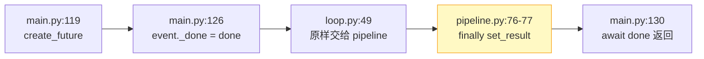

# scheduler_event.md —— Event 事件报文

> 对应源文件：`references/firmware/DesktopCompanion/host/src/scheduler/event.py`（共 47 行，含中文深注）
> 注释级别：A级（逐字段深注）
> 关联文档：[02-调度器与事件循环](../../../references/firmware/DesktopCompanion/Docs/02-调度器与事件循环.md)
> 关联条目：[scheduler_loop.md](scheduler_loop.md)、[scheduler_pipeline.md](scheduler_pipeline.md)、[host_main.md](host_main.md)

---

## 1. 文件职责

定义调度器队列里流动的"信封"：`EventSource`（来源）、`Priority`（优先级）、`Event`（报文本体 + 同步钩子）。所有输入通道（现在只有 CLI，未来 MQTT/TIMER）统一打包成 Event 投给 scheduler。

## 2. 逐类表

| 行号 | 成员 | 说明 |
|---|---|---|
| 1 | 模块 docstring | "事件系统" |
| 3-11 | 导读块 | 职责/_done 约定/数据流位置 |
| 20-27 | `EventSource` | CLI 现役；MQTT/TIMER/INTERNAL 注释预留 |
| 28-33 | `Priority` | NORMAL=0 / INTERRUPT=1 两级 |
| 35-47 | `Event` dataclass | 8 个字段，见下表 |

## 3. Event 字段逐个解释（event.py:35-47）

```python
@dataclass
class Event:
    # 事件的不可变描述 + 可选同步钩子，default_factory 保证
    # 每个事件拿到独立的 id/时间戳，而不是共享同一个值
    source: EventSource
    priority: Priority = Priority.NORMAL
    type: str = "user_input"
    content: str = ""  # 有效载荷：用户原话（也即 pipeline 的输入文本）
    metadata: dict = field(default_factory=dict)
    id: str = field(default_factory=lambda: uuid.uuid4().hex[:8])  # 8 位短 id，日志排查用
    created_at: float = field(default_factory=time.time)
    # 内部用：pipeline 完成时设置此 future
    _done: asyncio.Future | None = field(default=None, repr=False)  # repr 隐藏，避免打印事件时带出循环引用
```

| 字段 | 默认 | 用途 | 消费者 |
|---|---|---|---|
| `source` | 必填 | 来源标识 | 管道可区分"人打的字"与"机器触发"（当前未实际分支） |
| `priority` | NORMAL | INTERRUPT 触发 loop.py:44-45 的 cancel | loop.py |
| `type` | `"user_input"` | 预留事件类型 | 无第二类 |
| `content` | 空 | 用户原话 | pipeline 阶段 1/4 |
| `metadata` | `{}` | 预留扩展 | 无 |
| `id` | uuid4 前 8 位 hex | 日志排查（空间 16^8 ≈ 4.3×10^9） | 无（日志用） |
| `created_at` | time.time() | 积压延迟测量 | 无（日志用） |
| `_done` | None | **同步协议字段** | main 建 → pipeline finally 写 |

## 4. 关键细节

### 4.1 default_factory 防可变默认值陷阱

`metadata=dict`、`id=lambda: uuid4()...` 都用 `field(default_factory=...)`。若写成裸 `metadata={}`，所有 Event 实例会共享同一个字典——Python 可变默认值的经典坑，dataclass 的 factory 语义正是解法。

### 4.2 `_done` 的三方契约

```
main.py:119-126   创建 future 挂到 event._done
loop.py           原样把事件交给 pipeline（不解释 _done）
pipeline.py:76-77 finally 里 set_result（判 done() 防重复）
```

`repr=False` 让 `print(event)` 不带出 future（future 与循环引用相关，打印会很长）；字段名下划线开头标记"内部约定"。**改这段协议的任何一方都必须同步改另外两方**——这是全工程最脆的隐式契约，三处文件头的导读注释都点名了它。

## 5. 陷阱与观察

1. **`_done` 不是 dataclass 比较字段**：dataclass 生成的 `__eq__` 会包含它，但 future 无合理相等语义——工程中没人比较 Event，无实际影响。
2. **INTERRUPT 无抢占队列**：INTERRUPT 事件仍按 FIFO 排队，只是被派发时先 cancel 旧任务；若需要"插队"，得改用两个队列或优先级堆（记录为演进方向）。
3. **content 无长度限制**：超长粘贴会整句进 prompt；STM 窗口与 max_tokens 都会承受。

## 6. 事件构造速查与字段消费矩阵

| 字段 | 谁写入 | 谁读取 | 何时可有可无 |
|---|---|---|---|
| source | main.py:121（恒 CLI） | 暂无消费者 | 任何时候可缺省为 CLI |
| priority | 构造参数（默认 NORMAL） | loop.py:44 | CLI 场景恒 NORMAL |
| type | 构造参数（默认 user_input） | 暂无 | — |
| content | main.py:122 | pipeline.py:95/98/126 | 永远必须有值 |
| metadata | 暂无 | 暂无 | 纯预留 |
| id | factory 自动 | 暂无（日志） | — |
| created_at | factory 自动 | 暂无（日志） | — |
| _done | main.py:126 | pipeline.py:76-77 | 非交互事件（如定时器触发）可不挂 |

内存量化：一条 Event ≈ 对象头(56B) + 8 个字段引用 + content 字符串 + 空字典 ≈ 数百字节（不含 content 文本）；万条积压 < 5MB，无界队列的内存风险在真实使用量级下可忽略。

## 7. _done 生命周期（三方接力）



四方职责单一：main 只建与等、loop 只搬运、pipeline 只写、future 本身只承载"完成"这一比特信息。

## 8. 自测三问

1. 为什么 `_done` 要 `repr=False`？（答：事件可能被打进日志/调试输出，future 对象 repr 冗长且带循环引用风险）
2. 若 pipeline 忘记 set_result，会怎样？（答：main 的 `await done` 永久挂起，输入框不再出现——所以 finally 契约写在三处文件头导读里）
3. `field(default_factory=...)` 换成裸默认值会怎样？（答：metadata 共享同一 dict；id/created_at 全体相同——可变默认值经典陷阱）
