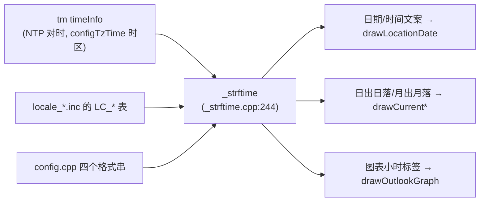

# _strftime.cpp —— 自定义 strftime（B级）

对应源文件：`platformio/src/_strftime.cpp`（共 654 行）；声明头 `platformio/include/_strftime.h`（27 行）
相关文档：[Docs/02-气象API与数据解析](../../../references/firmware/esp32-weather-epd/Docs/02-气象API与数据解析.md)
互链：[locale.md](locale.md) · [display_utils.md](display_utils.md) · [renderer.md](renderer.md)

## 0. 文件定位

公版 strftime 实现（arnoldrobbins/strftime 公有领域版本）的移植：把 locale 查询替换成 `_locale.h` 的 LC_* 翻译表，让 `%a/%b/%p` 等记号输出多语言（ESP32 上没有系统 locale 文件）。原码声明：不支持 `%z/%Z`。已加 B 级文件头导读块。

## 1. 逐函数表

| 函数 | 行号 | 可见性 | 职责 |
|---|---|---|---|
| `isleap` | 84 | static | 4/100/400 闰年规则 |
| `weeknumber` | 91 | static | 周数（firstweekday=0 周日起 / 1 周一起） |
| `iso8601wknum` | 111 | static | ISO 8601 周数（12 月末归次年、1 月初归上年，`USE_BROKEN_XPG4` 未启用） |
| `iso_8601_2000_year` | 212 | static | POSIX-2008 扩展年份（±9999 外用 `+_nnnn_` 形式） |
| `_strftime` | 244 | 公开 | 主函数：逐字符扫描 format，`%` 记号分派 |

## 2. 主函数结构（_strftime，244-634）

```cpp
size_t _strftime(char *s, size_t maxsize, const char *format,
                 const struct tm *timeptr)
```

- **前置检查**（259-263）：空指针/`maxsize==0` 返回 0；format 无 `%` 且长度不够直接返回 0。
- **主循环**（265 起）：普通字符直拷；`%` 后先吃 POSIX-2008 的 flag（`+`/`0`）与字段宽度（`%05d` 风格），再进 `again:` 处的大 switch。
- **记号分派**（292-613）：每档命中后把结果写进 `tbuf[100]`，循环尾部统一检查容量并 `strcpy` 进输出（614-624）；超容量返回 0（整体失败，不截断）。
- **递归组合记号**：`%c/%x/%X/%r/%D/%F/%R/%T` 都是通过以子格式串**递归调用自身**实现的（如 `%x → LC_D_FMT`），这是理解本实现的关键一把钥匙。

## 3. 本项目实际用到的记号

| config.cpp 常量 | 格式串 | 记号 |
|---|---|---|
| `TIME_FORMAT` | `%H:%M`（默认） | H, M |
| `HOUR_FORMAT` | `%H` | H |
| `DATE_FORMAT` | `%a, %B %e` | a（LC_ABDAY）、B（LC_MON）、e（空格补位日） |
| `REFRESH_TIME_FORMAT` | `%x %H:%M` | x（递归 LC_D_FMT） |

`%e` 输出 `" 1"` 式补位空格——`getDateStr`（display_utils.cpp:176）随后 `replace("  ", " ")` 压掉，两处配合才得到 `"Sat, January 1"`。

扩展档：`TZ_EXT`（%k/%l）、`VMS_EXT`（%v）、`GNU_EXT`（%P 小写 am/pm）、`POSIX_2008`（flag/宽度），均在文件头 56-59 行用宏启用。

关键摘录（_strftime.cpp:302-327，%a/%A 分派——本地化的核心入口）：

```cpp
    case 'a': // abbreviated weekday name
      if (timeptr->tm_wday < 0 || timeptr->tm_wday > 6)
        strcpy(tbuf, "?");
      else
        strcpy(tbuf, LC_ABDAY[timeptr->tm_wday]);
      break;

    case 'A': // full weekday name
      if (timeptr->tm_wday < 0 || timeptr->tm_wday > 6)
        strcpy(tbuf, "?");
      else
        strcpy(tbuf, LC_DAY[timeptr->tm_wday]);
      break;
```

系统 strftime 里这里会调 `nl_langinfo(ABDAY_1)`；本实现直接查翻译表数组，这就是"locale 无关化"的全部秘密。

关键摘录（_strftime.cpp:84-88，闰年判定）：

```cpp
static int isleap(long year)
{
  return ((year % 4 == 0 && year % 100 != 0) || year % 400 == 0);
} // end isleap
```

## 4. 深读要点

关键摘录（_strftime.cpp:633-652，写回与容量守卫——所有记号的共同出口）：

```cpp
    i = strlen(tbuf);
    if (i)
    {
      if (s + i < endp - 1)
      {
        strcpy(s, tbuf);
        s += i;
      }
      else
        return 0;
    }
  }
out:
  if (s < endp && *format == '\0')
  {
    *s = '\0';
    return (s - start);
  }
  else
    return 0;
} // end _strftime
```

先写 tbuf 再整体搬运、放不下整体失败（返回 0），保证输出缓冲永远是"完整结果或垃圾但不会半截"——调用方只需判返回值。

- **容量语义**：返回 0 = 失败（写入放不下或输入非法），调用方拿到的 buf 内容未定义——所有调用点都给了 12/48 字节的富余缓冲（`timeBuffer[12]` 注释"big enough to accommodate hh:mm:ss am"）。
- **locale 表来源**：`LC_ABDAY[7]/LC_DAY[7]/LC_ABMON[12]/LC_MON[12]/LC_AM_STR/LC_PM_STR/LC_D_FMT...`，声明在 `_locale.h:26-39`，定义在当前语言的 locale_*.inc——见 [locale.md](locale.md)。
- **`%s` 记号**（529-536）调用 `mktime`，会**修改**tm 的副本（函数里特意拷了一份 `non_const_timeptr`）；本项目未用到该记号。
- **范围钳制**：`range(low, item, hi)` 宏（61 行）把 tm 的越界字段夹回合法域，坏输入输出 "?"（星期/月份越界分支）而非崩溃。

## 5. 数据流角色


