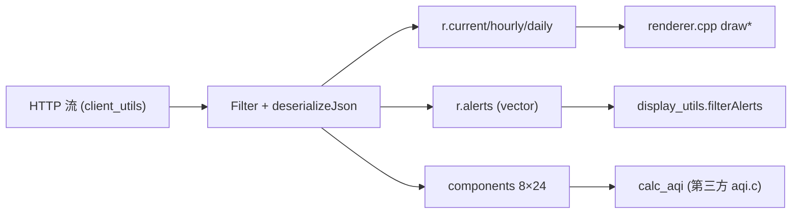

# api_response.cpp —— OpenWeatherMap JSON 解析（A级）

对应源文件：`platformio/src/api_response.cpp`（共 292 行）；数据建模头 `platformio/include/api_response.h`（221 行）
相关文档：[Docs/02-气象API与数据解析](../../../references/firmware/esp32-weather-epd/Docs/02-气象API与数据解析.md)
互链：[client_utils.md](client_utils.md) · [renderer.md](renderer.md) · [display_utils.md](display_utils.md)

## 0. 文件定位

ArduinoJson 7 的"过滤反序列化"教科书案例：把 One Call（原始数百 KB）与 Air Pollution history（几 KB）两个响应解析进固定结构体。依赖 `config.h` 的容量宏与 `DISPLAY_ALERTS` 宏。

## 1. 逐函数表

| 函数 | 行号 | 输入 | 输出 |
|---|---|---|---|
| `deserializeOneCall` | 42 | WiFiClient 流 | `owm_resp_onecall_t &r` |
| `deserializeAirQuality` | 244 | WiFiClient 流 | `owm_resp_air_pollution_t &r` |

### 1.1 deserializeOneCall（42-232）

五段式：
1. **Filter 构造**（47-72）：current/hourly/daily=true，minutely=false；alerts 分支按 `DISPLAY_ALERTS` 宏——启用时逐字段过滤（`sender_name`/`description`=false，event/start/end/tags=true）。
2. **解析**（85-89）：`deserializeJson(doc, json, DeserializationOption::Filter(filter))`；DEBUG>=1 打 `doc.overflowed()`，DEBUG>=2 打印全部 JSON。
3. **current**（89-115）：18 个标量字段 + `weather[0]` 4 字段。
4. **hourly 循环**（129-159）/ **daily 循环**（161-208）：逐字段 `as<T>()` 搬运，`if (i == OWM_NUM_x - 1) break;` 截断防越界。
5. **alerts**（210-229，`#if DISPLAY_ALERTS`）：`vector.push_back`，封顶 8 条；`sender_name`/`description` 被 Filter 掉，结构体字段保留但恒空。

关键摘录（api_response.cpp:47-48 与 85-89）：

```cpp
  JsonDocument filter;
  filter["current"]  = true;
```
```cpp
  JsonDocument doc;
  // doc 只容纳过滤后的数据；是否仍溢出可用 doc.overflowed() 验证（DEBUG）

  DeserializationError error = deserializeJson(doc, json,
                                         DeserializationOption::Filter(filter));
```

关键摘录（api_response.cpp:210-229，alerts 循环，`#if DISPLAY_ALERTS` 内）：

```cpp
  i = 0;
  for (JsonObject alerts : doc["alerts"].as<JsonArray>())
  {
    owm_alerts_t new_alert = {};
    // new_alert.sender_name = alerts["sender_name"].as<const char *>();
    new_alert.event       = alerts["event"]      .as<const char *>();
    new_alert.start       = alerts["start"]      .as<int64_t>();
    new_alert.end         = alerts["end"]        .as<int64_t>();
    // new_alert.description = alerts["description"].as<const char *>();
    new_alert.tags        = alerts["tags"][0]    .as<const char *>();
    r.alerts.push_back(new_alert);

    if (i == OWM_NUM_ALERTS - 1)
    {
      break;
    }
    ++i;
  }
```

被注释掉的两行正是 Filter 里排除的字段（sender_name/description）——Filter 与解析代码的对应关系一目了然；`tags[0]` 只取第一个分类标签。

### 1.2 deserializeAirQuality（244-281）

无 Filter（响应小）；`coord` + `list[]` 循环 24 条：`main.aqi`（OWM 自带 1~5 档）+ components 8 种污染物（μg/m³）+ `dt`。

## 2. 数据建模速查（api_response.h）

| 宏/结构体 | 行号 | 说明 |
|---|---|---|
| `OWM_NUM_MINUTELY/HOURLY/DAILY/ALERTS/AIR_POLLUTION` | 28-32 | 1/48/8/8/24 |
| `owm_weather_t` | 34-40 | id + 3 个 String |
| `owm_temp_t` | 45-53 | 晨昼夜晚 min/max 6 float |
| `owm_feels_like_t` | 58-64 | 晨昼夜晚 4 float（类型名 `owm_owm_feels_like_t`，双 owm 是原码笔误） |
| `owm_current_t` | 69-88 | 当前天气 16 标量 + weather |
| `owm_hourly_t` | 102-120 | current + pop |
| `owm_daily_t` | 125-148 | +月出月落月相 + 嵌套 temp/feels_like |
| `owm_alerts_t` | 153-161 | event/start/end/tags（+被过滤的 2 字段） |
| `owm_resp_onecall_t` | 168-180 | 头信息 + current + hourly[48] + daily[8] + vector alerts |
| `owm_resp_air_pollution_t` | 206-212 | coord + main_aqi[24] + components(8×float[24]) + dt[24] |

内存量化：`owm_resp_onecall_t` ≈ 6.3KB、`owm_resp_air_pollution_t` ≈ 1.1KB——main.cpp 中必须 static 的原因。

## 3. 深读要点

- **只有 5 个 String 字段**（timezone + weather.main/description/icon……current/hourly/daily 各自的 weather.*）：每条 hourly/daily 的 weather 三个字符串都会在堆上分配，48+8 条循环下来产生数十次小分配——ArduinoJson 的 `as<const char*>()` 指向 doc 内部缓冲，赋给 String 才真正拷贝。doc 在函数结束时释放，所以 String 拷贝是必须的（否则悬垂）。
- **`as<int64_t>()`**：全部 Unix 时间戳超 32 位，这个类型选择规避 2038。
- **缺字段语义**：`as<float>()` 对缺失字段返回 0（不是错误）——`wind_gust`/`rain`/`snow` 缺省时静默为 0，渲染端看起来就是"无阵风/无降水"。
- **weather 数组只取 [0]**：OWM 可能返回多条天气，界面只需主条目。

## 4. 数据流角色


