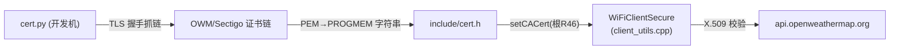

# cert_tool —— 证书链抓取与 cert.h 生成（B级）

对应源文件：`cert/cert.py`（共 144 行，已注释 B 级）；产物：`platformio/include/cert.h`（118 行，自动生成物，**C 级不动**）
相关文档：[Docs/01-启动流程与Wi-Fi连接](../../../references/firmware/esp32-weather-epd/Docs/01-启动流程与Wi-Fi连接.md)
互链：[client_utils.md](client_utils.md) · [main.md](main.md) · [config.md](config.md)

## 0. 文件定位

来自 esp8266/Arduino 的公域工具：与 TLS 服务器握手抓取证书链，沿 AIA 逐级下载签发者直到根，全部输出为 Arduino 可编译的 C 源码。本项目的 `USE_HTTPS_WITH_CERT_VERIF`（config.h:161）模式依赖它产出的 `cert.h`——main.cpp:314 附近 `client.setCACert(cert_Sectigo_Public_Server_Authentication_Root_R46)` 的根证书即来源于此。

## 1. 逐函数表

| 函数 | 行号 | 职责 |
|---|---|---|
| `printData` | 35 | 解析单张证书（DER/PEM/PKCS7 四重 try）→ 打印 CN/有效期/指纹+公钥（叶子）或证书 PEM（签发者）；沿 AIA CA-ISSUERS 递归 `urlopen` 上一级 |
| `get_certificate` | 88 | 建立不验证的 TLS 连接（`check_hostname=False, CERT_NONE`——工具自身抓包，不是安全缺陷），打印头注释后调 printData |
| `main` | 108 | argparse（-s 服务器 / -p 端口 / -n 名字），打印 include guard 与生成时间戳 |

关键摘录（cert/cert.py:36-46，四重格式兼容）：

```python
def printData(data, showPub = True):
    try:
        xcert = x509.load_der_x509_certificate(data)
    except:
        try:
            xcert = x509.load_pem_x509_certificate(data)
        except:
            try:
                xcert = pkcs7.load_der_pkcs7_certificates(data)
            except:
                xcert = pkcs7.load_pem_pkcs7_certificates(data)
```

各 CA 的 AIA 下载地址返回格式不一（DER/PKCS7 混杂），四重 try 是兼容层。

关键摘录（platformio/include/cert.h:1-4，产物头注释——可追溯性设计）：

```cpp
// this file is autogenerated - any modification will be overwritten
// unused symbols will not be linked in the final binary
// generated on 2026-03-23 18:25:25
// by 'cert.py -s api.openweathermap.org -p 443 -n openweathermap'
```

时间戳+完整命令行回显，任何人在任何时间都能复现/续期这份文件。

关键摘录（cert/cert.py:88-93，握手段）：

```python
def get_certificate(hostname, port, name):
    context = ssl.create_default_context()
    context.check_hostname = False
    context.verify_mode = ssl.CERT_NONE
    with socket.create_connection((hostname, port)) as sock:
        with context.wrap_socket(sock, server_hostname=hostname) as ssock:
```

`getpeercert(binary_form=True)` 拿到的是**对端实际发送的链**（叶子在先），printData 再沿 AIA 补齐缺失的上级——与 cert.h 中"叶子在前、根在后"的文件顺序对应。

## 2. 证书链结构（cert.h 现状）

| 符号 | 主体 | 有效期 | 用途 |
|---|---|---|---|
| `fingerprint___openweathermap_org` / `pubkey___openweathermap_org` | *.openweathermap.org 叶子 | 2026-03-19 ~ 2026-10-03 | 固定公钥的备选校验材料 |
| `cert_Sectigo_Public_Server_Authentication_CA_OV_R36` | Sectigo 中级 CA | 2021 ~ 2036 | 链中间证书 |
| `cert_Sectigo_Public_Server_Authentication_Root_R46` | Sectigo 根 CA | （同链） | **main.cpp setCACert 用的就是这个** |

`PROGMEM` 修饰把证书放进 flash 而非 RAM（~3KB 根证书省出 3KB SRAM）。原始 DER 约 1.3KB，PEM base64 后 ~1.8KB 文本。

## 3. 证书过期怎么办（标准操作）

```bash
cd cert
python3 cert.py -s api.openweathermap.org -p 443 -n openweathermap \
  > ../platformio/include/cert.h
```

cert.h 顶部的生成注释（时间戳/命令行）就是这条命令的回显。过期症状：WiFiClientSecure 报证书验证失败 → HTTPClient 返回负错误码 → 屏上出现 API 错误页。**叶子证书 2026-10-03 到期**，届时必须重跑（根证书一般多年不变，链会自动跟随）。

## 4. 深读要点

- **printData 的四重 try**（35-45）：DER 证书 → PEM 证书 → DER PKCS7 → PEM PKCS7，兼容各 CA 的 AIA 下载格式差异；PKCS7 可能含多条，取第一条并打 TODO 警告。
- **showPub 参数**：叶子传 True（输出指纹+公钥），签发者传 False（输出证书 PEM）——递归逐层翻转。
- **CN → 符号名**：`re.sub('[^a-zA-Z0-9_]', '_', cn)`，与 cert.h 里的变量名一一对应。
- **安全性模型**：固定根 CA = pinning。比 `setInsecure()`（免验证）强得多，代价是"证书轮换要重新烧录固件"——这是 config.h:154-157 原注释明示的取舍。

## 5. 数据流角色


