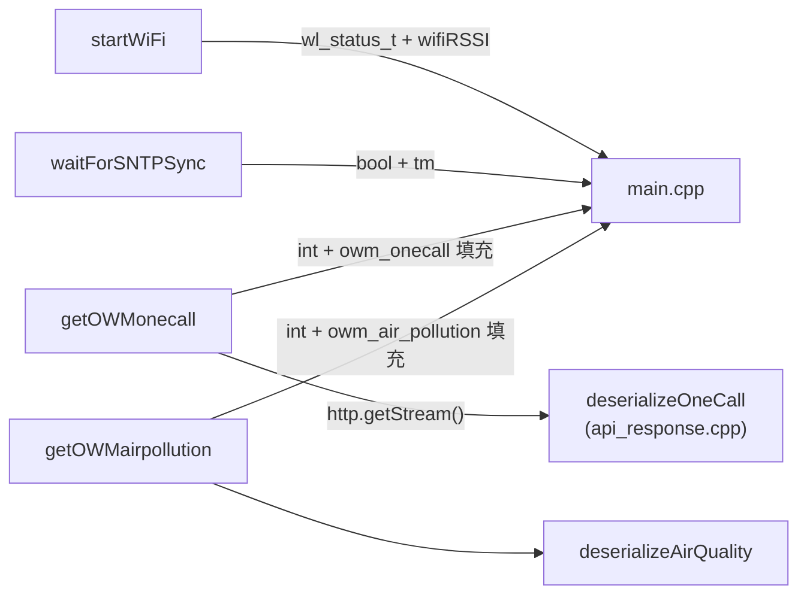

# client_utils.cpp —— Wi-Fi / SNTP / HTTPS 客户端（A级）

对应源文件：`platformio/src/client_utils.cpp`（共 368 行）；声明头 `platformio/include/client_utils.h`（44 行）
相关文档：[Docs/01-启动流程与Wi-Fi连接](../../../references/firmware/esp32-weather-epd/Docs/01-启动流程与Wi-Fi连接.md) · [Docs/02-气象API与数据解析](../../../references/firmware/esp32-weather-epd/Docs/02-气象API与数据解析.md)
互链：[main.md](main.md) · [api_response.md](api_response.md) · [display_utils.md](display_utils.md)

## 0. 文件定位

网络子系统全部在此：Wi-Fi 连接/断开、SNTP 对时等待、两个 OpenWeatherMap HTTPS 请求（重试+错误码分段）、堆调试打印。已按 A 级逐函数深注。端口在文件顶部按 `USE_HTTP` 宏编译期定死（80/443，行 56-60 附近）。

## 1. 逐函数表

| 函数 | 行号 | 返回 | 职责 |
|---|---|---|---|
| `startWiFi` | 77 | `wl_status_t` | STA 模式连接，10s 轮询超时，抓 RSSI |
| `killWiFi` | 118 | void | disconnect + WIFI_OFF（射频断电） |
| `printLocalTime` | 133 | bool | 取本地时间并打印（含死代码重试） |
| `waitForSNTPSync` | 163 | bool | 100ms 轮询 sntp_get_sync_status 至超时 |
| `getOWMonecall` | 203（Secure 分支） | int | One Call GET + 流式解析，≤3 次重试 |
| `getOWMairpollution` | 269（Secure 分支） | int | 24h 空气质量 GET，同款重试 |
| `printHeapUsage` | 349 | void | 四项堆指标打印（DEBUG_LEVEL≥1） |

### 1.1 startWiFi（77-118）

- `WiFi.begin()` 异步连接；`while ((connection_status != WL_CONNECTED) && (millis() < timeout))` 每 50ms 查一次（89-95）。
- 成功后立即 `wifiRSSI = WiFi.RSSI()`（103-105）——之后射频就关了，RSSI 是全周期唯一快照。
- 超时常量 `WIFI_TIMEOUT=10000`ms（config.cpp:78）。

### 1.2 waitForSNTPSync（163-185）

外层 if 判断 + 内层 while 都是 `sntp_get_sync_status() == SNTP_SYNC_STATUS_RESET` 且未超 `NTP_TIMEOUT=20000`ms（config.cpp:145）；每 100ms 打一个点。最终 `printLocalTime(timeInfo)` 决定返回值——timeInfo 即全项目时间基准。

### 1.3 getOWMonecall（203-252）

关键摘录（client_utils.cpp:206-221）：

```cpp
  int attempts = 0;
  bool rxSuccess = false;
  DeserializationError jsonErr = {};
  String uri = "/data/" + OWM_ONECALL_VERSION
               + "/onecall?lat=" + LAT + "&lon=" + LON + "&lang=" + OWM_LANG
               + "&units=standard&exclude=minutely";
#if !DISPLAY_ALERTS
  // exclude alerts
  uri += ",alerts";
#endif

  // This string is printed to terminal to help with debugging. The API key is
  // censored to reduce the risk of users exposing their key.
  String sanitizedUri = OWM_ENDPOINT + uri + "&appid={API key}";

  uri += "&appid=" + OWM_APIKEY;
```

重试体（225-250）要点：
- 每次尝试前查 `WiFi.status()`，掉线 `return -512 - status`；
- `HTTPClient::begin(client, OWM_ENDPOINT, OWM_PORT, uri)`，连接/读双超时 = `HTTP_CLIENT_TCP_TIMEOUT=10000`ms（config.cpp:86）；
- 200 时把 `http.getStream()` 直接喂 `deserializeOneCall`（247）——**流式**，不整包进 RAM；
- JSON 失败 `return -256 - err.code()`；`client.stop()+http.end()` 无条件释放。

### 1.4 getOWMairpollution（269-318）

`start/end` 用 `%lld` 把 int64 拼进 URL（296-299）；`start = end - (3600×24)+1`，减 1 秒防多取一小时（原注释在 290-291）。响应小，无 Filter 直接反序列化。

## 2. 错误码坐标系（返回 int 的设计）

| 区段 | 归属 | 例 |
|---|---|---|
| [100, 599] | HTTP 状态码 | 401 Unauthorized |
| [0, -255] | HTTPClient 错误 | -1 拒连 / -11 读超时 |
| [-256, -511] | ArduinoJson DeserializationError | -261 NoMemory |
| [-512, -767] | wl_status_t | -521 WL_NO_SSID_AVAIL |

文案转换在 `getHttpResponsePhrase()`（display_utils.cpp:1420）。main.cpp 错误屏第二行 = `"<code>: <phrase>"`。

## 3. 已知问题（记录不改码）

**printLocalTime 的重试是死代码**（client_utils.cpp:133-155）：

```cpp
  int attempts = 0;
  while (!getLocalTime(timeInfo) && attempts++ < 3)
  {
    Serial.println(TXT_FAILED_TO_GET_TIME);
    return false;
  }
```

循环体内无条件 `return false`：失败一次即退出，`attempts++ < 3` 永远只执行一次。行为上无害（外层 waitForSNTPSync 已有超时），但"3 次重试"注释与实现不符。

## 4. 数据流角色



RSSI 另一路去 `getWiFiBitmap16/getWiFidesc`（状态栏图标与文案）。
