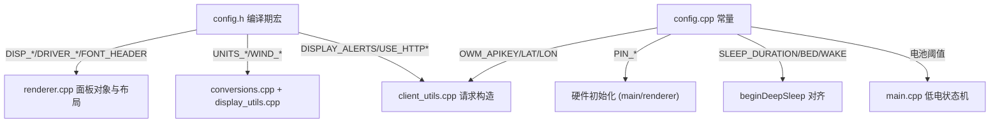

# config.cpp / config.h —— 双层配置体系（B级）

对应源文件：`platformio/src/config.cpp`（共 195 行，运行期常量定义）；`platformio/include/config.h`（476 行，编译期宏 + extern 声明 + 互斥校验）
相关文档：[Docs/00-总览与硬件架构](../../../references/firmware/esp32-weather-epd/Docs/00-总览与硬件架构.md) · [Docs/05-低功耗与实测指南](../../../references/firmware/esp32-weather-epd/Docs/05-低功耗与实测指南.md)
互链：[main.md](main.md) · [renderer.md](renderer.md) · [locale.md](locale.md)

## 0. 双层设计

| 层 | 文件 | 决定方式 | 典型内容 |
|---|---|---|---|
| 运行期 | config.cpp | 改完重编译（常量定义） | 引脚、Wi-Fi 凭据、API key、经纬度、时区、深睡参数、电池阈值 |
| 编译期 | config.h | 改完重编译（宏） | 面板型号/驱动板/传感器、单位制、语言、字体、风向精度、小部件槽位、HTTP 模式、DEBUG_LEVEL |

已加 B 级文件头导读块。注意：README 说"配置存 NVS、Web 配置页写入"（config.cpp 头部原导读也这么写）——**与本代码库不符**：本版本没有 wifi portal，NVS 只存 `lowBat` 标志（main.cpp:197），配置全部编译期写死。以代码为准。

## 1. config.cpp 分组行号

| 组 | 行号 | 内容 |
|---|---|---|
| PINS | 59-73 | EPD SPI 7 根（SCK18/MISO19/MOSI23/CS13/DC22/RST21/BUSY14）、EPD_PWR 26、BME I2C（SDA17/SCL16/PWR4、地址 0x76）、电池 ADC A2 |
| WIFI | 76-78 | SSID/密码/超时 10s |
| HTTP | 81-86 | TCP 超时 10s（-1/-11/-258 错误注释） |
| OWM | 89-106 | API key/endpoint/One Call 3.0 订阅说明 |
| LOCATION | 109-114 | 纬度/经度/城市名 |
| TIME | 117-165 | POSIX TZ、4 个格式串、2 台 NTP、超时 20s、SLEEP_DURATION=30、BED/WAKE=0/6 |
| GRAPH | 168 | HOURLY_GRAPH_MAX=24 |
| BATTERY | 171-185 | 4 阈值（3535/3462/3442/3404mV）+ 2 复测间隔（30/120min）+ 估算上下限（4200/3000mV） |

关键摘录（config.cpp:152-157）：

```cpp
const int SLEEP_DURATION = 30; // minutes
// Bed Time Power Savings.
// If BED_TIME == WAKE_TIME, then this battery saving feature will be disabled.
// (range: [0-23])
const int BED_TIME  = 00; // Last update at 00:00 (midnight) until WAKE_TIME.
const int WAKE_TIME = 06; // Hour of first update after BED_TIME, 06:00.
```

## 2. config.h 关键宏（行号）

| 宏 | 行号 | 默认 | 说明 |
|---|---|---|---|
| `DISP_BW_V2`（五选一） | 32 | 启用 | 面板型号，互斥校验 368-374 |
| `DRIVER_DESPI_C02`（二选一） | 44 | 启用 | 驱动板 |
| `SENSOR_BME280`（二选一） | 49 | 启用 | + `SENSOR_INIT_DELAY_MS`（52-54）读数失败可加延时 |
| `ACCENT_COLOR` | 58-65 | GxEPD_RED | 3 色屏第三色 |
| `LOCALE` | 82 | en_US | 见 [locale.md](locale.md) |
| `UNITS_TEMP/SPEED/PRES/DIST/HOURLY_PRECIP/DAILY_PRECIP` | 87-140 | 华氏/mph/inHg/miles/POP/inches | 每类恰好一个，`^` 互斥校验 |
| `USE_HTTPS_WITH_CERT_VERIF`（三选一） | 161 | 启用 | 证书固定模式（cert.h 需随证书过期更新） |
| `WIND_INDICATOR_ARROW` | 173 | 启用 | 箭头可与 NUMBER/CPN 叠加（434-444 校验特例） |
| `WIND_ICONS_SECONDARY_INTERCARDINAL` | 198 | 启用 | 风向图标精度（16 向 1152B；360 向 25.9KB） |
| `POS_*` 小部件槽位 | 211-224 | sunrise...humidity | 0-9 两列五行；BW_V1 仅 0-5 |
| `MOONPHASE_ALTERNATIVE` | 232 | 启用 | 月相图标风格 |
| `FONT_HEADER` | 263 | FreeSans.h | 版面按 FreeSans 字距手排，换字体可能错位 |
| `TEMP_ORDER_HL` | 271 | 启用 | 高低温顺序 |
| `DISPLAY_DAILY_PRECIP` | 280 | 2(smart) | 0/1/2 |
| `DISPLAY_HOURLY_ICONS` | 287 | 1 | 逐时图小图标 |
| `DISPLAY_ALERTS` | 296 | 1 | 预警（还控制 API exclude） |
| `STATUS_BAR_EXTRAS_*` | 301-304 | 百分比/信号=1 | 电压/RSSI=0 |
| `BATTERY_MONITORING` | 310 | 1 | 关掉则电池Voltage=UINT32_MAX（main.cpp:247） |
| `NVS_NAMESPACE` | 313 | "weather_epd" | NVS 命名空间 |
| `DEBUG_LEVEL` | 320 | 0 | 0/1/2 三档 |

## 3. 编译期互斥校验（config.h:367-474）

关键摘录（config.h:367-374，第一组校验）：

```cpp
// CONFIG VALIDATION - DO NOT MODIFY
#if !(  defined(DISP_BW_V2)  \
      ^ defined(DISP_3C_B)   \
      ^ defined(DISP_7C_F)   \
      ^ defined(DISP_7C_E6)  \
      ^ defined(DISP_BW_V1))
  #error Invalid configuration. Exactly one display panel must be selected.
#endif
```

"CONFIG VALIDATION - DO NOT MODIFY"：约 20 组 `#if !(defined(A) ^ defined(B) ...)` + `#error`。用按位异或 `^` 组合 `defined()` 保证"恰好选一个"（全没选或选了两个都会爆）；`WIND_INDICATOR` 一组是唯一允许组合的（箭头 ⊕ 其他单选，config.h:434-444）。这是宏配置防呆的范本：**配错在编译期爆炸，而不是运行期黑屏**。

## 4. 已知问题（记录不改码）

- config.h:82 的注释说"add it by copying ... files in src/locales"，实际目录是 `include/locales/`（注释路径过时）。
- config.h:417 "houly" 拼写错误（houly precipitation）。

## 5. 数据流角色


