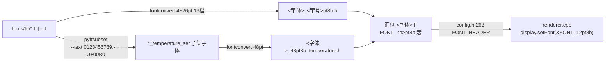

# fonts_toolchain —— 字体流水线（B级）

对应源文件：`fonts/ttf_to_adafruit_gfx.sh`（共 114 行，**未加源码注释**：校验脚本对非 .py 文件按 C 规则剥离注释，`#` 注释无法通过 strip_equiv_check，故只在 KB 覆盖）；辅助工具 `fonts/fontconvert/`（Adafruit 官方 C 工具，BSD，C 级）
- 源字体：`fonts/ttf/`（14 个开源字族，License 见 README Licensing 表）
- 产物：`platformio/include/fonts/<字体>/<字体>_<字号>pt8b.h` 与汇总头 `<字体>.h`

相关文档：[Docs/04-UI布局与绘制管线](../../../references/firmware/esp32-weather-epd/Docs/04-UI布局与绘制管线.md)
互链：[renderer.md](renderer.md) · [config.md](config.md) · [icons_toolchain.md](icons_toolchain.md)

## 0. 流水线全景



## 1. 脚本逐段表（行号为当前文件）

| 段 | 行号 | 职责 |
|---|---|---|
| 变量 | 17-20 | `TTF_FILES=ttf/*`；`SIZES=(4 5 6 7 8 9 10 11 12 14 16 18 20 22 24 26)`；`TEMPERATURE_SIZES=(48)` |
| 清理+构建 | 22-31 | `rm -r fonts 输出目录`（注意：脚本直接删当前 fonts/ 输出）→ fontconvert `make` |
| 温度子集 | 41-46 | `pyftsubset ${fontfile} --text="0123456789.-" --unicodes=U+00B0` → `*_temperature_set.*` |
| 常规字号循环 | 64-75 | `fontconvert ${fontfile} $SI` → `<字体>_<SI>pt8b.h`；`sed "s/${SI}pt8b/_${SI}pt8b/g"` 给字号前补下划线 |
| 温度字号循环 | 76-82 | 48pt 用子集字体；`sed "s/_temperature_set${SI}pt8b/_${SI}pt8b_temperature/g"` 改名 |
| 汇总头 | 91-106 | `<字体>.h`：include 全部字号 + `#define FONT_<n>pt8b<后缀> <结构体名>` |

## 2. 两个关键机制

### 2.1 符号名三次变换

以 FreeSans 12pt 为例，追踪一个 GFXfont 结构体名的诞生：

```
fontconvert 输入 ttf/FreeSans.otf 12
  → fontconvert 内部把路径/扩展名/非法字符清洗成标识符：FreeSans12pt8b
sed s/12pt8b/_12pt8b/           → FreeSans_12pt8b
汇总头 define FONT_12pt8b        → FreeSans_12pt8b
```

温度 48pt：

```
子集字体名 FreeSans_temperature_set.otf → fontconvert: FreeSans_temperature_set48pt8b
sed s/_temperature_set48pt8b/_48pt8b_temperature/ → FreeSans_48pt8b_temperature
汇总头 define FONT_48pt8b_temperature → FreeSans_48pt8b_temperature
```

renderer.cpp 里 `display.setFont(&FONT_48pt8b_temperature)` 引用的宏由此而来。**两次 sed 是符号名与文件名解耦的唯一手段**，改脚本时两边必须同步。

### 2.2 温度子集为什么存在

48pt 全字号的 GFX 位图数据要几十 KB，而大字温度只需要 `0-9 . - °` 13 个字形。pyftsubset 切出的子集只占几 KB——省下的 flash 足够放下 360 张风向图标（25.9KB，config.h:194）。这是"按用途裁剪资源"的典型做法，与 icons 的 constexpr 裁剪（[icons_toolchain.md](icons_toolchain.md)）同思路。

## 2.1 汇总头生成段实录

摘录 `fonts/ttf_to_adafruit_gfx.sh:90-106`：

```bash
  # create header file (this will make fonts way easier to include)
  HEADER_FILE=$OUTPUT_PATH/$FONT".h"
  echo "#ifndef __FONTS_"${FONT^^}"_H__" >> $HEADER_FILE
  echo "#define __FONTS_"${FONT^^}"_H__" >> $HEADER_FILE
  for FILE in $OUTPUT_PATH/$FONT/*
    do
    echo "#include \"$FONT/`basename $FILE`\"" >> $HEADER_FILE
  done
  echo "" >> $HEADER_FILE
  for FILE in $OUTPUT_PATH/$FONT/*
    do
    FONT_SUFFIX=$(echo "`basename $FILE .h`" | grep -oP '(?<=pt8b)\w+')
    FONT_SIZE=$(echo "`basename $FILE .h`" | grep -oP '\d+(?=pt8b)')

    echo "#define FONT_"$FONT_SIZE"pt8b"$FONT_SUFFIX" `basename $FILE .h`" >> $HEADER_FILE
  done
  echo "#endif" >> $HEADER_FILE
```

两个 grep 用正则从文件名反解字号与后缀（`FreeSans_12pt8b.h` → size=12、suffix 空；`..._48pt8b_temperature.h` → suffix=`_temperature`），自动产出 `FONT_12pt8b` / `FONT_48pt8b_temperature` 宏——新增字号无需手写宏。

## 3. 换字体的步骤与风险

1. 把 TTF 放进 `fonts/ttf/`，跑 `fonts/ttf_to_adafruit_gfx.sh`；
2. config.h:263 `#define FONT_HEADER "fonts/Lato_Regular.h"`（文件名对应表在 config.h:240-254 注释）；
3. 重编译。

风险（config.h:259-262 原注释明示）：**整个 800×480 版面按 GNU FreeSans 的字距手排**，其他字体宽度不同，可能出现文字溢出格子/错位——换字体后要按 [Docs/04](../../../references/firmware/esp32-weather-epd/Docs/04-UI布局与绘制管线.md) 第 8 节逐区检查。

## 4. 坑点

- 脚本会 `rm -r fonts`（输出目录）再重建——**在 fonts/ 目录内运行**，别在仓库根跑（会删错目标）。
- `pyftsubset` 需要 fonttools：`pip install fonttools`；`fontconvert` 需要 freetype 开发头文件。
- `sed -i` 在 macOS 是 BSD sed，语法不兼容（`-i ''`）——脚本按 Linux/macOS 通吃写的，实际在 Linux 跑最稳。
- 字号列表没有 13/15/17pt：渲染端引用的字号集合（5/6/7/8/9/10/11/12/14/16/18/26pt + 48 温度）是版面定死的，改 UI 用新字号要同步改 `SIZES` 数组。

## 5. 数据流角色


