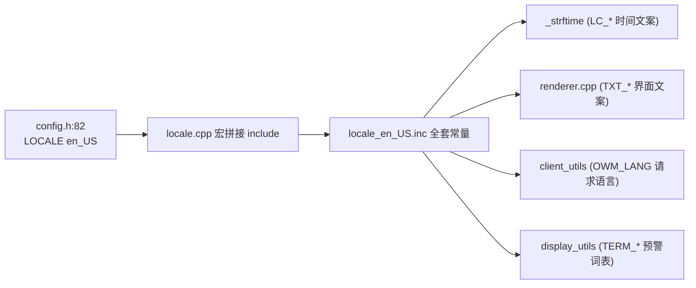

# locale.cpp —— 多语言装载器（B级）

对应源文件：`platformio/src/locale.cpp`（共 63 行）；关联：`platformio/include/_locale.h`（290 行，符号声明）、`platformio/include/locales/locale_*.inc`（11 个翻译表）
相关文档：[Docs/00-总览与硬件架构](../../../references/firmware/esp32-weather-epd/Docs/00-总览与硬件架构.md)
互链：[_strftime.md](_strftime.md) · [config.md](config.md) · [display_utils.md](display_utils.md)

## 0. 文件定位

无函数，只有"宏拼接 include"。config.h:82 的 `#define LOCALE en_US` 决定整个固件说哪种语言。已加 B 级文件头导读块。

## 1. 机制精读（locale.cpp:57-63）

```cpp
#define STR(s) #s
#define X_LOCALE_INC(code) STR(locales/locale_ ## code.inc)
#define LOCALE_INC(code) X_LOCALE_INC(code)

#include LOCALE_INC(LOCALE)
```

两级宏展开：`LOCALE_INC(en_US)` → `X_LOCALE_INC(en_US)` → `STR(locales/locale_en_US.inc)` → `"locales/locale_en_US.inc"`。必须经过 X-宏中转，否则 `LOCALE` 不会被展开成字符串（`#` 运算符阻止宏展开，经典技巧）。

## 2. locale_*.inc 资源清单（include/locales/）

| 文件 | 语言 | 行尾 |
|---|---|---|
| locale_de_DE.inc | 德语 | CRLF |
| locale_en_GB.inc | 英语（英） | CRLF |
| locale_en_US.inc | 英语（美） | LF |
| locale_es_ES.inc | 西语 | LF |
| locale_et_EE.inc | 爱沙尼亚语 | LF |
| locale_fi_FI.inc | 芬语 | LF |
| locale_fr_FR.inc | 法语 | CRLF |
| locale_it_IT.inc | 意语 | LF |
| locale_nl_BE.inc | 荷语（比） | LF |
| locale_pt_BR.inc | 葡语（巴西） | LF |

每个 .inc 定义同一套符号（extern 声明见 _locale.h）：`LC_DAY[7]/LC_ABDAY[7]/LC_MON[12]/LC_ABMON[12]`（星期月名）、`LC_D_T_FMT/LC_D_FMT/LC_T_FMT/LC_T_FMT_AMPM/LC_AM_STR/LC_PM_STR`（strftime 格式）、`OWM_LANG`（API 请求语言）、约 150 个 `TXT_*` 界面文案与 `TERM_*`（预警分类词表）、`ALERT_URGENCY`（紧急度关键词表，config.h 可覆写）。

## 2.1 表内定义长什么样（locale_en_US.inc 实录）

摘录 `platformio/include/locales/locale_en_US.inc:31`：

```cpp
const char *LC_D_T_FMT     = "%a %d %b %Y %r %Z";
```

摘录 `platformio/include/locales/locale_en_US.inc:70`：

```cpp
const String OWM_LANG = "en";
```

摘录 `platformio/include/locales/locale_en_US.inc:191-194`：

```cpp
const std::vector<String> ALERT_URGENCY = {"outlook", "statement", "watch", "advisory", "warning", "emergency"}; // US National Weather Service
// const std::vector<String> ALERT_URGENCY = {"yellow", "amber", "red"};                 // United Kingdom's national weather service (MET Office)
// const std::vector<String> ALERT_URGENCY = {"minor", "moderate", "severe", "extreme"}; // METEO
// const std::vector<String> ALERT_URGENCY = {}; // Disable urgency interpretation (algorithm will fallback to only prefer the most recently issued alerts)
```

`ALERT_URGENCY` 按紧急度从低到高排列（下标即等级，display_utils.cpp `eventUrgency` 消费）；换国家/地区就是取消注释对应行或自己写一份。

## 2.2 为什么用 String 与 const char* 混合

`LC_*` 与 `TXT_*` 是 `const char*`（指向 .inc 里的字面量，零运行期开销、可进 flash rodata）；只有 `OWM_LANG` 是 `String`（因为它被拼进动态构造的 URL）。`ALERT_URGENCY`/`TERM_*` 用 `std::vector<String>`（词表需要长度与遍历语义）。三种容器各按用途选型，是小型嵌入式的内存账本。

## 3. 新增语言的步骤

1. 复制 `locale_en_US.inc` → `locale_xx_YY.inc`，翻译全部字符串（注意 TXT_* 是 `const char*`，UTF-8 直接可用；但**界面字体只含拉丁字形**，中日韩文字需要先扩字体）；
2. config.h 把 `#define LOCALE en_US` 改成 `xx_YY`；
3. 重新编译——`OWM_LANG` 会随表切换，API 的 description 也变语言。

## 4. 深读要点 / 已知问题（记录不改码）

- **locale.cpp:26-41 有一段重复的版权注释**（与文件头 1-16 相同），历史遗留，保持原样。
- **`ALERT_URGENCY` 是 `std::vector<String>`**（非 constexpr），运行期构造堆字符串——每轮唤醒只构造一次，代价可忽略；但说明词表支持运行期扩展（config.h 里用 `.push_back` 风格的宏列表定义）。
- **预警词表大小写**：locale 表里是全小写，`filterAlerts` 先把 event/tags 转小写再匹配（display_utils.cpp:323）。
- **_locale.h 是 CRLF 行尾**（`file` 检测），改它时注意编辑器不要混行尾。

## 5. 数据流角色


