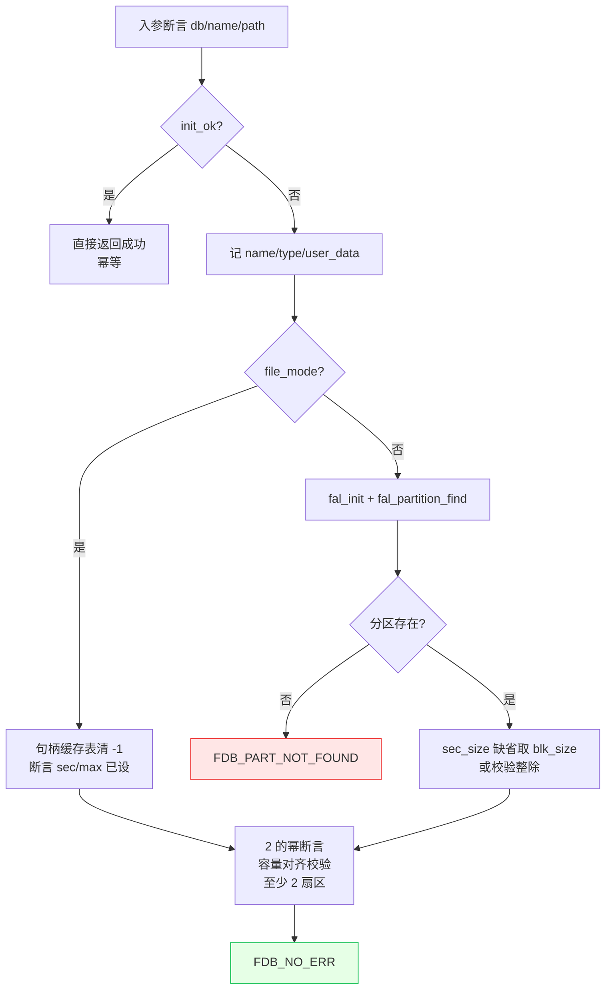

# fdb.c —— 通用层：初始化骨架与存储绑定

对应源文件：`references/filesystems/FlashDB/src/fdb.c`（共 202 行，A级逐函数深注）

KVDB 与 TSDB 共用的"init 骨架 + 公共收尾"，全库最短的核心文件，适合作为读码第一站。
互链：[[fdb_def]]、[[fdb_utils]]、[[fdb_kvdb]]、[[fdb_tsdb]]、Docs《01-初始化与分区管理》《06-FAL与移植层》。

## 一、逐函数表（行号 = 函数定义行）

| 函数 | 行号 | 职责 | 关键点 |
|---|---|---|---|
| `_fdb_init_ex` | 55 | 公共 init 骨架 | 幂等保护（61 行）；FAL 绑定（88-108 行：fal_init/fal_partition_find/块大小/容量）；文件模式断言 sec_size/max_size 已设（74-75 行）；三项几何校验（114/116/122 行） |
| `_fdb_init_finish` | 137 | init 收尾 | 置 init_ok；版本横幅全进程只打一次（static log_is_show）；not_formatable 失败静默 |
| `_fdb_deinit` | 158 | 公共反初始化 | 文件模式关缓存句柄（POSIX close / LIBC fclose）；init_ok=false |
| `_fdb_db_path` | 186 | 取路径/分区名 | 仅用于日志前缀（fdb_kvdb.c/fdb_tsdb.c 重写的 FDB_LOG_PREFIX2 用它） |

## 二、_fdb_init_ex 流程精读



## 三、关键摘录

1. **FAL 绑定与默认扇区大小**（`_fdb_init_ex` 内，89-99 行）：

```c
fal_init();
/* check the flash partition */
if ((db->storage.part = fal_partition_find(path)) == NULL) {
    FDB_INFO("Error: Partition (%s) not found.\n", path);
    return FDB_PART_NOT_FOUND;
}

block_size = fal_flash_device_find(db->storage.part->flash_name)->blk_size;
if (db->sec_size == 0) {
    /* 用户未预设扇区大小时，直接采用 FAL 驱动的块（擦除）大小 */
    db->sec_size = block_size;
```

2. **三项几何校验**（114-125 行）：

```c
FDB_ASSERT((db->sec_size & (db->sec_size - 1)) == 0);
/* must align with sector size */
if (db->max_size % db->sec_size != 0) { ... return FDB_INIT_FAILED; }
/* must has more than or equal 2 sectors */
if (db->max_size / db->sec_size < 2) { ... return FDB_INIT_FAILED; }
```

2 的幂断言是地址回绕（get_next_sector_addr 里 `>= db_max_size` 判断）正确性的前提；"至少 2 扇区"是给 GC/滚动预留操作余量。

3. **版本横幅只打一次**（`_fdb_init_finish` 内，139-146 行）：

```c
static bool log_is_show = false;
if (result == FDB_NO_ERR) {
    db->init_ok = true;
    if (!log_is_show) {
        FDB_INFO("FlashDB V%s is initialize success.\n", FDB_SW_VERSION);
```

两个库先后 init 时横幅只打一次——`log_is_show` 是函数内 static，全进程共享。

## 四、失败码与排查

| 返回码 | 抛出行 | 原因 |
|---|---|---|
| FDB_PART_NOT_FOUND | 93 | 分区名拼写/fal_init 失败 |
| FDB_INIT_FAILED | 104 | sec_size 非块大小整数倍 |
| FDB_INIT_FAILED | 118 | max_size 非扇区整数倍 |
| FDB_INIT_FAILED | 124 | 扇区数 < 2 |

## 五、读码顺序与互链

1. 先看 `_fdb_init_ex` 理解"存储后端绑定 + 几何校验"；
2. 然后 `fdb_kvdb_init`/`fdb_tsdb_init`（[[fdb_kvdb]]/[[fdb_tsdb]]）如何在其上叠加挂载恢复；
3. `db->storage` 是 union：FAL 模式存 `fal_partition*`，文件模式存目录字符串——`_fdb_db_path` 按模式取；
4. 文件模式的细节差异见 Docs《01-初始化与分区管理》5.1 节。

## 六、_fdb_init_ex 与上层 init 的分工边界

| 本文件负责 | 上层（kvdb/tsdb init）负责 |
|---|---|
| 绑定分区/目录、校验几何 | 定位 oldest_addr / cur_sec |
| 幂等与断言 | 缓存表初始化 |
| init_ok 置位与横幅 | 挂载恢复（_fdb_kv_load / tsdb 体检） |

调试 init 问题时先区分错误出在哪一层：`FDB_PART_NOT_FOUND`/几何类错误在本层，挂载类错误（FDB_READ_ERR、体检失败）在上层。

## 七、file_mode 分支的初始化细节（70-83 行）

- POSIX 模式句柄缓存 memset 为 -1（-1 表示无句柄），LIBC 模式 memset 为 0（NULL）——两套"空值"不同；
- `FDB_ASSERT(strlen(path) != 0)` 防呆空目录；
- `db->cur_file_sec` 表先全部置 FDB_FAILED_ADDR，与"无缓存扇区"哨兵一致。
