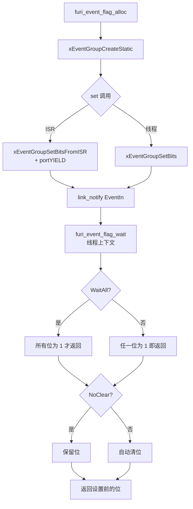
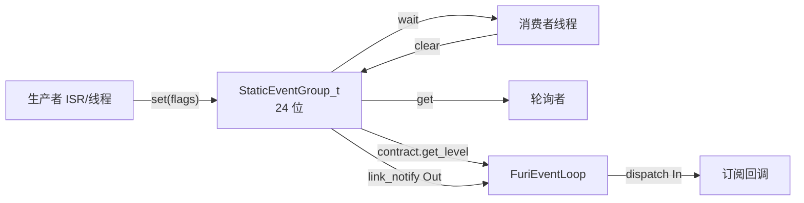

# furi_event —— 事件标志与事件循环

> 对应源文件：`furi/core/event_flag.c`（共 202 行）
> 配套头文件：`furi/core/event_flag.h`（75 行）
> 事件循环：`furi/core/event_loop.c`（601 行）、`event_loop.h`（356 行）
> 关联：`furi/core/event_loop_link_i.h`（对象与循环的连接节点）

## 一句话职责

`FuriEventFlag` 是 FreeRTOS event group 的 24 位封装，提供“置位/清位/等待
任意位或全部位”的线程与 ISR 双路径；`FuriEventLoop` 则是把队列、事件组、
互斥量、定时器、线程 flag 统一成“电平事件”的单线程 Reactor。

> 命名区分：源码里没有叫 `FuriEvent` 的类型。`furi_event_flag_*` 是位标志；
> `FuriEventLoop*` 是事件循环；`FuriEventLoopEvent` 是循环关注的事件种类
> （In/Out/Error 等）。本文两部分都覆盖。

---

## 1. FuriEventFlag 结构

```c
// furi/core/event_flag.c:14-20
struct FuriEventFlag {
    StaticEventGroup_t container;
    FuriEventLoopLink event_loop_link;
};

// IMPORTANT: container MUST be the FIRST struct member
static_assert(offsetof(FuriEventFlag, container) == 0);
```

| 字段 | 行号 | 含义 |
|---|---|---|
| `container` | 15 | FreeRTOS event group 控制块 |
| `event_loop_link` | 16 | 可挂到 `FuriEventLoop` 的链表节点 |

### 1.1 位宽

```c
// furi/core/event_flag.c:10-12
#define FURI_EVENT_FLAG_MAX_BITS_EVENT_GROUPS 24U
#define FURI_EVENT_FLAG_VALID_BITS            ((1UL << FURI_EVENT_FLAG_MAX_BITS_EVENT_GROUPS) - 1U)
#define FURI_EVENT_FLAG_INVALID_BITS          (~(FURI_EVENT_FLAG_VALID_BITS))
```

FreeRTOS 的 event group 只用低 24 位存用户标志，高 8 位是内部控制
（等待条件、清除标记）。因此：

| 位 | 用途 |
|---|---|
| 0~23 | 用户 flag |
| 24~31 | FreeRTOS 内部 |

任何 `set/clear/wait` 传入 bit24+ 都会返回 `FuriStatusErrorParameter`。

---

## 2. 逐函数表（event_flag.c）

| 函数 | 行号 | 关键行为 |
|---|---|---|
| `furi_event_flag_alloc` | 22-30 | 非 ISR；`xEventGroupCreateStatic` |
| `furi_event_flag_free` | 32-41 | 断言 event loop 已断开；`vEventGroupDelete` |
| `furi_event_flag_set` | 43-73 | 临界区；ISR 用 `FromISR`；成功通知 `EventIn` |
| `furi_event_flag_clear` | 75-105 | ISR 清位是“命令队列”语义，需 `portYIELD_FROM_ISR(pdTRUE)` |
| `furi_event_flag_get` | 107-121 | ISR 用 `xEventGroupGetBitsFromISR` |
| `furi_event_flag_wait` | 123-176 | 支持 `WaitAll`/`WaitAny`、`NoClear`、超时 |
| `event_loop_get_link` | 178-182 | 返回内嵌 link |
| `event_loop_get_level` | 184-197 | In = 有效位非 0；Out = 有效位未全满 |
| `furi_event_flag_event_loop_contract` | 199-202 | 导出契约 |

### 2.1 wait 的选项

| 选项 | 常量 | 行为 |
|---|---|---|
| 等任意位 | `FuriFlagWaitAny` | 任一请求位为 1 即返回 |
| 等全部位 | `FuriFlagWaitAll` | 所有请求位为 1 才返回 |
| 不清除 | `FuriFlagNoClear` | 返回后保留位；否则自动清 |
| 超时 0 | — | 不阻塞，立即返回当前状态 |
| 超时 >0 | tick 数 | 超时返回 `FuriStatusErrorTimeout` |

---

## 3. 逐字摘录

### 3.1 set：临界区包住整个操作

```c
// furi/core/event_flag.c:43-73
uint32_t furi_event_flag_set(FuriEventFlag* instance, uint32_t flags) {
    furi_check(instance);
    furi_check((flags & FURI_EVENT_FLAG_INVALID_BITS) == 0U);

    EventGroupHandle_t hEventGroup = (EventGroupHandle_t)instance;
    uint32_t rflags;
    BaseType_t yield;

    FURI_CRITICAL_ENTER();

    if(FURI_IS_IRQ_MODE()) {
        yield = pdFALSE;
        if(xEventGroupSetBitsFromISR(hEventGroup, (EventBits_t)flags, &yield) == pdFAIL) {
            rflags = (uint32_t)FuriFlagErrorResource;
        } else {
            rflags = flags;
            portYIELD_FROM_ISR(yield);
        }
    } else {
        rflags = xEventGroupSetBits(hEventGroup, (EventBits_t)flags);
    }

    if(rflags & flags) {
        furi_event_loop_link_notify(&instance->event_loop_link, FuriEventLoopEventIn);
    }

    FURI_CRITICAL_EXIT();

    /* Return event flags after setting */
    return rflags;
}
```

注意返回值语义：

- 非 ISR：`xEventGroupSetBits` 返回**设置后**的全部位；
- ISR 成功：只返回本次设置的 `flags`，不是全部位；
- ISR 失败：返回 `FuriFlagErrorResource`（bit31 置位）。

调用方若需要“设置后的全部位”，应在 ISR 路径额外 `get()`。

### 3.2 clear：ISR 里的顺序陷阱

```c
// furi/core/event_flag.c:83-96
    if(FURI_IS_IRQ_MODE()) {
        rflags = xEventGroupGetBitsFromISR(hEventGroup);

        if(xEventGroupClearBitsFromISR(hEventGroup, (EventBits_t)flags) == pdFAIL) {
            rflags = (uint32_t)FuriStatusErrorResource;
        } else {
            /* xEventGroupClearBitsFromISR only registers clear operation in the timer command queue. */
            /* Yield is required here otherwise clear operation might not execute in the right order. */
            /* See https://github.com/FreeRTOS/FreeRTOS-Kernel/issues/93 for more info.               */
            portYIELD_FROM_ISR(pdTRUE);
        }
    } else {
        rflags = xEventGroupClearBits(hEventGroup, (EventBits_t)flags);
    }
```

FreeRTOS 的 `xEventGroupClearBitsFromISR` 不是立即清，而是把命令塞进
timer command queue，由 `TimersSrv` 执行。若不 `portYIELD_FROM_ISR(pdTRUE)`，
ISR 返回后可能先运行其他任务，它们会看到**尚未清除**的旧位。
这是一个只有读源码/看 FreeRTOS issue 才会发现的时序坑。

### 3.3 wait：选项组合

```c
// furi/core/event_flag.c:123-176（节选）
uint32_t furi_event_flag_wait(
    FuriEventFlag* instance,
    uint32_t flags,
    uint32_t options,
    uint32_t timeout) {
    furi_check(!FURI_IS_IRQ_MODE());
    furi_check(instance);
    furi_check((flags & FURI_EVENT_FLAG_INVALID_BITS) == 0U);

    EventGroupHandle_t hEventGroup = (EventGroupHandle_t)instance;
    BaseType_t wait_all;
    BaseType_t exit_clr;
    uint32_t rflags;

    if(options & FuriFlagWaitAll) {
        wait_all = pdTRUE;
    } else {
        wait_all = pdFAIL;
    }

    if(options & FuriFlagNoClear) {
        exit_clr = pdFAIL;
    } else {
        exit_clr = pdTRUE;
    }

    rflags = xEventGroupWaitBits(
        hEventGroup, (EventBits_t)flags, exit_clr, wait_all, (TickType_t)timeout);

    if(options & FuriFlagWaitAll) {
        if((flags & rflags) != flags) {
            if(timeout > 0U) {
                rflags = (uint32_t)FuriStatusErrorTimeout;
            } else {
                rflags = (uint32_t)FuriStatusErrorResource;
            }
        }
    } else {
        if((flags & rflags) == 0U) {
            if(timeout > 0U) {
                rflags = (uint32_t)FuriStatusErrorTimeout;
            } else {
                rflags = (uint32_t)FuriStatusErrorResource;
            }
        }
    }

    if((rflags & FuriFlagError) == 0U) {
        furi_event_loop_link_notify(&instance->event_loop_link, FuriEventLoopEventOut);
    }

    /* Return event flags before clearing */
    return rflags;
}
```

`wait` 在 ISR 里会直接 `furi_check` 失败（`!FURI_IS_IRQ_MODE()`），
所以 ISR 只能用 `get` 轮询或用线程 flag 通知线程。

---

## 4. FuriEventLoop：单线程 Reactor

### 4.1 核心 API

| API | 声明行号 | 作用 |
|---|---|---|
| `furi_event_loop_alloc` | `event_loop.h:117` | 创建循环（B+ 树 + 等待链表） |
| `furi_event_loop_run` | `event_loop.h:131` | 进入循环，直到 `stop` |
| `furi_event_loop_stop` | `event_loop.h:137` | 请求退出 |
| `furi_event_loop_tick_set` | `event_loop.h:161` | 设置周期 tick 回调 |
| `furi_event_loop_subscribe_message_queue` | `event_loop.h:246` | 订阅队列的 `EventIn` |

实现位置：`event_loop.c:54`（alloc）、`208`（run）、`285`（stop）、
`376`（subscribe_message_queue）。

### 4.2 内部结构

`event_loop_i.h:31-52`：

| 成员 | 类型 | 作用 |
|---|---|---|
| `tree` | `FuriEventLoopTree`（B+ 树 rank 4） | 按对象指针索引订阅项，O(log n) |
| `waiting` | `ILIST` | 当前有事件待 dispatch 的对象 |
| `FuriEventLoopItem` | 订阅项 | object/contract/callback/context |
| `FuriEventLoopFlag` | 位掩码 | Event/Stop/Timer/Pending/ThreadFlag |

### 4.3 契约模式

每个可被订阅的对象提供 `FuriEventLoopContract`：

```c
// furi/core/event_flag.c:199-202
const FuriEventLoopContract furi_event_flag_event_loop_contract = {
    .get_link = furi_event_flag_event_loop_get_link,
    .get_level = furi_event_flag_event_loop_get_level,
};
```

| 回调 | 作用 |
|---|---|
| `get_link` | 返回内嵌的 `FuriEventLoopLink`（用于挂链表） |
| `get_level` | 返回事件电平（>0 表示就绪） |

于是 event loop 不需要知道对象类型，只通过两个函数指针操作。
这是 Furi 里唯一使用“运行期多态”的地方。

---

## 5. 执行流



## 6. 数据流



---

## 7. 陷阱与读码建议

| 陷阱 | 现象 | 根因 | 处理 |
|---|---|---|---|
| 用 bit24+ | `ErrorParameter` | event group 只有 24 位 | 拆多个 flag |
| ISR 里 `wait` | `furi_check` 崩溃 | wait 明确禁止 ISR | ISR 只 set/get |
| ISR clear 后立刻读 | 看到旧位 | 清除走 timer 队列 | 依赖源码里的 `portYIELD_FROM_ISR(pdTRUE)` |
| 忘记 `NoClear` | 第二个等待者永久阻塞 | 第一个 wait 清位 | 共享事件用 `NoClear` |
| 把 event flag 当计数器 | 丢事件 | 位语义会合并 | 用信号量或队列 |
| `free` 时仍被 event loop 订阅 | 崩溃 | link 未断开 | 先 unsubscribe |
| 在 tick 回调里阻塞 | 整个 loop 停摆 | 单线程 Reactor | 只投递 |

读码建议：

1. `event_flag.c` 的 43-105 行是核心：set/clear 的 ISR 分支各有一个坑。
2. 把 `FuriEventLoopContract` 当作“对象向循环暴露的接口”，
   读 `event_loop.c` 时只关注 `get_level` 如何被调用。
3. `FuriEventLoop` 不是线程池，所有回调都在调用 `run()` 的线程执行；
   任何阻塞都会拖垮全部订阅者。
4. 对比 `furi_message_queue` 的 contract：队列用“消息数/剩余空间”做电平，
   事件组用“有效位非 0/未全满”做电平，二者语义一致。

> 相关文档：[02-Furi 内核精读.md](../../../references/firmware/flipperzero-firmware/Docs/02-Furi 内核精读.md)、
> [05-GUI 与输入事件.md](../../../references/firmware/flipperzero-firmware/Docs/05-GUI 与输入事件.md)
