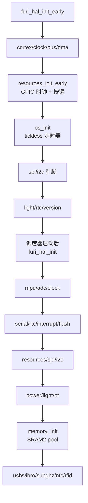
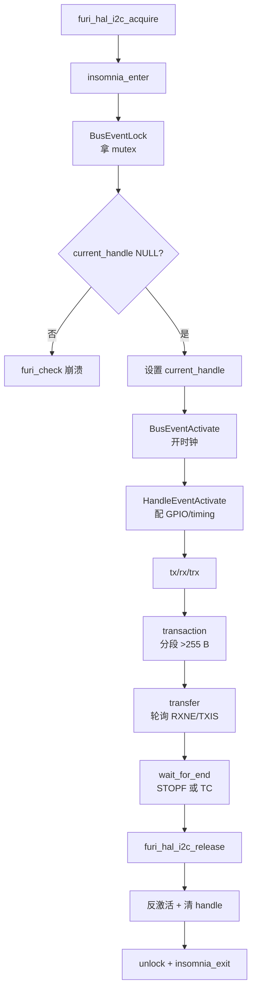

# furi_hal —— 硬件抽象层（以 GPIO / I2C 为主）

> 对应源文件：`targets/f7/furi_hal/furi_hal.c`（共 74 行）
> 主要实现：`targets/f7/furi_hal/furi_hal_gpio.c`（342 行）、
> `targets/f7/furi_hal/furi_hal_i2c.c`（419 行）、`furi_hal_i2c_config.c`（166 行）
> 声明头：`targets/furi_hal_include/furi_hal.h`（82 行）
> 引脚表：`targets/f7/furi_hal/furi_hal_resources.c`（308 行）
>
> **路径说明**：本仓库没有 `firmware/targets/`，HAL 实际位于
> `targets/f7/furi_hal/`（f7 平台实现）与 `targets/furi_hal_include/`
> （跨平台公共头文件）。本文按实际路径标注行号。

## 一句话职责

FuriHal 是 Furi 与 STM32WB55 寄存器之间的唯一薄层：向上提供与 RTOS 无关的
外设 API（GPIO/I2C/SPI/SD/USB/BLE…），向下用 STM32 LL 库操作寄存器，
并把“总线互斥、上电时序、低功耗唤醒”等硬件约束封装在内部。

---

## 1. 初始化：两段式

### 1.1 `furi_hal_init_early()`

```c
// targets/f7/furi_hal/furi_hal.c:9-21
void furi_hal_init_early(void) {
    furi_hal_cortex_init_early();
    furi_hal_clock_init_early();
    furi_hal_bus_init_early();
    furi_hal_dma_init_early();
    furi_hal_resources_init_early();
    furi_hal_os_init();
    furi_hal_spi_config_init_early();
    furi_hal_i2c_init_early();
    furi_hal_light_init();
    furi_hal_rtc_init_early();
    furi_hal_version_init();
}
```

运行条件：**调度器未启动、堆可用、不能阻塞**。因此这里只做寄存器级配置，
不创建线程/信号量。

### 1.2 `furi_hal_init()`

```c
// targets/f7/furi_hal/furi_hal.c:33-62（节选）
void furi_hal_init(void) {
    furi_hal_mpu_init();
    furi_hal_adc_init();
    furi_hal_clock_init();
    furi_hal_random_init();
    furi_hal_serial_control_init();
    furi_hal_rtc_init();
    furi_hal_interrupt_init();
    furi_hal_flash_init();
    furi_hal_resources_init();
    furi_hal_region_init();
    furi_hal_spi_config_init();
    furi_hal_spi_dma_init();
    furi_hal_ibutton_init();
    furi_hal_speaker_init();
    furi_hal_crypto_init();
    furi_hal_i2c_init();
    furi_hal_power_init();
    furi_hal_light_init();
    furi_hal_bt_init();
    furi_hal_memory_init();

#ifndef FURI_RAM_EXEC
    furi_hal_usb_init();
    furi_hal_vibro_init();
    furi_hal_subghz_init();
    furi_hal_nfc_init();
    furi_hal_rfid_init();
#endif
}
```

### 1.3 顺序依赖

顺序约束来自时钟/引脚/电源的依赖：`clock_init` 先于 `rtc/interrupt`，
`resources_init` 先于 `spi_config/i2c`，`power_init` 先于射频外设，
`bt_init` 先于 `memory_init`。

`furi_hal_memory_init()` 必须最后：它读 `FLASH->SRRVR` 判断 BLE 栈占用的
SRAM2 边界（`furi_hal_memory.c:35-60`），再建立线性 pool。



---

## 2. GPIO

### 2.1 数据结构

```c
// targets/f7/furi_hal/furi_hal_gpio.h:161-164
typedef struct {
    GPIO_TypeDef* port;
    uint16_t pin;
} GpioPin;
```

`GpioPin` 只有端口与引脚掩码；可读的名字在 `InputPin`
（`furi_hal_resources.h`）或 `GpioPin` 实例的变量名里。

### 2.2 模式枚举

`GpioMode`（`furi_hal_gpio.h:32-45`）共 12 种：输入、推挽/开漏输出、
推挽/开漏复用、模拟、上升/下降/双边中断、上升/下降/双边事件。
`GpioPull` 为 `No/Up/Down`，`GpioSpeed` 为 `Low/Medium/High/VeryHigh`
（`furi_hal_gpio.h:50-64`）。中断与事件的区别：中断进 ISR，事件只触发
EXTI 线而不进 ISR。

### 2.3 逐函数表

| 函数 | 行号 | 说明 |
|---|---|---|
| `furi_hal_gpio_init_simple` | gpio.c:58-60 | init + NoPull + LowSpeed |
| `furi_hal_gpio_init` | 62-72 | 禁止复用模式，转调 `init_ex` |
| `furi_hal_gpio_init_ex` | 74-194 | 完整配置：速度/上下拉/输出类型/复用/EXTI |
| `furi_hal_gpio_add_int_callback` | 196-211 | 注册回调 + 开 EXTI |
| `furi_hal_gpio_enable_int_callback` | 213-222 | 只开 EXTI |
| `furi_hal_gpio_disable_int_callback` | 224-234 | 关 EXTI + 清 flag |
| `furi_hal_gpio_remove_int_callback` | 236-250 | 关 EXTI + 清回调 |
| `furi_hal_gpio_int_call` | 252-256 | 查表调用回调 |
| `EXTI0..EXTI15_10_IRQHandler` | 259-342 | 清 flag + 调 `int_call(n)` |
| `furi_hal_gpio_write` | gpio.h:232-239 | 写 BSRR（原子） |
| `furi_hal_gpio_read` | gpio.h:262-268 | 读 IDR |

### 2.4 摘录：init_ex 的临界区

```c
// targets/f7/furi_hal/furi_hal_gpio.c:74-103（节选）
void furi_hal_gpio_init_ex(
    const GpioPin* gpio,
    const GpioMode mode,
    const GpioPull pull,
    const GpioSpeed speed,
    const GpioAltFn alt_fn) {
    const uint32_t sys_exti_port = GET_SYSCFG_EXTI_PORT(gpio->port);
    const uint32_t sys_exti_line = GET_SYSCFG_EXTI_LINE(gpio->pin);
    const uint32_t exti_line = GET_EXTI_LINE(gpio->pin);
    const uint32_t pwr_port = GET_PWR_PORT(gpio->port);
    const uint32_t pwr_pin = GET_PWR_PIN(gpio->pin);

    // Configure gpio with interrupts disabled
    FURI_CRITICAL_ENTER();

    // Set gpio speed
    switch(speed) {
    case GpioSpeedLow:
        LL_GPIO_SetPinSpeed(gpio->port, gpio->pin, LL_GPIO_SPEED_FREQ_LOW);
        break;
    case GpioSpeedMedium:
        LL_GPIO_SetPinSpeed(gpio->port, gpio->pin, LL_GPIO_SPEED_FREQ_MEDIUM);
        break;
    case GpioSpeedHigh:
        LL_GPIO_SetPinSpeed(gpio->port, gpio->pin, LL_GPIO_SPEED_FREQ_HIGH);
        break;
    case GpioSpeedVeryHigh:
        LL_GPIO_SetPinSpeed(gpio->port, gpio->pin, LL_GPIO_SPEED_FREQ_VERY_HIGH);
        break;
    }
```

整个配置在 `FURI_CRITICAL_ENTER/EXIT` 之间，因为改复用功能/上下拉时，
若中断在中间触发，可能读到瞬态电平或触发错误 EXTI。

上下拉同时写 `LL_PWR_*` 是有原因的：STM32WB 在 STOP2 下 GPIO 由 PWR 模块
维持，必须在 PWR 里也登记，否则休眠后上下拉丢失
（`furi_hal_gpio.c:106-120`）。

### 2.5 中断分发

```c
// targets/f7/furi_hal/furi_hal_gpio.c:259-264
void EXTI0_IRQHandler(void) {
    if(LL_EXTI_IsActiveFlag_0_31(LL_EXTI_LINE_0)) {
        LL_EXTI_ClearFlag_0_31(LL_EXTI_LINE_0);
        furi_hal_gpio_int_call(0);
    }
}
```

回调表是 `static volatile GpioInterrupt gpio_interrupt[GPIO_NUMBER]`
（`furi_hal_gpio.c:48`）。`furi_hal_gpio_int_call` 直接调用回调：

```c
// targets/f7/furi_hal/furi_hal_gpio.c:252-256
FURI_ALWAYS_INLINE static void furi_hal_gpio_int_call(uint16_t pin_num) {
    if(gpio_interrupt[pin_num].callback) {
        gpio_interrupt[pin_num].callback(gpio_interrupt[pin_num].context);
    }
}
```

**回调运行在 ISR 上下文**，只能做 `furi_thread_flags_set` / 队列
`FromISR` 等操作。`input` 服务就是把 `input_isr` 注册到这里，
ISR 里只置线程 flag（`input.c:53-56`）。

---

## 3. I2C

### 3.1 总线与句柄

```c
// targets/f7/furi_hal/furi_hal_i2c_types.h:24-37
struct FuriHalI2cBus {
    I2C_TypeDef* i2c;
    const FuriHalI2cBusHandle* current_handle;
    FuriHalI2cBusEventCallback callback;
};
...
struct FuriHalI2cBusHandle {
    FuriHalI2cBus* bus;
    FuriHalI2cBusHandleEventCallback callback;
};
```

Flipper 有两条 I2C：

| 总线 | 外设 | 用途 | 配置函数 |
|---|---|---|---|
| `furi_hal_i2c_bus_power` | I2C1 | 电源管理芯片 | `furi_hal_i2c_config.c:43-46` |
| `furi_hal_i2c_bus_external` | I2C3 | 外部扩展口 | `furi_hal_i2c_config.c:71-74` |

每条总线在 init 时创建一个 `FuriMutex`（`furi_hal_i2c_config.c:22-27` /
`50-55`），`FuriHalI2cBusEventLock/Unlock` 就是拿/放这把锁。

### 3.2 逐函数表

| 函数 | 行号 | 说明 |
|---|---|---|
| `furi_hal_i2c_init_early/deinit_early` | i2c.c:12-18 | 只处理 power bus |
| `furi_hal_i2c_init` | 20-23 | init external bus |
| `furi_hal_i2c_acquire` | 25-37 | insomnia + 总线锁 + 激活 |
| `furi_hal_i2c_release` | 39-51 | 反激活 + 解锁 + insomnia exit |
| `furi_hal_i2c_wait_for_idle/end` | 53-78 | 等 BUSY / STOPF / TC |
| `furi_hal_i2c_get_start/end_signal` | 80-109 | Start/Restart/Resume、Stop/Pause |
| `furi_hal_i2c_transfer` | 116-154 | 逐字节收发 + 超时 |
| `furi_hal_i2c_transaction` | 156-196 | 处理 >255 字节分段 |
| `furi_hal_i2c_rx_ext/tx_ext` | 198-230 | 支持 10 位地址 |
| `furi_hal_i2c_tx/rx/trx` | 232-282 | 7 位地址便捷封装 |
| `furi_hal_i2c_is_device_ready` | 284-317 | 发地址，看 NACK |
| `read_reg_8/16`、`read_mem` | 319-355 | 寄存器/内存读 |
| `write_reg_8/16`、`write_mem` | 357-419 | 寄存器/内存写 |

### 3.3 摘录：acquire 的四步

```c
// targets/f7/furi_hal/furi_hal_i2c.c:25-37
void furi_hal_i2c_acquire(const FuriHalI2cBusHandle* handle) {
    furi_hal_power_insomnia_enter();
    // Lock bus access
    handle->bus->callback(handle->bus, FuriHalI2cBusEventLock);
    // Ensure that no active handle set
    furi_check(handle->bus->current_handle == NULL);
    // Set current handle
    handle->bus->current_handle = handle;
    // Activate bus
    handle->bus->callback(handle->bus, FuriHalI2cBusEventActivate);
    // Activate handle
    handle->callback(handle, FuriHalI2cBusHandleEventActivate);
}
```

| 步骤 | 作用 |
|---|---|
| `insomnia_enter` | 阻止系统在传输中休眠 |
| `BusEventLock` | 拿总线 mutex（阻塞） |
| `current_handle` 检查 | 防重入；同一总线不能两个 handle |
| `BusEventActivate` | 开 I2C 外设时钟、设时钟源 |
| `HandleEventActivate` | 配 GPIO 复用、设 timing |

`release` 必须严格逆序（`i2c.c:39-51`），否则 `current_handle` 残留，
下次 acquire 会 `furi_check` 崩溃。

### 3.4 摘录：transfer 的字节循环

```c
// targets/f7/furi_hal/furi_hal_i2c.c:116-154
static bool furi_hal_i2c_transfer(
    I2C_TypeDef* i2c,
    uint8_t* data,
    uint32_t size,
    FuriHalI2cEnd end,
    bool read,
    FuriHalCortexTimer timer) {
    bool ret = true;

    while(size > 0) {
        bool should_stop = furi_hal_cortex_timer_is_expired(timer) ||
                           furi_hal_i2c_transfer_is_aborted(i2c);

        // Modifying the data pointer's data is UB if read is true
        if(read && LL_I2C_IsActiveFlag_RXNE(i2c)) {
            *data = LL_I2C_ReceiveData8(i2c);
            data++;
            size--;
        } else if(!read && LL_I2C_IsActiveFlag_TXIS(i2c)) {
            LL_I2C_TransmitData8(i2c, *data);
            data++;
            size--;
        }

        // Exit on timeout or premature stop, probably caused by a nacked address or byte
        if(should_stop) {
            ret = size == 0; // If the transfer was over, still a success
            break;
        }
    }

    if(ret) {
        ret = furi_hal_i2c_wait_for_end(i2c, end, timer);
    }

    LL_I2C_ClearFlag_STOP(i2c);

    return ret;
}
```

要点：

- 轮询 `RXNE/TXIS`，不用 DMA；I2C 速率低（100/400 kHz），轮询足够。
- 超时用 `FuriHalCortexTimer`（微秒计时），不是 RTOS tick；因此
  **可以在调度器未启动时使用**。
- 超时参数在 `rx_ext/tx_ext` 里乘 1000 后传给 timer（`i2c.c:209, 226`），
  所以公开 API 的 `timeout` 单位是**毫秒**。
- 超过 255 字节会分成多段，中间用 `FuriHalI2cEndPause` + `BeginResume`
  （`i2c.c:177-192`），因为 LL 的 `HandleTransfer` 长度字段是 8 位。

总线的 Lock/Unlock/Activate 行为不在 `i2c.c`，而在
`furi_hal_i2c_config.c:22-74` 的两个 event callback 里：Lock 拿
`FuriMutex`，Activate 开 `FuriHalBusI2C1/I2C3` 并设时钟源，Deactivate 关时钟。

### 3.6 I2C 执行流



### 3.7 数据流要点

数据路径是“应用 → `tx/rx` → `transaction`（>255 B 分段）→ `transfer`
（轮询 RXNE/TXIS）→ I2C 数据寄存器 → SCL/SDA”；`timeout` 从毫秒乘 1000
转成 `FuriHalCortexTimer` 的微秒。

---

## 4. 陷阱与读码建议

| 陷阱 | 现象 | 根因 | 处理 |
|---|---|---|---|
| acquire/release 不配对 | 下次 acquire `furi_check` 崩溃 | `current_handle` 残留 | 严格成对，异常路径也 release |
| 在 ISR 里 I2C | 崩溃/死锁 | acquire 会拿 mutex | 只在 Bly 线程上下文用 |
| 超时单位当成 tick | 超时过早/过晚 | API 是毫秒，内部转微秒 | 看 `timeout * 1000` |
| 以为 GPIO 回调在普通线程 | 调阻塞 API 崩溃 | 回调在 EXTI ISR | 只发 flag/队列 |

读码建议：先读 `furi_hal.h` 的 include 列表掌握覆盖面，再按 `furi_hal.c`
的顺序读；GPIO 重点看 `init_ex` 的 switch 与 EXTI 分发，I2C 重点看
`acquire/release` 的两层状态与 `transfer` 的轮询循环。所有 `furi_check`
都是硬件使用契约，崩溃字符串就是线索。

> 相关文档：[00-总览与架构.md](../../../references/firmware/flipperzero-firmware/Docs/00-总览与架构.md)、
> [01-启动流程与初始化.md](../../../references/firmware/flipperzero-firmware/Docs/01-启动流程与初始化.md)、
> [06-存储与文件系统.md](../../../references/firmware/flipperzero-firmware/Docs/06-存储与文件系统.md)
