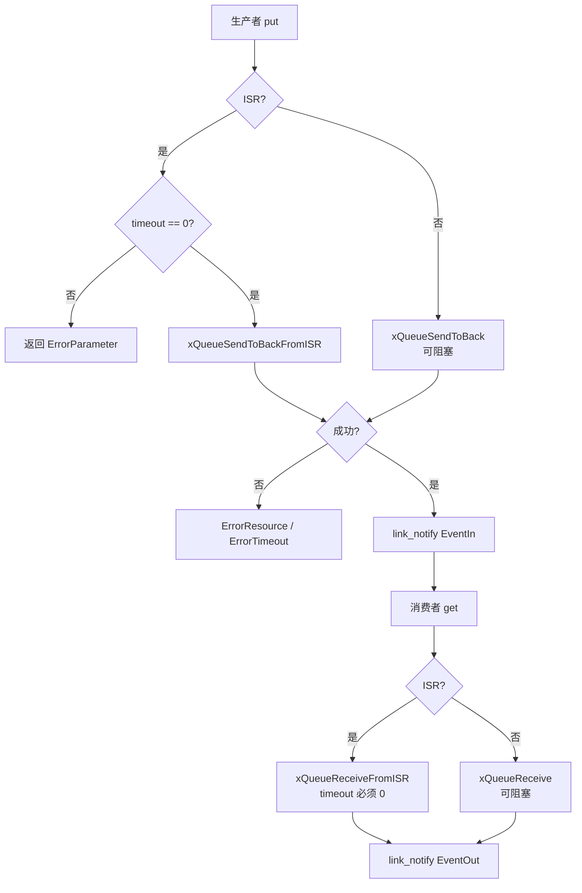
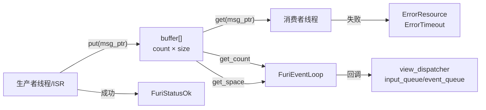

# furi_message_queue —— Furi 消息队列

> 对应源文件：`furi/core/message_queue.c`（共 233 行）
> 配套头文件：`furi/core/message_queue.h`（93 行）
> 关联：`furi/core/kernel.c`（上下文判定）、`furi/core/event_loop.c`（订阅）

## 一句话职责

把 FreeRTOS 的 `StaticQueue_t` 包装成“**一次 malloc 完成结构体+消息缓冲区**”
的 `FuriMessageQueue`，并在 ISR/线程两条路径上统一错误码，同时把
“可读/可写”电平暴露给 `FuriEventLoop`。

---

## 1. 核心结构

```c
// furi/core/message_queue.c:16-25
struct FuriMessageQueue {
    StaticQueue_t container;
    FuriEventLoopLink event_loop_link;
    uint8_t buffer[];
};

// IMPORTANT: container MUST be the FIRST struct member
static_assert(offsetof(FuriMessageQueue, container) == 0);
// IMPORTANT: buffer MUST be the LAST struct member
static_assert(offsetof(FuriMessageQueue, buffer) == sizeof(FuriMessageQueue));
```

| 字段 | 类型 | 行号 | 含义 |
|---|---|---|---|
| `container` | `StaticQueue_t` | 17 | FreeRTOS 队列控制块，必须首成员 |
| `event_loop_link` | `FuriEventLoopLink` | 18 | event loop 订阅链表节点 |
| `buffer` | `uint8_t[]` | 19 | 柔性数组，消息体紧跟结构体 |

两条断言的含义：

- 首成员 → `FuriMessageQueue*` 可强转 `QueueHandle_t`；
- 尾成员 → 一次 `malloc(sizeof + count*size)` 就能同时放结构体与消息体。

### 1.1 内存量化

| 部分 | 大小 | 说明 |
|---|---|---|
| `StaticQueue_t` | 约 80 B（Cortex-M4 配置） | FreeRTOS 内部字段 |
| `FuriEventLoopLink` | 2 个指针 + 标志 | 约 12~16 B |
| `buffer[]` | `msg_count × msg_size` | 消息体 |
| 总分配 | `sizeof(FuriMessageQueue) + count*size` | 单次 `malloc` |

例：8 条 `InputEvent`（`sizeof=8`）= 约 96 + 64 = **160 B**。

---

## 2. 逐函数表

| 函数 | 行号 | 关键行为 |
|---|---|---|
| `furi_message_queue_alloc` | 27-43 | 校验非 ISR、count/size > 0；一次 malloc；`xQueueCreateStatic` |
| `furi_message_queue_free` | 45-55 | 断言 event loop 已断开；`vQueueDelete` + `free` |
| `furi_message_queue_put` | 57-99 | ISR 路径要求 `timeout=0`；成功则通知 `EventIn` |
| `furi_message_queue_get` | 101-141 | ISR 路径要求 `timeout=0`；成功则通知 `EventOut` |
| `get_capacity` | 143-147 | 读 `container.uxLength` |
| `get_message_size` | 149-153 | 读 `container.uxItemSize` |
| `get_count` | 155-168 | ISR 用 `uxQueueMessagesWaitingFromISR` |
| `get_space` | 170-187 | ISR 用临界区直接算 `length - waiting` |
| `reset` | 189-208 | 清空队列；通知 `EventOut` |
| `event_loop_get_link` | 210-214 | 返回内嵌 link |
| `event_loop_get_level` | 216-228 | In=消息数，Out=剩余空间 |
| `furi_message_queue_event_loop_contract` | 230-233 | 导出契约结构 |

### 2.1 错误码映射

| 情况 | 非 ISR | ISR |
|---|---|---|
| 消息指针 NULL | `ErrorParameter` | `ErrorParameter` |
| timeout 非 0 | 正常阻塞 | `ErrorParameter` |
| 队列满（put） | timeout=0 → `ErrorResource`；>0 → `ErrorTimeout` | `ErrorResource` |
| 队列空（get） | timeout=0 → `ErrorResource`；>0 → `ErrorTimeout` | `ErrorResource` |
| 在 ISR 调 `reset` | — | `ErrorISR` |

---

## 3. 逐字摘录

### 3.1 一次性分配

```c
// furi/core/message_queue.c:27-43
FuriMessageQueue* furi_message_queue_alloc(uint32_t msg_count, uint32_t msg_size) {
    furi_check((furi_kernel_is_irq_or_masked() == 0U) && (msg_count > 0U) && (msg_size > 0U));

    FuriMessageQueue* instance = malloc(sizeof(FuriMessageQueue) + msg_count * msg_size);

    // 3 things happens here:
    // - create queue
    // - check results
    // - ensure that queue container is first in FuriMessageQueue structure
    //
    // As a bonus it guarantees that FuriMessageQueue* can be casted into StaticQueue_t* or QueueHandle_t.
    furi_check(
        xQueueCreateStatic(msg_count, msg_size, instance->buffer, &instance->container) ==
        (void*)instance);

    return instance;
}
```

注意 `xQueueCreateStatic` 的返回值必须是 `(void*)instance`。FreeRTOS 返回
`&instance->container`，只有首成员假设成立时才相等。

### 3.2 put 的双路径

```c
// furi/core/message_queue.c:57-99（保留全部分支）
FuriStatus
    furi_message_queue_put(FuriMessageQueue* instance, const void* msg_ptr, uint32_t timeout) {
    furi_check(instance);

    QueueHandle_t hQueue = (QueueHandle_t)instance;
    FuriStatus stat;
    BaseType_t yield;

    stat = FuriStatusOk;

    if(furi_kernel_is_irq_or_masked() != 0U) {
        if((msg_ptr == NULL) || (timeout != 0U)) {
            stat = FuriStatusErrorParameter;
        } else {
            yield = pdFALSE;

            if(xQueueSendToBackFromISR(hQueue, msg_ptr, &yield) != pdTRUE) {
                stat = FuriStatusErrorResource;
            } else {
                portYIELD_FROM_ISR(yield);
            }
        }
    } else {
        if(msg_ptr == NULL) {
            stat = FuriStatusErrorParameter;
        } else {
            if(xQueueSendToBack(hQueue, msg_ptr, (TickType_t)timeout) != pdPASS) {
                if(timeout != 0U) {
                    stat = FuriStatusErrorTimeout;
                } else {
                    stat = FuriStatusErrorResource;
                }
            }
        }
    }

    if(stat == FuriStatusOk) {
        furi_event_loop_link_notify(&instance->event_loop_link, FuriEventLoopEventIn);
    }

    /* Return execution status */
    return stat;
}
```

ISR 分支里有 `portYIELD_FROM_ISR(yield)`：如果入队唤醒了更高优先级任务，
ISR 返回后立刻切换，而不是等下一个 tick。

### 3.3 剩余空间：ISR 直接读私有字段

```c
// furi/core/message_queue.c:170-187
uint32_t furi_message_queue_get_space(FuriMessageQueue* instance) {
    furi_check(instance);

    uint32_t space;
    uint32_t isrm;

    if(furi_kernel_is_irq_or_masked() != 0U) {
        isrm = taskENTER_CRITICAL_FROM_ISR();

        space = instance->container.uxLength - instance->container.uxMessagesWaiting;

        taskEXIT_CRITICAL_FROM_ISR(isrm);
    } else {
        space = (uint32_t)uxQueueSpacesAvailable((QueueHandle_t)instance);
    }

    return space;
}
```

`uxLength` / `uxMessagesWaiting` 不是公开 API，Furi 用宏改名访问
（`message_queue.c:11-14`）：

```c
// Internal FreeRTOS member names
#define uxMessagesWaiting uxDummy4[0]
#define uxLength          uxDummy4[1]
#define uxItemSize        uxDummy4[2]
```

**升级 FreeRTOS 时必须重新核对 `uxDummy4` 布局**，否则容量查询返回垃圾。

---

## 4. 与 event loop 的契约

```c
// furi/core/message_queue.c:230-233
const FuriEventLoopContract furi_message_queue_event_loop_contract = {
    .get_link = furi_message_queue_event_loop_get_link,
    .get_level = furi_message_queue_event_loop_get_level,
};
```

| 事件 | `get_level` 返回 | 含义 |
|---|---|---|
| `FuriEventLoopEventIn` | `furi_message_queue_get_count()` | >0 表示可读 |
| `FuriEventLoopEventOut` | `furi_message_queue_get_space()` | >0 表示可写 |

`view_dispatcher` 就是这样把两个队列接入 event loop 的
（`view_dispatcher.c:39-53`），从而不需要单独的轮询线程。

---

## 5. 执行流



## 6. 数据流



---

## 7. 陷阱与读码建议

| 陷阱 | 现象 | 根因 | 处理 |
|---|---|---|---|
| ISR 里传 timeout | `ErrorParameter` | FromISR 不能阻塞 | timeout 固定 0 |
| 结构体拷贝含指针 | 悬空指针 | 队列只复制值 | 传值或传所有权明确的结构 |
| 消息很大 | 内存浪费 | 每条消息占 `size` | 传指针 + 单独缓冲 |
| 在 ISR 里 `get` 后立即用 | 数据竞争 | 出队后仍共享 | 值拷贝 |
| free 时还有订阅 | `furi_check` 崩溃 | event loop link 未断开 | 先 `unsubscribe` |
| 升级 FreeRTOS | 容量查询错误 | `uxDummy4` 布局变化 | 同步改宏 |
| 把队列当“事件标志” | 多次覆盖丢失 | 队列是值语义 | 用 `FuriEventFlag` 做位状态 |

读码建议：

1. `message_queue.c` 只有 233 行，建议全文读；重点对比 put/get 的 ISR 分支。
2. 把 `furi_kernel_is_irq_or_masked()` 当作“路径选择器”，看到它就分叉阅读。
3. `event_loop_link_notify` 在成功路径末尾，理解“队列同时也是 event loop 对象”。
4. 容量查询的宏是版本耦合点，升级内核时用 `grep uxDummy4` 全局检查。

> 相关文档：[02-Furi 内核精读.md](../../../references/firmware/flipperzero-firmware/Docs/02-Furi 内核精读.md)、
> [06-存储与文件系统.md](../../../references/firmware/flipperzero-firmware/Docs/06-存储与文件系统.md)
