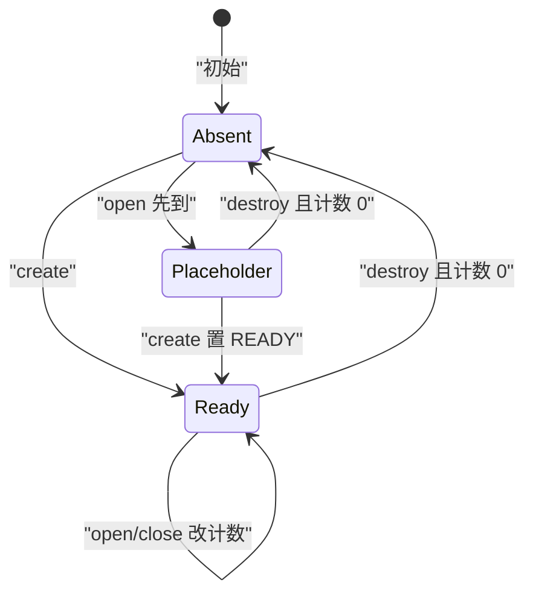
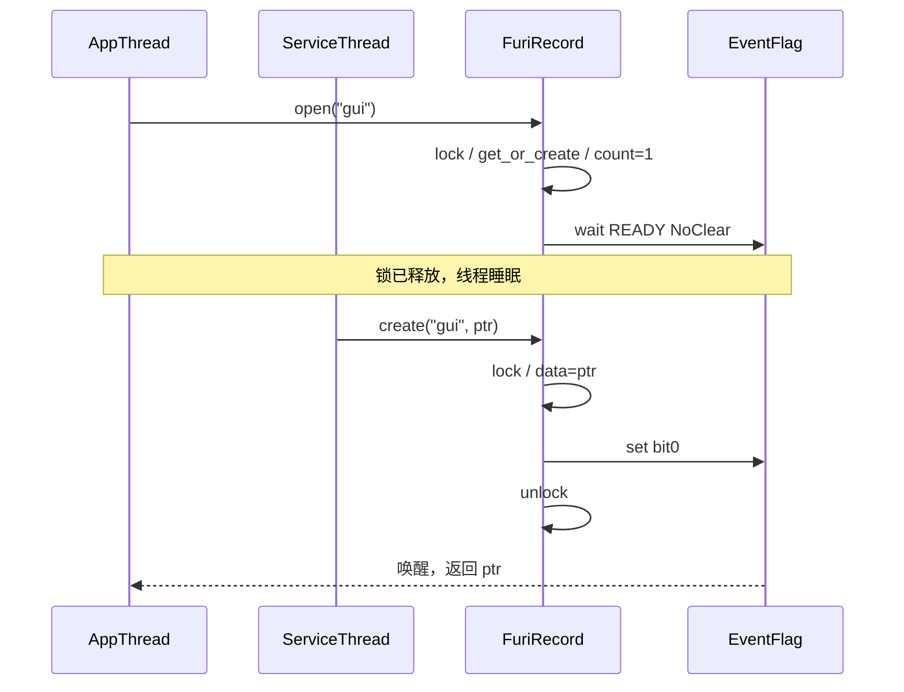

# furi_record —— Furi 记录（服务定位器）

> 对应源文件：`furi/core/record.c`（共 158 行）
> 配套头文件：`furi/core/record.h`（67 行）
> 关联：`furi/core/event_flag.c`（READY 位）、`furi/core/mutex.c`（字典锁）、
> `applications/services/*/application.fam`（服务注册）

## 一句话职责

用“字符串名 → `void*` 数据”的字典 + 每个条目一个 event flag，
实现**线程安全的服务定位器**：`open` 会阻塞到服务 `create` 完成，
`close` 维护持有者计数，`destroy` 只在无人持有时生效。

---

## 1. 核心结构

```c
// furi/core/record.c:18-33
#define FURI_RECORD_FLAG_READY (0x1)

typedef struct {
    FuriEventFlag* flags;
    void* data;
    size_t holders_count;
} FuriRecordData;

DICT_DEF2(FuriRecordDataDict, const char*, M_CSTR_DUP_OPLIST, FuriRecordData, M_POD_OPLIST)

typedef struct {
    FuriMutex* mutex;
    FuriRecordDataDict_t records;
} FuriRecord;

static FuriRecord* furi_record = NULL;
```

| 结构 | 字段 | 行号 | 含义 |
|---|---|---|---|
| `FuriRecordData` | `flags` | 21 | 每 record 一个 event flag |
| `FuriRecordData` | `data` | 22 | 服务对象指针，`NULL` 表示占位未就绪 |
| `FuriRecordData` | `holders_count` | 23 | open 未 close 的计数 |
| `FuriRecord` | `mutex` | 29 | 保护整个字典（Normal 类型） |
| `FuriRecord` | `records` | 30 | `const char* → FuriRecordData` |
| 全局 | `furi_record` | 33 | 单例，`furi_record_init` 分配 |

字典的 key 用 `M_CSTR_DUP_OPLIST`，即**深拷贝字符串**。调用方可以传栈上
临时字符串；字典自己保存一份。

---

## 2. 逐函数表

| 函数 | 行号 | 作用 | 锁 |
|---|---|---|---|
| `furi_record_get` | 35-37 | 按名查 `FuriRecordData*` | 调用者保证 |
| `furi_record_put` | 39-41 | 写入/覆盖字典项 | 调用者保证 |
| `furi_record_erase` | 43-46 | 释放 flag + 删字典项 | 调用者保证 |
| `furi_record_init` | 48-52 | 分配单例、创建 mutex、初始化字典 | 无（调度器未启动） |
| `furi_record_data_get_or_create` | 54-66 | 不存在则建占位项（flag + data=NULL + count=0） | 调用者保证 |
| `furi_record_lock` | 68-70 | 拿字典锁，`FuriWaitForever` | — |
| `furi_record_unlock` | 72-74 | 放锁 | — |
| `furi_record_exists` | 76-87 | 查名字是否存在 | 有 |
| `furi_record_create` | 89-103 | 写 data + 置 READY | 有 |
| `furi_record_destroy` | 105-123 | 计数为 0 才删除，返回是否成功 | 有 |
| `furi_record_open` | 125-145 | 计数 +1，等 READY，返回 data | 有（等待在锁外） |
| `furi_record_close` | 147-158 | 计数 -1 | 有 |

---

## 3. 逐字摘录

### 3.1 创建：先写 data 再置 ready

```c
// furi/core/record.c:89-103
void furi_record_create(const char* name, void* data) {
    furi_check(furi_record);
    furi_check(name);
    furi_check(data);

    furi_record_lock();

    // Get record data and fill it
    FuriRecordData* record_data = furi_record_data_get_or_create(name);
    furi_check(record_data->data == NULL);
    record_data->data = data;
    furi_event_flag_set(record_data->flags, FURI_RECORD_FLAG_READY);

    furi_record_unlock();
}
```

要点：

- `furi_check(record_data->data == NULL)`：同名重复 create 直接崩溃。
- 写 `data` 与 set flag 都在锁内；等待者在 flag 上被唤醒时，data 一定可见。
- 不检查 `name` 长度，也不做命名空间校验——命名约定靠 `RECORD_*` 宏。

### 3.2 打开：占位 + 锁外等待

```c
// furi/core/record.c:125-145
void* furi_record_open(const char* name) {
    furi_check(furi_record);
    furi_check(name);

    furi_record_lock();

    FuriRecordData* record_data = furi_record_data_get_or_create(name);
    record_data->holders_count++;

    furi_record_unlock();

    // Wait for record to become ready
    furi_check(
        furi_event_flag_wait(
            record_data->flags,
            FURI_RECORD_FLAG_READY,
            FuriFlagWaitAny | FuriFlagNoClear,
            FuriWaitForever) == FURI_RECORD_FLAG_READY);

    return record_data->data;
}
```

四个关键决策：

| 决策 | 原因 |
|---|---|
| 先 `holders_count++` | 防止等待期间被 destroy |
| 锁外 `event_flag_wait` | 否则 create 永远拿不到锁 |
| `FuriFlagNoClear` | READY 永不清，多个等待者都能立即返回 |
| `FuriWaitForever` | 没有超时；名字错就永久挂起 |

`FuriWaitForever` 是双刃剑：它让“服务还没启动”变成透明等待，也让
“拼错名字”变成无法诊断的黑屏。调试时用 GDB 看栈，若停在
`xEventGroupWaitBits`，往上找 `furi_record_open` 的字符串参数。

### 3.3 销毁：计数为 0 才生效

```c
// furi/core/record.c:105-123
bool furi_record_destroy(const char* name) {
    furi_check(furi_record);
    furi_check(name);

    bool ret = false;

    furi_record_lock();

    FuriRecordData* record_data = furi_record_get(name);
    furi_check(record_data);
    if(record_data->holders_count == 0) {
        furi_record_erase(name, record_data);
        ret = true;
    }

    furi_record_unlock();

    return ret;
}
```

`furi_record_erase()` 只释放 event flag 与字典项，**不 free `data`**。
`data` 的所有权始终在创建者（服务）手里。

---

## 4. 生命周期



| 场景 | 结果 |
|---|---|
| open 一个从未 create 的名字 | 建占位项并永久阻塞 |
| create 一个已存在的名字 | `furi_check` 崩溃 |
| destroy 时有 holder | 返回 `false`，record 保留 |
| close 次数 > open 次数 | `holders_count` 下溢，destroy 永远失败 |
| open/close 跨线程 | 计数正确，但违反 API 注释的所有权约定 |

---

## 5. 时序：两个线程竞争



---

## 6. 陷阱与读码建议

| 陷阱 | 现象 | 根因 | 处理 |
|---|---|---|---|
| 名字拼错 | 永久阻塞 | `FuriWaitForever` | 使用 `RECORD_*` 宏 |
| 重复 create | 崩溃 | `data == NULL` 断言 | 服务只创建一次 |
| 未 open 就 close | 计数下溢 | 无保护 | 严格配对 |
| ISR 里 open | 崩溃 | 会阻塞 | ISR 只发事件 |
| destroy 后继续用 | use-after-free | destroy 不 free data，但注册项没了 | 确认无 holder |
| 以为 destroy 会释放 data | 内存泄漏 | 只删注册项 | 服务自己 free |
| 跨 FAP 传 data 内部指针 | 非法访问 | FAP 独立地址空间 | 只传 API 句柄 |

读码建议：

1. 全文只有 158 行，建议逐行读；重点是三处锁边界。
2. 把 `furi_record_open` 的“计数在锁内、等待在锁外”画出来，就理解了整个设计。
3. 对照 `record.h` 的注释：`Create and destroy must be executed from the same thread`
   是 API 契约。
4. 调试启动卡死时，先查 record 名，再查服务是否被裁剪（`.fam` 的 `apptype`）。

> 相关文档：[03-服务与记录模型.md](../../../references/firmware/flipperzero-firmware/Docs/03-服务与记录模型.md)、
> [00-总览与架构.md](../../../references/firmware/flipperzero-firmware/Docs/00-总览与架构.md)
