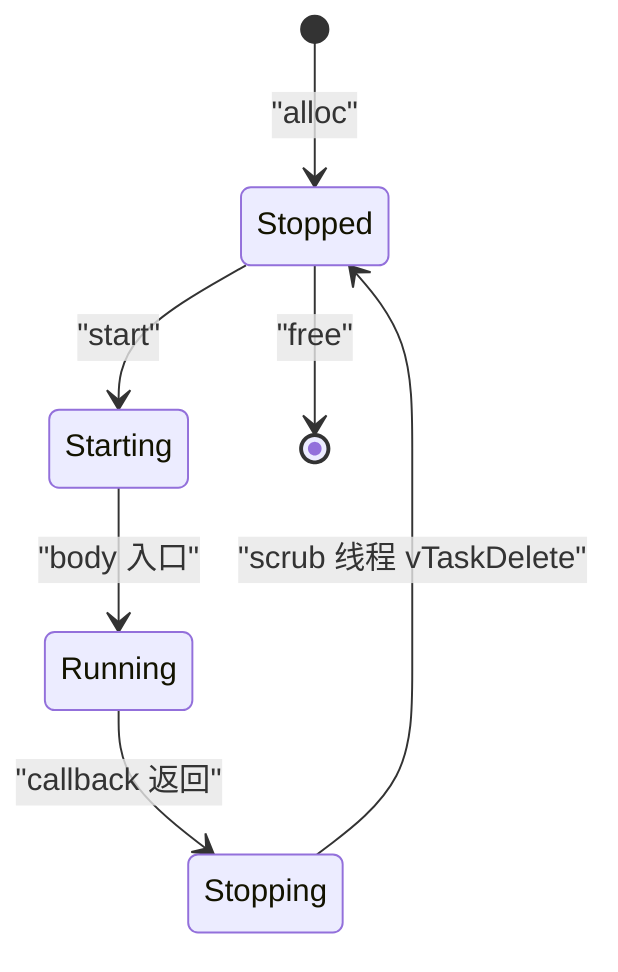
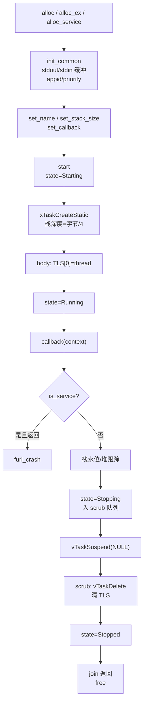

# furi_thread —— Furi 线程封装（FreeRTOS Task）

> 对应源文件：`furi/core/thread.c`（共 891 行）
> 配套头文件：`furi/core/thread.h`（575 行）、`furi/core/thread_i.h`
> 关联：`furi/core/thread_list.c`（线程枚举辅助）、`FreeRTOSConfig.h`

## 一句话职责

把 FreeRTOS 的 `TaskHandle_t` 包装成带**生命周期状态机、状态回调、信号回调、
appid、stdout/stdin 缓冲**的 C 对象，并提供“退出后由专用线程统一回收”的
确定性销毁路径。

---

## 1. 核心结构

`struct FuriThread` 定义在 `thread.c:51-82`（公开头文件只给前置声明）：

| 字段 | 类型 | 行号 | 含义 | 写入者 |
|---|---|---|---|---|
| `container` | `StaticTask_t` | 52 | FreeRTOS TCB，**必须是首成员** | `xTaskCreateStatic` |
| `stack_buffer` | `StackType_t*` | 53 | 栈底指针 | `alloc` / `set_stack_size` |
| `state` | `volatile FuriThreadState` | 55 | 四态状态机 | `furi_thread_set_state` |
| `ret` | `int32_t` | 56 | 回调返回值 | `furi_thread_body` |
| `callback` | `FuriThreadCallback` | 58 | 线程体 | `set_callback` |
| `context` | `void*` | 59 | 回调参数 | `set_context` |
| `state_callback` | `FuriThreadStateCallback` | 61 | 状态变化通知 | `set_state_callback` |
| `state_context` | `void*` | 62 | 状态回调参数 | `set_state_context` |
| `signal_callback` | `FuriThreadSignalCallback` | 64 | 跨线程信号处理 | `set_signal_callback` |
| `signal_context` | `void*` | 65 | 信号回调参数 | 同上 |
| `name` | `char*` | 67 | 线程名（`strdup`） | `set_name` |
| `appid` | `char*` | 68 | 归属应用 ID | `set_appid` |
| `priority` | `FuriThreadPriority` | 70 | 创建优先级 | `set_priority` |
| `stack_size` | `size_t` | 72 | **字节数** | `set_stack_size` |
| `heap_size` | `size_t` | 73 | 退出时堆分配余额 | `furi_thread_body` |
| `output` | `FuriThreadStdout` | 75 | stdout 回调 + FuriString 缓冲 | `stdout_*` |
| `input` | `FuriThreadStdin` | 76 | stdin 回调 + 回推缓冲 | `stdin_*` |
| `is_service` | `bool` | 80 | 服务线程标记 | `alloc_service` |
| `heap_trace_enabled` | `bool` | 81 | 堆跟踪开关 | RTC 模式 / API |

两个辅助结构：

```c
// furi/core/thread.c:39-49
typedef struct {
    FuriThreadStdoutWriteCallback write_callback;
    FuriString* buffer;
    void* context;
} FuriThreadStdout;

typedef struct {
    FuriThreadStdinReadCallback read_callback;
    FuriString* unread_buffer; // <! stores data from `ungetc` and friends
    void* context;
} FuriThreadStdin;
```

**首成员断言**（`thread.c:84-85`）：

```c
// IMPORTANT: container MUST be the FIRST struct member
static_assert(offsetof(FuriThread, container) == 0);
```

它保证 `(TaskHandle_t)thread == &thread->container`，从而
`furi_thread_get_id()` 可以直接把 `FuriThread*` 强转成 `FuriThreadId`。

---

## 2. 状态机

状态枚举（`thread.h:24-28`）：

| 状态 | 含义 | 由谁设置 | 时机 |
|---|---|---|---|
| `Stopped` | 可安全释放 | scrub 线程 | `vTaskDelete` 之后 |
| `Stopping` | 正在退出 | 子线程 | 回调返回、入 scrub 队列前 |
| `Starting` | 即将运行 | 父线程 | `furi_thread_start` |
| `Running` | 正在运行 | 子线程 | `furi_thread_body` 开头 |



`furi_thread_set_state()` 是唯一的状态写入口，并负责触发回调
（`thread.c:104-110`）：

```c
static void furi_thread_set_state(FuriThread* thread, FuriThreadState state) {
    furi_assert(thread);
    thread->state = state;
    if(thread->state_callback) {
        thread->state_callback(thread, state, thread->state_context);
    }
}
```

---

## 3. 逐函数表

### 3.1 创建与销毁

| 函数 | 行号 | 行为 | 栈来源 |
|---|---|---|---|
| `furi_thread_alloc` | 224-230 | `malloc` 结构体 + 公共初始化 | 由 `set_stack_size` 后分配 |
| `furi_thread_alloc_service` | 232-250 | 结构体与栈都来自 `memmgr_alloc_from_pool` | SRAM2 pool |
| `furi_thread_alloc_ex` | 252-263 | `alloc` + name/stack/callback/context | `malloc` |
| `furi_thread_free` | 265-282 | 断言非服务、已停止；释放 name/appid/栈/缓冲 | — |
| `furi_thread_init` | 199-201 | 创建 8 深度 scrub 队列 | — |
| `furi_thread_scrub` | 203-222 | 永久循环：`vTaskDelete` + 清 TLS + 置 `Stopped` | — |

### 3.2 配置（全部要求 `Stopped` 状态）

| 函数 | 行号 | 约束 |
|---|---|---|
| `set_name` | 284-293 | `state == Stopped` |
| `set_appid` | 295-304 | `state == Stopped` |
| `set_stack_size` | 306-321 | 非 0、≤ 262140 B、4 字节对齐、非服务线程 |
| `set_callback` | 323-327 | `state == Stopped` |
| `set_context` | 329-333 | `state == Stopped` |
| `set_priority` | 335-340 | `priority <= Isr(31)` |
| `set_state_callback` | 357-361 | `state == Stopped` |
| `set_state_context` | 363-367 | `state == Stopped` |
| `set_signal_callback` | 374-383 | `Stopped` 或当前线程自己 |
| `enable/disable_heap_trace` | 447-457 | `state == Stopped` |

### 3.3 运行与同步

| 函数 | 行号 | 说明 |
|---|---|---|
| `furi_thread_start` | 403-422 | `xTaskCreateStatic`，栈深度 = 字节/4 |
| `furi_thread_join` | 424-440 | 忙等 `state == Stopped`，粒度 2 tick |
| `furi_thread_get_current` | 475-478 | 读 TLS 槽 0 |
| `furi_thread_get_current_id` | 471-473 | `xTaskGetCurrentTaskHandle` |
| `furi_thread_get_id` | 442-445 | 强转 |
| `furi_thread_signal` | 391-401 | 调 `signal_callback`，返回是否消费 |
| `furi_thread_suspend/resume` | 865-883 | ISR 里用 `xTaskResumeFromISR` |
| `furi_thread_is_suspended` | 885-891 | `eTaskGetState == eSuspended` |

### 3.4 线程 flag（Task Notification index 1）

| 函数 | 行号 | 关键行为 |
|---|---|---|
| `furi_thread_flags_set` | 492-520 | ISR/非 ISR 双路径；`eSetBits`；通知 event loop |
| `furi_thread_flags_clear` | 522-549 | 先读后写；`eSetValueWithOverwrite` |
| `furi_thread_flags_get` | 551-567 | 查询当前值 |
| `furi_thread_flags_wait` | 569-637 | 支持 `WaitAny`/`WaitAll`、`NoClear`、超时补偿 |

### 3.5 调试与枚举

| 函数 | 行号 | 说明 |
|---|---|---|
| `furi_thread_enumerate` | 658-705 | 挂起调度器，遍历所有 TCB，填 `FuriThreadList` |
| `furi_thread_get_name` | 707-718 | ISR 返回 NULL |
| `furi_thread_get_appid` | 720-732 | TLS 取不到时返回 `"system"` |
| `furi_thread_get_stack_space` | 734-745 | 高水位 × 4（字节） |
| `furi_thread_get_return_code` | 465-469 | 要求 `Stopped` |

### 3.6 stdout / stdin

| 函数 | 行号 | 说明 |
|---|---|---|
| `furi_thread_stdout_write` | 808-831 | 遇 `\n` 立即 flush，否则入缓冲 |
| `furi_thread_stdout_flush` | 833-838 | 冲缓冲 |
| `furi_thread_stdin_read` | 840-852 | 先取回推缓冲，再读回调 |
| `furi_thread_stdin_unread` | 854-863 | 把数据塞回 unread 缓冲头部 |
| `set/get_stdout_callback` | 775-799 | 切换当前线程输出目标 |

---

## 4. 逐字摘录

### 4.1 线程体：TLS 与退出路径

```c
// furi/core/thread.c:112-166（节选，保留状态转换与退出）
static void furi_thread_body(void* context) {
    furi_check(context);
    FuriThread* thread = context;

    // store thread instance to thread local storage
    furi_check(pvTaskGetThreadLocalStoragePointer(NULL, 0) == NULL);
    vTaskSetThreadLocalStoragePointer(NULL, 0, thread);

    furi_check(thread->state == FuriThreadStateStarting);
    furi_thread_set_state(thread, FuriThreadStateRunning);

    if(thread->heap_trace_enabled == true) {
        memmgr_heap_enable_thread_trace((FuriThreadId)thread);
    }

    thread->ret = thread->callback(thread->context);

    furi_check(!thread->is_service, "Service threads MUST NOT return");

    size_t stack_watermark = furi_thread_get_stack_space(thread);
    if(stack_watermark < THREAD_STACK_WATERMARK_MIN) {
#ifdef FURI_DEBUG
        furi_crash("Stack watermark is dangerously low");
#endif
        FURI_LOG_E( //-V779
            thread->name ? thread->name : "Thread",
            "Stack watermark is too low %zu < " STRINGIFY(
                THREAD_STACK_WATERMARK_MIN) ". Increase stack size.",
            stack_watermark);
    }

    if(thread->heap_trace_enabled == true) {
        furi_delay_ms(33);
        thread->heap_size = memmgr_heap_get_thread_memory((FuriThreadId)thread);
        furi_log_print_format(
            thread->heap_size ? FuriLogLevelError : FuriLogLevelInfo,
            TAG,
            "%s allocation balance: %zu",
            thread->name ? thread->name : "Thread",
            thread->heap_size);
        memmgr_heap_disable_thread_trace((FuriThreadId)thread);
    }

    furi_check(thread->state == FuriThreadStateRunning);

    // flush stdout
    __furi_thread_stdout_flush(thread);

    furi_thread_set_state(thread, FuriThreadStateStopping);

    furi_message_queue_put(furi_thread_scrub_message_queue, &thread, FuriWaitForever);

    vTaskSuspend(NULL);
    furi_thread_catch();
}
```

逐行要点：

- `pvTaskGetThreadLocalStoragePointer(NULL, 0)` 的断言要求 TLS 槽 0 为空；
  如果非空，说明同一任务被启动了两次。
- `furi_check(!thread->is_service)` 在 release 也生效；服务线程 `return`
  必崩。
- 栈水位检查在**回调返回后**做，所以服务线程（永不返回）永远不会触发。
- `furi_delay_ms(33)` 是等 FreeRTOS 的堆跟踪延迟统计收敛。
- 入队后 `vTaskSuspend(NULL)`，把“删除”交给 scrub 线程。

### 4.2 启动：静态创建

```c
// furi/core/thread.c:403-422
void furi_thread_start(FuriThread* thread) {
    furi_check(thread);
    furi_check(thread->callback);
    furi_check(thread->state == FuriThreadStateStopped);
    furi_check(thread->stack_size > 0);

    furi_thread_set_state(thread, FuriThreadStateStarting);

    uint32_t stack_depth = thread->stack_size / sizeof(StackType_t);

    furi_check(
        xTaskCreateStatic(
            furi_thread_body,
            thread->name,
            stack_depth,
            thread,
            thread->priority,
            thread->stack_buffer,
            &thread->container) == (TaskHandle_t)thread);
}
```

`stack_depth` 是 **word** 数：`stack_size / 4`。返回值必须等于
`(TaskHandle_t)thread`，否则说明 `container` 不是首成员（结构体被改动）。

### 4.3 线程 flag 的位限制

```c
// furi/core/thread.c:486-490
#define MAX_BITS_TASK_NOTIFY  31U
#define MAX_BITS_EVENT_GROUPS 24U

#define THREAD_FLAGS_INVALID_BITS (~((1UL << MAX_BITS_TASK_NOTIFY) - 1U))
#define EVENT_FLAGS_INVALID_BITS  (~((1UL << MAX_BITS_EVENT_GROUPS) - 1U))
```

`THREAD_FLAGS_INVALID_BITS` 是“bit31 及以上”的掩码。`flags_set` 在入口
`(flags & THREAD_FLAGS_INVALID_BITS) != 0` 就返回 `FuriStatusErrorParameter`。

---

## 5. 执行流



---

## 6. 陷阱与读码建议

| 陷阱 | 现象 | 根因 | 处理 |
|---|---|---|---|
| 栈大小按 word 填 | 栈溢出 | Furi 用字节，内部除 4 | 以 `.fam` 的 `stack_size` 为准 |
| 服务线程 `return` | `furi_crash` | body 断言 | `while(1)` 或 `suspend` |
| 在 `Stopped` 之外 `set_stack_size` | `furi_check` 崩溃 | 配置 API 只允许停止态 | 先 alloc，再配置，再 start |
| 用 bit31 做 flag | `ErrorParameter` | 只有 31 位 | `1u << 0..30` |
| `join` 服务线程 | 崩溃 | 服务不可 join | 只 join 自己创建的应用线程 |
| `free` 未停止的线程 | 崩溃 | 断言 `Stopped` | 先 join |
| 在 ISR 里 `furi_thread_alloc` | 崩溃 | 走 `malloc` | ISR 只发 flag |
| 误以为 `join` 是阻塞唤醒 | CPU 占用偏高 | 忙等 2 tick | 可接受；高频 join 要改设计 |

读码建议：

1. 先读 `thread.h` 的枚举和注释，再读 `thread.c` 的 100-166 行。
2. 把 `furi_thread_scrub` 与 `furi_thread_body` 对照，理解“两段式退出”。
3. 看 `furi_thread_flags_wait`（569-637 行）时，手算一次
   `WaitAll + timeout` 的循环，才能真正理解 `tout` 的补偿逻辑。
4. 所有 `furi_check(thread->state == Stopped)` 都是“配置必须在启动前”的
   硬约束，不要试图绕过。

> 相关文档：[02-Furi 内核精读.md](../../../references/firmware/flipperzero-firmware/Docs/02-Furi 内核精读.md)、
> [01-启动流程与初始化.md](../../../references/firmware/flipperzero-firmware/Docs/01-启动流程与初始化.md)
