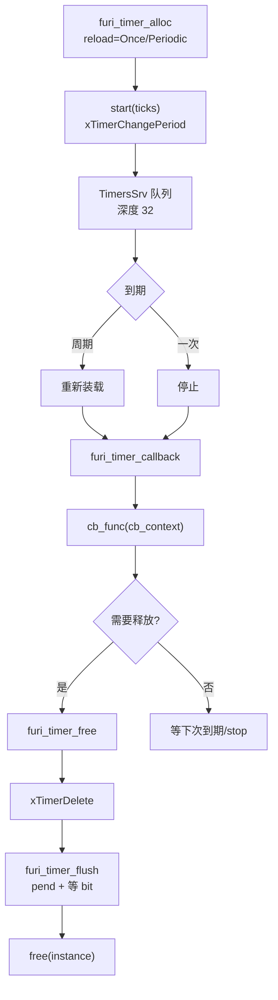
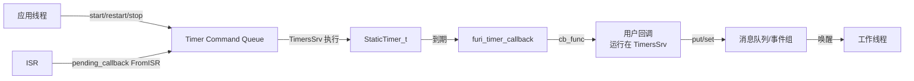

# furi_timer —— Furi 软件定时器

> 对应源文件：`furi/core/timer.c`（共 170 行）
> 配套头文件：`furi/core/timer.h`（115 行）
> 关联：`FreeRTOSConfig.h`（`configUSE_TIMERS`、`configTIMER_TASK_PRIORITY=2`、
> `configTIMER_QUEUE_LENGTH=32`）

## 一句话职责

把 FreeRTOS 的 `StaticTimer_t` 包装成 `FuriTimer`，提供一次性/周期定时器、
启动/重启/停止、`pend` 回调，以及**释放前冲刷命令队列**的安全销毁机制。
所有回调都运行在 FreeRTOS 的 `TimersSrv` 线程，不在调用者线程。

---

## 1. 核心结构

```c
// furi/core/timer.c:9-16
struct FuriTimer {
    StaticTimer_t container;
    FuriTimerCallback cb_func;
    void* cb_context;
};

// IMPORTANT: container MUST be the FIRST struct member
static_assert(offsetof(FuriTimer, container) == 0);
```

| 字段 | 行号 | 含义 |
|---|---|---|
| `container` | 10 | FreeRTOS 定时器控制块，首成员 |
| `cb_func` | 11 | 用户回调 |
| `cb_context` | 12 | 回调参数 |

定时器的 `TimerID` 被设为 `instance` 自身（`timer.c:48`），
FreeRTOS 回调时用 `pvTimerGetTimerID()` 取回：

```c
// furi/core/timer.c:20-24
static void furi_timer_callback(TimerHandle_t hTimer) {
    FuriTimer* instance = pvTimerGetTimerID(hTimer);
    furi_check(instance);
    instance->cb_func(instance->cb_context);
}
```

---

## 2. 逐函数表

| 函数 | 行号 | 关键行为 |
|---|---|---|
| `furi_timer_alloc` | 38-53 | 非 ISR；`xTimerCreateStatic(NULL, portMAX_DELAY, reload, instance, cb, &container)` |
| `furi_timer_free` | 55-65 | `xTimerDelete(portMAX_DELAY)` 后 `furi_timer_flush()`，再 `free` |
| `furi_timer_flush` | 67-77 | 往 timer 队列 pend 一个函数并等它执行完 |
| `furi_timer_flush_epilogue` | 26-36 | 挂起调度器后 set bit，规避 FreeRTOS issue 1142 |
| `furi_timer_start` | 79-94 | `xTimerChangePeriod(h, ticks, portMAX_DELAY)` |
| `furi_timer_restart` | 96-112 | `xTimerChangePeriod` + `xTimerReset` |
| `furi_timer_stop` | 114-123 | `xTimerStop(portMAX_DELAY)` |
| `furi_timer_is_running` | 125-133 | `xTimerIsTimerActive` 返回 0/1 |
| `furi_timer_get_expire_time` | 135-142 | 绝对 tick 到期时间 |
| `furi_timer_pending_callback` | 144-155 | ISR/线程双路径 pend 一个函数 |
| `furi_timer_set_thread_priority` | 157-170 | 改 `TimersSrv` 优先级（Normal / Elevated） |

### 2.1 类型与周期

| 项 | 值 | 来源 |
|---|---|---|
| 一次性 | `FuriTimerTypeOnce` → `reload=pdFALSE` | `timer.c:46` |
| 周期 | `FuriTimerTypePeriodic` → `reload=pdTRUE` | 同上 |
| 初始周期 | `portMAX_DELAY`（不启动） | `timer.c:48` |
| tick 单位 | 1 ms（`configTICK_RATE_HZ=1000`） | `FreeRTOSConfig.h:28` |
| 定时器线程优先级 | 2 | `FreeRTOSConfig.h:66` |
| 定时器队列深度 | 32 | `FreeRTOSConfig.h:67` |

---

## 3. 逐字摘录

### 3.1 分配：静态创建 + 不启动

```c
// furi/core/timer.c:38-53
FuriTimer* furi_timer_alloc(FuriTimerCallback func, FuriTimerType type, void* context) {
    furi_check((furi_kernel_is_irq_or_masked() == 0U) && (func != NULL));

    FuriTimer* instance = malloc(sizeof(FuriTimer));

    instance->cb_func = func;
    instance->cb_context = context;

    const UBaseType_t reload = (type == FuriTimerTypeOnce ? pdFALSE : pdTRUE);
    const TimerHandle_t hTimer = xTimerCreateStatic(
        NULL, portMAX_DELAY, reload, instance, furi_timer_callback, &instance->container);

    furi_check(hTimer == (TimerHandle_t)instance);

    return instance;
}
```

注意 `xTimerCreateStatic` 的第二个参数是 `portMAX_DELAY`：**创建后不会自动
启动**，必须显式 `furi_timer_start()`。返回值必须等于 `(TimerHandle_t)instance`，
同样依赖首成员假设。

### 3.2 释放：删除 + 冲刷

```c
// furi/core/timer.c:55-77
void furi_timer_free(FuriTimer* instance) {
    furi_check(!furi_kernel_is_irq_or_masked());
    furi_check(instance);

    TimerHandle_t hTimer = (TimerHandle_t)instance;
    furi_check(xTimerDelete(hTimer, portMAX_DELAY) == pdPASS);

    furi_timer_flush();

    free(instance);
}

void furi_timer_flush(void) {
    StaticEventGroup_t event_container = {};
    EventGroupHandle_t hEvent = xEventGroupCreateStatic(&event_container);
    furi_check(
        xTimerPendFunctionCall(furi_timer_flush_epilogue, hEvent, 0, portMAX_DELAY) == pdPASS);

    furi_check(
        xEventGroupWaitBits(hEvent, TIMER_DELETED_EVENT, pdFALSE, pdTRUE, portMAX_DELAY) ==
        TIMER_DELETED_EVENT);
    vEventGroupDelete(hEvent);
}
```

为什么 `xTimerDelete` 之后还要 flush？

- `xTimerDelete` 只是把“删除”命令放进 timer command queue；
- 定时器回调可能**已经在执行**；
- 如果立刻 `free(instance)`，正在执行的回调就会 use-after-free。

`furi_timer_flush()` 往同一个队列 pend 一个函数，等它执行完，说明
**前面所有命令（包括删除）都已处理**，此时 free 才安全。

### 3.3 flush 尾声：规避调度器竞态

```c
// furi/core/timer.c:26-36
static void furi_timer_flush_epilogue(void* context, uint32_t arg) {
    furi_assert(context);
    UNUSED(arg);

    EventGroupHandle_t hEvent = context;

    // See https://github.com/FreeRTOS/FreeRTOS-Kernel/issues/1142
    vTaskSuspendAll();
    xEventGroupSetBits(hEvent, TIMER_DELETED_EVENT);
    (void)xTaskResumeAll();
}
```

`xEventGroupSetBits` 在 timer 命令上下文里可能被调度器挂起，导致
flush 永远等不到。挂起调度器保证 set bit 原子完成。这是针对
FreeRTOS issue 1142 的 workaround。

---

## 4. 启动/重启的差异

```c
// furi/core/timer.c:79-112（节选）
FuriStatus furi_timer_start(FuriTimer* instance, uint32_t ticks) {
...
    if(xTimerChangePeriod(hTimer, ticks, portMAX_DELAY) == pdPASS) {
        stat = FuriStatusOk;
    } else {
        stat = FuriStatusErrorResource;
    }

    return stat;
}

FuriStatus furi_timer_restart(FuriTimer* instance, uint32_t ticks) {
...
    if(xTimerChangePeriod(hTimer, ticks, portMAX_DELAY) == pdPASS &&
       xTimerReset(hTimer, portMAX_DELAY) == pdPASS) {
        stat = FuriStatusOk;
    } else {
        stat = FuriStatusErrorResource;
    }

    return stat;
}
```

| API | FreeRTOS 组合 | 已启动时行为 |
|---|---|---|
| `start` | `xTimerChangePeriod` | 改周期并**立即**开始计时 |
| `restart` | `xTimerChangePeriod` + `xTimerReset` | 改周期并**从头**计时 |
| `stop` | `xTimerStop` | 停止，周期保留 |

`xTimerChangePeriod` 本身就会启动定时器（如果未启动），所以 `start`
不需要额外的 `xTimerStart`。

---

## 5. 定时器线程与优先级

| 优先级 | 值 | 来源 | 效果 |
|---|---|---|---|
| Normal | `configTIMER_TASK_PRIORITY=2` | `FreeRTOSConfig.h:66` | 低于所有应用线程（16） |
| Elevated | `configMAX_PRIORITIES-1=31` | `timer.c:165-167` | 高于一切，低抖动 |

```c
// furi/core/timer.c:157-170
void furi_timer_set_thread_priority(FuriTimerThreadPriority priority) {
    furi_check(!furi_kernel_is_irq_or_masked());

    TaskHandle_t task_handle = xTimerGetTimerDaemonTaskHandle();
    furi_check(task_handle); // Don't call this method before timer task start

    if(priority == FuriTimerThreadPriorityNormal) {
        vTaskPrioritySet(task_handle, configTIMER_TASK_PRIORITY);
    } else if(priority == FuriTimerThreadPriorityElevated) {
        vTaskPrioritySet(task_handle, configMAX_PRIORITIES - 1);
    } else {
        furi_crash();
    }
}
```

`Elevated` 只应在很短的时间窗口使用（例如 SubGHz 边沿采样），
用完立刻调回 `Normal`，否则会饿死 GUI 与所有应用。

---

## 6. 执行流



## 7. 数据流



---

## 8. 陷阱与读码建议

| 陷阱 | 现象 | 根因 | 处理 |
|---|---|---|---|
| 回调里 `furi_delay_ms` | 所有定时器停摆 | TimersSrv 被阻塞 | 回调只投递 |
| 回调里做重活 | 定时抖动 | 单线程串行执行 | 拆到工作线程 |
| free 后立刻复用指针 | 偶发跑飞 | 回调可能还在队列 | 依赖 flush，不要绕过 |
| 在调度器启动前 start | 死等 `portMAX_DELAY` | 队列无人消费 | 在服务线程里创建/启动 |
| `start` 当 `restart` 用 | 周期被重置 | `ChangePeriod` 会重启计时 | 需要保持相位用 `restart` |
| `ticks == portMAX_DELAY` | `furi_check` 崩溃 | API 禁止 | 用更小值 |
| Elevated 忘记恢复 | 系统卡顿 | TimersSrv 抢占一切 | 成对调用 |
| 定时器回调里 `furi_timer_free` 自己 | 死锁 | flush 等自己执行完 | 不要在回调里 free 自己 |

读码建议：

1. `timer.c` 只有 170 行，重点读 `free`/`flush`/`epilogue` 三连。
2. 配合 FreeRTOS 的 `xTimerPendFunctionCall` 文档看，理解“命令队列”不是
   立即执行。
3. `furi_timer_set_thread_priority` 是唯一改 `TimersSrv` 优先级的入口，
   读它在哪些驱动里被调用（`grep`）能看出哪些场景需要低抖动。
4. 回调运行线程这一点，决定了所有“定时器里能不能调 X”的问题；
   先问“X 会不会阻塞”，再问“X 是否 ISR 安全”。

> 相关文档：[02-Furi 内核精读.md](../../../references/firmware/flipperzero-firmware/Docs/02-Furi 内核精读.md)、
> [05-GUI 与输入事件.md](../../../references/firmware/flipperzero-firmware/Docs/05-GUI 与输入事件.md)
