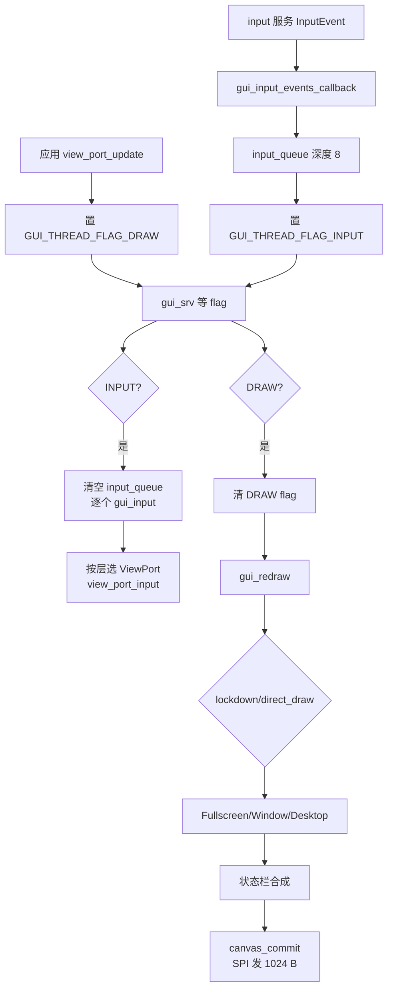
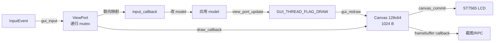

# gui_view_port —— GUI 的 ViewPort 与图层

> 对应源文件：`applications/services/gui/view_port.c`（共 253 行）
> 配套：`view_port_i.h`（结构）、`view_port.h`（API）、`gui.c`（576 行）、
> `gui_i.h`（Gui 结构与尺寸宏）、`gui.h`（GuiLayer 枚举）

## 一句话职责

`ViewPort` 是“一块可绘制、可接收输入的矩形区域”的统一接口；`Gui` 把多个
ViewPort 按 5 个图层组织，在单个 `gui_srv` 线程里完成输入路由与 128×64
画布合成。

---

## 1. ViewPort 结构

```c
// applications/services/gui/view_port_i.h:11-25
struct ViewPort {
    Gui* gui;
    FuriMutex* mutex;
    bool is_enabled;
    ViewPortOrientation orientation;

    uint8_t width;
    uint8_t height;

    ViewPortDrawCallback draw_callback;
    void* draw_callback_context;

    ViewPortInputCallback input_callback;
    void* input_callback_context;
};
```

| 字段 | 行号 | 含义 |
|---|---|---|
| `gui` | 12 | 所属 Gui，`NULL` 表示未挂载 |
| `mutex` | 13 | **递归**互斥量，保护全部字段 |
| `is_enabled` | 14 | 是否参与绘制/输入 |
| `orientation` | 15 | 0/90/180/270 |
| `width` / `height` | 17-18 | 状态栏自动布局用；0 按 8 px |
| `draw_callback` | 20 | `void(Canvas*, void*)` |
| `input_callback` | 23 | `void(InputEvent*, void*)` |

### 1.1 图层

`GuiLayer`（`gui.h:17-27`）：

| 层 | 值 | 区域 | 用途 |
|---|---|---|---|
| `GuiLayerDesktop` | 0 | 全屏 | 桌面 |
| `GuiLayerWindow` | 1 | y=13，128×51 | 普通窗口 |
| `GuiLayerStatusBarLeft` | 2 | 状态栏左 | SD/通知图标 |
| `GuiLayerStatusBarRight` | 3 | 状态栏右 | 电量/蓝牙 |
| `GuiLayerFullscreen` | 4 | 全屏 | 全屏应用 |

### 1.2 Gui 结构

```c
// applications/services/gui/gui_i.h:44-62（节选）
struct Gui {
    // Thread and lock
    FuriThreadId thread_id;
    FuriMutex* mutex;

    // Layers and Canvas
    bool lockdown;
    bool direct_draw;
    ViewPortArray_t layers[GuiLayerMAX];
    Canvas* canvas;

    // Input
    FuriMessageQueue* input_queue;
    FuriPubSub* input_events;
    uint8_t ongoing_input;
    ViewPort* ongoing_input_view_port;
};
```

| 字段 | 作用 |
|---|---|
| `thread_id` | `gui_srv` 线程 ID，用于 `furi_thread_flags_set` |
| `lockdown` | 只显示 desktop 层 |
| `direct_draw` | 应用独占 canvas |
| `layers[]` | 每层一个 ViewPort 动态数组 |
| `canvas` | u8g2 实例 + 1024 B 缓冲 |
| `input_queue` | 深度 8，来自 input 服务 |
| `ongoing_input` | 当前按下的键位图 |
| `ongoing_input_view_port` | 本次手势的粘滞目标 |

---

## 2. 逐函数表（view_port.c）

| 函数 | 行号 | 关键行为 |
|---|---|---|
| `view_port_map_input` | 63-77 | 按朝向重映射；仅硬件事件 |
| `view_port_setup_canvas_orientation` | 79-91 | 设置 canvas 朝向；左手模式翻转 |
| `view_port_alloc` | 93-99 | 默认 Horizontal、enabled、递归 mutex |
| `view_port_free` | 101-108 | 断言未挂载；释放 mutex |
| `view_port_set_width` | 110-115 | 加锁写 width |
| `view_port_get_width` | 117-123 | 加锁读 |
| `view_port_set_height` | 125-130 | 加锁写 |
| `view_port_get_height` | 132-138 | 加锁读 |
| `view_port_enabled_set` | 140-153 | 2 tick 拿锁；变化时 `gui_update` |
| `view_port_is_enabled` | 155-161 | 加锁读 |
| `view_port_draw_callback_set` | 163-169 | 加锁写回调 |
| `view_port_input_callback_set` | 171-180 | 加锁写回调 |
| `view_port_update` | 182-193 | 2 tick 拿锁；请求重绘 |
| `view_port_gui_set` | 195-200 | 加锁写 `gui` |
| `view_port_draw` | 202-220 | 2 tick 拿锁；调 draw 回调 |
| `view_port_input` | 222-234 | 永久锁；重映射后调 input 回调 |
| `view_port_set_orientation` | 236-241 | 加锁写 |
| `view_port_get_orientation` | 243-253 | 2 tick 拿锁；读朝向 |

---

## 3. 逐字摘录

### 3.1 输入朝向映射表

```c
// applications/services/gui/view_port.c:25-50
static const InputKey view_port_input_mapping[ViewPortOrientationMAX][InputKeyMAX] = {
    {InputKeyUp,
     InputKeyDown,
     InputKeyRight,
     InputKeyLeft,
     InputKeyOk,
     InputKeyBack}, //ViewPortOrientationHorizontal
    {InputKeyDown,
     InputKeyUp,
     InputKeyLeft,
     InputKeyRight,
     InputKeyOk,
     InputKeyBack}, //ViewPortOrientationHorizontalFlip
    {InputKeyRight,
     InputKeyLeft,
     InputKeyDown,
     InputKeyUp,
     InputKeyOk,
     InputKeyBack}, //ViewPortOrientationVertical
    {InputKeyLeft,
     InputKeyRight,
     InputKeyUp,
     InputKeyDown,
     InputKeyOk,
     InputKeyBack}, //ViewPortOrientationVerticalFlip
};
```

映射规则：

| 物理键 \ 朝向 | Horizontal | HorizontalFlip | Vertical | VerticalFlip |
|---|---|---|---|---|
| Up | Up | Down | Right | Left |
| Down | Down | Up | Left | Right |
| Right | Right | Left | Down | Up |
| Left | Left | Right | Up | Down |
| OK/Back | 不变 | 不变 | 不变 | 不变 |

只在 `event->sequence_source == INPUT_SEQUENCE_SOURCE_HARDWARE` 时重映射
（`view_port.c:66-68`），软件注入事件保持原样。

### 3.2 update：2 tick 的降级锁

```c
// applications/services/gui/view_port.c:182-193
void view_port_update(ViewPort* view_port) {
    furi_check(view_port);

    // We are not going to lockup system, but will notify you instead
    // Make sure that you don't call viewport methods inside of another mutex, especially one that is used in draw call
    if(furi_mutex_acquire(view_port->mutex, 2) != FuriStatusOk) {
        FURI_LOG_W(TAG, "ViewPort lockup: see %s:%d", __FILE__, __LINE__ - 3);
    }

    if(view_port->gui && view_port->is_enabled) gui_update(view_port->gui);
    furi_mutex_release(view_port->mutex);
}
```

为什么用 2 tick 而不是 `FuriWaitForever`？

- 最常见的误用是“在 draw 回调里调 `view_port_update`”；
- draw 回调已经持有 ViewPort 锁，再拿递归锁不会死，但如果同时要 GUI 锁，
  就可能与 GUI 线程形成 ABBA 死锁；
- 2 tick 超时把“永久挂死”降级为“警告 + 跳过本次”。

同样的模式出现在 `view_port_enabled_set`（145）、`view_port_draw`（208）、
`view_port_get_orientation`（247）。

### 3.3 input：先重映射再回调

```c
// applications/services/gui/view_port.c:222-234
void view_port_input(ViewPort* view_port, InputEvent* event) {
    furi_check(view_port);
    furi_check(event);
    furi_check(furi_mutex_acquire(view_port->mutex, FuriWaitForever) == FuriStatusOk);
    furi_check(view_port->gui);

    if(view_port->input_callback) {
        ViewPortOrientation orientation = view_port_get_orientation(view_port);
        view_port_map_input(event, orientation);
        view_port->input_callback(event, view_port->input_callback_context);
    }
    furi_check(furi_mutex_release(view_port->mutex) == FuriStatusOk);
}
```

`view_port_get_orientation()` 内部再次拿同一把锁——这就是 `view_port_alloc()`
必须用 `FuriMutexTypeRecursive` 的原因（`view_port.c:97`）。

---

## 4. Gui 的绘制与输入

### 4.1 重绘优先级

```c
// applications/services/gui/gui.c:243-271（节选）
static void gui_redraw(Gui* gui) {
    furi_assert(gui);
    gui_lock(gui);

    do {
        if(gui->direct_draw) break;

        canvas_reset(gui->canvas);

        if(gui->lockdown) {
            gui_redraw_desktop(gui);
...
        } else {
            if(!gui_redraw_fs(gui)) {
                if(!gui_redraw_window(gui)) {
                    gui_redraw_desktop(gui);
                }
                gui_redraw_status_bar(gui, false);
            }
        }

        canvas_commit(gui->canvas);
    } while(false);

    gui_unlock(gui);
}
```

规则：

| 条件 | 画什么 |
|---|---|
| `direct_draw` | 跳过，应用自己画 |
| `lockdown` | desktop + 状态栏（窗口/全屏只显示注意图标） |
| 有 Fullscreen | 只画 Fullscreen，不画状态栏 |
| 有 Window | 画 Window + 状态栏 |
| 只有 Desktop | 画 Desktop + 状态栏 |

### 4.2 输入路由

```c
// applications/services/gui/gui.c:300-316（节选）
        ViewPort* view_port = NULL;

        if(gui->lockdown) {
            view_port = gui_view_port_find_enabled(gui->layers[GuiLayerDesktop]);
        } else {
            view_port = gui_view_port_find_enabled(gui->layers[GuiLayerFullscreen]);
            if(!view_port) view_port = gui_view_port_find_enabled(gui->layers[GuiLayerWindow]);
            if(!view_port) view_port = gui_view_port_find_enabled(gui->layers[GuiLayerDesktop]);
        }

        if(!(gui->ongoing_input & ~key_bit) && input_event->type == InputTypePress) {
            gui->ongoing_input_view_port = view_port;
        }

        if(view_port && view_port == gui->ongoing_input_view_port) {
            view_port_input(view_port, input_event);
        } else if(gui->ongoing_input_view_port && input_event->type == InputTypeRelease) {
```

粘滞语义：按下时记录目标 ViewPort，松开时即使该 ViewPort 已被移除，
仍把 Release 发给它（316-325 行），避免半截手势。

### 4.3 图层的增删与顺序

| API | 行号 | 行为 |
|---|---|---|
| `gui_add_view_port` | 351-380 | 查重 + push_back + `view_port_gui_set` + `gui_update` |
| `gui_remove_view_port` | 382-406 | 清 gui + 从所有层删除 + 清粘滞 + `gui_update` |
| `gui_view_port_send_to_front` | 408-435 | 移到同层末尾（最后绘制） |
| `gui_view_port_send_to_back` | 437-464 | 移到同层开头（最先绘制） |

`gui_view_port_find_enabled()` 从数组末尾往前找（`gui.c:6-18`），
所以“后加入/送到前面”的 ViewPort 优先获得输入与绘制。

---

## 5. 执行流



## 6. 数据流



---

## 7. 陷阱与读码建议

| 陷阱 | 现象 | 根因 | 处理 |
|---|---|---|---|
| draw 回调里 `view_port_update` | `ViewPort lockup` 日志 | 2 tick 拿不到锁 | 只改 model，回调外重绘 |
| draw 回调里阻塞 | GUI 卡死 | 回调在 gui_srv | 禁止 sleep/等锁 |
| 竖屏加 Window 层 | `furi_check` 崩溃 | 只有 Fullscreen 支持竖屏 | 改层或改朝向 |
| 同一 ViewPort 加两次 | `furi_assert` | add 时查重 | 先 remove |
| 忘记 disable | 下层收不到输入 | 上层仍 enabled | 切换时显式设置 |
| `view_port_free` 时还挂着 | `furi_check` 崩溃 | `gui != NULL` | 先 remove |
| 在 input 回调里做重活 | 丢按键 | 阻塞 gui_srv | 投递到应用队列 |
| direct_draw 后不 release | GUI 不再重绘 | `direct_draw` 仍为 true | 成对调用 |

读码建议：

1. `view_port.c` 只有 253 行，建议全文读；重点看哪些 API 用 2 tick、哪些用永久锁。
2. `gui.c` 的 243-339 行是绘制与输入路由的核心，配合 `gui_i.h` 的尺寸宏读。
3. 把 `view_port_input` 与 `gui_input` 一起看，理解“两层次粘滞”：
   GUI 粘 ViewPort，ViewDispatcher 粘 View。
4. `canvas_commit` 是唯一真正碰硬件的地方；所有上层都只操作内存缓冲。

> 相关文档：[05-GUI 与输入事件.md](../../../references/firmware/flipperzero-firmware/Docs/05-GUI 与输入事件.md)、
> [04-应用框架与加载器.md](../../../references/firmware/flipperzero-firmware/Docs/04-应用框架与加载器.md)
