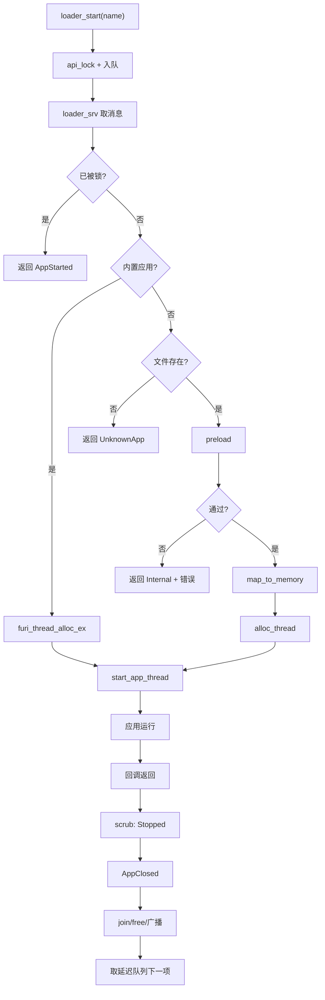
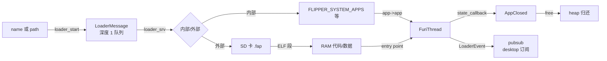

# loader —— 应用加载服务

> 对应源文件：`applications/services/loader/loader.c`（共 912 行）
> 配套：`loader_i.h`（Loader 结构与消息枚举，102 行）、`loader.h`（公开 API，157 行）、
> `loader_queue.c`（延迟启动队列，32 行）、`application.fam`
> 关联：`lib/flipper_application/flipper_application.c`（FAP 加载，364 行）

## 一句话职责

以**单线程消息循环**串行处理“启动/锁定/查询/延迟启动”请求：内置应用直接
建线程，外部应用先做 ELF 预检与段映射，再建线程；应用退出时统一回收并
广播事件。

---

## 1. 核心结构

```c
// applications/services/loader/loader_i.h:15-37（节选）
typedef struct {
    FuriString* launch_path;
    char* args;
    FuriThread* thread;
    bool insomniac;
    FlipperApplication* fap;
} LoaderAppData;

struct Loader {
    FuriPubSub* pubsub;
    FuriMessageQueue* queue;
    LoaderMenu* loader_menu;
    LoaderApplications* loader_applications;
    LoaderAppData app;

    LoaderLaunchQueue launch_queue;

    Gui* gui;
    ViewHolder* view_holder;
    Loading* loading;
};
```

| 字段 | 行号 | 含义 |
|---|---|---|
| `pubsub` | 26 | 广播 `LoaderEvent` |
| `queue` | 27 | 深度 **1** 的请求队列 |
| `loader_menu` | 28 | 应用菜单（按需创建） |
| `loader_applications` | 29 | “Apps”分类界面 |
| `app` | 30 | 当前应用数据 |
| `launch_queue` | 32 | 延迟启动队列（最多 4 项） |
| `gui` | 34 | 用于显示加载动画/错误对话框 |
| `view_holder` | 35 | 承载 loading view |
| `loading` | 36 | 加载动画 |

### 1.1 请求消息

`LoaderMessageType`（`loader_i.h:40-55`）共 14 种：

| 消息 | 触发 API | 是否同步 |
|---|---|---|
| `StartByName` | `loader_start` | 是（api_lock） |
| `StartByNameDetachedWithGuiError` | `loader_start_detached_with_gui_error` | 否 |
| `AppClosed` | 线程状态回调 | 内部 |
| `ShowMenu` | `loader_show_menu` | 否 |
| `MenuClosed` | 菜单关闭回调 | 内部 |
| `ApplicationsClosed` | Apps 界面关闭回调 | 内部 |
| `Lock` / `Unlock` / `IsLocked` | `loader_lock/unlock/is_locked` | 前两者同步 |
| `Signal` | `loader_signal` | 是 |
| `GetApplicationName` | `loader_get_application_name` | 是 |
| `GetApplicationLaunchPath` | `loader_get_application_launch_path` | 是 |
| `EnqueueLaunch` | `loader_enqueue_launch` | 是 |
| `ClearLaunchQueue` | `loader_clear_launch_queue` | 是 |

`LoaderMessage` 用两个 union 承载“输入参数”和“输出指针”（`loader_i.h:88-102`）。

---

## 2. 逐函数表

| 函数 | 行号 | 作用 |
|---|---|---|
| `loader_find_external_application_by_name` | 19-27 | 在 `FLIPPER_EXTERNAL_APPS[]` 里按显示名找路径 |
| `loader_start_internal` | 31-49 | 填消息 + `api_lock` + 入队 + 等待 |
| `loader_start` | 178-186 | 同步启动，返回状态 |
| `loader_start_with_gui_error` | 188-198 | 失败时弹对话框 |
| `loader_start_detached_with_gui_error` | 200-210 | 异步启动（strdup 参数） |
| `loader_lock/unlock/is_locked` | 212-239 | 用 `0xDEADBEEF` 占位 |
| `loader_show_menu` | 241-248 | 异步显示应用菜单 |
| `loader_get_pubsub` | 250-256 | 返回事件总线（不锁） |
| `loader_signal` | 258-268 | 向当前应用线程发信号 |
| `loader_get_application_name` | 270-279 | 查询当前应用名 |
| `loader_get_application_launch_path` | 281-290 | 查询启动路径 |
| `loader_enqueue_launch` | 292-307 | 追加延迟启动 |
| `loader_clear_launch_queue` | 309-314 | 清空延迟队列 |
| `loader_thread_state_callback` | 332-344 | `Stopped` 时投递 `AppClosed` |
| `loader_alloc` | 348-357 | 创建 pubsub/queue/view_holder |
| `loader_find_application_by_name` | 371-390 | settings→system→debug 查找 |
| `loader_start_app_thread` | 392-415 | heap trace + insomnia + state callback + start |
| `loader_start_internal_app` | 417-434 | 内置应用线程 |
| `loader_start_external_app` | 499-569 | FAP 预检/映射/线程 |
| `loader_do_start_by_name` | 604-683 | 统一入口：锁检查→内置→Apps→外部→FAP |
| `loader_do_app_closed` | 751-784 | join/free/广播/取延迟队列 |
| `loader_srv` | 819-912 | 服务主循环 + STARTUP 钩子 + autorun |

---

## 3. 逐字摘录

### 3.1 同步请求：api_lock 的用法

```c
// applications/services/loader/loader.c:31-49
static LoaderMessageLoaderStatusResult loader_start_internal(
    Loader* loader,
    const char* name,
    const char* args,
    FuriString* error_message) {
    LoaderMessage message;
    LoaderMessageLoaderStatusResult result;

    message.type = LoaderMessageTypeStartByName;
    message.start.name = name;
    message.start.args = args;
    message.start.error_message = error_message;
    message.api_lock = api_lock_alloc_locked();
    message.status_value = &result;
    furi_message_queue_put(loader->queue, &message, FuriWaitForever);
    api_lock_wait_unlock_and_free(message.api_lock);

    return result;
}
```

`api_lock_alloc_locked()` 创建时就是“已锁”状态；调用方阻塞在
`api_lock_wait_unlock_and_free()`。loader 处理完把结果写入 `&result`
（栈上），再 `api_lock_unlock()`。因为调用方在等待，栈帧仍然有效。

### 3.2 外部应用：四段式加载

```c
// applications/services/loader/loader.c:515-557（节选）
        FlipperApplicationPreloadStatus preload_res =
            flipper_application_preload(loader->app.fap, path);
        if(preload_res != FlipperApplicationPreloadStatusSuccess) {
            const char* err_msg = flipper_application_preload_status_to_string(preload_res);
            result.value = loader_make_status_error(
                LoaderStatusErrorInternal, error_message, "Preload failed, %s: %s", path, err_msg);
            result.error = loader_status_error_from_preload_status(preload_res);
            break;
        }

        FlipperApplicationLoadStatus load_status =
            flipper_application_map_to_memory(loader->app.fap);
        if(load_status != FlipperApplicationLoadStatusSuccess) {
            const char* err_msg = flipper_application_load_status_to_string(load_status);
            result.value = loader_make_status_error(
                LoaderStatusErrorInternal, error_message, "Load failed, %s: %s", path, err_msg);
            result.error = loader_status_error_from_load_status(load_status);
            break;
        }

        FURI_LOG_I(TAG, "Loaded in %zums", (size_t)(furi_get_tick() - start));

        if(flipper_application_is_plugin(loader->app.fap)) {
            result.value = loader_make_status_error(
                LoaderStatusErrorInternal, error_message, "Plugin %s is not runnable", path);
            break;
        }

        loader->app.thread = flipper_application_alloc_thread(loader->app.fap, args);
        FuriString* app_name = furi_string_alloc();
        path_extract_filename_no_ext(path, app_name);
        furi_thread_set_appid(loader->app.thread, furi_string_get_cstr(app_name));
        furi_string_free(app_name);

        /* This flag is set by the debugger - to break on app start */
        if(furi_hal_debug_is_gdb_session_active()) {
            FURI_LOG_W(TAG, "Triggering BP for debugger");
            /* After hitting this, you can set breakpoints in your .fap's code
             * Note that you have to toggle breakpoints that were set before */
            __asm volatile("bkpt 0");
        }

        loader_start_app_thread(loader, FlipperInternalApplicationFlagDefault);
```

四段：

1. `preload`：读 ELF header + manifest，校验 magic/version/api/target；
2. `map_to_memory`：把可加载段复制到 RAM，解析符号；
3. plugin 检查：`stack_size == 0` 的 FAP 不能独立运行；
4. `alloc_thread`：包装 init/entry/fini，建 `FuriThread`。

### 3.3 退出回收

```c
// applications/services/loader/loader.c:751-784
static void loader_do_app_closed(Loader* loader) {
    furi_assert(loader->app.thread);

    furi_thread_join(loader->app.thread);
    FURI_LOG_I(TAG, "App returned: %li", furi_thread_get_return_code(loader->app.thread));

    if(loader->app.args) {
        free(loader->app.args);
        loader->app.args = NULL;
    }

    if(loader->app.insomniac) {
        furi_hal_power_insomnia_exit();
    }

    if(loader->app.fap) {
        flipper_application_free(loader->app.fap);
        loader->app.fap = NULL;
        loader->app.thread = NULL;
    } else {
        furi_thread_free(loader->app.thread);
        loader->app.thread = NULL;
    }

    furi_string_free(loader->app.launch_path);

    FURI_LOG_I(TAG, "Application stopped. Free heap: %zu", memmgr_get_free_heap());

    LoaderEvent event;
    event.type = LoaderEventTypeApplicationStopped;
    furi_pubsub_publish(loader->pubsub, &event);

    loader_do_next_deferred_launch_if_available(loader);
}
```

顺序很重要：

1. `join`（此时线程已是 `Stopped`，立即返回）；
2. 释放 args；
3. 退出 insomnia；
4. FAP 走 `flipper_application_free`（内部再 join/free 线程），内置走
   `furi_thread_free`；
5. 释放 launch path；
6. 广播 `ApplicationStopped`；
7. 尝试下一个延迟启动。

任何一步顺序错都会导致 use-after-free 或电源状态泄漏。

---

## 4. 应用生命周期



## 5. 数据流



---

## 6. 陷阱与读码建议

| 陷阱 | 现象 | 根因 | 处理 |
|---|---|---|---|
| 应用返回后继续用全局 | use-after-free | loader 释放 FAP 内存 | 退出前清理 |
| 延迟队列第 5 个 | `furi_check` 崩溃 | `loader_queue_push` 返回 false 未处理 | 先查返回值 |
| `loader_lock` 未 unlock | 永远无法启动 | 魔数残留 | 成对调用 |
| 认为 `loader_start` 异步 | 逻辑顺序错 | 内部 api_lock 同步 | 要异步用 `start_detached` |
| 在应用里 free 自己线程 | 崩溃 | 框架负责回收 | 只释放自己的资源 |
| `stack_size` 太小 | 栈溢出 | manifest 字节数 | 用 `top` 看水位 |
| 启动卡在 `api_lock` | loader 线程死了 | 加载大 FAP 耗时长/死锁 | 看 `Loaded in %zums` 日志 |

读码建议：

1. 先读 `loader.h` 的 API 注释，再看 `loader_srv` 的 switch（836-907 行）。
2. `loader_do_start_by_name`（604-683 行）是总入口，按“锁→内置→Apps→外部→FAP”
   的顺序读。
3. 把 `loader_thread_state_callback`、`loader_do_app_closed`、`furi_thread_scrub`
   三者连起来看，理解三段式退出。
4. `loader_start_external_app` 的错误码映射（469-497 行）是排查 FAP 加载失败的
   字典：`preload` 对应文件/manifest/api/target，`load` 对应符号缺失。

> 相关文档：[04-应用框架与加载器.md](../../../references/firmware/flipperzero-firmware/Docs/04-应用框架与加载器.md)、
> [01-启动流程与初始化.md](../../../references/firmware/flipperzero-firmware/Docs/01-启动流程与初始化.md)
