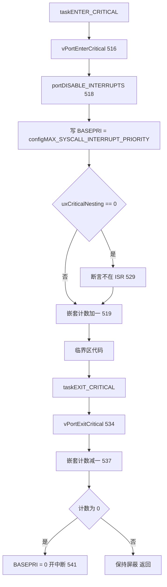
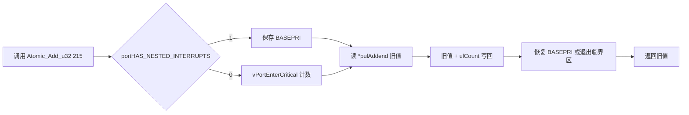

# 原子操作与 portmacro —— 临界区、BASEPRI 与调度器挂起

> 对应源文件：`include/atomic.h`（共 422 行）、`portable/GCC/ARM_CM4F/portmacro.h`（共 272 行）、`portable/GCC/ARM_CM4F/port.c`（共 972 行）、`tasks.c` 的临界区段
>
> **前置阅读：** [port_cortex_m4f.md](port_cortex_m4f.md)（PendSV/SVC 汇编）、[tasks.md](tasks.md)（调度器挂起）
> **相关条目：** [queue.md](queue.md)（临界区的最大用户）
>
> 行号以本仓库当前文件为准。

---

# 第一部分：atomic.h —— 通用原子操作

## 1.1 它不是什么

**它不是无锁原子指令封装。** 打开 `atomic.h` 会看到每个函数都是"关中断 → 读改写 → 开中断"：

```c
static portFORCE_INLINE uint32_t Atomic_Add_u32( uint32_t volatile * pulAddend,
                                                 uint32_t ulCount )
{
    uint32_t ulCurrent;

    ATOMIC_ENTER_CRITICAL();
    {
        ulCurrent = *pulAddend;
        *pulAddend += ulCount;
    }
    ATOMIC_EXIT_CRITICAL();

    return ulCurrent;
}
```

（atomic.h:215-228，逐字）

文件头也明确写了这一点（atomic.h:33-34）："本文件通过全局禁用中断来实现原子函数。各编译器目录下可提供使用架构特定原子指令的实现。"

**它的"原子"= 临界区互斥，不是 LDREX/STREX。** 单核足够；多核需移植层提供真原子指令。

## 1.2 全部 11 个函数

| 函数 | 行号 | 语义 | 返回值 |
|---|---|---|---|
| `Atomic_CompareAndSwap_u32` | 115 | 若 `*dst == comparand` 则写 `exchange` | 1 成功 / 0 失败 |
| `Atomic_SwapPointers_p32` | 151 | 交换指针 | 旧指针 |
| `Atomic_CompareAndSwapPointers_p32` | 182 | 指针 CAS | 1/0 |
| `Atomic_Add_u32` | 215 | `*dst += count` | **旧值** |
| `Atomic_Subtract_u32` | 242 | `*dst -= count` | **旧值** |
| `Atomic_Increment_u32` | 268 | `*dst += 1` | **旧值** |
| `Atomic_Decrement_u32` | 293 | `*dst -= 1` | **旧值** |
| `Atomic_OR_u32` | 320 | `*dst \|= value` | **旧值** |
| `Atomic_AND_u32` | 347 | `*dst &= value` | **旧值** |
| `Atomic_NAND_u32` | 374 | `*dst = ~(*dst & value)` | **旧值** |
| `Atomic_XOR_u32` | 401 | `*dst ^= value` | **旧值** |

**"返回旧值"是刻意设计**：调用者可以用它判断"是不是我把它从 0 变成 1"（引用计数、单次初始化），无需二次读。

## 1.3 临界区宏的双实现

```c
#if ( portHAS_NESTED_INTERRUPTS == 1 )

/* 此移植层支持嵌套中断方案。 */
    #define ATOMIC_ENTER_CRITICAL() \
    UBaseType_t uxCriticalSectionType = portSET_INTERRUPT_MASK_FROM_ISR()

    #define ATOMIC_EXIT_CRITICAL() \
    portCLEAR_INTERRUPT_MASK_FROM_ISR( uxCriticalSectionType )

#else

/* 此移植层不支持嵌套中断方案。 */
    #define ATOMIC_ENTER_CRITICAL()    portENTER_CRITICAL()
    #define ATOMIC_EXIT_CRITICAL()     portEXIT_CRITICAL()

#endif
```

（atomic.h:67-82，逐字）

两种路径的差别：

| 路径 | 机制 | 能否在 ISR 用 | 嵌套 |
|---|---|---|---|
| `portHAS_NESTED_INTERRUPTS == 1` | 保存/恢复 BASEPRI | 可以 | 由保存值天然支持 |
| `portHAS_NESTED_INTERRUPTS == 0` | `vPortEnterCritical` 计数 | **不可以**（会断言） | 靠 `uxCriticalNesting` |

`portFORCE_INLINE` 在端口未定义时退化为空（atomic.h:91-93），所以这些"函数"可能真的是函数调用——**不要假设零开销**。

## 1.4 一个重要的仓库事实：内核没有调用它

在本仓库根目录执行：

```bash
grep -rl "Atomic_" .        # 只有 include/atomic.h 自己
```

**内核主体（tasks.c / queue.c / list.c / timers.c）一次都没用 `Atomic_*`。** 它是给移植层和应用程序的可选工具，不是内核运行的依赖。读内核时看到"原子"字样，指的是临界区保护，不是这个头文件。

---

# 第二部分：portmacro.h —— 移植层的 272 行

## 2.1 类型与常量

| 宏/类型 | 行号 | 值 | 影响 |
|---|---|---|---|
| `portSTACK_TYPE` | 55 | `uint32_t` | 栈单位 4 字节；`usStackDepth` 是字数 |
| `StackType_t` | 58 | `uint32_t` | 栈数组元素类型 |
| `BaseType_t` | 59 | `long`（32 位） | 返回值类型 |
| `UBaseType_t` | 60 | `unsigned long` | 计数类型 |
| `TickType_t` | 66 | `uint32_t`（32 位 tick） | 49.7 天回绕 |
| `portMAX_DELAY` | 67 | `0xffffffff` | 无限等待 |
| `portSTACK_GROWTH` | 83 | `-1` | 栈向下增长（影响溢出检测方向） |
| `portTICK_PERIOD_MS` | 84 | `1000 / configTICK_RATE_HZ` | 1 tick 的毫秒数 |
| `portBYTE_ALIGNMENT` | 85 | **8** | 堆块 8 字节对齐（见 [heap.md](heap.md)） |

**量化：** `TickType_t` 32 位在 1000 Hz 下 **49.7 天**回绕一次；长期运行必须用 tick 差值比较。

## 2.2 `portYIELD`：写 ICSR 的 PendSV 位

```c
#define portYIELD()                                     \
    {                                                   \
        /* Set a PendSV to request a context switch. */ \
        portNVIC_INT_CTRL_REG = portNVIC_PENDSVSET_BIT; \
                                                        \
        __asm volatile ( "dsb" ::: "memory" );                     \
        __asm volatile ( "isb" );                                  \
    }
```

（portmacro.h:90-99，逐字）

- `portNVIC_INT_CTRL_REG` = `0xE000ED04`（ICSR），`portNVIC_PENDSVSET_BIT` = `1 << 28`（portmacro.h:101-102）。
- `dsb` 保证之前的内存访问完成，`isb` 保证流水线冲刷——**这两条不是装饰**，去掉后编译器/CPU 可能把 PendSV 之前的写重排到切换之后。
- 它只是"请求"，真正的切换在 PendSV 异常里（见 [port_cortex_m4f.md](port_cortex_m4f.md)）。

## 2.3 中断屏蔽：BASEPRI 而不是 PRIMASK

```c
#define portSET_INTERRUPT_MASK_FROM_ISR()         ulPortRaiseBASEPRI()
#define portCLEAR_INTERRUPT_MASK_FROM_ISR( x )    vPortSetBASEPRI( x )
#define portDISABLE_INTERRUPTS()                  vPortRaiseBASEPRI()
#define portENABLE_INTERRUPTS()                   vPortSetBASEPRI( 0 )
#define portENTER_CRITICAL()                      vPortEnterCritical()
#define portEXIT_CRITICAL()                       vPortExitCritical()
```

（portmacro.h:122-127，逐字）

`vPortRaiseBASEPRI` 的内联汇编（portmacro.h:217-229）：

```c
"   mov %0, %1                                              \n" \
"   msr basepri, %0                                         \n" \
"   isb                                                     \n" \
"   dsb                                                     \n" \
: "=r" ( ulNewBASEPRI ) : "i" ( configMAX_SYSCALL_INTERRUPT_PRIORITY ) : "memory"
```

**BASEPRI 的语义：屏蔽优先级数值 >= `configMAX_SYSCALL_INTERRUPT_PRIORITY` 的中断。** 数值更小（逻辑优先级更高）的中断**不会被屏蔽**。

这就是 FreeRTOS 的"双区"设计：

```text
优先级 0  ────────────────  最高，绝不被 RTOS 屏蔽（急停、看门狗）
        ...
configMAX_SYSCALL_INTERRUPT_PRIORITY  ← 分界线
        ...                  可被屏蔽；可调用 FromISR API
优先级 15 ────────────────  最低（SysTick/PendSV 在此）
```

**三条铁律：**

1. 调用任何 `xxxFromISR` 的中断，优先级必须 **>=** `configMAX_SYSCALL_INTERRUPT_PRIORITY`（数值上更大）。
2. 数值小于分界线的中断**不能**调用任何 FreeRTOS API，但它们也不会被临界区延迟——适合硬实时。
3. `configMAX_SYSCALL_INTERRUPT_PRIORITY` 不能为 0（0 等于不屏蔽，见 port.c:404-410 的断言）。

## 2.4 就绪位图优化

```c
#define portRECORD_READY_PRIORITY( uxPriority, uxReadyPriorities )    ( uxReadyPriorities ) |= ( 1UL << ( uxPriority ) )
#define portRESET_READY_PRIORITY( uxPriority, uxReadyPriorities )     ( uxReadyPriorities ) &= ~( 1UL << ( uxPriority ) )
...
#define portGET_HIGHEST_PRIORITY( uxTopPriority, uxReadyPriorities )    uxTopPriority = ( 31UL - ( uint32_t ) ucPortCountLeadingZeros( ( uxReadyPriorities ) ) )
```

（portmacro.h:170-175，逐字）

`ucPortCountLeadingZeros` 用 `clz` 指令（portmacro.h:155-162）。**选下一个任务的复杂度从 O(configMAX_PRIORITIES) 降到 O(1)**（一条 CLZ + 减法）。

前提：`configMAX_PRIORITIES <= 32`（portmacro.h:165-167 的 `#error` 拦住）。超过 32 个优先级必须关掉 `configUSE_PORT_OPTIMISED_TASK_SELECTION`。

## 2.5 其它有用宏

| 宏 | 行号 | 用途 |
|---|---|---|
| `portEND_SWITCHING_ISR(x)` | 103-115 | ISR 退出前按需触发 PendSV；内部带 trace 钩子 |
| `portYIELD_FROM_ISR(x)` | 116 | 同上，旧名字 |
| `portSUPPRESS_TICKS_AND_SLEEP(x)` | 141-144 | tickless idle 入口 |
| `portASSERT_IF_INTERRUPT_PRIORITY_INVALID()` | 181-184 | 校验 ISR 优先级 |
| `xPortIsInsideInterrupt()` | 195-213 | 读 IPSR 判断是否在中断 |
| `portMEMORY_BARRIER()` | 264 | 编译屏障 |

---

# 第三部分：三层"临界区"的区别

## 3.1 第一层：`taskENTER_CRITICAL` / `portENTER_CRITICAL`

port.c 的实现（516-544）：

```c
void vPortEnterCritical( void )
{
    portDISABLE_INTERRUPTS();
    uxCriticalNesting++;
    ...
    if( uxCriticalNesting == 1 )
    {
        configASSERT( ( portNVIC_INT_CTRL_REG & portVECTACTIVE_MASK ) == 0 );
    }
}

void vPortExitCritical( void )
{
    configASSERT( uxCriticalNesting );
    uxCriticalNesting--;

    if( uxCriticalNesting == 0 )
    {
        portENABLE_INTERRUPTS();
    }
}
```

（port.c:516-544，节选逐字）

特点：

屏蔽中断（BASEPRI）能挡住 ISR；可嵌套，计数在 `uxCriticalNesting`（port.c:184，启动时清 0，port.c:481）；不能在 ISR 调用；区内不能调用阻塞 API。

## 3.2 第二层：`vTaskEnterCritical`（当 `portCRITICAL_NESTING_IN_TCB == 1`）

tasks.c:7480 的版本把嵌套计数放进 **TCB** 而不是 port.c 的全局变量：

```c
void vTaskEnterCritical( void )
{
    portDISABLE_INTERRUPTS();

    if( xSchedulerRunning != pdFALSE )
    {
        ( pxCurrentTCB->uxCriticalNesting )++;
        ...
        if( pxCurrentTCB->uxCriticalNesting == 1U )
        {
            portASSERT_IF_IN_ISR();
        }
    }
}
```

（tasks.c:7480-7500，节选逐字）

**为什么放 TCB？** 每个任务有自己的嵌套深度；上下文切换后不会把别人的计数带过来。SMP 版本（tasks.c:7514）还要额外拿 task lock / ISR lock。

## 3.3 第三层：`vTaskSuspendAll` / `xTaskResumeAll`

```c
void vTaskSuspendAll( void )
{
    traceENTER_vTaskSuspendAll();
    ...
    uxSchedulerSuspended = ( UBaseType_t ) ( uxSchedulerSuspended + 1U );
    portMEMORY_BARRIER();
}
```

（tasks.c:4165-4203，节选逐字）

特点：

不关中断（ISR 可调 `FromISR`）；只阻止 `vTaskSwitchContext` 切换；计数 `uxSchedulerSuspended` 可嵌套（tasks.c:594）；挂起期间就绪的任务进 `xPendingReadyList`，`xTaskResumeAll`（tasks.c:4348）时搬回（tasks.c:4384-4393）；不能调用阻塞 API。

## 3.4 三者对比

| 维度 | `taskENTER_CRITICAL` | `vTaskEnterCritical`（TCB 版） | `vTaskSuspendAll` |
|---|---|---|---|
| 屏蔽中断 | 是（BASEPRI） | 是 | **否** |
| 阻止任务切换 | 是 | 是 | 是 |
| 可嵌套 | 是 | 是 | 是 |
| 计数位置 | port.c 全局 / TCB | TCB | 全局 |
| ISR 可调用 | 否 | 否（有 FromISR 版） | 否 |
| 典型耗时 | 十几周期 | 十几周期 | 几次内存写 |
| 典型用户 | 队列计数、链表操作 | 内核 API 内部 | 队列锁、heap malloc |

**选择原则：**

- 只保护几个变量、几行代码 → `taskENTER_CRITICAL`。
- 要调用 `pvPortMalloc`、要改多条链表、不能容忍关中断太久 → `vTaskSuspendAll`。
- 绝不要为了"省事"把整段业务逻辑包进临界区——那是在用中断延迟换简单。

## 3.5 临界区长度量化

Cortex-M4F @ 168 MHz，1 µs = 168 周期。

| 临界区长度 | 对 10 kHz 控制中断的影响 |
|---|---|
| 20 周期（约 0.12 µs） | 可忽略 |
| 200 周期（约 1.2 µs） | 抖动 ~1 µs |
| 2000 周期（约 12 µs） | 可能丢 1 次 10 kHz 采样 |
| 20000 周期（约 120 µs） | 10 kHz 中断被推迟 1 个周期以上，控制环失稳 |

**经验值：** 单核 MCU 上单个临界区控制在 **10 µs 以内**；超过就拆分成"临界区内只做计数/指针交换，临界区外做计算"。

---

# 第四部分：执行流与数据流

## 4.1 进入/退出临界区



## 4.2 原子加的数据流



## 4.3 中断优先级分区


---

# 第五部分：陷阱与检查清单

## 5.1 八个高频陷阱

| # | 陷阱 | 后果 | 正确做法 |
|---|---|---|---|
| 1 | 在 ISR 里 `taskENTER_CRITICAL` | `vPortEnterCritical` 断言（port.c:529） | 用 `portSET_INTERRUPT_MASK_FROM_ISR` |
| 2 | 临界区里 `vTaskDelay` | 断言/死锁 | 临界区只做原子操作 |
| 3 | `configMAX_SYSCALL_INTERRUPT_PRIORITY = 0` | BASEPRI 不屏蔽任何中断 | 设为最低优先级（如 15 << 4） |
| 4 | 高优先级中断调用 `FromISR` API | `vPortValidateInterruptPriority` 断言（port.c:919） | 中断优先级数值 >= 分界线 |
| 5 | 以为 `vTaskSuspendAll` 能挡 ISR | ISR 仍运行，可能改共享数据 | 需要挡 ISR 就用临界区 |
| 6 | 临界区里调用 `pvPortMalloc` | heap 内部会 `vTaskSuspendAll`，嵌套但语义混乱 | 分配在临界区外做 |
| 8 | 忘记 `dsb/isb` 的语义 | 极少数重排导致的偶发 bug | 用 `portYIELD`/`portMEMORY_BARRIER`，不手写 |

## 5.2 自检清单

- [ ] 所有 `taskENTER_CRITICAL` 都有配对退出（含 `return`/`break` 路径）。
- [ ] 临界区内无 `malloc`、`printf`、`vTaskDelay`、带超时的队列操作。
- [ ] `FromISR` 中断优先级通过 `vPortValidateInterruptPriority`（`configASSERT_DEFINED=1` 时自动）。
- [ ] `configMAX_PRIORITIES <= 32` 才开 `configUSE_PORT_OPTIMISED_TASK_SELECTION`。
- [ ] `xTaskResumeAll` 返回 `pdFALSE` 时手动 `taskYIELD`。

## 5.3 读码路径

1. `atomic.h:67-93` —— 先看两套临界区宏与 `portFORCE_INLINE` 退化。
2. `atomic.h:115-136` —— CAS 是理解其它函数的基础（读改写 + 返回成功/失败）。
3. `portmacro.h:90-127` —— YIELD、BASEPRI、临界区宏，一页看完。
4. `portmacro.h:155-177` —— CLZ 位图优化，理解 O(1) 选任务。
5. `port.c:516-544` + `tasks.c:7480-7500 / 7601-7643` —— 两套嵌套计数实现。
6. `tasks.c:4165-4203 / 4348-4393` —— 调度器挂起与 `xPendingReadyList` 回灌。
