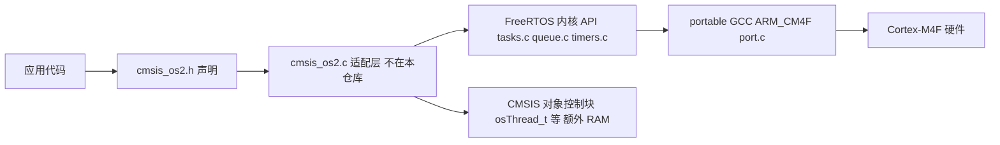
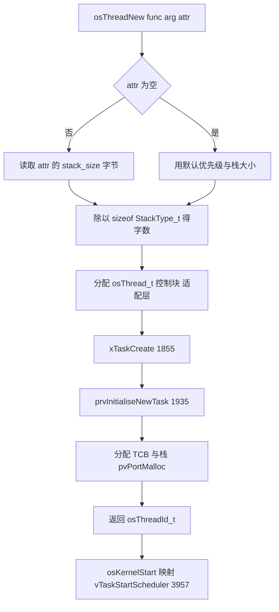

# CMSIS-RTOS2 封装层 —— osThread / osMessageQueue / osEventFlags 到内核 API 的映射

> 对应源文件：**本仓库不含 CMSIS-RTOS2 层**。`find . -iname "*cmsis*"` 无结果，`source/` 目录也不存在；内核本体为仓库根目录的 `*.c` + `include/` + `portable/`。
>
> 本文的映射依据：CMSIS-RTOS2 规范（`cmsis_os2.h` 的 API 契约）+ FreeRTOS 内核真实函数（行号见各表）。
> CMSIS 适配层在独立仓库 **CMSIS-FreeRTOS** 中，典型路径为 `CMSIS/RTOS2/FreeRTOS/Source/cmsis_os2.c` 与 `CMSIS/RTOS2/FreeRTOS/Include/cmsis_os2.h`，需另行获取。
>
> **相关条目：** [tasks.md](tasks.md)、[queue.md](queue.md)、[semphr.md](semphr.md)、[event_groups.md](event_groups.md)、[timers.md](timers.md)

---

# 第一部分：先确认仓库边界

## 1.1 本仓库有什么、没有什么

| 层 | 是否在本仓库 | 路径/说明 |
|---|---|---|
| FreeRTOS 内核 | 是 | `tasks.c`、`queue.c`、`timers.c`、`event_groups.c`、`stream_buffer.c`、`list.c`、`croutine.c` |
| 内核头文件 | 是 | `include/*.h`（`FreeRTOS.h` 3345 行） |
| 移植层 | 是 | `portable/GCC/ARM_CM4F/port.c`（972 行）、`portmacro.h`（272 行） |
| 堆方案 | 是 | `portable/MemMang/heap_1..5.c` |
| **CMSIS-RTOS2 适配层** | **否** | 无 `cmsis_os2.c`、无 `cmsis_os2.h`、无 `osThread*` 符号 |
| CMSIS-RTOS1 适配层 | 否 | 无 `cmsis_os.c` |

**验证方式（可直接复跑）：**

```bash
find . -iname "*cmsis*"            # 无输出
grep -rl "osThreadNew" .           # 无输出
```

## 1.2 为什么仍然值得单独写一条

因为实际工程（STM32CubeMX、Keil MDK、NXP MCUXpresso）几乎都通过 CMSIS-RTOS2 调 FreeRTOS。读内核时看到 `osMessageQueuePut`，必须知道它最终落到 `xQueueGenericSend` 的哪个分支、超时单位是什么、返回值怎么变。**这层映射错了，内核读得再细也会在应用层踩坑。**

## 1.3 分层结构



**关键认知：适配层不是"零成本宏"。** 每个 `osThreadNew` 除了分配 TCB + 栈，还会分配一个 `osThread_t` 控制块保存 CMSIS 属性（优先级、栈大小、状态）。这部分 RAM 在内核账本之外。

---

# 第二部分：对象映射总表

## 2.1 内核对象

| CMSIS-RTOS2 API | FreeRTOS 真实调用 | 内核实现位置 | 备注 |
|---|---|---|---|
| `osThreadNew(func, arg, attr)` | `xTaskCreate` / `xTaskCreateStatic` | tasks.c:1855 / 1435 | 栈大小单位换算见 3.1 |
| `osThreadTerminate(id)` | `vTaskDelete` | tasks.c:2367 | 删自己传 `NULL` |
| `osThreadSuspend(id)` | `vTaskSuspend` | tasks.c:3394 | |
| `osThreadResume(id)` | `vTaskResume` | tasks.c:3637 | |
| `osThreadGetId()` | `xTaskGetCurrentTaskHandle` | tasks.c | 返回当前 TCB |
| `osThreadSetPriority(id, prio)` | `vTaskPrioritySet` | tasks.c:3024 | |
| `osThreadGetPriority(id)` | `uxTaskPriorityGet` | tasks.c:2869 | |
| `osDelay(ticks)` | `vTaskDelay( ticks )` | tasks.c:2680 | 单位是 **tick**，不是 ms |
| `osMessageQueueNew(len, size, attr)` | `xQueueCreate` | queue.c:496 | `size` 是单条消息字节数 |
| `osMessageQueuePut(q, msg, prio, timeout)` | `xQueueSend` | queue.c:941 | `timeout` 单位 tick |
| `osMessageQueueGet(q, msg, prio, timeout)` | `xQueueReceive` | queue.c:1476 | |
| `osMessageQueueGetCount(q)` | `uxQueueMessagesWaiting` | queue.c:2166 | O(1) |
| `osSemaphoreNew(max, init, attr)` | `xSemaphoreCreateCounting` / `xSemaphoreCreateBinary` | queue.c:911 / semphr.h:156 | `max == 1` 时通常是二值 |
| `osSemaphoreAcquire(s, timeout)` | `xSemaphoreTake` | queue.c:1634 | |
| `osSemaphoreRelease(s)` | `xSemaphoreGive` | queue.c:941（`semGIVE_BLOCK_TIME`） | 不阻塞 |
| `osMutexNew(attr)` | `xSemaphoreCreateMutex` / `xSemaphoreCreateRecursiveMutex` | queue.c:642 | `attr_bits` 含 `osMutexRecursive` |
| `osMutexAcquire(m, timeout)` | `xSemaphoreTake` / `xSemaphoreTakeRecursive` | queue.c:1634 / 809 | 递归锁走后者 |
| `osMutexRelease(m)` | `xSemaphoreGive` / `xSemaphoreGiveRecursive` | queue.c:753 | |
| `osEventFlagsNew(attr)` | `xEventGroupCreate` | event_groups.c | |
| `osEventFlagsSet(ef, flags)` | `xEventGroupSetBits` | event_groups.c:575 | ISR 版走 `FromISR` + 定时器任务 |
| `osEventFlagsWait(ef, flags, options, timeout)` | `xEventGroupWaitBits` | event_groups.c:332 | `options` 映射见 4.2 |
| `osTimerNew(func, type, arg, attr)` | `xTimerCreate` | timers.c | 回调在 **定时器守护任务** 里跑 |
| `osTimerStart(t, ticks)` | `xTimerStart` | timers.c | `ticks` 单位 tick |
| `osThreadFlagsSet(t, flags)` | `xTaskNotify(t, flags, eSetBits)` | tasks.c:8426 | 点对点，见 4.3 |
| `osThreadFlagsWait(flags, opt, timeout)` | `xTaskNotifyWait` | tasks.c:8305 | |
| `osKernelStart()` | `vTaskStartScheduler` | tasks.c:3957 | 正常**不返回** |
| `osKernelGetTickCount()` | `xTaskGetTickCount` | tasks.c | |
| `osKernelGetTickFreq()` | `configTICK_RATE_HZ` | FreeRTOSConfig.h | 编译期常量 |
| `osKernelLock()` | `vTaskSuspendAll` | tasks.c:4165 | |
| `osKernelUnlock()` | `xTaskResumeAll` | tasks.c:4348 | |

## 2.2 创建路径示意



---

# 第三部分：栈单位换算（最常见的坑）

## 3.1 字节 → 字

FreeRTOS 的 `usStackDepth` 单位是 **`StackType_t` 的个数**，不是字节：

```c
typedef portSTACK_TYPE   StackType_t;
typedef long             BaseType_t;
typedef unsigned long    UBaseType_t;
```

（portable/GCC/ARM_CM4F/portmacro.h:58-60，逐字）
其中 `portSTACK_TYPE` 定义为 `uint32_t`（portmacro.h:55）。

CMSIS-RTOS2 的 `osThreadAttr_t.stack_size` 单位是 **字节**。所以适配层必须做：

```text
usStackDepth = stack_size_bytes / sizeof( StackType_t )
```

Cortex-M4F 上 `sizeof(StackType_t) == 4`：

| CMSIS `stack_size` | FreeRTOS `usStackDepth` | 实际栈字节 | 说明 |
|---|---|---|---|
| 128 | 32 | 128 | 太小，仅够空任务 |
| 256 | 64 | 256 | 只能跑极简函数 |
| **512** | **128** | **512** | 常见最小值（等于模板 `configMINIMAL_STACK_SIZE`） |
| 1024 | 256 | 1024 | 带 printf/浮点的任务建议起点 |
| 4096 | 1024 | 4096 | 协议栈/文件系统 |

**三个陷阱：**

1. **整除截断**：`stack_size = 510` → 127 字 → 508 字节，少 2 字节。适配层若直接整除会静默缩水；应向上取整 `(bytes + 3) / 4`。
2. **CMSIS 控制块另算**：`osThread_t` 通常从 heap 再分配几十字节，`configTOTAL_HEAP_SIZE` 要留余量。
3. **FPU 上下文另算**：CM4F 的 PendSV 会额外保存 `s16-s31`（16 个 32 位寄存器 = 64 字节）到任务栈，见 [port_cortex_m4f.md](port_cortex_m4f.md)。带浮点的任务栈要在此基础上加 64-72 字节。

## 3.2 量化示例

```c
const osThreadAttr_t attr = {
    .name = "ctrl",
    .stack_size = 1024,          /* 字节 */
    .priority = osPriorityNormal,
};
osThreadNew( vControlTask, NULL, &attr );
```

实际消耗：

| 项目 | 字节 |
|---|---|
| 任务栈（1024 B） | 1024 |
| TCB（`TCB_t`，tasks.c:425-505） | 约 100 |
| `osThread_t` 控制块 | 约 40-80（随版本） |
| 合计 | **约 1.2 KB** |

若 `configTOTAL_HEAP_SIZE = 4096`，这样一个任务就吃掉近 30%。

---

# 第四部分：返回值与语义映射

## 4.1 `osStatus_t` ↔ FreeRTOS 返回码

CMSIS-RTOS2 的状态码（以 `cmsis_os2.h` 为准）：

| `osStatus_t` | 值 | FreeRTOS 对应 | 何时出现 |
|---|---|---|---|
| `osOK` | 0 | `pdPASS`（= 1） | 成功 |
| `osError` | -1 | `pdFAIL`（= 0） | 通用失败 |
| `osErrorTimeout` | -2 | `errQUEUE_EMPTY` / `errQUEUE_FULL`（**都是 0**） | 超时 |
| `osErrorResource` | -3 | 计数不足/队列空 | 资源不可用 |
| `osErrorParameter` | -4 | `configASSERT` 失败 / NULL 参数 | 参数错 |
| `osErrorNoMemory` | -5 | `errCOULD_NOT_ALLOCATE_REQUIRED_MEMORY`（= -1） | 创建失败 |
| `osErrorISR` | -6 | 在 ISR 调了非 FromISR API | 上下文错 |
| `osErrorISRRecursive` | -7 | 同一中断重入 | |
| `osErrorPriority` | -8 | 优先级越界 | |

**最关键的坑：`pdPASS = 1`、`pdFAIL = 0`、`errQUEUE_EMPTY = 0`、`errQUEUE_FULL = 0`**（include/projdefs.h:63-66）：

```c
#define pdPASS                                   ( pdTRUE )
#define pdFAIL                                   ( pdFALSE )
#define errQUEUE_EMPTY                           ( ( BaseType_t ) 0 )
#define errQUEUE_FULL                            ( ( BaseType_t ) 0 )
```

（projdefs.h:63-66，逐字）

所以适配层**不能靠返回值区分**"队列空"和"队列满"——必须按 API 语境判断（Put 返回 0 = 满，Get 返回 0 = 空）。这也是为什么 CMSIS 封装里每个函数都单独写一段 `if( xReturn == pdPASS ) ... else ...`，而不是统一转换。

## 4.2 `osEventFlagsWait` 的 options 映射

| CMSIS 选项 | 值 | FreeRTOS 参数 |
|---|---|---|
| `osFlagsWaitAny` | 0x00000000 | `xWaitForAllBits = pdFALSE` |
| `osFlagsWaitAll` | 0x00000001 | `xWaitForAllBits = pdTRUE` |
| `osFlagsNoClear` | 0x00000002 | `xClearOnExit = pdFALSE` |

对应 `xEventGroupWaitBits( ef, flags, xClearOnExit, xWaitForAllBits, timeout )`（event_groups.c:332）。**默认（不传 NoClear）是"退出时清除"**，与 `xEventGroupWaitBits` 需要显式传 `pdTRUE` 相反——这是 CMSIS 封装里最容易写反的一处。

## 4.3 `osThreadFlags` 与通知索引

CMSIS 的 thread flags 直接映射到任务通知的 `eSetBits`：

- `osThreadFlagsSet( thread_id, flags )` → `xTaskNotify( thread_id, flags, eSetBits )`（tasks.c:8426）；
- `osThreadFlagsWait( flags, options, timeout )` → `xTaskNotifyWait( 0, clearMask, &value, timeout )`（tasks.c:8305）；
- `osFlagsWaitAny/All` 由**应用层**判断（通知本身不支持"等所有位"）；
- 默认使用索引 0（`configTASK_NOTIFICATION_ARRAY_ENTRIES == 1` 时唯一可用）。

**注意：** thread flags 与 `osEventFlags` 是两套东西——前者点对点、无独立对象；后者是共享对象、支持多等待者。

## 4.4 中断上下文规则

| CMSIS API | 能否在 ISR 调用 | 说明 |
|---|---|---|
| `osMessageQueuePut/Get` | 可以，`timeout` 必须为 0 | 适配层转 `xQueueSendFromISR` |
| `osSemaphoreRelease` | 可以 | 转 `xSemaphoreGiveFromISR` |
| `osEventFlagsSet` | 可以（有延迟） | 转 `xEventGroupSetBitsFromISR`，实际由定时器守护任务完成 |
| `osThreadFlagsSet` | 可以 | 转 `xTaskNotifyFromISR` |
| `osMutexAcquire/Release` | **不可以** | 互斥量禁止在 ISR 使用 |
| `osDelay` | **不可以** | 返回 `osErrorISR` |
| `osThreadNew` | 不可以 | 会分配内存 |

**`osEventFlagsSet` 的隐藏成本：** `xEventGroupSetBitsFromISR` 不是直接置位，而是把"置位请求"发给定时器守护任务（`configUSE_TIMERS` 必须为 1），由守护任务调用 `xEventGroupSetBits`。中断到实际置位之间有 **一个 tick 级延迟**。

---

# 第五部分：选型与接入建议

## 5.1 用 CMSIS 还是直接用 FreeRTOS API

| 场景 | 建议 | 理由 |
|---|---|---|
| STM32CubeMX 生成工程 | 用 CMSIS-RTOS2 | CubeMX 默认生成 `osThreadNew` 等 |
| 跨 RTOS 移植（FreeRTOS/RTX/ThreadX） | 用 CMSIS-RTOS2 | 应用层不绑死内核 |
| 需要极致性能/最小 RAM | 直接用 FreeRTOS | 省掉控制块与一层函数调用 |
| 需要 `xTaskNotify` 高级语义 | 直接用 FreeRTOS | CMSIS thread flags 只覆盖一部分 |
| 需要事件组"等所有位" | 两者皆可 | CMSIS `osFlagsWaitAll` 已覆盖 |

## 5.2 接入 CMSIS-FreeRTOS 的最小步骤

1. 获取 CMSIS-FreeRTOS（独立仓库），把 `CMSIS/RTOS2/FreeRTOS/Source/*.c` 加入工程。
2. 包含路径加入 `CMSIS/RTOS2/FreeRTOS/Include` 与 `CMSIS/RTOS2/Include`。
3. 确认 `FreeRTOSConfig.h` 打开：`configUSE_TIMERS=1`（事件组 FromISR 需要）、`configUSE_MUTEXES=1`、`configUSE_COUNTING_SEMAPHORES=1`、`configUSE_TASK_NOTIFICATIONS=1`。
4. `osKernelInitialize()` → 创建对象 → `osKernelStart()`（内部调 `vTaskStartScheduler`，正常不返回）。
5. 在 `FreeRTOSConfig.h` 里给 `configTOTAL_HEAP_SIZE` 留出 CMSIS 控制块的开销。

## 5.3 常见集成错误

| # | 现象 | 根因 | 修复 |
|---|---|---|---|
| 1 | 任务栈随机踩坏 | `stack_size` 按字而不是字节传 | 传字节；确认适配层除以 4 |
| 2 | `osDelay(100)` 实际延时 1 s | 以为单位是 ms | 用 `osDelay( pdMS_TO_TICKS(100) )` 或改 tick 频率 |
| 3 | `osEventFlagsSet` 在 ISR 里不生效 | `configUSE_TIMERS=0` | 打开定时器，或改用通知 |
| 4 | `osMutexAcquire` 在 ISR 断言 | 互斥量禁止 ISR | 改用二值信号量 |
| 5 | 创建 3 个任务后 heap 耗尽 | 只算了 TCB+栈，没算 `osThread_t` | 提高 `configTOTAL_HEAP_SIZE` 或用静态创建 |
| 6 | 返回值判断反了 | `pdPASS=1`、`errQUEUE_EMPTY=0` 混用 | 按 API 语境分别判断 |

## 5.4 读码路径

1. 先读本仓库 `queue.c:941`（`xQueueGenericSend`）与 `queue.c:1476`（`xQueueReceive`），建立"CMSIS Put/Get 最终落到哪"的直觉。
2. 再读 `tasks.c:8426`（通知）与 `event_groups.c:575`（事件组置位），对应 thread flags / event flags。
3. 拿到 CMSIS-FreeRTOS 源码后，按 `osThreadNew → xTaskCreate`、`osMessageQueuePut → xQueueSend` 两条线各跟一遍，重点看**栈换算**与**返回值转换**两处。
4. 最后用 `uxTaskGetStackHighWaterMark` 验证 CMSIS 传入的 `stack_size` 是否真的够用（见 [tasks.md](tasks.md)）。
