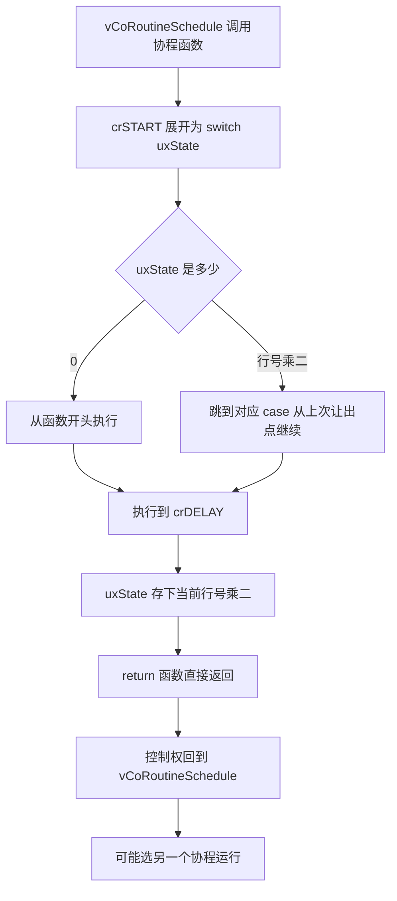
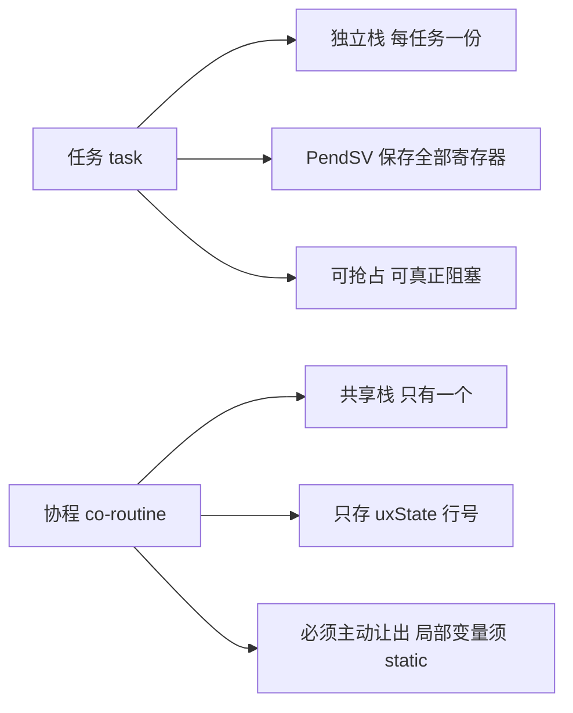
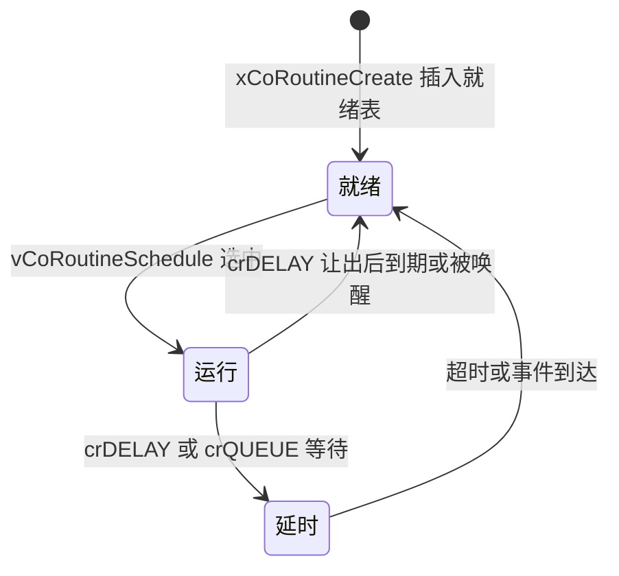

# croutine.c 与 croutine.h —— 协程完全解读

> 对应源文件（本地仓库 `~/workspace/freertos/`，FreeRTOS-Kernel V11.1.0+，行号以当前文件为准）：
> - [croutine.c](/Users/theo-richard/workspace/freertos/croutine.c)（435 行）—— 协程实现，**全文件只有 5 个函数**
> - [include/croutine.h](/Users/theo-richard/workspace/freertos/include/croutine.h)（735 行）—— 类型定义 + 协程专用宏
>
> **前置阅读：** [list.md](list.md) → [tasks.md](tasks.md) → [queue.md](queue.md)
> **配置项：** [freertosconfigh.md](freertosconfigh.md)
>
> ⚠️ **重要前提：现代 FreeRTOS 项目基本不用协程。** 本文件只有 435 行、
> 需要 `configUSE_CO_ROUTINES=1`（模板中默认是 0）、且已在官方文档中被标注为遗留特性。
> **读它是为了理解历史设计，不是为了在生产中使用。**

---

# 第一部分：先掌握什么、按什么顺序读

## 1.1 三句话讲清协程

1. **协程是"共享同一个栈的伪并发"**：所有协程跑在同一个栈上，靠**显式 `crDELAY` 主动让出**
   来切换——没有抢占，没有独立栈；
2. **它的"保存现场"不是保存寄存器，而是保存一个行号**：协程函数里用 `switch( uxState )`
   加 `case __LINE__*2:` 实现"从上次返回的地方继续"（这是 Duff's device 技巧）；
3. **省 RAM，但代价极大**：不能阻塞、函数内变量必须 `static` 才能跨让出保持、
   调试困难——所以现代 MCU 有足够 RAM 时一律用任务（task）。

## 1.2 为什么它省内存（核心对比）

| | 任务（task） | 协程（co-routine） |
|---|---|---|
| 栈 | **每个任务一个独立栈**（几百字节~几 KB） | **所有协程共用一个栈**（就是调用者的栈） |
| 切换方式 | 抢占式，PendSV 保存/恢复全部寄存器 | **协作式**，只有主动 `crDELAY`/`crQUEUE_*` 才切换 |
| 现场保存 | 整个寄存器组 + 栈指针 | **只存一个 `uxState`（行号）** |
| 局部变量跨切换 | 天然保持（在自己的栈上） | **必须 `static`**，否则丢失 |
| 阻塞能力 | 能（`vTaskDelay`、任意超时） | **不能真正阻塞**，只能"让出后再回来" |
| 抢占 | 能 | **不能**（除非别处主动让出） |
| 现代使用 | 标准做法 | 已淘汰 |

**一句话：协程用"不能有问题地保存局部变量 + 不能抢占"换来了"多个并发流共用一个栈"。**
在 2KB RAM 的 8 位 MCU 上这是必要的取舍；在今天不必要。

## 1.3 必须提前搞懂的 6 个概念

### 概念 1：`crSTART` / `crEND` 是一个 switch 语句的两半

这是理解协程的唯一钥匙。看 croutine.h 的定义（不展开宏时）：

```c
#define crSTART( pxCRCB )  switch( ((CRCB_t*)(pxCRCB))->uxState ) { case 0:
#define crEND()            }
```

所以一个协程函数的**实际形状**是：

```c
void vMyCoRoutine( CoRoutineHandle_t xHandle, UBaseType_t uxIndex )
{
    crSTART( xHandle );        // → switch( xHandle->uxState ) { case 0:

    for( ;; )
    {
        /* ... 干活 ... */
        crDELAY( xHandle, 100 );   // 里面会 return; 下次从这里继续
    }

    crEND();                   // → }
}
```

**编译器看到的其实是一个巨大的 switch**，`case` 标签由 `crSET_STATE0/1` 自动生成。

### 概念 2：`crSET_STATE0` 用 `__LINE__` 制造"恢复点"

```c
#define crSET_STATE0( xHandle )                                       \
    ( ( CRCB_t * ) ( xHandle ) )->uxState = ( __LINE__ * 2 ); return; \
    case ( __LINE__ * 2 ):
```

展开后是两段：

```c
uxState = __LINE__ * 2;   // 记住"我执行到这一行了"
return;                   // 函数返回（栈帧销毁，但协程的"进度"存在 uxState 里）
case __LINE__ * 2:        // 下次调用时，switch 直接跳到这里
```

**这就是"协程"的全部魔法**：
- 函数返回了 → 栈可以给别人用；
- 但 `uxState` 记住了行号 → 下次进入函数时 `switch` 跳到那个 `case` → 看起来"从上次那里继续"。

`crSET_STATE1`（croutine.h:257）用 `__LINE__*2 + 1`，是为了支持**同一行有两个恢复点**。

### 概念 3：局部变量必须 `static`

因为**函数每次返回时栈帧被销毁**了。普通局部变量在下次进入时是**重新初始化**的
（未初始化的话是栈上的垃圾值）。

```c
void vBad( CoRoutineHandle_t xHandle, UBaseType_t uxIndex )
{
    crSTART( xHandle );
    int count = 0;          // ✗ 每次恢复都会重置（或更糟：垃圾值）
    for( ;; ) { count++; crDELAY( xHandle, 10 ); }
    crEND();
}

void vGood( CoRoutineHandle_t xHandle, UBaseType_t uxIndex )
{
    static int count = 0;   // ✓ 存在静态区，跨恢复保持
    crSTART( xHandle );
    for( ;; ) { count++; crDELAY( xHandle, 10 ); }
    crEND();
}
```

**croutine.h:224-228 的示例注释特意强调了这一点**（"若协程变量需要在阻塞调用前后保持取值，
则必须声明为 static"）。

### 概念 4：没有抢占，只有主动让出

协程是**协作式（co-operative）**的：只有协程自己调用
`crDELAY` / `crQUEUE_SEND` / `crQUEUE_RECEIVE` 时才会让出 CPU。

**后果：一个死循环的协程会饿死所有其他协程和任务**（如果它不让出）。

对比任务：抢占式调度器会在 tick 中断里强制切换。

### 概念 5：`uxIndex` —— 用同一个函数创建多个协程实例

```c
typedef void (* crCOROUTINE_CODE)( CoRoutineHandle_t xHandle, UBaseType_t uxIndex );
```

一个协程函数可以用不同的 `uxIndex` 创建多个实例（croutine.h:127 的示例就是这么做的）：

```c
xCoRoutineCreate( vFlashCoRoutine, 0, 0 );   // 实例 0
xCoRoutineCreate( vFlashCoRoutine, 0, 1 );   // 实例 1（同一函数，不同 index）
```

**但注意：`static` 变量是函数级共享的**，两个实例会互相干扰！
所以 `uxIndex` 必须用来索引**数组**，而不是让每个实例有独立变量：

```c
static int counters[4];
counters[ uxIndex ]++;   // ✓ 每个实例独立
```

**这又是一个"用起来容易错"的地方。**

### 概念 6：`vCoRoutineSchedule` 必须由任务驱动

协程**不能自己运行**。必须有一个任务（通常是空闲任务或专门的"调度任务"）周期性地调用：

```c
void vCoRoutineSchedule( void );   // croutine.c:322
```

典型做法：在 `configUSE_IDLE_HOOK` 里调，或者开一个低优先级任务循环调用。

**`vCoRoutineSchedule` 每次调用只运行"最高优先级就绪协程的一个片段"**
（因为协程在 `crDELAY` 里 return 了，控制权回到调用者）。

## 1.4 推荐阅读顺序（4 站，30 分钟够）

```text
┌─ 第 1 站：CRCB_t 结构 ──────────────────────────────────────────
│  croutine.h:55-63
│  目标：注意到"其大小直到 uxPriority 为止必须与 TCB_t 完全一致"
│        （这是为了兼容内核感知调试器）
└──────────────────────────────────────────────────────────────────
                          │
                          ▼
┌─ 第 2 站：宏的实现（先看这个，比看 .c 更本质）────────────────────
│  croutine.h:210  crSTART      ← switch( uxState ) { case 0:
│  croutine.h:247  crEND        ← }
│  croutine.h:254  crSET_STATE0 ← 存行号 + return + case
│  croutine.h:308  crDELAY
│  目标：想通"协程 = 用 switch 手工实现的状态机"
└──────────────────────────────────────────────────────────────────
                          │
                          ▼
┌─ 第 3 站：创建与调度 ──────────────────────────────────────────
│  xCoRoutineCreate   croutine.c:111
│  vCoRoutineSchedule croutine.c:322
│  目标：明白协程怎么进就绪表、怎么被选中运行
└──────────────────────────────────────────────────────────────────
                          │
                          ▼
┌─ 第 4 站：延时与事件（与任务的对照）─────────────────────────────
│  vCoRoutineAddToDelayedList     croutine.c:184
│  xCoRoutineRemoveFromEventList  croutine.c:386
│  crQUEUE_SEND / crQUEUE_RECEIVE  croutine.h:395 / 485
└──────────────────────────────────────────────────────────────────
```

---

# 第二部分：数据类型

## 2.1 `CRCB_t`（croutine.h:55-63）

| 字段 | 行号 | 作用 |
|---|---|---|
| `pxCoRoutineFunction` | 57 | 协程函数指针 |
| `xGenericListItem` | 58 | 挂在**就绪表 / 延时表**上的链表项 |
| `xEventListItem` | 59 | 挂在**事件表**（队列/信号量等待）上的链表项 |
| `uxPriority` | 60 | 协程之间相对优先级 |
| `uxIndex` | 61 | **区分同一函数的多个实例** |
| `uxState` | 62 | **"执行到哪一行"**——协程的核心状态 |

**注意 croutine.h:63 的注释：**

> `其大小直到 uxPriority 为止必须与 TCB_t 完全一致`

这是为了让**内核感知调试器**能用同一套代码查看任务和协程的链表项。
`xGenericListItem`/`xEventListItem`/`uxPriority` 在 `TCB_t` 和 `CRCB_t` 里的偏移完全相同。

**对比 `TCB_t`：** 没有 `pxTopOfStack`（没有自己的栈！）、没有 `pxStack`、没有名字、
没有通知、没有优先级继承。**只有 6 个字段**——这就是它省内存的直接体现。

## 2.2 `uxState` 是怎么被编码的

```text
uxState 的取值           含义
──────────────          ──────────────────────────────────────
0                         协程刚开始（crSTART 的 case 0）
__LINE__ * 2              在 crSET_STATE0 处让出（偶数）
__LINE__ * 2 + 1          在 crSET_STATE1 处让出（奇数）

★ 用行号编码的好处：不需要手写状态机编号，编译器自动生成 case 标签
★ 代价：源码一旦改动（行号变化），已有的 uxState 值就失效
        → 实际影响不大，因为协程都是在启动时创建、运行期不改源码
```

## 2.3 协程与任务的结构对比

```text
        TCB_t（任务）                          CRCB_t（协程）
        ├─ pxTopOfStack  ← 每个任务一个栈        ├─ （没有！共享调用者的栈）
        ├─ pxStack                              ├─ pxCoRoutineFunction
        ├─ xStateListItem                       ├─ xGenericListItem
        ├─ xEventListItem                       ├─ xEventListItem
        ├─ uxPriority                           ├─ uxPriority
        ├─ pcTaskName[]                         ├─ uxIndex
        ├─ ulNotifiedValue[]                    ├─ uxState   ← 保存"执行到哪一行"
        └─ ...（几十个字段）                     └─ 只有 6 个字段

★ 任务的"现场"在栈上（大）；协程的"现场"在 uxState 里（2 字节）
★ 从 uxPriority 往上，两个结构的字段偏移完全一致
```

---

# 第三部分：croutine.c 的 5 个函数

## 3.1 全局变量（croutine.c:56-64）

| 变量 | 行号 | 作用 |
|---|---|---|
| `pxReadyCoRoutineLists[]` | 56 | **每个协程优先级一条就绪表** |
| `pxDelayedCoRoutineList` | 59 | 当前延时表 |
| `pxOverflowDelayedCoRoutineList` | 60 | 溢出延时表（**又是双表防回绕**） |
| `pxCurrentCoRoutine` | 64 | 当前运行的协程 |

**结构与 tasks.c 完全同构**：按优先级组织就绪表、双延时表防回绕。
这就是为什么 [list.md](list.md) 值得先读——这套链表模式被复用了三次（tasks / timers / croutine）。

**插入就绪表的内联宏（croutine.c:79-88）：**

```c
#define prvAddCoRoutineToReadyQueue( pxCRCB )
    do {
        if( ( pxCRCB )->uxPriority > uxTopCoRoutineReadyPriority )
        {
            uxTopCoRoutineReadyPriority = ( pxCRCB )->uxPriority;   // ← 顺带更新最高优先级缓存
        }
        vListInsertEnd( &pxReadyCoRoutineLists[ pxCRCB->uxPriority ],
                        &pxCRCB->xGenericListItem );               // ← O(1) 插到队尾
    } while( 0 )
```

**注意它做的两件事**：① 更新"最高就绪优先级"缓存（对应任务的
`taskRECORD_READY_PRIORITY`，tasks.c:229）；② O(1) 插到该优先级就绪表队尾。
与 `prvAddTaskToReadyList`（tasks.c:335）逻辑完全对应。

## 3.2 创建：`xCoRoutineCreate`（croutine.c:111，声明 croutine.h:134）

```text
xCoRoutineCreate( pxCoRoutineCode, uxPriority, uxIndex )      croutine.c:111
  │
  ├─ pxCoRoutine = pvPortMalloc( sizeof( CRCB_t ) )            croutine.c:124
  │    ★ 注意：只分配 CRCB，不分配栈——协程没有自己的栈
  │
  ├─ if( uxPriority >= configMAX_CO_ROUTINE_PRIORITIES )        croutine.c:139
  │     uxPriority = configMAX_CO_ROUTINE_PRIORITIES - 1        croutine.c:141
  │     （超范围就夹到最大值）
  │
  ├─ 填 uxPriority / uxIndex                                   146-147
  ├─ vListInitialiseItem( &xGenericListItem )                   151  ← list.c:151
  ├─ vListInitialiseItem( &xEventListItem )                     152
  ├─ listSET_LIST_ITEM_OWNER( &xGenericListItem, pxCoRoutine )  159  ← 指回自己
  ├─ listSET_LIST_ITEM_OWNER( &xEventListItem, pxCoRoutine )    160
  ├─ listSET_LIST_ITEM_VALUE( &xEventListItem,
  │                           configMAX_CO_ROUTINE_PRIORITIES - uxPriority )   163
  │     （与任务的 xEventListItem 编码一致：值小 = 优先级高 = 排表头）
  │
  └─ prvAddCoRoutineToReadyQueue( pxCoRoutine )                 169
       └─ vListInsertEnd( 就绪表[uxPriority], &xGenericListItem )   ← 队尾，不排序
```

**`uxState` 没在这里初始化！** 它由 `pvPortMalloc` 之后的清零逻辑处理
（`pvPortMalloc` 不清零，但 `CRCB_t` 是首次分配……**这是一个需要注意的点**：
若依赖"初始 uxState == 0"，必须在创建时显式清零。当前实现依赖 `crSTART` 的 `case 0` 兜底）。

## 3.3 调度：`vCoRoutineSchedule`（croutine.c:322）

```text
vCoRoutineSchedule( void )                        croutine.c:322
  │
  ├─ prvCheckPendingReadyList()                   croutine.c:333
  │    └─ 把挂起调度期间被唤醒的协程搬回就绪表（对应 tasks.c 的 xPendingReadyList）
  │
  ├─ prvCheckDelayedList()                        croutine.c:336
  │    └─ 遍历延时表，把到期的协程搬回就绪表
  │
  ├─ while( 就绪表[uxTopCoRoutineReadyPriority] 为空 )     croutine.c:339
  │     └─ 递减优先级，直到找到非空表
  │
  ├─ listGET_OWNER_OF_NEXT_ENTRY( pxCurrentCoRoutine,
  │                               &pxReadyCoRoutineLists[最高优先级] )   croutine.c:354
  │    └─ 与任务完全相同的 pxIndex 轮转（list.h:283）
  │
  └─ ( pxCurrentCoRoutine->pxCoRoutineFunction )(
          pxCurrentCoRoutine, pxCurrentCoRoutine->uxIndex );    croutine.c:357
       └─ ★ 调用协程函数。它会一直跑到 crDELAY 里 return 为止
```

**关键：`vCoRoutineSchedule` 调用协程函数，协程在 `crDELAY` 里 `return`，控制权回到这里。**
所以"协程切换"就是"函数返回"——**没有任何寄存器保存动作**。

## 3.4 延时：`vCoRoutineAddToDelayedList`（croutine.c:184）

```text
vCoRoutineAddToDelayedList( xTicksToDelay, pxEventList )    croutine.c:184
  ├─ uxListRemove( &pxCurrentCoRoutine->xGenericListItem )          201
  │    └─ 先离开就绪表（与 tasks.c:9024 同款）
  ├─ listSET_LIST_ITEM_VALUE( &xGenericListItem, xTimeToWake )      204
  │    └─ 写排序键 = 绝对唤醒时刻
  ├─ vListInsert( 当前或溢出延时表, &xGenericListItem )              （按时刻升序）
  └─ 若传了 pxEventList → vListInsert( pxEventList, &xEventListItem )  （等事件）
```

**注意 `pxEventList` 参数：** 协程等待队列/信号量时，同时挂延时表和事件表——
和任务完全一样（见 [list.md](list.md) 图 6）。

## 3.5 事件唤醒：`xCoRoutineRemoveFromEventList`（croutine.c:386）

由 queue.c 在"资源可用"时调用（`crQUEUE_SEND` / `crQUEUE_RECEIVE` 宏内部）。

```text
xCoRoutineRemoveFromEventList( pxEventList )    croutine.c:386
  ├─ 取事件表表头（按优先级排序，表头最优先）
  ├─ listREMOVE_ITEM( 事件项 ) + listREMOVE_ITEM( 状态项 )
  ├─ prvAddCoRoutineToReadyQueue( 该协程 )
  └─ 返回"是否需要让出"
```

**与 `xTaskRemoveFromEventList`（tasks.c:5732）几乎逐行对应**，只是操作对象从 TCB 换成 CRCB。

## 3.6 复位：`vCoRoutineResetState`（croutine.c:420）

把 `uxTopCoRoutineReadyPriority` 归零，并**重新初始化所有就绪表**（croutine.c:368-370）：

```c
for( uxPriority = 0; uxPriority < configMAX_CO_ROUTINE_PRIORITIES; uxPriority++ )
    vListInitialise( &pxReadyCoRoutineLists[ uxPriority ] );
```

用于**单元测试**场景（每个测试用例之间复位全部状态）。

---

# 第四部分：croutine.h 的协程专用宏

| 宏 | 行号 | 作用 |
|---|---:|---|
| `crSTART( pxCRCB )` | 210 | **协程函数开头必须调用**。展开为 `switch( uxState ) { case 0:` |
| `crEND()` | 247 | **协程函数结尾必须调用**。展开为 `}` |
| `crSET_STATE0( xHandle )` | 254 | 存 `__LINE__*2` 到 uxState，`return`，并生成 `case` 标签 |
| `crSET_STATE1( xHandle )` | 257 | 同上，但用 `__LINE__*2+1`（同一行两个恢复点） |
| `crDELAY( xHandle, xTicksToDelay )` | 308 | 延时让出（内部就是 `crSET_STATE0` + 延时列表操作） |
| `crQUEUE_SEND(...)` | 395 | 向队列发送，满则让出等待 |
| `crQUEUE_RECEIVE(...)` | 485 | 从队列接收，空则让出等待 |
| `crQUEUE_SEND_FROM_ISR(...)` | 589 | ISR 里向队列发送（唤醒协程） |
| `crQUEUE_RECEIVE_FROM_ISR(...)` | 699 | ISR 里从队列接收 |

**宏数量与任务版的对照：** 任务的 `xQueueSend` 可以被任何上下文调用；
协程必须用 `crQUEUE_*` 版本，因为它要"让出后从原处继续"，语义不同。

---

# 第五部分：图

## 5.1 图 1：协程的"切换"到底是什么

```text
任务切换（抢占式）                          协程切换（协作式）

  任务 A 运行                                协程 A 运行
       │                                          │
  SysTick 中断                                crDELAY( h, 10 )
       │                                          ├─ uxState = __LINE__*2
       ▼                                          └─ return  ← 函数直接返回！
  PendSV 汇编                                     │
  ├─ 把 A 的 16 个寄存器压入 A 的栈                ▼
  ├─ A.pxTopOfStack = 栈顶                    回到 vCoRoutineSchedule
  ├─ 从 B.pxTopOfStack 弹出寄存器                  │
  └─ 跳到 B 上次的 PC                              ▼
                                            就绪表里还有别的协程吗？
  代价：保存/恢复 16+ 个寄存器                     ├─ 有 → 调用它（在同一个栈上）
       每个任务一个栈                              └─ 没有 → 返回调用者
                                                
                                            协程 A 下次被调用时：
                                              vCoRoutineSchedule → A( h, i )
                                                → crSTART → switch( uxState )
                                                   → 直接跳到 case __LINE__*2
                                                     → 从 crDELAY 后面继续

★ 关键：寄存器从来没被保存过——因为函数返回时 ABI 已经保证了调用者保存寄存器
★ 代价：所有局部变量都随栈帧消失 → 必须 static
```

## 5.2 图 2：一个协程函数的真实形状

```text
你写的代码                              编译器看到的（宏展开后）

void vMyCo( CoRoutineHandle_t h,        void vMyCo( CoRoutineHandle_t h,
            UBaseType_t i )                          UBaseType_t i )
{                                       {
  crSTART( h );                           switch( ((CRCB_t*)h)->uxState ) {
                                          case 0:
  for( ;; )                                 for( ;; ) {
  {                                           /* 干活 */
     /* 干活 */                              uxState = 30*2;   ← crDELAY 展开
     crDELAY( h, 100 );                      return;
  }                                           case 60:          ← 恢复点
                                                /* 从这继续 */
                                            }
  crEND();                                }
}                                       }

★ 只有 1 个 switch 和 N 个 case，没有任何栈操作
★ uxState 就是"程序计数器"的替身
```

## 5.3 图 3：协程共享栈 vs 任务独立栈

```text
任务（每个独立栈）

  ┌─ TCB_A ────    ┌─ TCB_B ────    ┌─ TCB_C ────
  │ 栈 A           │ 栈 B           │ 栈 C            3 个栈 = 3 × 几百字节
  │ 512 字         │ 512 字         │ 512 字
  └─────────────   └─────────────   └─────────────

协程（共享一个栈）

  ┌─ CRCB_A ──    ┌─ CRCB_B ──    ┌─ CRCB_C ──
  │ uxState       │ uxState       │ uxState        3 × 2 字节
  └────────────   └────────────   └────────────
        │               │               │
        └───────────────┴───────────────┘
                        │
                        ▼
     都跑在"调用 vCoRoutineSchedule 的那个任务"的栈上
        ┌─ 调度任务的栈（共用）──────────────
        │  协程的局部变量、函数调用都在这上面
        └──────────────────────────────────

★ 省下的内存 = (N-1) × 栈大小
★ 代价 = 协程不能"停在某处保存现场"，只能在函数返回点恢复
```

## 5.4 图 4：vCoRoutineSchedule 的一次调用

```text
vCoRoutineSchedule()                              croutine.c:322
  │
  ├─ prvCheckPendingReadyList()                   croutine.c:333
  │    把挂起期间被唤醒的协程搬回就绪表
  ├─ prvCheckDelayedList()                        croutine.c:336
  │    把到期的协程从延时表搬回就绪表
  │
  ├─ 找最高优先级的非空就绪表                      croutine.c:339
  │    while( listLIST_IS_EMPTY( &pxReadyCoRoutineLists[ prio ] ) )
  │        prio--;
  │
  ├─ listGET_OWNER_OF_NEXT_ENTRY( &pxCurrentCoRoutine, 该表 )   croutine.c:354
  │    pxIndex 轮转（同优先级公平）
  │
  └─ 调用 pxCoRoutineFunction( pxCurrentCoRoutine, uxIndex )     croutine.c:357
       │
       ├─ 协程执行到 crDELAY → uxState=行号, return  ← 回到这里
       │     （一次调用只运行一个片段！）
       │
       └─ 下次再进 vCoRoutineSchedule，可能选中另一个协程

★ 所以"vCoRoutineSchedule 运行最高优先级协程"其实是"运行它的一个片段"
★ 想让它继续跑，必须再次调用 vCoRoutineSchedule
```

## 5.5 图 5：协程等待队列（与任务同构）

```text
crQUEUE_RECEIVE( h, pxQueue, buf, wait, &result )     croutine.h:485
  │
  ├─ 队列有数据 → 直接取走，返回（不让出）
  │
  └─ 队列空：
       ├─ vCoRoutineAddToDelayedList( wait, &pxQueue->xTasksWaitingToReceive )
       │    croutine.c:184
       │    ├─ uxListRemove( &xGenericListItem )        201  ← 离开就绪表
       │    ├─ listSET_LIST_ITEM_VALUE( 唤醒时刻 )       204
       │    ├─ vListInsert( 延时表, &xGenericListItem )       ← 等超时
       │    └─ vListInsert( 队列事件表, &xEventListItem )     ← 等数据
       │
       └─ crSET_STATE0 → 让出

   唤醒（两条路径，与任务完全相同）：
     ① 数据到达 → xCoRoutineRemoveFromEventList   croutine.c:386
     ② 超时     → prvCheckDelayedList             croutine.c:336

★ 数据结构复用 list.c，逻辑照搬 tasks.c，只是"切换"实现完全不同
```

## 5.6 图 6：Mermaid 版本

### 协程的恢复机制



### 与任务的对比



### 协程状态



---

# 第六部分：易错点与速查

## 6.1 最容易误解的 7 处

| # | 误解 | 实际 |
|---|---|---|
| 1 | 以为协程有独立栈 | **所有协程共用一个栈**（调用 `vCoRoutineSchedule` 的任务的栈） |
| 2 | 用普通局部变量保存状态 | **必须 `static`**，否则每次恢复都重置/读到垃圾（croutine.h:224-228 明确说明） |
| 3 | 以为协程能被抢占 | **不能**。不让出的协程会饿死所有其他协程和任务 |
| 4 | 以为协程能"真正阻塞" | 只是"让出后再回来"，底层还是靠延时表 + 事件表 |
| 5 | 以为 `crDELAY` 里保存了寄存器 | 只保存了一个 `uxState`（行号）；寄存器靠 ABI 自然保存 |
| 6 | 用同一函数创建多个协程却用 `static` 变量 | 两个实例会**互相干扰**；要配 `uxIndex` 索引数组 |
| 7 | 以为协程会自动运行 | 必须有个任务周期性地调 `vCoRoutineSchedule`（croutine.c:322） |

## 6.2 任务 vs 协程选型

| 场景 | 选 |
|---|---|
| 任何现代项目 | **任务**（协程已淘汰） |
| RAM 极小（几 KB）、并发流很多、无需抢占 | 协程（历史方案） |
| 需要阻塞、需要优先级、需要调试 | 任务 |
| 需要在中断里唤醒 | 都可，但协程用 `crQUEUE_*_FROM_ISR` |

## 6.3 行号自查命令

```bash
grep -n "^BaseType_t xCoRoutineCreate"           croutine.c
grep -n "^void vCoRoutineSchedule"              croutine.c
grep -n "^void vCoRoutineAddToDelayedList"      croutine.c
grep -n "^BaseType_t xCoRoutineRemoveFromEventList" croutine.c
grep -n "^void vCoRoutineResetState"            croutine.c
```

期望（当前 croutine.c 共 435 行）：

```text
111:BaseType_t xCoRoutineCreate( crCOROUTINE_CODE pxCoRoutineCode,
184:void vCoRoutineAddToDelayedList( TickType_t xTicksToDelay,
322:void vCoRoutineSchedule( void )
386:BaseType_t xCoRoutineRemoveFromEventList( const List_t * pxEventList )
420:void vCoRoutineResetState( void )
```

```bash
grep -n "#define crSTART\|#define crEND\|#define crSET_STATE0\|#define crDELAY" include/croutine.h
# 期望：210 crSTART / 247 crEND / 254 crSET_STATE0 / 308 crDELAY
```

## 6.4 一句话总结

- **协程 = 用 `switch( uxState )` + `case __LINE__*2:` 手工实现的状态机**，
  本质是把"程序计数器"存进一个 2 字节字段，从而让函数能"返回后再从原处继续"。
- **省栈不省逻辑**：共享一个栈 → 省内存；但局部变量必须 `static`、不能抢占、不能真正阻塞。
- **数据结构与任务完全同构**：按优先级就绪表 + 双延时表 + 事件表 + pxIndex 轮转，
  全部复用 [list.md](list.md) 的链表。
- **已被淘汰**：`configUSE_CO_ROUTINES=0`（模板默认），现代项目一律用任务。
  读它是为了理解"一个字节的栈都舍不得的时代"如何做并发。

---

## 附：本知识库文档导航

| 文档 | 内容 | 建议顺序 |
|---|---|---|
| [freertosconfigh.md](freertosconfigh.md) | 配置项详解 + 平台差异 | 0（先了解配置） |
| [list.md](list.md) | 内核链表（数据结构基础） | 1 |
| [tasks.md](tasks.md) | 任务管理与调度器 | 2 |
| [queue.md](queue.md) | 队列 / 信号量 / 互斥量 | 3 |
| [timers.md](timers.md) | 软件定时器 | 4 |
| [event_groups.md](event_groups.md) | 事件组 | 5 |
| [stream_buffer.md](stream_buffer.md) | 流缓冲 / 消息缓冲 | 6 |
| **croutine.md**（本文） | 协程（遗留特性） | 7 |
| [port_cortex_m4f.md](port_cortex_m4f.md) | Cortex-M4F 移植层（上下文切换） | 8（最后串起来） |
