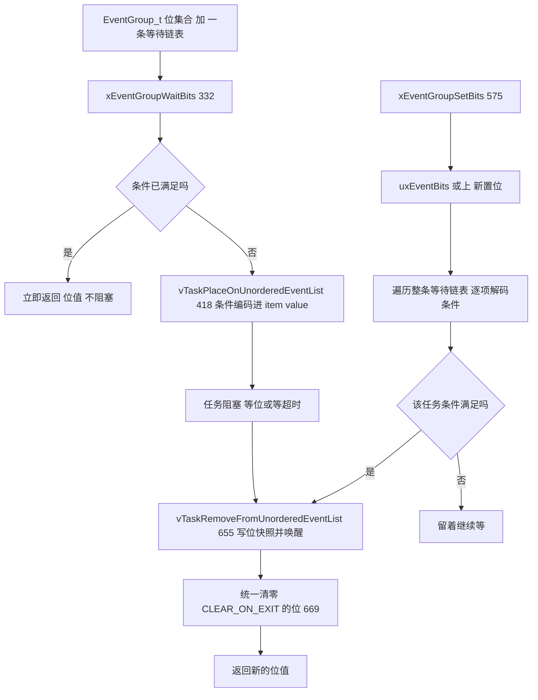
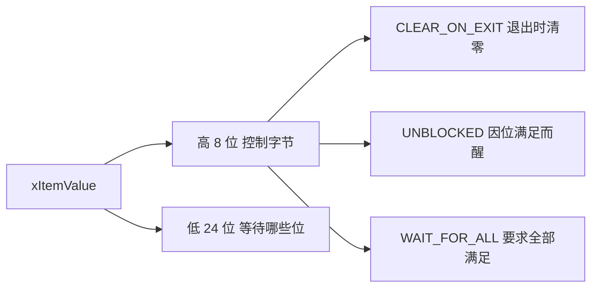
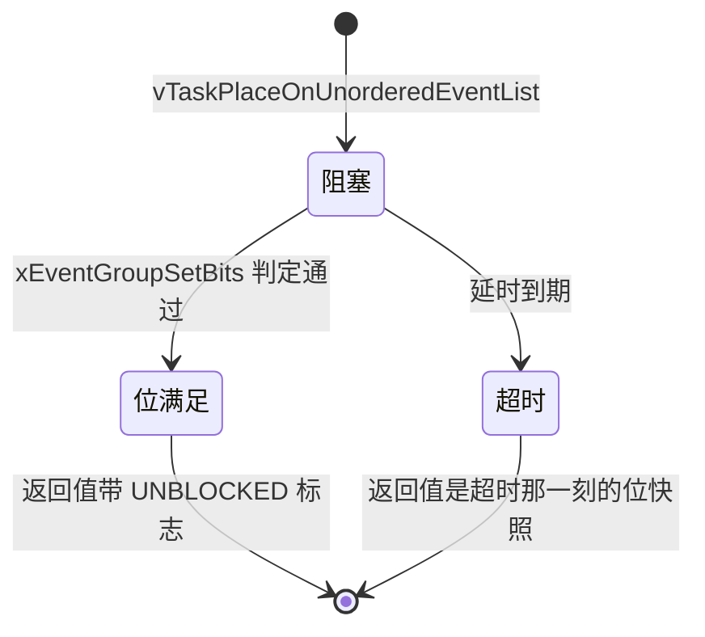

# event_groups.c 与 event_groups.h —— 事件组完全解读

> 对应源文件（本地仓库 `~/workspace/freertos/`，FreeRTOS-Kernel V11.1.0+，行号以当前文件为准）：
> - [event_groups.c](/Users/theo-richard/workspace/freertos/event_groups.c)（928 行）—— 事件组实现
> - [include/event_groups.h](/Users/theo-richard/workspace/freertos/include/event_groups.h)（748 行）—— 类型与 API 声明
>
> **前置阅读：** [list.md](list.md) → [tasks.md](tasks.md) → [queue.md](queue.md) → [timers.md](timers.md)
> **配置项：** [freertosconfigh.md](freertosconfigh.md)

---

# 第一部分：先掌握什么、按什么顺序读

## 1.1 一句话讲清事件组

**事件组 = 一个 32 位（或 16/64 位）的"标志位集合" + 一条等待任务链表。**

任务可以：

- **等一组位中的任意一位被置位**（"任一满足"）；
- **等一组位全部被置位**（"全部满足"）；
- 置位/清零位（任务或中断里）。

**与信号量最大的区别：事件组能一次等多个条件，而且"置位"会广播——可以同时唤醒多个任务。**

## 1.2 与其他同步机制的本质区别

| | 信号量 | 队列 | **事件组** |
|---|---|---|---|
| 一次等多个条件 | 不能 | 不能 | **能** |
| 置位是否"消耗" | 是（take 后减 1） | 是（收走就没了） | **否**（位一直保持） |
| 唤醒几个任务 | 一个（最高优先级） | 一个 | **所有满足条件的** |
| 位能否被多个任务共享 | 不能 | 不能 | **能**（广播特性） |
| 数据 | 无 | 有 | 只有标志 |

**"不消耗"是最关键的特性**：置位后位一直是 1，直到有人清零或设置了"退出时清零"。
所以事件组天然适合"广播 + 多个任务各自响应"以及"状态标志"场景。

## 1.3 必须提前搞懂的 6 个概念

### 概念 1：可用位数不是 32，而是 24

```c
#define eventEVENT_BITS_CONTROL_BYTES    ( ( uint32_t ) 0xff000000U )   // event_groups.h:52
```

**`EventBits_t` 的高 8 位被内核征用了**（用于编码等待条件），所以 32 位 tick 类型下：

> **用户可用事件位 = 低 24 位**（`bit0 ~ bit23`）

如果你试图置位 bit24 及以上，`xEventGroupSetBits` 会触发断言（event_groups.c:592）：

```c
configASSERT( ( uxBitsToSet & eventEVENT_BITS_CONTROL_BYTES ) == 0 );
```

**这是事件组最容易踩的坑**：不是"32 位事件组"，是"24 位"。

### 概念 2：等待条件被编码进"链表项的 xItemValue"

这是本文件最巧妙的设计。任务挂到 `xTasksWaitingForBits` 上时，
它的 `xEventListItem.xItemValue` 不是优先级，而是**打包的等待条件**：

```text
  xItemValue 的高 8 位 = 控制位        低 24 位 = 等待哪些位

    高 8 位（控制字节）        低 24 位（等待哪些位）
    ├─ 控制字节 ─────────────┼─ uxBitsToWaitFor ─────────────
    │  见下方控制位含义         │  任务在等哪些位
    └─────────────────────────┴──────────────────────────────

控制位含义（以 32 位 TickType 为例，event_groups.h:44-47）：
  eventCLEAR_EVENTS_ON_EXIT_BIT  0x01000000   → 条件满足后清零这些位
  eventUNBLOCKED_DUE_TO_BIT_SET  0x02000000   → 标记"因位满足而被唤醒"（非超时）
  eventWAIT_FOR_ALL_BITS         0x04000000   → 要求"全部满足"（否则"任一满足"）
  eventEVENT_BITS_CONTROL_BYTES  0xff000000   → 控制字节掩码
```

**为什么要编码进 item value？** 因为置位时（`xEventGroupSetBits`）需要知道**每个等待者
各自在等什么条件**——这些条件各不相同。把条件随任务一起存在链表项里，
置位时逐个解码即可，不需要额外的数据结构。

### 概念 3：用"无序事件链表"，不是按优先级排序

普通事件（队列/信号量）用 `vTaskPlaceOnEventList`（按优先级排序，表头最优先）。
**事件组用的是 `vTaskPlaceOnUnorderedEventList`**（tasks.c:5826）：

```c
vTaskPlaceOnUnorderedEventList( &( pxEventBits->xTasksWaitingForBits ),
                                ( uxBitsToWaitFor | uxControlBits ), xTicksToWait );
                                // event_groups.c:418
```

**原因：item value 已经被条件占用了，没有空间再放优先级。** 所以事件组的等待表是
**先进先出（无序）**的，置位时**遍历整条链表**检查每个任务的条件。

**代价：事件组的置位复杂度是 O(等待任务数)**，而队列/信号量是 O(1)（取表头）。
这是功能换性能的取舍。

### 概念 4：置位会唤醒**所有**满足条件的任务（不 break）

看 `xEventGroupSetBits` 的循环（event_groups.c:606-663）：**没有任何 `break`**。

```c
while( pxListItem != pxListEnd )
{
    pxNext = listGET_NEXT( pxListItem );        // ★ 先缓存下一个
    ... 解码条件、判断是否满足 ...
    if( xMatchFound != pdFALSE )
        vTaskRemoveFromUnorderedEventList( pxListItem, ... );   // 摘掉这个
    pxListItem = pxNext;                        // ★ 用缓存而不是 pxListItem->pxNext
}
```

**注意第 608 行和 662 行的细节**：必须**先缓存 `pxNext`**，因为当前项可能已被移出链表，
此时 `pxListItem->pxNext` 已不可靠（源码注释在 event_groups.c:658-661 特意说明了这一点）。

**这个"不 break"就是事件组的广播能力来源。**

### 概念 5：`xEventGroupWaitBits` 的返回值有讲究

返回的 `EventBits_t` 不只是当前位值，还可能带 `eventUNBLOCKED_DUE_TO_BIT_SET` 标志：

```c
uxReturn = pxEventBits->uxEventBits;                                     // 当前位值
if( ( uxReturn & eventUNBLOCKED_DUE_TO_BIT_SET ) == 0 )                  // 不是因位满足而醒
{
    // → 说明是超时醒的，返回值就是超时时刻的位快照
}
else
{
    uxReturn &= ~eventEVENT_BITS_CONTROL_BYTES;                          // 掉标志，只留位
}
```

所以**调用者可以判断自己为什么醒**：

- 返回值里带了 `eventUNBLOCKED_DUE_TO_BIT_SET`（会被内核剥掉）→ 位满足了；
- 没带 → 超时了，返回值是超时那一刻的位快照。

## 1.4 推荐阅读顺序（5 站）

```text
┌─ 第 1 站：EventGroup_t 结构 ─────────────────────────────────────
│  event_groups.c:66-78   （只有 2 个核心字段）
│  目标：认清"一个位集合 + 一条等待链表"
└──────────────────────────────────────────────────────────────────
                          │
                          ▼
┌─ 第 2 站：创建 ──────────────────────────────────────────────────
│  xEventGroupCreate        event_groups.c:159
│  xEventGroupCreateStatic  event_groups.c:97
│  目标：注意创建只是分配结构 + 初始化链表 + 位清零
└──────────────────────────────────────────────────────────────────
                          │
                          ▼
┌─ 第 3 站：位操作（读这段就懂数据模型）────────────────────────────
│  xEventGroupSetBits       event_groups.c:575   ★ 遍历+广播唤醒
│  xEventGroupClearBits     event_groups.c:498
│  目标：看清"条件怎么编码、怎么解码、怎么唤醒"
└──────────────────────────────────────────────────────────────────
                          │
                          ▼
┌─ 第 4 站：等待（核心）───────────────────────────────────────────
│  xEventGroupWaitBits      event_groups.c:332
│  prvTestWaitCondition     event_groups.c:816   ★ 任一 / 全部 两种判定
│  目标：搞清"快速路径（已满足）+ 慢路径（挂无序链表）"
└──────────────────────────────────────────────────────────────────
                          │
                          ▼
┌─ 第 5 站：中断版与同步点 ────────────────────────────────────────
│  xEventGroupSetBitsFromISR  event_groups.c:857  （委托给定时器任务！）
│  xEventGroupSync            event_groups.c:200  （多方会合）
└──────────────────────────────────────────────────────────────────
```

---

# 第二部分：数据结构

## 2.1 `EventGroup_t`（event_groups.c:66-78）

| 字段 | 行号 | 作用 |
|---|---|---|
| `uxEventBits` | 68 | **位集合**（`EventBits_t` = `TickType_t`）。低 24 位用户可用 |
| `xTasksWaitingForBits` | 69 | **等待任务链表**（list.h 的 `List_t`，无序） |
| `uxEventGroupNumber` | 72 | 调试编号（`configUSE_TRACE_FACILITY=1`） |
| `ucStaticallyAllocated` | 76 | 是否静态分配 |

**只有两个核心字段。**

## 2.2 两个"副作用字段"其实存在任务里

事件组自身很薄，因为**等待条件存在等待者的链表项里**（见概念 2）。
所以：

- 事件组不知道"谁在等什么"——它只持有一条链表；
- 每个等待者自己在 `xEventListItem.xItemValue` 里带着"我在等哪些位 + 控制位"。

**这是"把状态存在数据里"而不是"存在管理结构里"的典型做法**，省掉了事件组里
一张"任务 → 条件"的映射表。

## 2.3 位布局（32 位 TickType 下）

```text
  bit31                            bit24 bit23                     bit0
  ├────── 控制字节（内核使用，用户不可碰）──────┼──── 用户可用事件位（24 位）──────
  │  任一位为 1 → 说明这个值不是"纯位值"        │  bit0 ~ bit23 可自由使用
  └─────────────────────────────────────────────┴──────────────────────────────────

  ★ 所以 xEventGroupSetBits( eg, 0x01000000 ) 会触发断言（碰了控制位）
```

---

# 第三部分：event_groups.c 核心函数

## 3.1 创建：`xEventGroupCreate`（event_groups.c:159）

```text
xEventGroupCreate()
  ├─ pvPortMalloc( sizeof( EventGroup_t ) )
  ├─ uxEventBits = 0                      ← 所有位清零
  ├─ vListInitialise( &xTasksWaitingForBits )   ← list.c:89，空链表（哨兵自指）
  └─ 返回句柄
```

**创建后所有位都是 0**，任何"等某位"的任务都会立刻阻塞（除非超时为 0）。

## 3.2 等待：`xEventGroupWaitBits`（event_groups.c:332）

```text
xEventGroupWaitBits( xEventGroup, uxBitsToWaitFor, xClearOnExit, xWaitForAllBits, xTicksToWait )
  event_groups.c:332
  │
  ├─ configASSERT( 没碰控制位 )                              event_groups.c:约 349
  │
  ├─ 构造控制字：
  │    uxControlBits = 0
  │    if( xClearOnExit )      uxControlBits |= eventCLEAR_EVENTS_ON_EXIT_BIT   （约 398）
  │    if( xWaitForAllBits )   uxControlBits |= eventWAIT_FOR_ALL_BITS          （约 407）
  │
  ├─ vTaskSuspendAll()                                        event_groups.c:约 370
  │
  ├─ 快速路径：当前位已经满足条件？
  │    prvTestWaitCondition( uxEventBits, uxBitsToWaitFor, xWaitForAllBits )    event_groups.c:816
  │      ├─ 任一模式：( 当前 & 等待 ) != 0        → 满足
  │      └─ 全部模式：( 当前 & 等待 ) == 等待      → 满足
  │    │
  │    ├─ 满足 + xClearOnExit → 清零对应位
  │    └─ 满足 → 直接返回当前位值（不进阻塞）
  │
  └─ 不满足 且 xTicksToWait > 0 → 慢路径：
       vTaskPlaceOnUnorderedEventList( &xTasksWaitingForBits,
                                       uxBitsToWaitFor | uxControlBits,
                                       xTicksToWait )           event_groups.c:418
         └─ ★ 条件编码进 item value，挂到无序事件表 + 延时表（tasks.c:5826）

       醒来后判断：                                event_groups.c:448
         ├─ uxReturn 带 eventUNBLOCKED_DUE_TO_BIT_SET ？
         │    ├─ 是 → 因位满足而醒（bits 已被 xEventGroupSetBits 写进 item value）
         │    └─ 否 → 超时醒，uxReturn 是超时那一刻的位快照
         └─ 若 xClearOnExit 且是"位满足"路径 → 清零对应的位
```

**要点：`xEventGroupWaitBits` 的"快速路径"让已满足的条件不进入阻塞**——
这是它比"先查再等"更好的地方（原子的查+等）。

## 3.3 置位：`xEventGroupSetBits`（event_groups.c:575）—— 广播唤醒

这是本文件最核心的函数，完整流程：

```text
xEventGroupSetBits( xEventGroup, uxBitsToSet )                      event_groups.c:575
  │
  ├─ configASSERT( xEventGroup )
  ├─ configASSERT( ( uxBitsToSet & eventEVENT_BITS_CONTROL_BYTES ) == 0 )   event_groups.c:592
  │
  ├─ vTaskSuspendAll()                                              event_groups.c:596
  │
  ├─ pxEventBits->uxEventBits |= uxBitsToSet                       event_groups.c:603
  │    （先把位置上去，再检查谁被唤醒）
  │
  ├─ pxListItem = listGET_HEAD_ENTRY( pxList )                     event_groups.c:600
  │
  ├─ while( pxListItem != pxListEnd )                              event_groups.c:606
  │    ├─ pxNext = listGET_NEXT( pxListItem )          ★ 先缓存      608
  │    ├─ uxBitsWaitedFor = listGET_LIST_ITEM_VALUE( pxListItem )     609
  │    ├─ uxControlBits     = uxBitsWaitedFor & 控制字节掩码          613
  │    ├─ uxBitsWaitedFor  &= ~控制字节掩码                           614
  │    │
  │    ├─ 判定（与 prvTestWaitCondition 同逻辑）：
  │    │    ├─ 任一模式：( 等待 & 当前位集 ) != 0        → 匹配      619
  │    │    └─ 全部模式：( 等待 & 当前位集 ) == 等待      → 匹配      628
  │    │
  │    ├─ 若匹配：
  │    │    ├─ 若控制字含 CLEAR_ON_EXIT → 累积到 uxBitsToClear        643
  │    │    └─ vTaskRemoveFromUnorderedEventList(
  │    │             pxListItem,
  │    │             pxEventBits->uxEventBits | eventUNBLOCKED_DUE_TO_BIT_SET )
  │    │             event_groups.c:655
  │    │          ├─ 把"当前位值 + 已满足标志"写进任务的 item value
  │    │          └─ 把任务从等待表摘掉、挂回就绪表（tasks.c:5826）
  │    │
  │    └─ pxListItem = pxNext      ★ 用缓存值，不用 pxListItem->pxNext   662
  │
  ├─ pxEventBits->uxEventBits &= ~uxBitsToClear                    event_groups.c:669
  │    （所有 CLEAR_ON_EXIT 的清零累加后统一做，避免影响后续等待者的判定）
  │
  ├─ uxReturnBits = pxEventBits->uxEventBits                       event_groups.c:672
  ├─ xTaskResumeAll()
  └─ return uxReturnBits
```

**三个容易忽略的细节：**

| 细节 | 行号 | 为什么重要 |
|---|---|---|
| 先缓存 `pxNext` | 608 / 662 | 当前项可能被摘走，`pxListItem->pxNext` 会失效（源码注释 658-661 特意说明） |
| 清零延后到循环之后 | 669 | 若边循环边清，后面的等待者会看到被清掉的位，判定出错 |
| 唤醒时写入"当前位值快照" | 655 | 让任务知道醒来时位是什么样（而不是醒来后再读，可能已变） |

## 3.4 清零：`xEventGroupClearBits`（event_groups.c:498）与 ISR 版（534）

```c
EventBits_t xEventGroupClearBits( eg, uxBitsToClear )    // event_groups.c:498
{
    进临界区
    uxEventBits &= ~uxBitsToClear
    返回清零前的值
}
```

**注意：清零不会唤醒任何任务。** 它只是让位变 0。
`xEventGroupClearBitsFromISR`（event_groups.c:534）通过定时器任务委托执行
（因为要进临界区，ISR 里不能直接做）。

## 3.5 中断里置位：`xEventGroupSetBitsFromISR`（event_groups.c:857）

**这里有个重要依赖：**

```c
#if ( ( INCLUDE_xTimerPendFunctionCall == 1 ) && ( configUSE_TIMERS == 1 ) )
    BaseType_t xEventGroupSetBitsFromISR( ... )    // event_groups.c:857
```

**`xEventGroupSetBitsFromISR` 需要定时器功能**：它不直接置位，而是把
"置位动作"作为一个回调函数**委托给定时器服务任务**执行：

```text
xEventGroupSetBitsFromISR( eg, bits, pxWoken )        event_groups.c:857
  └─ xTimerPendFunctionCallFromISR( vEventGroupSetBitsCallback,
                                    eg, bits, pxWoken )    （timers.c:1280）
       └─ 定时器服务任务执行 vEventGroupSetBitsCallback( eg, bits )   event_groups.c:785
            └─ 内部调用 xEventGroupSetBits( eg, bits )     ← 真正的置位在任务里做
```

**所以如果你的配置里 `configUSE_TIMERS=0`，就不能用 `xEventGroupSetBitsFromISR`。**
这个依赖关系很容易被忽略（在当前模板配置 `configUSE_TIMERS=1` 下没问题）。

**为什么不在 ISR 里直接做？** 因为 `xEventGroupSetBits` 要遍历整条等待链表、
可能要摸调度链表、可能触发切换——这些在 ISR 里代价太高且不安全。
（对比 [timers.md](timers.md) 里讲过的"ISR 只记账、唤醒推迟"是同一个思路。）

## 3.6 会合同步：`xEventGroupSync`（event_groups.c:200）

```text
xEventGroupSync( eg, uxBitsToSet, uxBitsToWaitFor, xTicksToWait )
  event_groups.c:200
  ├─ 先置位 uxBitsToSet                          （告诉别人"我到了"）
  ├─ 再等 uxBitsToWaitFor 全部满足                （等别人也到）
  └─ 若满足时集齐了 → 用 CLEAR_ON_EXIT 清掉       （会合点自动复位）
```

**用途：多方会合 / 屏障（barrier）。** 三个任务各自到一个集合点：

```text
  任务 A: xEventGroupSync( eg, BIT_A, BIT_A|BIT_B|BIT_C, portMAX_DELAY )
  任务 B: xEventGroupSync( eg, BIT_B, BIT_A|BIT_B|BIT_C, portMAX_DELAY )
  任务 C: xEventGroupSync( eg, BIT_C, BIT_A|BIT_B|BIT_C, portMAX_DELAY )

  每个任务先置自己的位，再等"三个位都齐" → 齐了之后一起被唤醒，且自动清零
  效果：三个任务严格对齐到同一个时刻继续往下跑
```

**注意 `xEventGroupSync` 内部的 `vTaskPlaceOnUnorderedEventList` 在 event_groups.c:249，
控制字里同时带了 `CLEAR_EVENTS_ON_EXIT_BIT | WAIT_FOR_ALL_BITS`。**

## 3.7 删除：`vEventGroupDelete`（event_groups.c:682）

```text
vEventGroupDelete( eg )
  ├─ vTaskSuspendAll()
  ├─ while( 等待表非空 )
  │     └─ vTaskRemoveFromUnorderedEventList( 表头, eventUNBLOCKED_DUE_TO_BIT_SET )
  │          └─ 把所有等待者以"位满足"的假象唤醒（避免它们永久阻塞）   event_groups.c:704
  ├─ xTaskResumeAll()
  └─ vPortFree( eg )
```

**注意它把等待者的返回值设为 `eventUNBLOCKED_DUE_TO_BIT_SET`**，
这样那些任务醒来后**不会**误以为超时。不过调用者仍应自己保证"不要在还有人等时删除事件组"。

---

# 第四部分：event_groups.h API 一览

| API | event_groups.c | 说明 |
|---|---:|---|
| `xEventGroupCreate` | 159 | 动态创建 |
| `xEventGroupCreateStatic` | 97 | 静态创建 |
| `xEventGroupClearBits` | 498 | 清位（任务级） |
| `xEventGroupClearBitsFromISR` | 534 | 清位（中断级，委托给定时器任务） |
| `xEventGroupSetBits` | 575 | **置位 + 广播唤醒**（任务级） |
| `xEventGroupSetBitsFromISR` | 857 | 置位（中断级，**需 `configUSE_TIMERS=1`**） |
| `xEventGroupGetBitsFromISR` | 552 | 读位（中断级） |
| `xEventGroupWaitBits` | 332 | **等待（任一 / 全部）** |
| `xEventGroupSync` | 200 | 会合（置位 + 等全部 + 自动清零） |
| `vEventGroupDelete` | 682 | 删除 |
| `xEventGroupGetStaticBuffer` | 737 | 取静态缓冲区（静态创建时） |
| `vEventGroupSetNumber` | 908 | 调试编号 |
| `vEventGroupSetBitsCallback` | 785 | **内部**：ISR 委托的实际执行体 |
| `vEventGroupClearBitsCallback` | 802 | **内部**：同上 |

**注意：事件组的 API 没有 `FromISR` 的"等待"版本**——中断里不能阻塞。

---

# 第五部分：图

## 5.1 图 1：事件组的数据结构

```text
        EventGroup_t（event_groups.c:66-78）
        ├─ uxEventBits（位集合）
        │    bit23 ................................. bit0
        │     0    1    0    1    1    0    0    1
        │     │    │    │    │    │    │    │    │
        │     └────┴────┴────┴────┴────┴────┴────┘  ← 用户自由使用（24 位）
        │     高 8 位（bit24-31）被内核征用为控制位
        │
        └─ xTasksWaitingForBits（List_t，无序）
             哨兵 ⇄ TCB_A的event项 ⇄ TCB_B的event项 ⇄ 哨兵
                     │                   │
                     │ xItemValue =       │ xItemValue =
                     │  BIT3 | BIT5       │  BIT7 | WAIT_FOR_ALL | CLEAR_ON_EXIT
                     │  （等我3或5）        │  （等我7，且退出时清零）
                     ▼                   ▼
                 各自的条件就存在自己的链表项里
```

## 5.2 图 2：等待路径（xEventGroupWaitBits）

```text
xEventGroupWaitBits( eg, 等待位, 退出清零?, 全部满足?, 超时 )
  │
  ├─ 构造控制字（CLEAR_ON_EXIT / WAIT_FOR_ALL）
  │
  ├─ 当前位已经满足？
  │    │
  │    ├─ 是（快速路径）
  │    │    ├─ 需要退出清零？ → 清位
  │    │    └─ 立刻返回位值（不阻塞）★ 查和等是原子的
  │    │
  │    └─ 否
  │         ├─ 超时 == 0 → 立刻返回当前位值
  │         └─ 超时 > 0
  │              └─ vTaskPlaceOnUnorderedEventList(
  │                   等待表, 等待位|控制字, 超时 )    event_groups.c:418
  │                   ├─ 条件编码进 xItemValue
  │                   └─ 挂进无序事件表 + 延时表
  │                       │
  │                       ├─ 位满足了 → xEventGroupSetBits 唤醒
  │                       │     item value 被写成 "当前位值 | 已满足标志"
  │                       └─ 超时了 → tick 唤醒
  │                             item value 保持 "等待位|控制字"
  │
  └─ 醒来后：检查返回值里有没有 eventUNBLOCKED_DUE_TO_BIT_SET
       ├─ 有 → 因位满足醒来（值 = 当时位快照）
       └─ 无 → 超时醒来
```

## 5.3 图 3：置位与广播（xEventGroupSetBits）

```text
xEventGroupSetBits( eg, 新置位 )
  │
  ├─ uxEventBits |= 新置位                        ← 先置位
  │
  ├─ 从表头开始遍历等待表（注意：无序）
  │    │
  │    ├─ 项1：等 BIT3（任一模式）
  │    │    当前位 = {BIT3, BIT7} → BIT3 满足 ✓ → 摘掉、唤醒
  │    │
  │    ├─ 项2：等 BIT4|BIT5（全部模式）
  │    │    当前位只含 BIT3/BIT7 → 不满足 ✗ → 留着继续等
  │    │
  │    ├─ 项3：等 BIT7（任一）+ CLEAR_ON_EXIT
  │    │    BIT7 满足 ✓ → 登记"要清 BIT7"、摘掉、唤醒
  │    │
  │    └─ ... 直到表尾
  │
  ├─ 统一清零（CLEAR_ON_EXIT 累计的那些位）        event_groups.c:669
  │
  └─ 返回置位后的位值

★ 没有 break → 所有满足条件的任务都被唤醒（广播）
★ 先缓存 pxNext → 因为当前项正在被移出链表
★ 清零延后 → 否则后面的等待者会误判
```

## 5.4 图 4："任一满足" vs "全部满足"

```text
设当前位集合 = { BIT0, BIT2 }

等待条件 A：等 { BIT1, BIT2 }，任一模式
  ( BIT1|BIT2 ) & ( BIT0|BIT2 ) = BIT2 ≠ 0  → 满足 ✓
  （只要有交集就满足）

等待条件 B：等 { BIT1, BIT2 }，全部模式
  ( BIT1|BIT2 ) & ( BIT0|BIT2 ) = BIT2 ≠ ( BIT1|BIT2 )  → 不满足 ✗
  （必须全部包含才满足）

等待条件 C：等 { BIT0, BIT2 }，全部模式
  ( BIT0|BIT2 ) & ( BIT0|BIT2 ) = BIT0|BIT2 = 等待值  → 满足 ✓
```

对应源码 `prvTestWaitCondition`（event_groups.c:816）：

```c
任一模式：  if( ( uxCurrentEventBits & uxBitsToWaitFor ) != 0 )        → 满足
全部模式：  if( ( uxCurrentEventBits & uxBitsToWaitFor ) == uxBitsToWaitFor )  → 满足
```

## 5.5 图 5：ISR 置位的委托链路

```text
ISR 上下文
  xEventGroupSetBitsFromISR( eg, bits, &woken )        event_groups.c:857
    └─ xTimerPendFunctionCallFromISR(                   timers.c:1280
            vEventGroupSetBitsCallback, eg, bits, &woken )
         ├─ 往定时器命令队列发一条 EXECUTE_CALLBACK_FROM_ISR 消息
         └─ 设置 *woken

（ISR 退出）

定时器服务任务 prvTimerTask                          timers.c:778
  └─ prvProcessReceivedCommands                      timers.c:972
       └─ commandID == EXECUTE_CALLBACK_FROM_ISR
            └─ 调用 vEventGroupSetBitsCallback( eg, bits )    event_groups.c:785
                 └─ xEventGroupSetBits( eg, bits )            event_groups.c:575
                      └─ 真正的遍历 + 广播唤醒在任务上下文完成

★ 前提：INCLUDE_xTimerPendFunctionCall == 1 且 configUSE_TIMERS == 1
★ 如果关闭了定时器功能，xEventGroupSetBitsFromISR 根本不会被编译进来
```

## 5.6 图 6：xEventGroupSync 的会合

```text
三个任务分别在时刻 t1/t2/t3 到达会合点

  xEventGroupSync( eg, 自己的位, 三位的全部, portMAX_DELAY )

任务 A(t1) ──► 置 BIT_A ──► 等三位全部 ──► 阻塞
任务 B(t2) ──► 置 BIT_B ──► 等三位全部 ──► 阻塞
任务 C(t3) ──► 置 BIT_C ──► 三位齐了！
                            │
                            ▼
              三个任务同时被唤醒（广播），且位被自动清零
              效果：三个任务严格对齐，一起继续往下跑

★ 这就是"屏障（barrier）"语义，普通信号量做不到
```

## 5.7 图 7：Mermaid 版本

### 事件组的数据流



### 等待条件的解码



### 唤醒判定



---

# 第六部分：易错点与速查

## 6.1 最容易误解的 8 处

| # | 误解 | 实际 |
|---|---|---|
| 1 | 以为有 32 位可用 | **只有低 24 位**，高 8 位是内核控制位（event_groups.h:52，断言在 event_groups.c:592） |
| 2 | 以为置位是"消耗性"的 | 位一直保持，直到被清零（这正是广播能力的基础） |
| 3 | 以为只唤醒一个任务 | `xEventGroupSetBits` 遍历全表，**所有满足的都唤醒**（无 break） |
| 4 | 以为等待表按优先级排序 | 事件组用**无序**链表（`vTaskPlaceOnUnorderedEventList`），因为 item value 被条件占了 |
| 5 | 以为 `xEventGroupSetBitsFromISR` 随时可用 | **需要 `configUSE_TIMERS=1` 且 `INCLUDE_xTimerPendFunctionCall=1`** |
| 6 | 以为 `xEventGroupClearBits` 会唤醒等待者 | 不会。清位只是让位变 0 |
| 7 | 以为返回值一定等于"当前位值" | 可能含 `eventUNBLOCKED_DUE_TO_BIT_SET`（内核会剥掉）或表现超时快照 |
| 8 | 以为可以在 ISR 里"等"事件组 | 没有 `FromISR` 的等待版本，中断不能阻塞 |

## 6.2 位宽速查

| TickType 位宽 | 可用事件位 | 控制位掩码 | 定义处 |
|---|---:|---|---|
| 16 位 | **8 位**（bit0-7） | `0xff00` | event_groups.h:47 |
| 32 位 | **24 位**（bit0-23） | `0xff000000` | event_groups.h:52 |
| 64 位 | **56 位**（bit0-55） | `0xff00000000000000` | event_groups.h:约 57 |

> 当前模板 `configTICK_TYPE_WIDTH_IN_BITS = TICK_TYPE_WIDTH_32_BITS`（见
> [freertosconfigh.md](freertosconfigh.md)），所以是 **24 位可用**。

## 6.3 行号自查命令

```bash
grep -n "typedef struct EventGroupDef_t"        event_groups.c
grep -n "EventBits_t xEventGroupWaitBits"       event_groups.c
grep -n "EventBits_t xEventGroupSetBits"        event_groups.c
grep -n "EventBits_t xEventGroupSync"           event_groups.c
grep -n "static BaseType_t prvTestWaitCondition" event_groups.c
grep -n "BaseType_t xEventGroupSetBitsFromISR"  event_groups.c
```

期望（当前 event_groups.c 共 928 行）：

```text
66:    typedef struct EventGroupDef_t
200:    EventBits_t xEventGroupSync( EventGroupHandle_t xEventGroup,
332:    EventBits_t xEventGroupWaitBits( EventGroupHandle_t xEventGroup,
575:    EventBits_t xEventGroupSetBits( EventGroupHandle_t xEventGroup,
816:    static BaseType_t prvTestWaitCondition( const EventBits_t uxCurrentEventBits,
857:    BaseType_t xEventGroupSetBitsFromISR( EventGroupHandle_t xEventGroup,
```

## 6.4 一句话总结

- **事件组 = 一个位集合 + 一条无序等待链表**，两个核心字段，结构极简。
- **等待条件编码进等待者的 `xItemValue`**（高 8 位控制、低 24 位位掩码）
  → 事件组自己不需要"任务→条件"的映射表。
- **置位遍历全表、无 break** → **广播唤醒所有满足者**；因此置位是
  O(等待任务数)，不是 O(1)。
- **位不消耗** → 适合多任务共享状态、多方会合（`xEventGroupSync`）。
- **`xEventGroupSetBitsFromISR` 依赖定时器功能**，它把置位委托给定时器服务任务
  （`configUSE_TIMERS=1` + `INCLUDE_xTimerPendFunctionCall=1`）。
- 下一步：读 [stream_buffer.md](stream_buffer.md)——它是"单生产者单消费者字节流"的专用优化。
