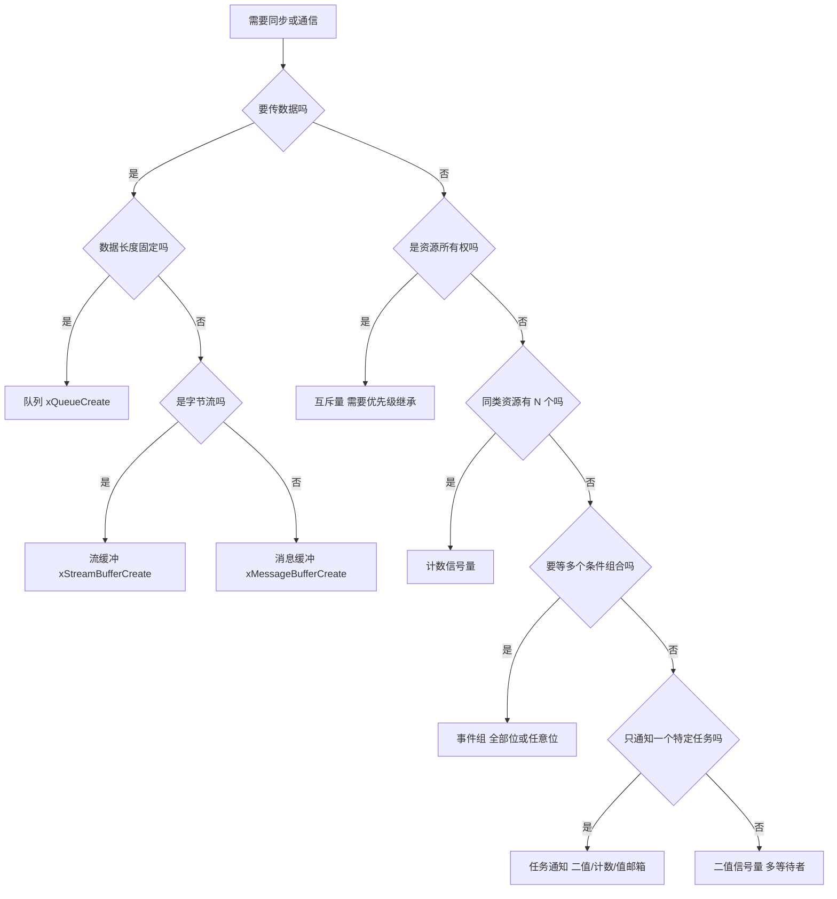
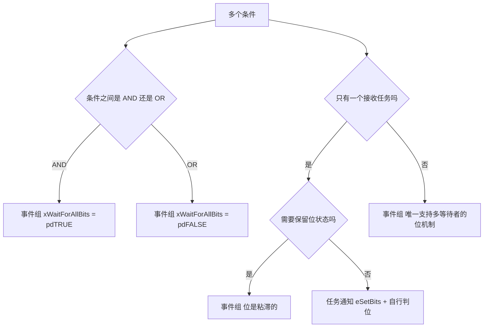
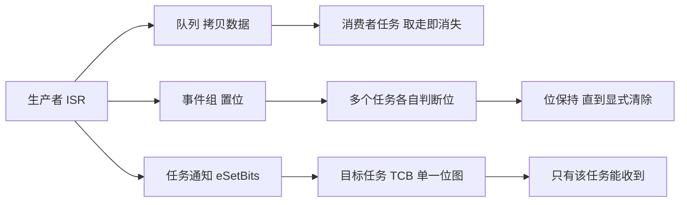

# 事件组 vs 队列/信号量/任务通知 —— 同步机制选型指南

> 对应源文件：`event_groups.c`（共 928 行）、`include/event_groups.h`（共 748 行）；对照 `queue.c`（3369 行）、`semphr.h`（1095 行）、`tasks.c` 通知段（9398 行）
>
> **已有条目：** [event_groups.md](event_groups.md)（事件组原理）、[queue.md](queue.md)、[semphr.md](semphr.md)、[task_notification.md](task_notification.md)、[message_buffer.md](message_buffer.md)
> **本文定位：** 不重复实现细节，只回答"这个场景该用哪个"。
>
> 行号以本仓库当前文件为准。

---

# 第一部分：先给结论

## 1.1 一句话选型

| 你的需求 | 用这个 |
|---|---|
| 传数据（结构体/帧/字节流） | **队列**（定长）或 **消息缓冲**（变长） |
| 多个事件位，要"全部满足"或"任一满足" | **事件组** |
| 一个资源的所有权（谁持有谁释放） | **互斥量** |
| N 个同类资源的计数 | **计数信号量** |
| 中断/任务只通知"某件事发生了" | **任务通知** |
| 点对点传一个 32 位值/计数 | **任务通知** |
| 字节流（UART、ADC） | **流缓冲** |

## 1.2 能力矩阵

| 能力 | 事件组 | 队列 | 二值信号量 | 计数信号量 | 互斥量 | 任务通知 | 消息缓冲 |
|---|---|---|---|---|---|---|---|
| 携带数据 | 仅位图（24 位） | 任意定长 | 无 | 无 | 无 | 32 位值 | 变长消息 |
| 多个等待者 | 是 | 是 | 是 | 是 | 是 | **否** | **否** |
| 等待"全部位" | **是** | 否 | 否 | 否 | 否 | 否（自行判断） | 否 |
| 等待"任意位" | **是** | 否 | 否 | 否 | 否 | 否（自行判断） | 否 |
| 退出时自动清位 | **是** | — | — | — | — | 可选清位 | — |
| 优先级继承 | 否 | 否 | 否 | 否 | **是** | 否 | 否 |
| ISR 直接发送 | 否（**延迟**） | 是 | 是 | 是 | 否 | **是** | 是 |
| 独立对象 RAM | 约 40 B | 约 80 B + 数据 | 约 80 B | 约 80 B | 约 80 B | **0** | 约 40 B + 数据 |
| 覆盖语义 | 位或 | `xQueueOverwrite` | 合并 | 累加 | — | `eSetValueWithOverwrite` | 无 |

## 1.3 关键差异一句话

- **事件组是"状态"**：位一直挂着，直到有人清；适合"条件满足"而不是"事件发生一次"。
- **队列是"数据"**：取出即消失；满/空是核心状态。
- **信号量是"计数/所有权"**：没有数据，只有"能不能进"。
- **通知是"点名"**：只对某个任务，值存在对方 TCB 里，没有共享对象。

---

# 第二部分：事件组内部（只讲选型相关的）

## 2.1 只有 24 个可用位

`EventBits_t` 是 `TickType_t`，但高 8 位被内核占用为控制位（event_groups.h:47-56）：

```c
#if ( configTICK_TYPE_WIDTH_IN_BITS == TICK_TYPE_WIDTH_16_BITS )
    #define eventCLEAR_EVENTS_ON_EXIT_BIT    ( ( uint16_t ) 0x0100U )
    #define eventUNBLOCKED_DUE_TO_BIT_SET    ( ( uint16_t ) 0x0200U )
    #define eventWAIT_FOR_ALL_BITS           ( ( uint16_t ) 0x0400U )
    #define eventEVENT_BITS_CONTROL_BYTES    ( ( uint16_t ) 0xff00U )
#elif ( configTICK_TYPE_WIDTH_IN_BITS == TICK_TYPE_WIDTH_32_BITS )
    #define eventCLEAR_EVENTS_ON_EXIT_BIT    ( ( uint32_t ) 0x01000000U )
    #define eventUNBLOCKED_DUE_TO_BIT_SET    ( ( uint32_t ) 0x02000000U )
    #define eventWAIT_FOR_ALL_BITS           ( ( uint32_t ) 0x04000000U )
    #define eventEVENT_BITS_CONTROL_BYTES    ( ( uint32_t ) 0xff000000U )
```

（event_groups.h:47-56，节选逐字）

| tick 宽度 | 控制位掩码 | **可用事件位** |
|---|---|---|
| 16 位 | `0xff00` | **8 位**（bit0-7） |
| 32 位 | `0xff000000` | **24 位**（bit0-23） |
| 64 位 | `0xff00000000000000` | **56 位**（bit0-55） |

`xEventGroupWaitBits` 入口直接断言（event_groups.c:349-350）：

```c
configASSERT( ( uxBitsToWaitFor & eventEVENT_BITS_CONTROL_BYTES ) == 0 );
configASSERT( uxBitsToWaitFor != 0 );
```

**陷阱：** 用 `1 << 24` 及以上当事件位，在 32 位 tick 下会撞上控制位，断言失败。

## 2.2 等待条件如何编码进链表项

事件组的等待链表是"无序"的（`vTaskPlaceOnUnorderedEventList`，event_groups.c:418），因为所有等待者都关心同一组位，不需要排序。等待者的"要求"存在它的事件链表项 `xItemValue` 里：

```c
vTaskPlaceOnUnorderedEventList( &( pxEventBits->xTasksWaitingForBits ), ( uxBitsToWaitFor | uxControlBits ), xTicksToWait );
```

（event_groups.c:418，逐字）

`uxControlBits` 由两个参数拼成（event_groups.c:396-408）：

```c
if( xClearOnExit != pdFALSE )
{
    uxControlBits |= eventCLEAR_EVENTS_ON_EXIT_BIT;
}
...
if( xWaitForAllBits != pdFALSE )
{
    uxControlBits |= eventWAIT_FOR_ALL_BITS;
}
```

**所以一个 `EventBits_t` 同时编码了"等哪些位"和"怎么等、退出清不清"**——这是事件组能在一条链表上支持多种等待语义的原因。

## 2.3 置位时如何匹配

```c
/* 置位这些位。 */
pxEventBits->uxEventBits |= uxBitsToSet;

/* 检查新的位值是否应解除某些任务的阻塞。 */
while( pxListItem != pxListEnd )
{
    ...
    /* 分离等待位与控制位。 */
    uxControlBits = uxBitsWaitedFor & eventEVENT_BITS_CONTROL_BYTES;
    uxBitsWaitedFor &= ~eventEVENT_BITS_CONTROL_BYTES;

    if( ( uxControlBits & eventWAIT_FOR_ALL_BITS ) == ( EventBits_t ) 0 )
    {
        /* 只要求任意一位被置位。 */
        if( ( uxBitsWaitedFor & pxEventBits->uxEventBits ) != ( EventBits_t ) 0 )
        {
            xMatchFound = pdTRUE;
        }
    }
    else if( ( uxBitsWaitedFor & pxEventBits->uxEventBits ) == uxBitsWaitedFor )
    {
        /* 所有位均已置位。 */
        xMatchFound = pdTRUE;
    }
```

（event_groups.c:602-632，节选逐字）

**复杂度 O(n)**（n = 等待任务数）。每个等待者都要做一次位运算，匹配的会被 `vTaskRemoveFromUnorderedEventList` 摘走。

## 2.4 返回值语义

`xEventGroupSetBits` 返回**清除之后**的快照（event_groups.c:669-672）：

```c
pxEventBits->uxEventBits &= ~uxBitsToClear;

/* 对结果位进行快照。 */
uxReturnBits = pxEventBits->uxEventBits;
```

`xEventGroupWaitBits` 返回的是"解除阻塞那一刻的位值"，并带 `eventUNBLOCKED_DUE_TO_BIT_SET` 标志；API 内部会通过 `uxTaskResetEventItemValue()`（event_groups.c:446）把控制位剥掉。**超时返回的是当前位值，不是 0**——所以不能用"返回值是否为 0"判断超时。

---

# 第三部分：决策树

## 3.1 主决策树



## 3.2 事件组 vs 通知的细分



**结论：** 多任务等同一组条件 → 事件组；单任务等几个位 → 通知更省。

## 3.3 数据流对比



---

# 第四部分：五个典型场景的写法

## 4.1 场景 A：ISR 通知任务处理一次采样

**首选任务通知**（零对象、单值）：

```c
/* ISR */
BaseType_t woken = pdFALSE;
vTaskNotifyGiveFromISR( xSampleTask, &woken );
portYIELD_FROM_ISR( woken );

/* 任务 */
ulTaskNotifyTake( pdTRUE, portMAX_DELAY );
read_sample();
```

若采样的**数据**也要传，且只有最新值有效：用 `eSetValueWithOverwrite` 传指针/索引；若要保序，用队列。

## 4.2 场景 B：等待"网络就绪 + 配置加载完成 + 用户登录"

三个条件必须全部满足才启动业务：

```c
EventBits_t bits = xEventGroupWaitBits(
    xSystemEvents,
    BIT_NET_READY | BIT_CONFIG_LOADED | BIT_USER_LOGGED_IN,
    pdTRUE,        /* 退出时清除 */
    pdTRUE,        /* 等待所有位 */
    portMAX_DELAY );
```

**为什么不用三个二值信号量？** 需要三次 take，且顺序/超时难协调；事件组一次等待就能表达 AND。

## 4.3 场景 C：保护共享 I2C 总线

**互斥量**（需要优先级继承）：

```c
xSemaphoreTake( xI2CMutex, portMAX_DELAY );
i2c_transfer( ... );
xSemaphoreGive( xI2CMutex );
```

**不要用二值信号量**：它没有持有者概念，低优先级任务持有时高优先级任务只能干等，优先级反转无解。

## 4.4 场景 D：限制同时访问外设的任务数（最多 3 个）

**计数信号量**，初值 3：

```c
SemaphoreHandle_t xSlots = xSemaphoreCreateCounting( 3, 3 );
xSemaphoreTake( xSlots, portMAX_DELAY );
use_peripheral();
xSemaphoreGive( xSlots );
```

事件组的位图**不能表达"计数"**（同一位重复置位仍是 1）。

## 4.5 场景 E：命令队列（定长结构体，多消费者）

**队列**：

```c
QueueHandle_t xCmdQ = xQueueCreate( 8, sizeof( cmd_t ) );
xQueueSend( xCmdQ, &cmd, pdMS_TO_TICKS( 10 ) );
xQueueReceive( xCmdQ, &cmd, portMAX_DELAY );
```

多个工作任务的场景必须用队列（通知和流缓冲都只支持单等待者）。

---

# 第五部分：量化与陷阱

## 5.1 成本量化（Cortex-M4F，32 位）

| 机制 | 对象 RAM | 每次操作的关键动作 | 阻塞时链表操作 |
|---|---|---|---|
| 事件组 | `EventGroup_t` 约 40 B | 位或 + 遍历等待者 | 1 次无序插入/删除 |
| 队列 | `Queue_t` 约 80 B + N×item | memcpy + 计数 | 事件链表插入/删除 |
| 二值/计数信号量 | 约 80 B | 计数 ±1 | 同上 |
| 互斥量 | 约 80 B | 计数 + holder + 继承 | 同上 + 优先级搬家 |
| 任务通知 | **0**（TCB 内 5 B） | 改 2 个字段 | 只摘状态项 |
| 消息缓冲 | 约 40 B + size + 1 | 2 次 memcpy + 4 B 长度头 | 无链表，单 TaskHandle |

**事件组的隐藏成本在"遍历"**：等待者越多，`xEventGroupSetBits` 越慢（O(n)）。队列/信号量的唤醒是 O(1)（只摘优先级最高的一个）。

## 5.2 事件组的五个陷阱

| # | 陷阱 | 后果 | 正确做法 |
|---|---|---|---|
| 1 | 把事件组当"事件计数" | 同一位置位两次仍是 1，丢事件 | 用计数信号量或通知计数 |
| 2 | 忘记清位 | 下一轮等待立刻满足，逻辑跑飞 | `xClearOnExit=pdTRUE` 或显式 `xEventGroupClearBits` |
| 3 | 在 ISR 里直接 `xEventGroupSetBits` | 断言/崩溃 | `xEventGroupSetBitsFromISR`，且 `configUSE_TIMERS=1` |
| 4 | 用 bit24 及以上 | 撞控制位，断言（event_groups.c:349） | 只用 bit0-23（32 位 tick） |
| 5 | 用返回值 0 判断超时 | 超时也返回当前位值 | 用 `xEventGroupWaitBits` 的返回值与 `eventUNBLOCKED_DUE_TO_BIT_SET` 语义，或记录时间 |

## 5.3 队列/信号量的四个陷阱

| # | 陷阱 | 后果 | 正确做法 |
|---|---|---|---|
| 1 | 队列 item 传大结构体 | 每次 send/receive 都 memcpy，CPU 飙升 | 传指针 + 静态/池化缓冲 |
| 2 | 用二值信号量做互斥 | 优先级反转 | 互斥量 |
| 3 | `xQueueSend` 超时 0 却忽略返回值 | 静默丢数据 | 检查 `pdPASS`，或阻塞等待 |
| 4 | 在 ISR 里用非 FromISR 版本 | 断言 | `xQueueSendFromISR` 等 |

## 5.4 任务通知的四个陷阱

| # | 陷阱 | 后果 | 正确做法 |
|---|---|---|---|
| 1 | 多消费者等同一个任务 | 只有一个收到 | 队列/事件组 |
| 2 | 用 0 当"无通知" | 值 0 是合法值 | 看 `xTaskNotifyWait` 返回值 |
| 3 | 用通知做互斥 | 无优先级继承 | 互斥量 |
| 4 | `eSetValueWithoutOverwrite` 不检查返回值 | 丢值 | 检查 `pdFAIL` |

## 5.5 一张"别用错"速查

```text
要传数据        → 队列 / 消息缓冲
要等 AND 条件   → 事件组 (xWaitForAllBits = pdTRUE)
要等 OR 条件    → 事件组 (xWaitForAllBits = pdFALSE) 或通知位图
要所有权        → 互斥量（递归用递归互斥量）
要计数          → 计数信号量
要单值/单任务   → 任务通知
要字节流        → 流缓冲
要多消费者      → 队列（唯一支持多等待者的数据通道）
```

## 5.6 读码路径

1. `event_groups.h:47-56` —— 先记住 24 位限制。
2. `event_groups.c:332-492` —— `xEventGroupWaitBits`：条件已满足/阻塞/超时三条路。
3. `event_groups.c:575-676` —— `xEventGroupSetBits`：O(n) 遍历匹配。
4. `event_groups.c:200-326` —— `xEventGroupSync`：置位 + 等待的会合语义。
5. 对照读 [queue.md](queue.md) 的 `xQueueGenericSend` 与 [task_notification.md](task_notification.md) 的 `xTaskGenericNotify`，比较三者的阻塞链表操作次数。
