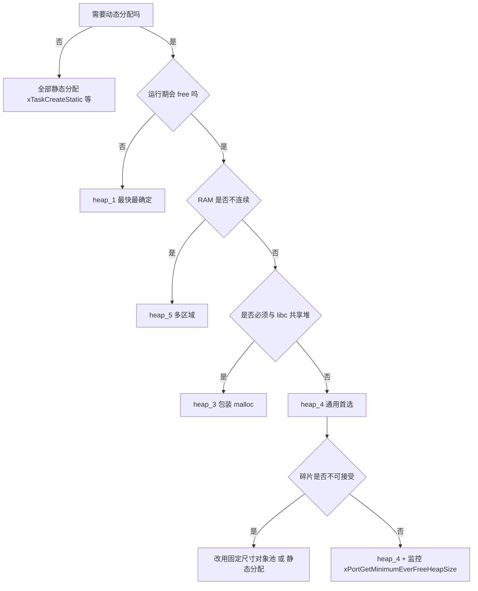

# MemMang 五种堆方案 —— heap_1 ~ heap_5 与 heap_4 块合并算法

> 对应源文件：`portable/MemMang/heap_1.c`（共 185 行）、`heap_2.c`（共 432 行）、`heap_3.c`（共 104 行）、`heap_4.c`（共 682 行）、`heap_5.c`（共 803 行）
>
> **前置阅读：** [tasks.md](tasks.md)（谁在调用 `pvPortMalloc`）、[freertosconfigh.md](freertosconfigh.md)（`configTOTAL_HEAP_SIZE`、`configSUPPORT_DYNAMIC_ALLOCATION`）
> **选型决策：** [../Docs/03-常见设计模式与陷阱.md](../../../references/rtos/freertos/Docs/03-常见设计模式与陷阱.md)
>
> 行号以本仓库当前文件为准。五种方案**同一时刻只能选一个**编译（`portable/MemMang/` 下只加入一个 .c）。

---

# 第一部分：五种方案全景

## 1.1 一句话对比

| 方案 | 行数 | 能 free | 合并相邻块 | 空闲链表排序 | 确定性 | 典型用途 |
|---|---|---|---|---|---|---|
| heap_1 | 185 | **否** | — | 无链表（线性指针） | 最高，O(1) | 只创建不删除：安全关键、启动后固定 |
| heap_2 | 432 | 是 | **否** | 按**块大小**升序 | 中 | 已弃用；固定尺寸反复分配 |
| heap_3 | 104 | 是 | 交给 libc | 交给 libc | 低 | 已有成熟 malloc、需与 libc 共享堆 |
| heap_4 | 682 | 是 | **是**（双向） | 按**地址**升序 | 中 | 通用首选，碎片可控 |
| heap_5 | 803 | 是 | 是（同 heap_4） | 按地址升序、跨区域 | 中 | 多块不连续 RAM（CCM + SRAM + SDRAM） |


## 1.2 共同骨架：静态数组 + 两个指针

除 heap_3 外，四种方案都用一个静态数组当堆：

```c
PRIVILEGED_DATA static uint8_t ucHeap[ configTOTAL_HEAP_SIZE ];
```

（heap_4.c:98；heap_1/2/5 同构）

堆的起点不是 `&ucHeap[0]`，而是**向上对齐**后的地址。heap_1 的处理（heap_1.c:115-116）：

```c
pucAlignedHeap = ( uint8_t * ) ( ( ( portPOINTER_SIZE_TYPE ) &( ucHeap[ portBYTE_ALIGNMENT - 1 ] ) ) &
                                 ( ~( ( portPOINTER_SIZE_TYPE ) portBYTE_ALIGNMENT_MASK ) ) );
```

**为什么加 `portBYTE_ALIGNMENT - 1` 再掩码？** 这是标准的"向上取整"技巧：先加 `align-1`，再按位与掉低位。`ucHeap` 本身可能只按 1 字节对齐（取决于链接器），而 Cortex-M4F 的 `portBYTE_ALIGNMENT = 8`（portmacro.h:85）。代价是最多浪费 7 字节，heap_1/2 用 `configADJUSTED_HEAP_SIZE = configTOTAL_HEAP_SIZE - portBYTE_ALIGNMENT`（heap_1.c:56）预留了这部分。

## 1.3 块头开销（所有方案的共同成本）

`heap_2/4/5` 的块头是：

```c
typedef struct A_BLOCK_LINK
{
    struct A_BLOCK_LINK * pxNextFreeBlock; /**< 链表中的下一个空闲块。 */
    size_t xBlockSize;                     /**< 空闲块的大小。 */
} BlockLink_t;
```

（heap_4.c:104-108，逐字）

在 32 位 Cortex-M 上：

- `BlockLink_t` = 2 × 4 = **8 字节**；
- `xHeapStructSize = ( sizeof( BlockLink_t ) + ( portBYTE_ALIGNMENT - 1 ) ) & ~( portBYTE_ALIGNMENT_MASK )`（heap_4.c:161）= **8 字节**；
- `heapMINIMUM_BLOCK_SIZE = xHeapStructSize << 1`（heap_4.c:59）= **16 字节**。

**量化：** 请求 1 字节 → `1 + 8 = 9` → 按 8 对齐到 16 → 实际占用 16 字节，可用 8 字节，**开销 100%**。
请求 20 字节 → `20 + 8 = 28` → 对齐到 32 → **开销 12 字节（37.5%）**。
请求 100 字节 → `108` → 对齐到 112 → 开销 12 字节（12%）。

**结论：小对象密集分配时，heap 头开销不可忽略；这也是"用静态分配/对象池"的量化理由。**

---

# 第二部分：heap_1 —— 只分配，永不释放

## 2.1 分配：一个指针向上推

```c
if( ( xWantedSize > 0 ) &&
    ( heapADD_WILL_OVERFLOW( xNextFreeByte, xWantedSize ) == 0 ) &&
    ( ( xNextFreeByte + xWantedSize ) < configADJUSTED_HEAP_SIZE ) )
{
    /*
     * 返回下一个空闲字节的地址，然后将索引递增越过
     * 该块。
     */
    pvReturn = pucAlignedHeap + xNextFreeByte;
    xNextFreeByte += xWantedSize;
}
```

（heap_1.c:120-128，逐字）

`xNextFreeByte` 是唯一的堆状态。分配就是"切一块、指针后移"，**O(1)、无链表、无循环**。

## 2.2 释放：断言，而不是空操作

```c
void vPortFree( void * pv )
{
    ...
    ( void ) pv;

    /* 调用该函数是无效操作，因此强制触发断言。 */
    configASSERT( pv == NULL );
}
```

（heap_1.c:149-160，逐字）

注意它断言的是 `pv == NULL`：`vPortFree(NULL)` 合法（什么都不做），释放真实指针则**直接断言失败**。这是刻意设计——把"运行时才发现不支持 free"提前到第一次错误调用。

## 2.3 适用与不适用

- 适用：任务/队列启动期一次性创建、运行期不删除。
- 不适用：动态创建/销毁对象、协议栈频繁 malloc、动态定时器删除。
- 风险：`xTaskCreate` 失败无法回收；`vTaskDelete` 后 TCB/栈永久占用，且 idle 任务回收时 `vPortFree` 会断言。

---

# 第三部分：heap_2 —— 按大小排序，不合并

## 3.1 空闲链表按"块大小"排序

heap_2 的插入是宏（heap_2.c:139-158），核心一行：

```c
for( pxIterator = &xStart; pxIterator->pxNextFreeBlock->xBlockSize < xBlockSize; pxIterator = pxIterator->pxNextFreeBlock )
```

（heap_2.c:148，逐字）

链表头是**最小块**，尾部是最大块。分配时从 `xStart` 往后找第一个 `xBlockSize >= xWantedSize` 的块——这是 **best-fit 的近似**（按大小升序，第一个满足的就是最小的满足者）。

## 3.2 致命缺陷：不合并

heap_2 的 `vPortFree`（heap_2.c:315-359）只做"把块插回按大小排序的链表"，**没有检查物理相邻**。

后果（量化）：堆 1024 字节，交替分配 A(100)、B(100)、C(100)、D(100)，然后释放 B 和 D。空闲链表有 2 个 100 字节块 + 尾部大块；此时申请 150 字节——**即使总空闲 200+，也分配失败**，因为两个 100 不连续、也不会合并。

heap_2 已不推荐用于新设计；官方保留它主要是兼容旧代码。**需要 free 就用 heap_4。**

---

# 第四部分：heap_3 —— 把活交给 libc

```c
void * pvPortMalloc( size_t xWantedSize )
{
    void * pvReturn;

    vTaskSuspendAll();
    {
        pvReturn = malloc( xWantedSize );
        traceMALLOC( pvReturn, xWantedSize );
    }
    ( void ) xTaskResumeAll();
    ...
}
```

（heap_3.c:58-77，逐字）

它只做两件事：**挂起调度器**（不是关中断）包住 `malloc/free`，以及调用 malloc 失败钩子。真正的堆管理、合并、碎片策略全在 libc（newlib / picolibc / glibc）。

**代价与风险：** `vTaskSuspendAll()` 不阻止中断，中断里调用仍可能重入非线程安全的 libc malloc；libc 的最坏执行时间不可控；`configTOTAL_HEAP_SIZE` 对 heap_3 **无效**（堆由链接脚本决定）。
适用：POSIX 仿真、已有成熟内存池、需与 libc 共享同一堆。

---

# 第五部分：heap_4 —— 地址有序 + 双向合并（重点）

## 5.1 数据结构：高位当"已分配"标志

```c
#define heapBLOCK_ALLOCATED_BITMASK    ( ( ( size_t ) 1 ) << ( ( sizeof( size_t ) * heapBITS_PER_BYTE ) - 1 ) )
#define heapBLOCK_IS_ALLOCATED( pxBlock )        ( ( ( pxBlock->xBlockSize ) & heapBLOCK_ALLOCATED_BITMASK ) != 0 )
#define heapALLOCATE_BLOCK( pxBlock )            ( ( pxBlock->xBlockSize ) |= heapBLOCK_ALLOCATED_BITMASK )
#define heapFREE_BLOCK( pxBlock )                ( ( pxBlock->xBlockSize ) &= ~heapBLOCK_ALLOCATED_BITMASK )
```

（heap_4.c:81-85，逐字）

**为什么用最高位而不是单独一个字段？** 省 4 字节/块。代价是块大小上限为 `SIZE_MAX/2`；`heapBLOCK_SIZE_IS_VALID()`（heap_4.c:82）在分配前挡住超限请求。

## 5.2 分配：first-fit + 分裂

先算实际块大小（heap_4.c:193-207）：

```c
if( heapADD_WILL_OVERFLOW( xWantedSize, xHeapStructSize ) == 0 )
{
    xWantedSize += xHeapStructSize;

    /*
     * 确保块始终按要求的字节数对齐。
     */
    if( ( xWantedSize & portBYTE_ALIGNMENT_MASK ) != 0x00 )
    {
        /* 需要进行字节对齐。 */
        xAdditionalRequiredSize = portBYTE_ALIGNMENT - ( xWantedSize & portBYTE_ALIGNMENT_MASK );
        ...
        xWantedSize += xAdditionalRequiredSize;
```

（heap_4.c:193-207，节选逐字）

然后沿**地址升序**的空闲链表找第一个够大的块（heap_4.c:257-266）：

```c
pxPreviousBlock = &xStart;
pxBlock = heapPROTECT_BLOCK_POINTER( xStart.pxNextFreeBlock );
...
while( ( pxBlock->xBlockSize < xWantedSize ) && ( pxBlock->pxNextFreeBlock != heapPROTECT_BLOCK_POINTER( NULL ) ) )
{
    pxPreviousBlock = pxBlock;
    pxBlock = heapPROTECT_BLOCK_POINTER( pxBlock->pxNextFreeBlock );
}
```

（heap_4.c:257-266，逐字）

**first-fit 而非 best-fit**：找到第一个够大的就切，不继续找"最合适"的。好处是最坏 O(n) 但常数小；坏处是低地址大块容易被切碎。地址有序的真正目的是**为合并服务**。

分裂条件（heap_4.c:292-310）：

```c
if( ( pxBlock->xBlockSize - xWantedSize ) > heapMINIMUM_BLOCK_SIZE )
{
    pxNewBlockLink = ( void * ) ( ( ( uint8_t * ) pxBlock ) + xWantedSize );
    ...
    pxNewBlockLink->xBlockSize = pxBlock->xBlockSize - xWantedSize;
    pxBlock->xBlockSize = xWantedSize;

    /* 将新块插入空闲块链表。 */
    pxNewBlockLink->pxNextFreeBlock = pxPreviousBlock->pxNextFreeBlock;
    pxPreviousBlock->pxNextFreeBlock = heapPROTECT_BLOCK_POINTER( pxNewBlockLink );
}
```

（heap_4.c:292-310，节选逐字）

**阈值 `> heapMINIMUM_BLOCK_SIZE`（16 字节）**：剩余部分必须至少能构成一个"8 字节头 + 8 字节可用"的空闲块，否则不切，整块给用户（内部碎片换链表简洁）。

## 5.3 释放与合并：`prvInsertBlockIntoFreeList`

这是 heap_4 的灵魂（heap_4.c:539-609）。第一步按地址找到插入点（heap_4.c:547）：

```c
for( pxIterator = &xStart; heapPROTECT_BLOCK_POINTER( pxIterator->pxNextFreeBlock ) < pxBlockToInsert; pxIterator = heapPROTECT_BLOCK_POINTER( pxIterator->pxNextFreeBlock ) )
```

第二步与**前一个**块合并（heap_4.c:561-567）：

```c
puc = ( uint8_t * ) pxIterator;

if( ( puc + pxIterator->xBlockSize ) == ( uint8_t * ) pxBlockToInsert )
{
    pxIterator->xBlockSize += pxBlockToInsert->xBlockSize;
    pxBlockToInsert = pxIterator;
}
```

第三步与**后一个**块合并（heap_4.c:577-591）：

```c
puc = ( uint8_t * ) pxBlockToInsert;

if( ( puc + pxBlockToInsert->xBlockSize ) == ( uint8_t * ) heapPROTECT_BLOCK_POINTER( pxIterator->pxNextFreeBlock ) )
{
    if( heapPROTECT_BLOCK_POINTER( pxIterator->pxNextFreeBlock ) != pxEnd )
    {
        /* 将两个块合并为一个大块。 */
        pxBlockToInsert->xBlockSize += heapPROTECT_BLOCK_POINTER( pxIterator->pxNextFreeBlock )->xBlockSize;
        pxBlockToInsert->pxNextFreeBlock = heapPROTECT_BLOCK_POINTER( pxIterator->pxNextFreeBlock )->pxNextFreeBlock;
    }
    else
    {
        pxBlockToInsert->pxNextFreeBlock = heapPROTECT_BLOCK_POINTER( pxEnd );
    }
}
```

第四步更新前驱指针，并处理"两边都合并"时 `pxIterator == pxBlockToInsert` 的自指陷阱（heap_4.c:602-605）：

```c
if( pxIterator != pxBlockToInsert )
{
    pxIterator->pxNextFreeBlock = heapPROTECT_BLOCK_POINTER( pxBlockToInsert );
}
```

**算法复杂度：** 插入 O(n)（n = 空闲块数），合并 O(1)。最坏情况 n 很大时 free 变慢；但合并让 n 保持较小，形成负反馈。

## 5.4 释放路径的完整性检查

```c
puc -= xHeapStructSize;
pxLink = ( void * ) puc;

heapVALIDATE_BLOCK_POINTER( pxLink );
configASSERT( heapBLOCK_IS_ALLOCATED( pxLink ) != 0 );
configASSERT( pxLink->pxNextFreeBlock == heapPROTECT_BLOCK_POINTER( NULL ) );
```

（heap_4.c:388-395，逐字）

三条检查分别防：越界指针、重复 free（已释放块的高位是 0）、释放非堆指针（已分配块的 `pxNextFreeBlock` 必须是 NULL）。**这是 heap_4 比 heap_2 更安全的另一个原因**（heap_2 只有前两条）。

---

# 第六部分：heap_5 —— 多段不连续 RAM

heap_5 = heap_4 的算法 + 多区域初始化。入口：

```c
void vPortDefineHeapRegions( const HeapRegion_t * const pxHeapRegions )
{
    ...
    /* 只能调用一次！ */
    configASSERT( pxEnd == NULL );
```

（heap_5.c:593-604，节选逐字）

每个区域独立算 `pxEnd`，再把上一区域的 `pxEnd` 链到下一区域的首块（heap_5.c:691-694）：

```c
if( pxPreviousFreeBlock != NULL )
{
    pxPreviousFreeBlock->pxNextFreeBlock = heapPROTECT_BLOCK_POINTER( pxFirstFreeBlockInRegion );
}
```

**使用约束（heap_5.c:38-42 的注释）：**

1. `vPortDefineHeapRegions()` 必须在**任何** `pvPortMalloc()` 之前调用——包括创建第一个任务/队列之前。
2. 区域数组必须按**地址从低到高**排列，并以 `{ NULL, 0 }` 结尾。
3. 每个区域起始地址会被向上对齐到 8 字节，区域大小相应扣减。

**典型场景：** STM32 的 CCM RAM（64 KB，只能放数据）+ 主 SRAM（128 KB）+ 外部 SDRAM。CCM 不能走 DMA，但放任务栈/TCB 最快；用 heap_5 可以把两者串成一个堆。

---

# 第七部分：碎片、量化与选型

## 7.1 一个可复现的碎片例子（heap_4）

`configTOTAL_HEAP_SIZE = 4096`，初始空闲块约 4080 字节。依次：

| 步骤 | 操作 | 空闲链表（地址升序） | 最大可分配 |
|---|---|---|---|
| 1 | malloc(1000) | [~3072] | 3072 |
| 2 | malloc(1000) | [~2064] | 2064 |
| 3 | malloc(500) | [~1556] | 1556 |
| 4 | free(第 2 块) | [1000, ~1556] | 1556 |
| 5 | malloc(1200) | **失败** | 总空闲 2556，但无单块 ≥ 1208 |

第 5 步失败的原因不是"内存不够"，而是"没有连续块"。heap_4 的合并只能在**相邻**块之间发生，跨过一个已分配块就无能为力。

## 7.2 选型决策树



## 7.3 运行时监控接口

| 函数 | heap_1 | heap_2 | heap_3 | heap_4 | heap_5 |
|---|---|---|---|---|---|
| `xPortGetFreeHeapSize()` | heap_1.c:170 | heap_2.c:363 | **无** | heap_4.c:442 | heap_5.c:482 |
| `xPortGetMinimumEverFreeHeapSize()` | 无 | 无 | 无 | heap_4.c:448 | heap_5.c:488 |
| `vPortInitialiseBlocks()` | heap_1.c:163 | heap_2.c:369 | 无 | heap_4.c:460（空） | 无 |
| `vPortDefineHeapRegions()` | 无 | 无 | 无 | 无 | heap_5.c:593 |

**`xPortGetMinimumEverFreeHeapSize` 是最有价值的运行期指标**：它记录历史最低水位，比"当前剩余"更能暴露峰值压力。建议在版本发布前跑满负载，把它打到接近 0 但不为 0。

## 7.4 五个高频陷阱

| # | 陷阱 | 后果 | 正确做法 |
|---|---|---|---|
| 1 | 在 heap_1 下调用 `vTaskDelete` | `vPortFree` 断言（heap_1.c:159） | 任务常驻，或换 heap_4 |
| 2 | 以为 `configTOTAL_HEAP_SIZE` 对 heap_3 有效 | 堆大小仍由链接脚本决定 | 改 `_sbrk`/链接脚本 |
| 3 | heap_5 在创建任务后才 `vPortDefineHeapRegions` | 断言 `pxEnd == NULL` 失败 | 在 `main` 最开头调用 |
| 4 | 频繁 malloc/free 不同尺寸 | 碎片，最终分配失败 | 固定尺寸对象池；或启动期一次性分配 |
| 5 | 在中断里 `pvPortMalloc` | 调度器挂起/临界区语义错乱 | 中断只发通知，由任务分配 |

> 读码顺序：`heap_1.c:83-147`（极简）→ `heap_2.c:139-158`（反面教材）→ `heap_4.c:178-375`（分配）→ `heap_4.c:378-439`（释放）→ `heap_4.c:539-609`（四种合并情况）→ `heap_5.c:593-720`（多区域）。
