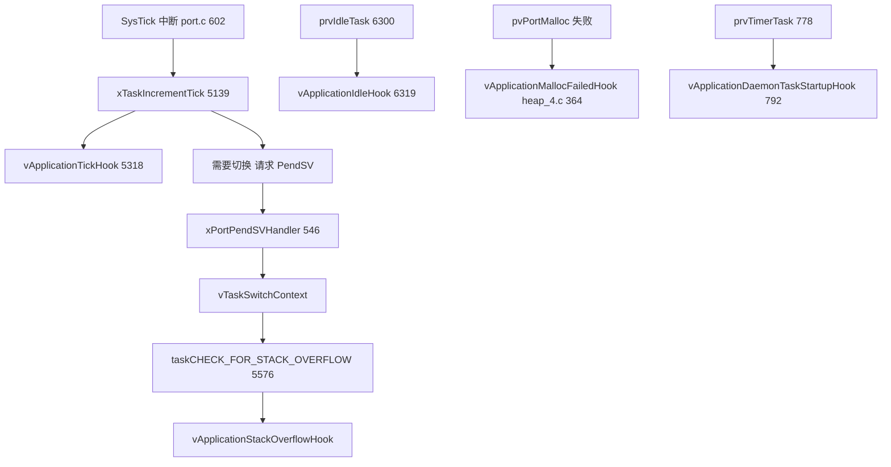
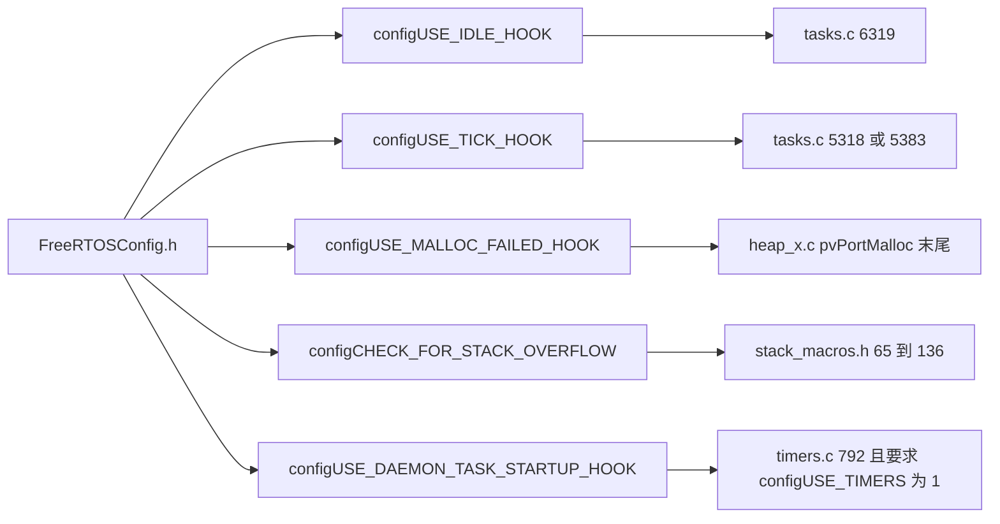

# 五种 Hook 函数 —— 开关、调用时机与上下文约束

> 对应源文件：`tasks.c`（共 9398 行）、`include/FreeRTOS.h`（共 3354 行）、`include/stack_macros.h`（共 150 行）、`timers.c`（共 1391 行）、`portable/MemMang/heap_*.c`
>
> **前置阅读：** [tasks.md](tasks.md)（idle 任务与上下文切换）、[timers.md](timers.md)（守护任务）
> **配置全景：** [../Docs/01-配置项全景.md](../../../references/rtos/freertos/Docs/01-配置项全景.md)
>
> 行号以本仓库当前文件为准。

---

# 第一部分：总表

## 1.1 五个 Hook 一眼看完

| Hook | 开关宏 | 默认 | 调用位置 | 运行上下文 | 能否阻塞 |
|---|---|---|---|---|---|
| `vApplicationIdleHook` | `configUSE_IDLE_HOOK` | **必须显式定义** | tasks.c:6319 | 空闲任务（优先级 0） | **否** |
| `vApplicationTickHook` | `configUSE_TICK_HOOK` | **必须显式定义** | tasks.c:5318 / 5383 | SysTick ISR | **否**（只能 FromISR） |
| `vApplicationMallocFailedHook` | `configUSE_MALLOC_FAILED_HOOK` | 0 | heap_1.c:140 等 | 调用 `pvPortMalloc` 的任务 | 可以，但别分配 |
| `vApplicationStackOverflowHook` | `configCHECK_FOR_STACK_OVERFLOW` | 0 | stack_macros.h:72/89/111/136 | PendSV（切换上下文时） | **否**，通常不返回 |
| `vApplicationDaemonTaskStartupHook` | `configUSE_DAEMON_TASK_STARTUP_HOOK` | 0 | timers.c:792 | 定时器守护任务 | 可以（会延迟定时器） |

**"必须显式定义"的含义：** `configUSE_IDLE_HOOK` / `configUSE_TICK_HOOK` 没有默认值，`FreeRTOS.h` 里是 `#error`（195-197、205-207）。也就是说，**每个 FreeRTOSConfig.h 都必须写这两行**，哪怕值为 0。

## 1.2 开关在 FreeRTOS.h 的位置

| 宏 | 行号 | 处理方式 |
|---|---|---|
| `configUSE_MALLOC_FAILED_HOOK` | 94-95 | `#ifndef` → 默认 0 |
| `configUSE_IDLE_HOOK` | 195-197 | `#ifndef` → **`#error`** |
| `configUSE_TICK_HOOK` | 205-207 | `#ifndef` → **`#error`** |
| `configUSE_DAEMON_TASK_STARTUP_HOOK` | 347-348 | 默认 0 |
| 守护任务依赖检查 | 351-355 | 若 hook=1 且 `configUSE_TIMERS=0` → `#error` |
| `configCHECK_FOR_STACK_OVERFLOW` | 729-731 | 默认 0 |

守护任务的依赖检查原文（FreeRTOS.h:351-355）：

```c
#if ( configUSE_DAEMON_TASK_STARTUP_HOOK != 0 )
    #if ( configUSE_TIMERS == 0 )
        #error configUSE_DAEMON_TASK_STARTUP_HOOK is set, but the daemon task is not created because configUSE_TIMERS is 0.
    #endif
#endif
```

**为什么这个 hook 特殊？** 它运行在定时器守护任务里；没有 `configUSE_TIMERS` 就没有守护任务，hook 永远不会被调用。编译器直接报错比运行期静默失效好。

## 1.3 函数原型（内核不声明，必须自己写）

```c
void vApplicationIdleHook( void );
void vApplicationTickHook( void );
void vApplicationMallocFailedHook( void );
void vApplicationStackOverflowHook( TaskHandle_t xTask, char * pcTaskName );
void vApplicationDaemonTaskStartupHook( void );
```

**注意：** 这些原型**不在** `FreeRTOS.h` / `task.h` 里。写错参数列表不会报"缺少声明"，而是在链接期报 `undefined reference`，或在 C99 下报隐式声明警告。签名以 `stack_macros.h:72` 的调用为准：

```c
vApplicationStackOverflowHook( ( TaskHandle_t ) pxCurrentTCB, pcOverflowTaskName );
```

（stack_macros.h:72，逐字）

---

# 第二部分：逐个 Hook

## 2.1 空闲 Hook：`vApplicationIdleHook`

调用点（tasks.c:6316-6321）：

```c
#if ( configUSE_IDLE_HOOK == 1 )
{
    /* 在空闲任务内部调用用户定义的函数。 */
    vApplicationIdleHook();
}
#endif /* 条件：configUSE_IDLE_HOOK */
```

（tasks.c:6316-6321，逐字）

**它在 `prvIdleTask` 的 `for(;;)` 循环里**（tasks.c:6250 起），每轮循环调用一次。循环里在它之前还有：

1. `prvCheckTasksWaitingTermination()`（tasks.c:6282）——回收已删除任务的 TCB/栈；
2. 协作式调度下的 `taskYIELD()`；
3. `configIDLE_SHOULD_YIELD` 的同优先级让出判断。

**上下文约束：**

- 优先级 = `tskIDLE_PRIORITY`（0），任何就绪任务都能抢占它；
- **不能阻塞**：一旦阻塞，idle 任务停摆，已删除任务永远不回收，tickless 也无法进入；
- 可以调用 `xTaskGetIdleTaskHandle()` 拿自己的句柄；
- 典型用途：`__WFI()` 低功耗、喂狗、统计 CPU 空闲率、内存碎片巡检。

**量化：** idle hook 每次执行的时间就是"系统剩余算力"的度量。若 hook 里做 10 ms 的活，等于把 CPU 空闲时间吃掉 10 ms/tick 周期——低功耗设计里这是致命的。

## 2.2 Tick Hook：`vApplicationTickHook`

有两个调用点，行为不同：

**正常路径（tasks.c:5313-5325）：**

```c
#if ( configUSE_TICK_HOOK == 1 )
{
    /*
     * 防止在挂起节拍计数被递减（调度器解锁）时调用节拍钩子函数。
     */
    if( xPendedTicks == ( TickType_t ) 0 )
    {
        vApplicationTickHook();
    }
```

（tasks.c:5313-5322，节选逐字）

**调度器挂起路径（tasks.c:5376-5386）：**

```c
else
{
    xPendedTicks += 1U;

    /*
     * 即使调度器已锁定，节拍钩子函数仍会按固定间隔调用。
     */
    #if ( configUSE_TICK_HOOK == 1 )
    {
        vApplicationTickHook();
    }
    #endif
}
```

（tasks.c:5376-5386，节选逐字）

**关键语义：**

| 场景 | hook 是否调用 | 原因 |
|---|---|---|
| 正常 tick | 是 | 每个 tick 一次 |
| 调度器挂起（`vTaskSuspendAll`） | **是** | 注释明确"仍按固定间隔调用" |
| 恢复调度器时补发 `xPendedTicks` | **否** | `xPendedTicks != 0` 时跳过，避免一次性爆发 |

**上下文：SysTick 中断**（port.c:602-629，`xTaskIncrementTick()` 在 613 行被调用）。因此：

- 只能调用 `xxxFromISR` API；
- 不能 `malloc`、不能 `printf`（除非重定向是中断安全的）、不能阻塞；
- 执行时间直接加到中断延迟上。168 MHz 下 **1 µs = 168 周期**；tick hook 超过 5 µs 就会明显影响高优先级中断。

典型用途：软件定时器计数、周期性的 GPIO 翻转（用示波器测 tick 抖动）、看门狗喂狗（注意不要饿死）。

## 2.3 内存分配失败 Hook：`vApplicationMallocFailedHook`

五个 heap 方案的调用点完全一致：

| 文件 | 行号 |
|---|---|
| heap_1.c | 136-141 |
| heap_2.c | 302-307 |
| heap_3.c | 69-74 |
| heap_4.c | 360-371 |
| heap_5.c | 400-411 |

heap_4 的形态（heap_4.c:360-371）：

```c
#if ( configUSE_MALLOC_FAILED_HOOK == 1 )
{
    if( pvReturn == NULL )
    {
        vApplicationMallocFailedHook();
    }
    else
    {
        mtCOVERAGE_TEST_MARKER();
    }
}
#endif
```

（heap_4.c:360-371，逐字）

**调用时机：** `pvPortMalloc` 已经 `xTaskResumeAll()` 之后（heap_4.c:358），所以**调度器已恢复**，hook 运行在调用者的任务上下文（不是中断）。

**能做什么：**

- 记录 `xPortGetFreeHeapSize()` / `xPortGetMinimumEverFreeHeapSize()`（heap_4.c:442/448）；
- 触发看门狗复位；
- 点亮错误 LED。

**不能做什么：**

- **不能再调用 `pvPortMalloc`**（递归失败，可能栈溢出）；
- 不要假设有足够栈做复杂格式化（`snprintf` 可能几百字节）；
- 不要在这里 `vTaskDelete` 一堆任务试图"抢救"——堆已经不可信。

## 2.4 栈溢出 Hook：`vApplicationStackOverflowHook`

### 两种检测级别

`configCHECK_FOR_STACK_OVERFLOW` 的取值决定检测强度：

**级别 1（`== 1`）：只比栈指针**（stack_macros.h:65-73）：

```c
#define taskCHECK_FOR_STACK_OVERFLOW()                                                      \
do                                                                                          \
{                                                                                           \
    /* Is the currently saved stack pointer within the stack limit? */                      \
    if( pxCurrentTCB->pxTopOfStack <= pxCurrentTCB->pxStack + portSTACK_LIMIT_PADDING )     \
    {                                                                                       \
        char * pcOverflowTaskName = pxCurrentTCB->pcTaskName;                               \
        vApplicationStackOverflowHook( ( TaskHandle_t ) pxCurrentTCB, pcOverflowTaskName ); \
    }                                                                                       \
} while( 0 )
```

（stack_macros.h:65-73，逐字，向下增长栈）

**级别 2（`> 1`）：栈指针 + 填充图案**（stack_macros.h:98-111）：

```c
const uint32_t * const pulStack = ( uint32_t * ) pxCurrentTCB->pxStack;
const uint32_t ulCheckValue = ( uint32_t ) 0xa5a5a5a5U;

if( ( pxCurrentTCB->pxTopOfStack <= pxCurrentTCB->pxStack + portSTACK_LIMIT_PADDING ) ||
    ( pulStack[ 0 ] != ulCheckValue ) ||
    ( pulStack[ 1 ] != ulCheckValue ) ||
    ( pulStack[ 2 ] != ulCheckValue ) ||
    ( pulStack[ 3 ] != ulCheckValue ) )
```

（stack_macros.h:101-107，节选逐字）

`0xa5` 来自 `tskSTACK_FILL_BYTE`（tasks.c:160）。任务创建时整块栈被填成 `0xa5`（`tskSET_NEW_STACKS_TO_KNOWN_VALUE` 为 1 时，tasks.c:171-175），级别 2 检查栈底 4 个字是否还是 `0xa5a5a5a5`。

### 调用时机

`taskCHECK_FOR_STACK_OVERFLOW()` 在 `vTaskSwitchContext` 里调用（tasks.c:5576 单核版、5681 SMP 版），即：

```text
SysTick/PendSV → xPortPendSVHandler → vTaskSwitchContext → taskCHECK_FOR_STACK_OVERFLOW
```

**上下文：PendSV 异常，BASEPRI 已被设为 `configMAX_SYSCALL_INTERRUPT_PRIORITY`**（port.c:579-583）。所以 hook 运行时：

- 处于 Handler 模式，中断被屏蔽；
- `pxCurrentTCB` 仍指向**被切出**的任务；
- 不能调用大多数 FreeRTOS API；
- 通常实现为"打印任务名 + 关中断死循环"或"复位"。

**级别 2 的代价：** 每次上下文切换都要读栈底 4 个字 + 比较，约 10-20 周期；级别 1 只比较一个指针，约 2-4 周期。**只有在调试/认证阶段才开级别 2**。

## 2.5 守护任务启动 Hook：`vApplicationDaemonTaskStartupHook`

调用点（timers.c:786-794）：

```c
#if ( configUSE_DAEMON_TASK_STARTUP_HOOK == 1 )
{
    /*
     * 允许应用开发者在任务开始执行时，于该任务的上下文中执行一些代码。
     * 如果应用包含适合在调度器启动后执行的初始化代码，这将很有用。
     */
    vApplicationDaemonTaskStartupHook();
}
#endif /* 配置项 configUSE_DAEMON_TASK_STARTUP_HOOK */
```

（timers.c:786-794，逐字）

**位置：** `prvTimerTask` 的 `for(;;)` 循环**之前**，只执行一次。

**上下文：** 定时器守护任务，优先级 `configTIMER_TASK_PRIORITY`（模板默认 `configMAX_PRIORITIES - 1`，FreeRTOSConfig.h:230），栈 `configTIMER_TASK_STACK_DEPTH`（默认 `configMINIMAL_STACK_SIZE`，:237）。

**典型用途：**

- 创建需要调度器已运行的定时器/队列；
- 启动需要延时的外设初始化；
- 把"main 里不方便做"的初始化从 `main` 挪到这里。

**约束：** 这里阻塞会延迟所有软件定时器回调；不要在这里写 `while(1)`。

---

# 第三部分：执行流与依赖

## 3.1 五个 hook 的调用上下文



## 3.2 配置开关到调用的链路



---

# 第四部分：陷阱与最小实现

## 4.1 七个高频陷阱

| # | 陷阱 | 后果 | 正确做法 |
|---|---|---|---|
| 1 | 忘了在 FreeRTOSConfig.h 写 `configUSE_IDLE_HOOK` | 编译 `#error`（FreeRTOS.h:196） | 两个 hook 开关都显式写 0 或 1 |
| 2 | 在 idle hook 里阻塞 | 已删除任务不回收、tickless 失效 | 只做非阻塞短操作 |
| 3 | 在 tick hook 里 `printf` | 中断延迟暴涨/死锁 | 只置标志，任务里打印 |
| 4 | 在 malloc failed hook 里再 malloc | 递归失败/栈溢出 | 只记录/复位 |
| 5 | 栈溢出 hook 返回 | 已溢出任务继续跑，内存被踩烂 | 死循环或 `NVIC_SystemReset()` |
| 6 | 开级别 2 却忘了填栈图案 | 检查永远通过（旧栈不是 0xa5） | 确认 `tskSET_NEW_STACKS_TO_KNOWN_VALUE=1`（tasks.c:171-175） |
| 7 | 守护任务 hook 里死等 | 所有软件定时器停摆 | 只做一次性初始化 |

## 4.2 最小可用实现

```c
/* FreeRTOSConfig.h */
#define configUSE_IDLE_HOOK                    1
#define configUSE_TICK_HOOK                    0
#define configUSE_MALLOC_FAILED_HOOK           1
#define configCHECK_FOR_STACK_OVERFLOW         2
#define configUSE_DAEMON_TASK_STARTUP_HOOK     0
```

```c
/* hooks.c */
#include "FreeRTOS.h"
#include "task.h"

void vApplicationIdleHook( void )
{
    __asm volatile ( "wfi" );          /* 低功耗；有中断时自动唤醒 */
}

void vApplicationMallocFailedHook( void )
{
    taskDISABLE_INTERRUPTS();
    for( ;; )
    {
        /* 记录 xPortGetFreeHeapSize() 或直接复位 */
    }
}

void vApplicationStackOverflowHook( TaskHandle_t xTask, char * pcTaskName )
{
    ( void ) xTask;
    ( void ) pcTaskName;
    taskDISABLE_INTERRUPTS();
    for( ;; )
    {
    }
}
```

## 4.3 自检清单

- [ ] `configUSE_IDLE_HOOK`、`configUSE_TICK_HOOK` 在 FreeRTOSConfig.h 中显式定义。
- [ ] 五个 hook 函数签名与本文 1.3 完全一致（尤其栈溢出 hook 的两个参数）。
- [ ] tick hook 里没有阻塞/动态分配/长循环。
- [ ] 栈溢出 hook 不返回。
- [ ] `configCHECK_FOR_STACK_OVERFLOW > 1` 时确认任务栈被 `0xa5` 填充（`tskSET_NEW_STACKS_TO_KNOWN_VALUE`）。
- [ ] 开守护任务 hook 时 `configUSE_TIMERS == 1`。

## 4.4 读码路径

1. `include/FreeRTOS.h:94-95 / 195-207 / 347-355 / 729-731` —— 五个开关与依赖检查。
2. `tasks.c:6300-6330` —— `prvIdleTask` 循环，看 hook 在哪个位置。
3. `tasks.c:5313-5325 / 5376-5386` —— tick hook 的两条路径。
4. `stack_macros.h:65-140` —— 四种组合（增长方向 × 检测级别）。
5. `timers.c:778-800` —— 守护任务启动 hook。
6. `heap_4.c:360-371` —— 分配失败 hook 的调用点。
