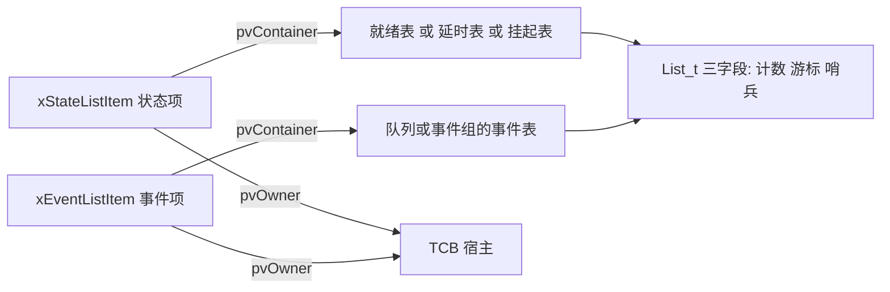
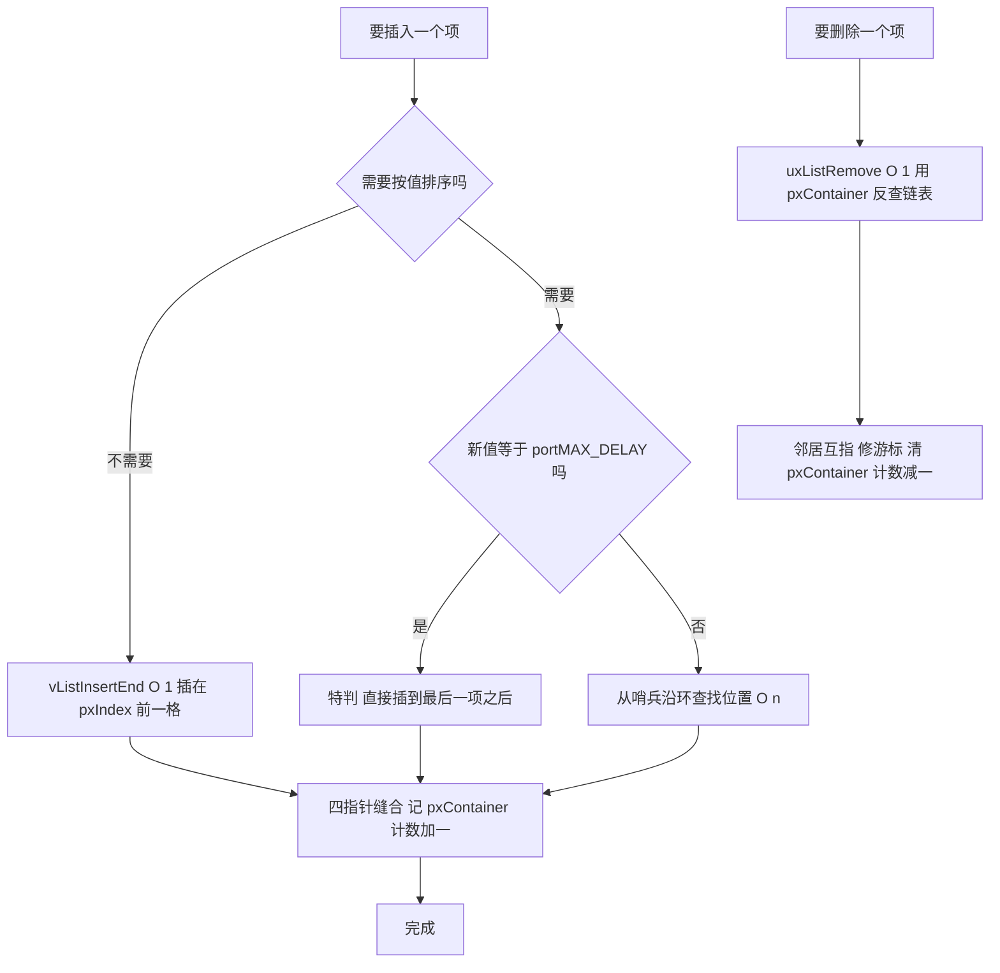
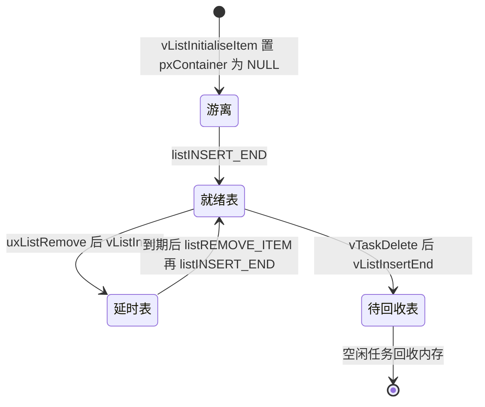

# list.c 与 list.h —— FreeRTOS 内核链表完全解读

> 对应源文件（本地仓库 `~/workspace/freertos/`，FreeRTOS-Kernel V11.1.0+，行号以当前文件为准）：
> - [list.c](/Users/theo-richard/workspace/freertos/list.c)（529 行，含大量中文注释）—— 链表操作实现，全文件只有 **5 个函数**
> - [include/list.h](/Users/theo-richard/workspace/freertos/include/list.h)（501 行）—— 3 个数据类型 + **17 个访问宏** + 5 个函数声明
>
> **后续阅读：** [tasks.md](tasks.md)（调度器如何用这些链表）、[queue.md](queue.md)（队列/信号量）
> **配置项：** [freertosconfigh.md](freertosconfigh.md)
>
> ⚠️ **行号提示**：本文行号已按当前 `list.c`（529 行，含大量中文注释）与 `list.h`（501 行）逐条校对。
> 若源码被改动，用 7.3 的自查命令重新核对。

---

# 第一部分：先掌握什么、按什么顺序读

## 1.1 这个文件到底是什么

**一句话：`list.c` 是 FreeRTOS 唯一的"通用双向环形链表"。就绪任务、延时任务、挂起任务、
队列的等待者、软件定时器、事件组的等待者——内核里所有"排队"都用它。**

它代码部分只有约 200 行、5 个函数，是理解整个内核数据结构的地基，也是读 `tasks.c` 之前的前置必修课
（list.c 自己的中文导读注释也这么说：list.c:29-46）。

**关键认知：FreeRTOS 用一个哨兵节点同时充当首和尾**（这是它区别于教科书双向链表的地方）。
所以它没有"头指针 + NULL 结尾"这套东西：环上没有 NULL，头尾是同一个哨兵，
遍历永远靠"绕回哨兵"来终止。

**它不存业务数据。** 链表只维护"谁排在前面"这个关系；真正的任务信息在 TCB 里，
链表项只是 TCB 内部的一个成员。这是理解 FreeRTOS 链表最关键的一点。

## 1.2 必须提前搞懂的 6 个概念

### 概念 1：环形链表 + 哨兵（不是普通链表）

普通链表：`head → A → B → NULL`。
FreeRTOS：`哨兵 ⇄ A ⇄ B ⇄（回到哨兵）`。

**为什么用一个哨兵同时当首尾？** 因为这样边界情况全部消失：

| 场景 | 普通链表要特判 | 有哨兵的环 |
|---|---|---|
| 空表插入 | 要判 head == NULL | 不需要，插到哨兵前即可 |
| 删除首元素 | 要改 head | 不需要，邻居互指即可 |
| 遍历终止 | 判 NULL | 判"绕回哨兵" |
| 尾部标记 | 需要额外变量 | 哨兵 `xItemValue = portMAX_DELAY` 天然恒最大 |

代价只是多一个节点（`List_t` 里内嵌，不额外分配），换来的是**所有操作都没有边界特判**。

### 概念 2：链表项嵌在宿主里，不是独立分配

`ListItem_t` **从不单独 malloc**。它被嵌在宿主结构体内部：

| 宿主 | 内嵌的链表项 | 用途 |
|---|---|---|
| `TCB_t` | `xStateListItem` | 挂在 就绪 / 延时 / 挂起 表 |
| `TCB_t` | `xEventListItem` | 挂在 队列 / 事件组 的事件表 |
| `Timer_t` | `xTimerListItem` | 挂在定时器活动表 |

**一个任务同时可能在两条链表上**（阻塞时：状态项在延时表、事件项在事件表）。
这就是为什么一个 TCB 需要**两个**链表项，而不是一个。

### 概念 3：`pvOwner` 和 `pxContainer` —— 两个反向指针

```c
pvOwner      // 链表项 → 宿主（"我嵌在谁体内"，调度器里 = TCB）
pxContainer  // 链表项 → 所属链表（"我此刻挂在谁身上"，NULL = 没挂）
```

这两个指针让所有反查变成 O(1)：

- 拿到链表项就能立刻找到宿主任务（`listGET_OWNER_OF_NEXT_ENTRY` 靠它挑选下一个任务）；
- 删除时**只需传项、不需传表**（`uxListRemove` 靠 `pxContainer` 反查，list.c:419）。

### 概念 4：三种插入方式对应三种语义

同一个结构，在内核里有三种完全不同的用法：

| 用法 | 插入方式 | 排序键 `xItemValue` 的含义 |
|---|---|---|
| 就绪表 | `vListInsertEnd` / `listINSERT_END` | **不用**（同表内值都相同，排序无意义） |
| 延时表 | `vListInsert` | 任务唤醒时刻（绝对 tick） |
| 事件表 | `vListInsert` | `configMAX_PRIORITIES - 优先级`（值小=优先级高 → 表头最优先） |
| 定时器表 | `vListInsert` | 定时器到期时刻 |

**内核从不在同一条链上混用两种插入方式**——这是隐含契约（见 6.2 图 2 的说明）。

### 概念 5：`pxIndex` 游标 —— 时间片轮转的执行者

`List_t.pxIndex` 是"遍历游标"，指向 `listGET_OWNER_OF_NEXT_ENTRY()` 上次取出的项。
每次调用它前进一格、跳过哨兵、返回新项的 `pvOwner`。

**同优先级任务的时间片轮转就靠它实现**——不是靠队列，不是靠重新排序，就是在环上换个起点。
看起来像队列，实际是个环。

### 概念 6：两个"可选加固"，默认都关

| 配置项 | 定义处 | 默认 | 打开后 |
|---|---|---|---|
| `configLIST_VOLATILE` | list.h:80-82 | 空 | 给所有链表指针加 `volatile`（list.h:59-79 有详细讨论，含"什么情况下才需要"） |
| `configUSE_LIST_DATA_INTEGRITY_CHECK_BYTES` | list.h:96-126 | 0 | 在结构首尾塞魔数，插入/删除前断言是否被踩坏 |

两者都遵循同一个模式：**不定义就有默认行为**，想开才在 `FreeRTOSConfig.h` 里定义。

## 1.3 推荐阅读顺序（5 站，约 1 小时）

```text
┌─ 第 1 站：三个数据类型 ──────────────────────────────────────────
│  ListItem_t      list.h:133-143
│  MiniListItem_t  list.h:145-156
│  List_t          list.h:173-180
│  目标：认清 5 个字段各自作用；明白"链表不拥有项，项嵌在宿主里"
└──────────────────────────────────────────────────────────────────
                          │
                          ▼
┌─ 第 2 站：两个初始化函数 ────────────────────────────────────────
│  vListInitialise      list.c:89-148   （初始化链表本身）
│  vListInitialiseItem  list.c:151-179  （初始化链表项）
│  目标：明白"空链表长什么样"；记住 pxContainer = NULL 这条约定
└──────────────────────────────────────────────────────────────────
                          │
                          ▼
┌─ 第 3 站：两个插入（对比着读，重点）─────────────────────────────
│  vListInsertEnd  list.c:182-227  O(1)，不排序，插在 pxIndex 前一格
│  vListInsert     list.c:230-399  O(n)，按 xItemValue 升序
│  目标：想通"为什么就绪表用 InsertEnd、延时表用 Insert"；
│        以及 portMAX_DELAY 为什么必须特判（list.c:266）
└──────────────────────────────────────────────────────────────────
                          │
                          ▼
┌─ 第 4 站：删除 ──────────────────────────────────────────────────
│  uxListRemove  list.c:404-527  O(1)，只传项不传表
│  目标：明白 pxContainer 反查的原理，以及"返回值 0"的妙用
└──────────────────────────────────────────────────────────────────
                          │
                          ▼
┌─ 第 5 站：17 个宏（快速过，用的时候回来查）──────────────────────
│  访问类：list.h:189-262
│  逻辑类：list.h:283（轮转）/ 319（删除）/ 358（插入）的内联版
│  目标：知道热路径走宏的内联版，逻辑与函数版一致
└──────────────────────────────────────────────────────────────────
```

**读完立刻做：** 打开 [tasks.md](tasks.md) 的 2.2 / 2.3 节，看这些链表怎么变成就绪表和延时表。

---

# 第二部分：list.h —— 三个数据类型

## 2.1 `ListItem_t`（list.h:133-143）

| 字段 | 行号 | 类型 | 作用 | 谁写它 |
|---|---|---|---|---|
| `xItemValue` | 136 | TickType_t | **排序键**。延时表=唤醒时刻；事件表=优先级编码；就绪表=不使用 | `listSET_LIST_ITEM_VALUE`（list.h:207） |
| `pxNext` | 137 | 指针 | 环上的下一个 | 插入/删除 |
| `pxPrevious` | 138 | 指针 | 环上的上一个 | 插入/删除 |
| `pvOwner` | 139 | void* | **宿主指针**（调度器里指向 TCB） | `listSET_LIST_ITEM_OWNER`（list.h:189） |
| `pxContainer` | 140 | 指针 | **当前所在链表**；NULL = 不在任何链表 | 插入/删除 |

所有指针成员带 `configLIST_VOLATILE` 前缀（默认展开为空，见 list.h:80-82）。

## 2.2 `MiniListItem_t`（list.h:145-156）—— 哨兵专用瘦身版

哨兵 `xListEnd` 不需要 `pvOwner`（它不属于任何任务），也不需要 `pxContainer`（它不属于任何链表），
所以：

- `configUSE_MINI_LIST_ITEM = 1`（当前模板值）：哨兵用 `MiniListItem_t`，省 2 个指针的 RAM；
- `configUSE_MINI_LIST_ITEM = 0`：哨兵就是完整 `ListItem_t`（list.h:155
  `typedef struct xLIST_ITEM MiniListItem_t;`），此时 `vListInitialise` 里那段
  `#if` 才会编译，去补 `pvOwner` / `pxContainer`（list.c:126-132）。

> 这就是 list.c:126 那个 `#if ( configUSE_MINI_LIST_ITEM == 0 )` 存在的原因——
> 不是可有可无的防御代码，而是两种结构定义下都必须让哨兵字段完整。

## 2.3 `List_t`（list.h:173-180）

| 字段 | 行号 | 作用 |
|---|---|---|
| `uxNumberOfItems` | 176 | 项数。O(1) 判空与计数 |
| `pxIndex` | 177 | **遍历游标**。同优先级轮转的执行者 |
| `xListEnd` | 178 | 哨兵。`xItemValue = portMAX_DELAY` 恒最大 → 排序永远沉底；空链时自指 |

**只有 3 个字段。** 链表结构本身极其轻量——因为它不拥有数据，只维护关系。

## 2.4 三个类型的关系

```text
List_t（链表根，list.h:173）—— 只有 3 个字段
  ├─ uxNumberOfItems = 3
  ├─ pxIndex ─────────────► 指向"上次取出的项"（轮转用）
  └─ xListEnd（哨兵，MiniListItem_t，list.h:178）
       ├─ xItemValue = portMAX_DELAY（恒最大 = 天然的尾标记）
       ├─ pxNext ─────────► 第一个真实项
       └─ pxPrevious ─────► 最后一个真实项

ListItem_t（list.h:133）—— 嵌在宿主体内，不单独分配
  ├─ xItemValue            ← 排序键
  ├─ pxNext / pxPrevious   ← 环上邻居
  ├─ pvOwner ─────────────► 宿主：TCB / Timer_t / ...
  └─ pxContainer ─────────► 所属 List_t（NULL = 游离）

环的形状（所有真实项 + 哨兵首尾相接）：
    哨兵 ⇄ 项1 ⇄ 项2 ⇄ 项3 ⇄ 哨兵
      ▲                          │
      └──────────────────────────┘
```

**注意：链表与项之间不是"包含"关系。** `List_t` 不持有任何项的内存，`ListItem_t` 也不持有
`List_t` 的内存，两边只靠指针互相认识。这就是为什么一个 TCB 能把两个链表项挂到两条不同链表上，
而链表本身毫无感知。

## 2.5 `xItemValue` 的四种语义（理解内核的关键）

| 挂在哪 | 值含义 | 谁写 | 出处 |
|---|---|---|---|
| 就绪表 | **不使用** | — | — |
| 延时表 / 溢出表 | 绝对唤醒时刻 `xTickCount + 延时` | `prvAddCurrentTaskToDelayedList` | tasks.c:9056 |
| 事件表 | `configMAX_PRIORITIES - uxPriority` | 任务创建时写入一次 | tasks.c:1876 区段 |
| 定时器活动表 | 绝对到期时刻 | `xTimerStart` / `xTimerReset` | timers.c |

**为什么事件表要"取反"？** 因为链表按升序，而优先级是"数字大=优先级高"。
用 `MAX - prio` 变换后，最高优先级变成最小值、排在表头，于是：

> **事件表表头天然就是"最该被唤醒的任务"**，`xTaskRemoveFromEventList` 直接取表头即可，
> 完全不需要遍历比较优先级。这是 FreeRTOS 用数据结构换算法复杂度的典型手法。

---

# 第三部分：list.c —— 5 个函数逐个详解

> **关于函数入口出口的 `traceENTER_xxx` / `traceRETURN_xxx`：** 它们默认在
> `include/FreeRTOS.h` 里被 `#ifndef` 定义为**空展开**（如 `traceENTER_vListInitialise` 在
> FreeRTOS.h:2639-2645），编译后等价于不存在，零开销。只在你于 `FreeRTOSConfig.h` 里自己定义、
> 或接入 Tracealyzer 时才有实体。下文不再重复。
>
> 同理：`listTEST_LIST_INTEGRITY` / `listTEST_LIST_ITEM_INTEGRITY` 只在
> `configUSE_LIST_DATA_INTEGRITY_CHECK_BYTES=1` 时有实体（list.h:124-125）；
> `mtCOVERAGE_TEST_DELAY()` / `mtCOVERAGE_TEST_MARKER()`（list.c:208、259、268）
> 是判定覆盖率测试的占位宏，默认也为空。

## 3.1 `vListInitialise`（实现 list.c:89-148，声明 list.h:433）

**作用：把一块 `List_t` 内存初始化成合法空链表。必须在使用前调用。**

| 行号 | 代码 | 含义 |
|---|---|---|
| list.c:102 | `pxList->pxIndex = &xListEnd` | 游标先指向哨兵（空链没有真实项可指） |
| list.c:104 | `listSET_FIRST_LIST_ITEM_INTEGRITY_CHECK_VALUE` | 哨兵头部写魔数（若开启校验） |
| list.c:109 | `xListEnd.xItemValue = portMAX_DELAY` | **哨兵恒最大**：排序时永远排最后，充当"尾标记" |
| list.c:116 | `pxNext = pxPrevious = &xListEnd` | **自指 → 空环**。这也是另一种判空方式 |
| list.c:126-132 | `#if ( configUSE_MINI_LIST_ITEM == 0 )` | 哨兵是完整项时补齐 `pvOwner` / `pxContainer` |
| list.c:137 | `uxNumberOfItems = 0` | 计数清零 |
| list.c:144-145 | `listSET_LIST_INTEGRITY_CHECK_1/2_VALUE` | 链表头尾写魔数（若开启校验） |

**空链表长这样：**

```text
   List_t
   ├─ uxNumberOfItems = 0
   ├─ pxIndex ────┐
   └─ xListEnd ◄──┘
        │    ▲
        └────┘     pxNext 和 pxPrevious 都指向自己 → 环长为 1（只有哨兵）
```

**调用者：** 定时器服务启动 `vListInitialise( &xActiveTimerList1 )`（timers.c:1166）；
队列/事件组创建时初始化"等待发送/接收"表；
调度器第一次建任务时 `prvInitialiseTaskLists`（tasks.c:6424）初始化全部调度链表。

## 3.2 `vListInitialiseItem`（实现 list.c:151-179，声明 list.h:444）

**作用：把一个链表项标记为"不属于任何链表"。必须在使用前调用。**

整个函数只有 1 行实质代码：

```c
pxItem->pxContainer = NULL;    // list.c:161
```

**为什么这一行这么重要？** 它是三条机制的根基：

1. `uxListRemove(pxItem)` 靠 `pxContainer` 反查所属链表（list.c:419）——若为 NULL 就会空指针解引用；
2. `listIS_CONTAINED_WITHIN(pxList, pxItem)`（list.h:407）靠它判断"这个项挂在这条链上吗"；
3. `listLIST_ITEM_CONTAINER(pxItem)`（list.h:415）——`xTaskIncrementTick` 用它判断
   "任务从延时表醒来时，另一个链表项是否还挂在事件表上"（tasks.c:5123）。

**调用者：** `xTaskCreate` 初始化 TCB 的 `xStateListItem` 与 `xEventListItem`；
`xTimerCreate` 初始化 `xTimerListItem`。

## 3.3 `vListInsertEnd`（实现 list.c:182-227，声明 list.h:478）

**作用：不排序，把新项插到 `pxIndex` 的"前一格"**（即 `pxIndex->pxPrevious` 与 `pxIndex` 之间）。
效果 = 它将成为 `listGET_OWNER_OF_NEXT_ENTRY()` **最后**轮到的项。

**插入位置图示：**

```text
插入前：      哨兵 ⇄ A ⇄ B ⇄ C
                        ▲
                        └── pxIndex 停在 B

执行 vListInsertEnd(N)：
  N.pxNext     = pxIndex             // N 的后继 = B
  N.pxPrevious = pxIndex->pxPrevious // N 的前驱 = A
  A.pxNext     = N
  B.pxPrevious = N

插入后：      哨兵 ⇄ A ⇄ N ⇄ B ⇄ C
                            ▲
                            └── pxIndex 仍在 B，N 排在它前面
```

**关键理解："插在 pxIndex 前一格"为什么等于"追加到队尾"？**
调度链表初始化后 `pxIndex` 指向哨兵，哨兵在环尾，所以新项总排在所有老项之后。
于是语义恰好是"同优先级任务按到达先后轮转，后来的排最后"——公平，且 O(1)。

| 行号 | 代码 | 含义 |
|---|---|---|
| list.c:188 | `pxIndex = pxList->pxIndex` | 缓存到局部变量（后面用 4 次） |
| list.c:204-205 | 设置新项的 next / previous | 前两步：新项先指好邻居 |
| list.c:216-217 | 邻居反指新项 | 后两步：邻居认新项 |
| list.c:220 | `pxContainer = pxList` | 记账：我现在在这条链上 |
| list.c:224 | `uxNumberOfItems + 1` | 计数 |

**调用者：** 就绪表插入宏 `prvAddTaskToReadyList`（tasks.c:335，用内联版 `listINSERT_END`）；
无限期阻塞进挂起表（tasks.c:9045）。

## 3.4 `vListInsert`（实现 list.c:230-399，声明 list.h:457）

**作用：按 `xItemValue` 升序插入。5 个函数里唯一可能 O(n) 的。**

| 行号 | 代码 | 含义 |
|---|---|---|
| list.c:245 | `xValueOfInsertion = pxNewListItem->xItemValue` | 先取出排序键 |
| list.c:266-289 | `if( xValueOfInsertion == portMAX_DELAY )` → 迭代器直接定位到最后一项 | **必须特判**，原因见下 |
| list.c:342-348 | `for(...; pxIterator->pxNext->xItemValue <= xValueOfInsertion; ...)` | 从哨兵沿环走，直到"下一个值 > 新值"停下 |
| list.c:373-382 | 四指针缝合 | 把新项接到迭代器之后 |
| list.c:388 | `pxContainer = pxList` | 记账 |
| list.c:396 | `uxNumberOfItems + 1` | 计数 |

### 为什么 `portMAX_DELAY` 必须特判（list.c:266）

循环条件是 `pxIterator->pxNext->xItemValue <= 新值`：

- 哨兵的 `xItemValue` **恰好也是** `portMAX_DELAY`；
- 若新值也是 `portMAX_DELAY`，则 `哨兵值 <= 新值` **恒成立**；
- 循环会在环上**永远转下去**（死循环），永远找不到"下一个值更大"的停止点。

所以先把迭代器挪到最后一项，新项直接插在它和哨兵之间（同值时排在哨兵之前）。

> **两条重要性质：**
> 1. **相同值的新项排在后面**（条件是 `<=` 而非 `<`）→ 稳定插入 → 同优先级任务公平；
> 2. **哨兵值最大保证了它是唯一的"末尾标记"**，这正是 `vListInitialise` 把哨兵值设为
>    `portMAX_DELAY` 的真正原因（list.c:109）。

### 官方崩溃排查清单（list.c:293-307）

源码在这里留了一大段注释。应用若在此处死循环/崩溃，按顺序查：

1. **栈溢出**；
2. **中断优先级配错**（Cortex-M 上数值大 = 优先级低，反直觉）——见 [freertosconfigh.md](freertosconfigh.md) 2.2 节；
3. 在**临界区或调度器挂起时**调用了非 FromISR 的 API；
4. 队列/信号量**未初始化**，或**调度器未启动**就使用（启动前是否有中断在触发？）；
5. tick 中断优先级必须**等于或低于** `configMAX_SYSCALL_INTERRUPT_PRIORITY`。

这段注释出现在这里不是随意的：链表是最先被破坏的数据结构，任何内存越界都先在这里露出症状。

**调用者：** 延时表/溢出表（tasks.c:9064、9072，按唤醒时刻）；
事件表 `vTaskPlaceOnEventList`（tasks.c:5644，按优先级）；定时器活动表（timers.c，按到期时刻）。

## 3.5 `uxListRemove`（实现 list.c:404-527，声明 list.h:493）

**作用：把项从所在链表摘下，O(1)，返回剩余项数。参数是"项"不是"表"。**

**摘除图示：**

```text
删除前：   哨兵 ⇄ A ⇄ B ⇄ C        pxIndex 停在 B

步骤 1（list.c:452-453）：邻居互相指过去
        B.pxNext->pxPrevious = B.pxPrevious   // C.prev = A
        B.pxPrevious->pxNext = B.pxNext       // A.next = C
步骤 2（list.c:480-487）：若 pxIndex 正指向 B，拨回前一项
        pxIndex = B.pxPrevious                // = A
步骤 3（list.c:505）：B.pxContainer = NULL
步骤 4（list.c:513）：uxNumberOfItems - 1

删除后：   哨兵 ⇄ A ⇄ C            pxIndex 指向 A（仍有效）
           B 游离：pxContainer 已清空，但 pxNext / pxPrevious 仍是旧值
```

| 行号 | 代码 | 含义 |
|---|---|---|
| list.c:419 | `pxList = pxItemToRemove->pxContainer` | **反查所属链表**——参数只需传项的原因 |
| list.c:452-453 | 邻居互指 | 标准双向链表 O(1) 摘除 |
| list.c:480-487 | `if( pxList->pxIndex == pxItemToRemove )` → 拨回前一项 | 保证游标永远指向有效项 |
| list.c:505 | `pxContainer = NULL` | 恢复"游离"状态（与 3.2 的约定闭环） |
| list.c:513-526 | 计数 -1，返回剩余项数 | |

### 返回值的巧妙用法

`prvAddCurrentTaskToDelayedList`（tasks.c:9002）这样用：

```c
if( uxListRemove( &( pxCurrentTCB->xStateListItem ) ) == ( UBaseType_t ) 0 )
{
    portRESET_READY_PRIORITY( pxCurrentTCB->uxPriority, uxTopReadyPriority );
}
```

**一次删除顺带完成了优先级位图维护**：返回 0 说明"该优先级的就绪表空了"，
此时才有必要清位图对应位（tasks.c:9024-9030）。省掉一次独立的判空查询。

**调用者：** tasks.c:9024 等内核路径；更热的路径（每 tick 解除阻塞，tasks.c:5119）
用内联版宏 `listREMOVE_ITEM`（list.h:319），逻辑一样，省一次函数调用。

---

# 第四部分：list.h 的 17 个宏

> list.h 里除了类型就是宏，**没有隐藏的第六个函数**。
> 4.2 里那三个"看起来像函数"的宏是 `do{...}while(0)` 多语句宏，逻辑上等于内联函数。

## 4.1 访问/查询宏（14 个，单表达式）

| 宏 | 行号 | 作用 | 内核里的典型用法 |
|---|---:|---|---|
| `listSET_LIST_ITEM_OWNER(pxItem, pxOwner)` | 189 | 写 pvOwner | 创建任务时把 TCB 登记到链表项 |
| `listGET_LIST_ITEM_OWNER(pxItem)` | 198 | 读 pvOwner | 由项反查宿主 |
| `listSET_LIST_ITEM_VALUE(pxItem, xValue)` | 207 | 写排序键 | 阻塞前写唤醒时刻（tasks.c:9056） |
| `listGET_LIST_ITEM_VALUE(pxItem)` | 216 | 读排序键 | tick 里比对到期时刻（tasks.c:5102） |
| `listGET_ITEM_VALUE_OF_HEAD_ENTRY(pxList)` | 224 | 读表头项的值 | O(1) 偷看最早到期时刻（tasks.c:6904） |
| `listGET_HEAD_ENTRY(pxList)` | 232 | 取表头项 | 手工遍历起点 |
| `listGET_NEXT(pxItem)` | 240 | 取下一个项 | 手工遍历 |
| `listGET_END_MARKER(pxList)` | 248 | 取哨兵 | 手工遍历终止条件 |
| `listLIST_IS_EMPTY(pxList)` | 257 | O(1) 判空 | `xTaskResumeAll` 搬表前判空（tasks.c:4279） |
| `listCURRENT_LIST_LENGTH(pxList)` | 262 | O(1) 读项数 | 优化版任务选择时断言非空 |
| `listGET_OWNER_OF_HEAD_ENTRY(pxList)` | 396 | 取表头项的宿主 | 取最早到期任务，**tick 热路径**（tasks.c:5101） |
| `listIS_CONTAINED_WITHIN(pxList, pxItem)` | 407 | 判断项是否挂着 | 状态查询 |
| `listLIST_ITEM_CONTAINER(pxItem)` | 415 | 读 pxContainer | 判断"还挂在事件表吗"（tasks.c:5123） |
| `listLIST_IS_INITIALISED(pxList)` | 422 | 粗略判断是否初始化过 | 防"未初始化就使用"（哨兵值是否 = portMAX_DELAY） |

## 4.2 带逻辑的"内联函数"宏（3 个）

### `listGET_OWNER_OF_NEXT_ENTRY(pxTCB, pxList)`（list.h:283-294）—— 调度器的心脏

```c
( pxConstList )->pxIndex = ( pxConstList )->pxIndex->pxNext;      // 游标前进一格
if( pxIndex == &xListEnd )                                        // 撞到哨兵就跳过
    ( pxConstList )->pxIndex = ( pxConstList )->xListEnd.pxNext;  // 回到第一个真实项
( pxTCB ) = ( pxConstList )->pxIndex->pvOwner;                    // 返回宿主
```

**轮转图示：**

```text
就绪表（优先级 3）：  哨兵 ⇄ A ⇄ B ⇄ C

第 1 次：pxIndex 哨兵 → A，返回 TCB_A
第 2 次：pxIndex A → B，  返回 TCB_B
第 3 次：pxIndex B → C，  返回 TCB_C
第 4 次：pxIndex C → 哨兵（命中 if）→ 跳到 哨兵.next = A，返回 TCB_A
                                ▲
                                └── "跳过哨兵"那两行的作用就在此

效果：A → B → C → A → B → C ... 无限轮转 = 时间片轮转
```

`vTaskSwitchContext` 每次切换都调用它（tasks.c:253 / 290）。

**注意 SMP 分支（list.h:295-302）：** 多核下这个宏**根本不定义**——
SMP 调度器不使用 `pxIndex` 轮转，`pxIndex` 应始终指向 `xListEnd`。

### `listREMOVE_ITEM(pxItemToRemove)`（list.h:319-335）—— `uxListRemove` 的内联版

逻辑与 `uxListRemove` 完全相同：邻居互指 → 修游标 → `pxContainer=NULL` → 计数 -1。
区别只有两点：少了返回值、没有完整性校验。
专为 `xTaskIncrementTick` 这类每 tick 都跑的热路径省函数调用（tasks.c:5119、5126、5753、5757）。

### `listINSERT_END(pxList, pxNewListItem)`（list.h:358-381）—— `vListInsertEnd` 的内联版

逻辑与 `vListInsertEnd` 相同（含两步完整性校验），
`prvAddTaskToReadyList`（tasks.c:335）用它把任务放进就绪表
——调度器出现频率最高的操作。

> **为什么手写内联版而不依赖编译器的 inline？**
> 因为它们要被多个内核 C 文件使用，跨文件无法 inline；而 tick 中断每毫秒都要执行，
> 一次函数调用的开销（寄存器保存、栈操作）在高 tick 频率 + 低主频 MCU 上是可观的。

---

# 第五部分：内核里这些链表的真实用户

## 5.1 全局链表实例清单

| 实例 | 定义处 | 装什么 | 插入方式 |
|---|---|---|---|
| `pxReadyTasksLists[configMAX_PRIORITIES]` | tasks.c:530 | 每个优先级一条就绪表 | `listINSERT_END`（不排序） |
| `xDelayedTaskList1` / `xDelayedTaskList2` | tasks.c:531-532 | 延时任务；两表轮换防 tick 回绕 | `vListInsert`（按唤醒时刻） |
| `pxDelayedTaskList` / `pxOverflowDelayedTaskList` | tasks.c:533-534 | 指向上面两张表的"当前/溢出"指针 | — |
| `xPendingReadyList` | tasks.c:535 | 调度器挂起期间被唤醒的任务，恢复时统一搬回 | `vListInsertEnd` |
| `xTasksWaitingTermination` | tasks.c:539 | 已删除、等空闲任务回收内存的 TCB | `vListInsertEnd` |
| `xSuspendedTaskList` | tasks.c:546 | 挂起的任务；**无限期阻塞也进这里** | `listINSERT_END`（tasks.c:9045） |
| `Queue_t.xTasksWaitingToSend` | queue.c:126 | 等发送而阻塞的任务（挂在队列自己身上） | `vListInsert`（按优先级） |
| `Queue_t.xTasksWaitingToReceive` | queue.c:127 | 等接收而阻塞的任务 | `vListInsert`（按优先级） |
| `EventGroup_t.xTasksWaitingForBits` | event_groups.c:69 | 等事件位的任务 | `vListInsert`（按优先级） |
| `xActiveTimerList1` / `xActiveTimerList2` | timers.c:168-169 | 活动软件定时器 | `vListInsert`（按到期时刻） |

**注意最后三项：链表"挂在被等的对象身上"，不是挂在内核全局。**
所以每个队列、每个事件组都自带空链表，随对象创建/销毁——这是 O(1) 精确唤醒的前提，
也意味着**几千个队列就有几千套链表**，这是 FreeRTOS 用内存换并发能力的取舍。

## 5.2 一条任务的链表项流动（配合 tasks.md 阅读）

```text
xTaskCreate
  ├─ vListInitialiseItem(&xStateListItem)   ← 状态项：pxContainer = NULL
  ├─ vListInitialiseItem(&xEventListItem)   ← 事件项：pxContainer = NULL
  └─ prvAddTaskToReadyList
       └─ listINSERT_END(就绪表[prio], &xStateListItem)   【状态项 → 就绪表】

vTaskDelay / xQueueReceive 阻塞
  ├─ uxListRemove(&xStateListItem)                     【状态项 ← 离开就绪表】
  ├─ vListInsert(事件表, &xEventListItem)               【事件项 → 队列事件表】
  └─ vListInsert(延时表, &xStateListItem)               【状态项 → 延时表】
     （★ 此刻两个项挂在两条不同链表上）

被唤醒（超时 或 事件到达）
  ├─ listREMOVE_ITEM(两项各摘一个)
  └─ prvAddTaskToReadyList → listINSERT_END            【状态项 → 回到就绪表】

vTaskDelete
  ├─ uxListRemove 两项
  └─ vListInsertEnd(xTasksWaitingTermination, &xStateListItem)
       └─ 空闲任务回收 TCB 与栈
```

---

# 第六部分：图

## 6.1 图 1：链表的内存与指针全景

```text
        ┌─ TCB_A ────────────────────────────────► 就绪表[3]
        │  xStateListItem
        │    pxContainer = 就绪表[3]         List_t 就绪表[3]
        │    pvOwner     = &TCB_A            ├─ uxNumberOfItems = 2
        │  xEventListItem                    ├─ pxIndex ──►（轮转游标）
        │    pxContainer = NULL              └─ xListEnd（哨兵）
        └──────────────────────────────────────   │  ▲
                                                  ▼  │
        ┌─ TCB_B ────────────────────────► [ A ] ⇄ [ B ] ⇄ 哨兵
        │  xStateListItem
        │    pxContainer = 就绪表[3]
        └──────────────────────────────────────────

读法：
  · 每个 TCB 内嵌 2 个链表项，但只有"当前挂着"的项其 pxContainer 非 NULL
  · 链表项通过 pvOwner 反查 TCB，通过 pxContainer 反查 List_t
  · List_t 不拥有任何 TCB / 项的内存，只维护"谁在前谁在后"
```

## 6.2 图 2：链表生命周期（空 → 插入 → 有序）

```text
① vListInitialise 之后（空）
   哨兵.pxNext = 哨兵
   哨兵.pxPrevious = 哨兵
   uxNumberOfItems = 0
   pxIndex = &哨兵

        ┌──────
        │ 哨兵 │◄── 自指环（环长 1）
        └──────

② vListInsertEnd(A) 之后
   uxNumberOfItems = 1

        哨兵 ⇄ A            pxIndex 仍指向哨兵
                            A 插在 pxIndex 前一格 = 哨兵之后 = 队尾

③ 再 vListInsertEnd(B)
        哨兵 ⇄ A ⇄ B        pxIndex 仍指向哨兵，B 排在 A 之后

④ 换用 vListInsert(C, 值=50) 按值插入（设 A=10, B=20）
        哨兵 ⇄ A(10) ⇄ B(20) ⇄ C(50)

★ 注意：InsertEnd 与 Insert 混用后链表不再有序。
  内核从不在同一条链上混用两种插入方式——这是隐含契约：
    就绪表/挂起表/待回收表 → 只用 InsertEnd
    延时表/事件表/定时器表 → 只用 Insert
```

## 6.3 图 3：`vListInsert` 的查找过程（把 N(25) 插进去）

```text
链表：哨兵 ⇄ A(10) ⇄ B(20) ⇄ D(40)        新项 N(25)

循环从迭代器 = &哨兵 开始：
  第 1 轮：迭代器=哨兵，检查 哨兵.pxNext = A(10)
           10 <= 25 ？成立 → 迭代器前进到 A
  第 2 轮：迭代器=A，检查 A.pxNext = B(20)
           20 <= 25 ？成立 → 迭代器前进到 B
  第 3 轮：迭代器=B，检查 B.pxNext = D(40)
           40 <= 25 ？不成立 → 停止

停止时迭代器 = B，N 插在 B 之后：

   哨兵 ⇄ A(10) ⇄ B(20) ⇄ N(25) ⇄ D(40)
                          ▲
                          └── 插在"第一个比自己大的项"之前

★ 条件是 <=（不是 <）：若已有 C(25)，新 N 会排在 C 之后 → 稳定插入
★ 若新值 = portMAX_DELAY，哨兵值（也是 portMAX_DELAY）会让条件恒成立
  → 必须在 list.c:266 特判，否则死循环
```

## 6.4 图 4：InsertEnd 插入位置 vs 轮转取任务

```text
就绪表初始：哨兵 ⇄ A ⇄ B       pxIndex → 哨兵

插入 C（vListInsertEnd）：
  C 插在 pxIndex 前一格 = 哨兵前一格 = 队尾
  结果：哨兵 ⇄ A ⇄ B ⇄ C      pxIndex → 哨兵

轮转取任务（listGET_OWNER_OF_NEXT_ENTRY）：
  第 1 次 → A     （先来的先跑）
  第 2 次 → B
  第 3 次 → C     （后插入的最后才轮到）
  第 4 次 → 撞到哨兵 → 跳到 A   （绕回，循环）

★ "同优先级任务公平分享 CPU"的全部实现就在这里：
  没有额外队列，没有排序，只是在环上换个起点
```

## 6.5 图 5：`uxListRemove` 的三种情形

```text
情形 A：删除非游标项（最常见）
   哨兵 ⇄ A ⇄ B ⇄ C，pxIndex → C，删 B
   → 邻居互指 A.next=C, C.prev=A；pxIndex 不动
   结果：哨兵 ⇄ A ⇄ C

情形 B：删除游标项
   哨兵 ⇄ A ⇄ B ⇄ C，pxIndex → B，删 B
   → 邻居互指；pxIndex 拨回 B.prev = A（list.c:482）
   结果：哨兵 ⇄ A ⇄ C，pxIndex → A（仍有效）

情形 C：删除链表最后一项
   哨兵 ⇄ A，pxIndex → 哨兵，删 A
   → 邻居互指：哨兵.next = 哨兵, 哨兵.prev = 哨兵（重新自指）
   → 返回值 0（uxNumberOfItems 由 1 减到 0）
   结果：空链表；调用者据此维护优先级位图
```

## 6.6 图 6：一个任务同时挂两条链表（阻塞态）

```text
任务阻塞在 xQueueReceive(q, 100)：

        ┌─ TCB_C ──────────────────────┐
        │  xStateListItem              │──► 延时表（按唤醒时刻升序）
        │    xItemValue = 当前tick+100 │      哨兵 ⇄ ... ⇄ C(1050)
        │  xEventListItem              │──► q->xTasksWaitingToReceive（按优先级）
        │    xItemValue = MAX - prio   │      哨兵 ⇄ C ⇄ ...（表头=最优先）
        └──────────────────────────────┘

两条唤醒路径，谁先到都能叫醒它，且都会顺手摘掉另一条链上的项：
  ① 数据到达 → xTaskRemoveFromEventList 摘事件项 + 摘状态项（tasks.c:5753/5757）
  ② 超时到达 → xTaskIncrementTick      摘状态项 + 摘事件项（tasks.c:5119/5126）

★ 这正是 pvContainer 存在的意义：不查表就知道"我还挂在哪、
  以及另一个项还有没有挂在别处"
```

## 6.7 图 7：Mermaid 版本

### 链表与任务的引用关系



### 插入与删除的路径选择



### 状态链表项的流转



> **Mermaid 语法两条硬规则**（本仓库所有图都遵守）：
> 1. `stateDiagram-v2` 的标签里**不能出现冒号**——会被当成分隔符，报 `Parse error on line 2`；
> 2. 标签里**不要用 `<br/>`**——部分渲染器会把它转义成字面量，导致文字粘连。

---

# 第七部分：易错点与速查

## 7.1 读代码时最容易误解的 8 处

| # | 误解 | 实际 |
|---|---|---|
| 1 | 以为哨兵是一个真实数据项 | 哨兵只标记末尾，`xItemValue` 恒为 `portMAX_DELAY`，不承载业务 |
| 2 | 以为空链表时 `pxNext == NULL` | 空链时哨兵自指，`pxNext == &xListEnd` |
| 3 | 以为 `vListInsertEnd` 就是"追加到尾部" | 它是"插到 `pxIndex` 前一格"；只在 `pxIndex` 指向哨兵时等价于追加 |
| 4 | 以为 `uxListRemove` 要传链表 | 只传项，靠 `pxContainer` 反查 |
| 5 | 以为删除后项的两个指针被清零 | 只清 `pxContainer`；`pxNext`/`pxPrevious` 仍是旧值（悬空但不会被读） |
| 6 | 以为 `vListInsert` 相同值时插在前面 | 条件是 `<=`，新项排在后（稳定插入） |
| 7 | 以为 `portMAX_DELAY` 特判是性能优化 | 是**正确性必需**，否则死循环 |
| 8 | 以为 SMP 下也用 `pxIndex` 轮转 | SMP 下 `listGET_OWNER_OF_NEXT_ENTRY` **不定义**（list.h:295-302） |

## 7.2 关键数字速查

| 项 | 值 | 出处 |
|---|---|---|
| 链表项字段数 | 5（+ 2 个可选校验字段） | list.h:133-143 |
| 链表根字段数 | 3（+ 2 个可选校验字段） | list.h:173-180 |
| 哨兵 `xItemValue` | `portMAX_DELAY` | list.c:109 |
| 空链表判据 | `uxNumberOfItems == 0` 或 哨兵自指 | list.h:257 / list.c:116 |
| 插入复杂度 | InsertEnd = O(1)；Insert = O(n) | list.c:182 / 174 |
| 删除复杂度 | O(1) | list.c:404 |
| 公开宏数量 | 17 | list.h |

## 7.3 行号自查命令

源码改动后，用下面命令确认本文行号是否仍然有效：

```bash
grep -nE "^void vListInitialise\(|^void vListInitialiseItem\(|^void vListInsertEnd\(|^void vListInsert\(|^UBaseType_t uxListRemove\(" list.c
```

期望输出（当前 list.c 共 529 行）：

```text
89:void vListInitialise( List_t * const pxList )
151:void vListInitialiseItem( ListItem_t * const pxItem )
182:void vListInsertEnd( List_t * const pxList, ListItem_t * const pxNewListItem )
230:void vListInsert( List_t * const pxList,ListItem_t * const pxNewListItem )
404:UBaseType_t uxListRemove( ListItem_t * const pxItemToRemove )
```

## 7.4 一句话总结

- **list.h 管"是什么"**：3 个类型 + 17 个宏；**list.c 管"怎么动"**：5 个函数、约 200 行有效代码。
- 全部 O(1) 操作的前提是 **`pvOwner` + `pxContainer` 两个反向指针**；
  `pxIndex` 游标是**同优先级时间片轮转**的执行者；
  哨兵 `xListEnd` 用**一个节点同时承担首、尾、空表判据、排序终止条件**四种职责。
- 热路径（就绪表插入、tick 解除阻塞）走**内联宏版**（`listINSERT_END` / `listREMOVE_ITEM`）。
- 下一步：读 [tasks.md](tasks.md)，看这 10 条链表怎么组成调度器。
