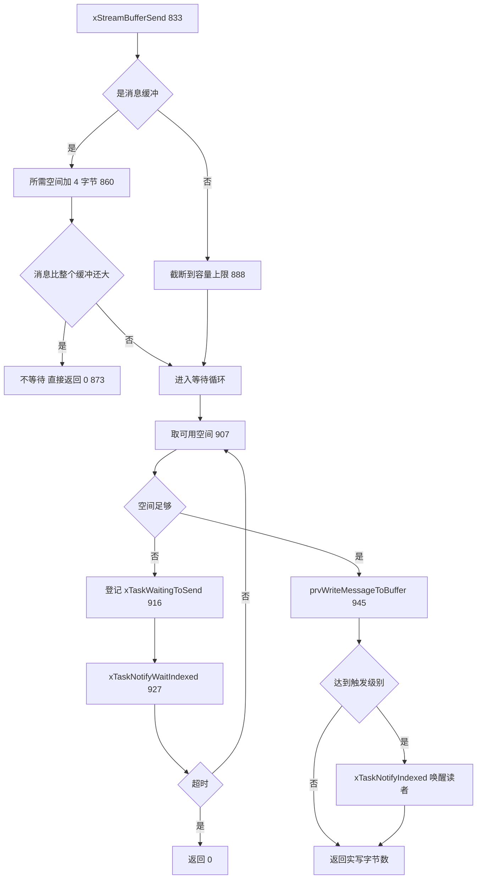
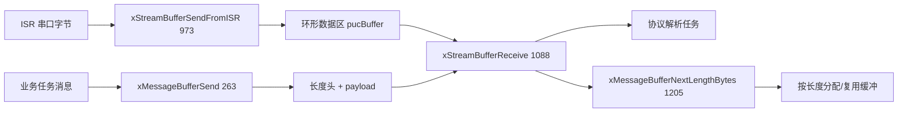

# stream_buffer.c 与 message_buffer.h —— 流缓冲 vs 消息缓冲

> 对应源文件：`stream_buffer.c`（共 1796 行）、`include/message_buffer.h`（共 655 行）、`include/stream_buffer.h`（共 909 行）
>
> **前置阅读：** [queue.md](queue.md)（对照"复制式队列"）、[task_notification.md](task_notification.md)（流缓冲内部用通知唤醒任务）
> **相关条目：** [stream_buffer.md](stream_buffer.md)（已有的流缓冲基础条目，本文侧重消息缓冲与差异）
>
> 行号以本仓库当前文件为准。

---

# 第一部分：两种缓冲的差异

## 1.1 一句话区别

**流缓冲（stream buffer）= 字节管道，没有边界；消息缓冲（message buffer）= 每条消息前加 4 字节长度头的字节管道。**

两者共用 `StreamBuffer_t` 和同一套读写函数，只靠 `ucFlags` 的 bit0 区分（stream_buffer.c:241）：

```c
#define sbFLAGS_IS_MESSAGE_BUFFER          ( ( uint8_t ) 1 )
```

## 1.2 差异总表

| 维度 | 流缓冲 | 消息缓冲 |
|---|---|---|
| 创建宏 | `xStreamBufferCreate(size, trigger)`（stream_buffer.h:115） | `xMessageBufferCreate(size)`（message_buffer.h:106） |
| 数据边界 | **无**，字节连续 | **有**，每条消息带长度头 |
| 每条消息开销 | 0 | `sizeof(configMESSAGE_BUFFER_LENGTH_TYPE)`，默认 **4 字节** |
| 写入语义 | 空间不够就写一部分，返回实写字节数 | **整条写入或完全不写**（stream_buffer.c:868-874） |
| 读取语义 | 有多少读多少 | 缓冲区不够大则**返回 0 且消息留在缓冲里**（stream_buffer.c:1339-1343） |
| 适用 | 串口/UART 字节流、ADC 采样流 | 协议帧、命令、结构体消息 |
| 典型 API | `xStreamBufferSend/Receive` | `xMessageBufferSend/Receive`（宏，映射到同一函数） |

## 1.3 句柄与创建：消息缓冲只是"预设参数"

```c
#define xMessageBufferCreate( xBufferSizeBytes ) \
    xStreamBufferGenericCreate( ( xBufferSizeBytes ), ( size_t ) 0, sbTYPE_MESSAGE_BUFFER, NULL, NULL )
```

（message_buffer.h:106-107，逐字）

三个关键点：

- `xTriggerLevelBytes = 0` → 创建函数内部改成 1（stream_buffer.c:384-386）。
- `sbTYPE_MESSAGE_BUFFER` → `ucFlags = sbFLAGS_IS_MESSAGE_BUFFER`（stream_buffer.c:363）。
- 消息缓冲的句柄类型就是 `StreamBufferHandle_t`（message_buffer.h:55 的注释明确说明），`MessageBufferHandle_t` 只是别名。

## 1.4 `StreamBuffer_t`：8 个字段撑起两种缓冲

```c
typedef struct StreamBufferDef_t
{
    volatile size_t xTail;                       /* 缓冲区中下一个待读位置的索引。 */
    volatile size_t xHead;                       /* 缓冲区中下一个待写位置的索引。 */
    size_t xLength;                              /* pucBuffer 所指向缓冲区的长度。 */
    size_t xTriggerLevelBytes;                   /* 在等待数据的任务解除阻塞之前，流缓冲中必须存在的字节数。 */
    volatile TaskHandle_t xTaskWaitingToReceive; /* 保存正在等待数据的任务句柄；若无任务等待则为 NULL。 */
    volatile TaskHandle_t xTaskWaitingToSend;    /* 保存因消息缓冲已满而等待发送数据的任务句柄。 */
    uint8_t * pucBuffer;                         /* 指向缓冲区本身，即存储流经缓冲区的数据的 RAM。 */
    uint8_t ucFlags;
    ...
    UBaseType_t uxNotificationIndex;
} StreamBuffer_t;
```

（stream_buffer.c:248-268，节选逐字）

| 字段 | 行号 | 作用 | 谁写 |
|---|---|---|---|
| `xTail` | 250 | 读位置 | 接收方 |
| `xHead` | 251 | 写位置 | 发送方 |
| `xLength` | 252 | 缓冲区总字节数 | 创建时固定 |
| `xTriggerLevelBytes` | 253 | 解除接收方阻塞的门槛 | `xStreamBufferSetTriggerLevel`（743） |
| `xTaskWaitingToReceive` | 254 | 唯一读等待者 | 接收方 |
| `xTaskWaitingToSend` | 255 | 唯一写等待者 | 发送方 |
| `pucBuffer` | 256 | 数据区 | 创建时固定 |
| `ucFlags` | 257 | 消息/静态/批量标志 | 创建时固定 |
| `uxNotificationIndex` | 267 | 用哪个通知索引唤醒 | 创建时默认 `tskDEFAULT_INDEX_TO_NOTIFY` |

**注意：只有"一个"读等待者和"一个"写等待者字段。** 这不是省内存，而是硬约束——流缓冲**只支持单读者单写者**，多任务同时读会在 `configASSERT( xTaskWaitingToReceive == NULL )`（stream_buffer.c:1143）处炸掉。

---

# 第二部分：环形缓冲的数学

## 2.1 为什么可用容量是 `size - 1`

```c
/*
 * 流缓冲能够报告的最大空间为其长度减 1。
 */
xMaxReportedSpace = pxStreamBuffer->xLength - ( size_t ) 1;
```

（stream_buffer.c:849-852，逐字）

环形缓冲用 `xHead == xTail` 表示"空"。如果允许写满 N 字节，`head` 绕回后也会等于 `tail`，无法区分"空"和"满"。**牺牲 1 字节**是最便宜的解法（另一种是额外维护计数）。

**量化：**

| 创建参数 | 数据区 | 最大可存字节 | 最大消息 payload |
|---|---|---|---|
| `xStreamBufferCreate(64, 1)` | 64 | **63** | — |
| `xMessageBufferCreate(64)` | 64 | 63 | **59**（63 - 4） |
| `xMessageBufferCreate(256)` | 256 | 255 | **251** |

最后一行是选型时最容易被忽略的：**声明 256 字节的消息缓冲，装不下 252 字节的消息。**

## 2.2 读写指针的绕回

`prvWriteBytesToBuffer`（stream_buffer.c:1519）与 `prvReadBytesFromBuffer`（1567）都做两件事：先写到缓冲区末尾，再把剩余部分从头部写。伪代码：

```text
第一段 = min( count, xLength - head )
memcpy( buffer + head, data, 第一段 )
第二段 = count - 第一段
memcpy( buffer, data + 第一段, 第二段 )
head = ( head + count ) % xLength
```

**复杂度 O(1) 次 memcpy（最多两次），无链表、无逐字节循环。**

## 2.3 消息的物理布局

```text
pucBuffer:
+--------+--------+--------+--------+------------------+--------+--------+
| len[0] | len[1] | len[2] | len[3] | payload byte 0   |  ...   |  ...   |
+--------+--------+--------+--------+------------------+--------+--------+
 ^tail                                  ^tail+4                  ^tail+4+len
```

长度头由 `prvWriteMessageToBuffer` 先写（stream_buffer.c:1058）：

```c
xNextHead = prvWriteBytesToBuffer( pxStreamBuffer, ( const uint8_t * ) &( xMessageLength ), sbBYTES_TO_STORE_MESSAGE_LENGTH, xNextHead );
```

（stream_buffer.c:1058，逐字）

**关键设计：`prvWriteBytesToBuffer` 不更新 `xHead`，而是返回新的 head。** 这样"写长度头"和"写数据"可以串成一次原子提交（stream_buffer.c:1081 才真正写 `pxStreamBuffer->xHead`）。否则读方可能看到"长度已写、数据未写"的中间态。

---

# 第三部分：发送路径

## 3.1 消息缓冲：整条或零

```c
if( ( pxStreamBuffer->ucFlags & sbFLAGS_IS_MESSAGE_BUFFER ) != ( uint8_t ) 0 )
{
    xRequiredSpace += sbBYTES_TO_STORE_MESSAGE_LENGTH;

    /* 是否溢出？ */
    configASSERT( xRequiredSpace > xDataLengthBytes );

    /*
     * 若为消息缓冲，则必须能够写入整条消息。
     */
    if( xRequiredSpace > xMaxReportedSpace )
    {
        xTicksToWait = ( TickType_t ) 0;
    }
```

（stream_buffer.c:858-874，节选逐字）

**两条硬规则：**

1. 消息长度 + 4 > 可用容量 → **直接放弃等待**（`xTicksToWait = 0`），因为再等也不可能有空间。返回 0。
2. 空间不足但消息本身放得下 → 阻塞等待，直到有任务读走数据腾出连续空间。

## 3.2 流缓冲：能写多少写多少

```c
if( xRequiredSpace > xMaxReportedSpace )
{
    xRequiredSpace = xMaxReportedSpace;
}
```

（stream_buffer.c:886-889，逐字）

流缓冲把请求截断到容量上限，然后 `prvWriteMessageToBuffer` 里再取 `configMIN( xDataLengthBytes, xSpace )`（stream_buffer.c:1072）。**返回值可能小于请求值，调用者必须检查。**

## 3.3 阻塞：用任务通知，不用事件链表

```c
/* 即将等待空间，清除通知状态。 */
( void ) xTaskNotifyStateClearIndexed( NULL, pxStreamBuffer->uxNotificationIndex );

/* 应当只有一个写入方。 */
configASSERT( pxStreamBuffer->xTaskWaitingToSend == NULL );
pxStreamBuffer->xTaskWaitingToSend = xTaskGetCurrentTaskHandle();
...
( void ) xTaskNotifyWaitIndexed( pxStreamBuffer->uxNotificationIndex, ( uint32_t ) 0, ( uint32_t ) 0, NULL, xTicksToWait );
```

（stream_buffer.c:911-927，节选逐字）

**这是流缓冲与队列最大的实现差异：**

| 对比项 | 队列 | 流缓冲 |
|---|---|---|
| 等待结构 | `xTasksWaitingToSend/Receive` 两条 `List_t` | 两个 `TaskHandle_t` 字段 |
| 唤醒方式 | `xTaskRemoveFromEventList` | `xTaskNotifyIndexed`（stream_buffer.c:86、167） |
| 多等待者 | 支持，按优先级 | **不支持**，断言拦住 |
| 超时 | 延时表统一管理 | `xTaskNotifyWaitIndexed` 自带的超时 |

**代价：** 只有一个等待者，所以流缓冲不能当"多消费者队列"用。
**收益：** 少两条链表（约 40 字节/缓冲）+ 唤醒路径更短。

## 3.4 唤醒时机由触发级别决定

```c
/* 是否有任务在等待数据？ */
if( prvBytesInBufferMeetTriggerLevel( pxStreamBuffer, prvBytesInBuffer( pxStreamBuffer ) ) != pdFALSE )
{
    prvSEND_COMPLETED( pxStreamBuffer );
}
```

（stream_buffer.c:951-955，逐字）

`prvBytesInBufferMeetTriggerLevel`（stream_buffer.c:1635）的规则：

- 普通流缓冲/消息缓冲：字节数 **>=** 触发级别就唤醒；
- 批量缓冲（`sbFLAGS_IS_BATCHING_BUFFER`）：必须 **>** 触发级别（见函数内注释与实现）。

**用途：** 串口 DMA 场景设 `trigger = 帧长`，避免每来 1 字节就唤醒一次任务。`xStreamBufferSetTriggerLevel`（743）可在运行期改，但要求 `newLevel < xLength`（763），否则返回 `pdFALSE`。

## 3.5 发送流程图



---

# 第四部分：接收路径与"截断"语义

## 4.1 消息太长：返回 0，消息不丢

```c
xNextTail = prvReadBytesFromBuffer( pxStreamBuffer, ( uint8_t * ) &xTempNextMessageLength, sbBYTES_TO_STORE_MESSAGE_LENGTH, xNextTail );
xNextMessageLength = ( size_t ) xTempNextMessageLength;
...
if( xNextMessageLength > xBufferLengthBytes )
{
    /* 用户提供的空间不足以读取该消息。 */
    xNextMessageLength = 0;
}
```

（stream_buffer.c:1328-1343，节选逐字）

**这是消息缓冲最重要的语义：**

- 用户缓冲区 `xBufferLengthBytes` 小于消息长度 → **不消费**，`xTail` 不前进（`prvReadBytesFromBuffer` 只在 `xCount != 0` 时提交，stream_buffer.c:1360-1366），返回 0。
- 消息**完整保留**在缓冲里，调用者可以用 `xMessageBufferNextLengthBytes`（stream_buffer.c:1205）先问长度，再换大缓冲区重读。

对比队列：`xQueueReceive` 的 item size 是固定的，不存在"缓冲区太小"；消息缓冲是变长的，所以必须有这套协议。

## 4.2 流缓冲：有多少拿多少

```c
else
{
    /*
     * 正在接收字节流（而非离散消息），因此尽可能多地读取字节。
     */
    xNextMessageLength = xBufferLengthBytes;
}
```

（stream_buffer.c:1349-1355，逐字）

随后 `xCount = configMIN( xNextMessageLength, xBytesAvailable )`（1358）。**流缓冲不保证一次读到"一条完整帧"**——帧边界要由应用层自己解析。

## 4.3 接收端唤醒

`prvRECEIVE_COMPLETED`（stream_buffer.c:186）在读到数据后调用，内部 `xTaskNotifyIndexed` 唤醒 `xTaskWaitingToSend`（等待空间的写者）。**读写双方互相通知**，形成闭环：


## 4.4 数据流全景



---

# 第五部分：量化与陷阱

## 5.1 内存开销

以 Cortex-M4F、`configMESSAGE_BUFFER_LENGTH_TYPE = size_t` 为例：

| 项目 | 字节数 |
|---|---|
| `StreamBuffer_t`（无 trace/无回调） | 约 40（8 字段 + 对齐） |
| 动态创建的额外分配 | `sizeof(StreamBuffer_t) + size + 1` 一次 malloc（stream_buffer.c:395-398） |
| 每条消息头 | 4 |
| 环形缓冲牺牲 | 1 |

`xStreamBufferCreate( 256, 1 )` 实际向 heap 申请约 `40 + 256 + 1 = 297` 字节；可用 payload 255 字节。

## 5.2 六个高频陷阱

| # | 陷阱 | 后果 | 正确做法 |
|---|---|---|---|
| 1 | 用 `xMessageBufferCreate(256)` 发 252 字节消息 | 永远发不出去（容量 255，需 256） | 按 `payload + 4 + 1` 算容量 |
| 2 | 多任务同时读同一个流缓冲 | `configASSERT( xTaskWaitingToReceive == NULL )` | 单读者；多消费者改用队列 |
| 3 | 把流缓冲当消息缓冲，按帧解析 | 读到半帧/多帧 | 用消息缓冲，或应用层自建帧头 |
| 4 | 忽略 `xStreamBufferSend` 返回值 | 只写了一部分，数据错位 | 循环发送剩余部分 |
| 5 | 发送 0 长度消息 | 返回 0，与"失败"无法区分 | 约定最小消息长度 ≥ 1 |
| 6 | 在 ISR 里用非 FromISR 版本 | 断言/崩溃 | `xStreamBufferSendFromISR`（973）/`ReceiveFromISR`（1251） |

## 5.3 与队列的选型

| 需求 | 选择 | 理由 |
|---|---|---|
| 固定大小结构体、多消费者 | 队列 | 有 item size、支持多等待者 |
| 变长消息、单消费者 | 消息缓冲 | 无固定 item 限制，长度头自描述 |
| 连续字节流（UART） | 流缓冲 | 无边界，写满即止 |
| 只要最新一条、可覆盖 | 队列长度 1 + `xQueueOverwrite` | 覆盖语义明确 |
| 极低开销、单值 | 任务通知 | 零对象 |

## 5.4 读码路径

1. `stream_buffer.c:248-268` —— 记住 8 个字段，尤其两个 `TaskHandle_t`。
2. `stream_buffer.c:833-970` —— 发送：容量计算 → 阻塞 → 写入 → 触发通知。
3. `stream_buffer.c:1033-1085` —— `prvWriteMessageToBuffer`，看长度头如何与数据一起提交。
4. `stream_buffer.c:1314-1370` —— 接收：先读长度、再判用户缓冲区、最后提交 `xTail`。
5. `stream_buffer.c:1519-1613` —— 环形缓冲的两次 memcpy 绕回。
6. `message_buffer.h:106-110 / 263 / 384` —— 确认消息 API 只是宏，没有独立实现。
