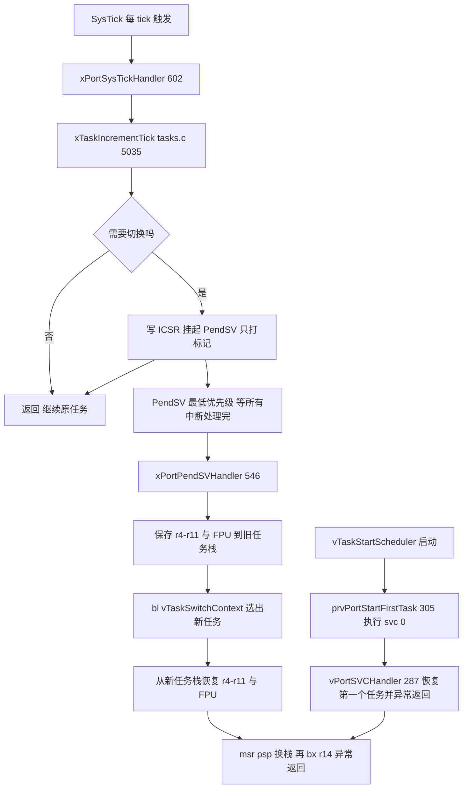
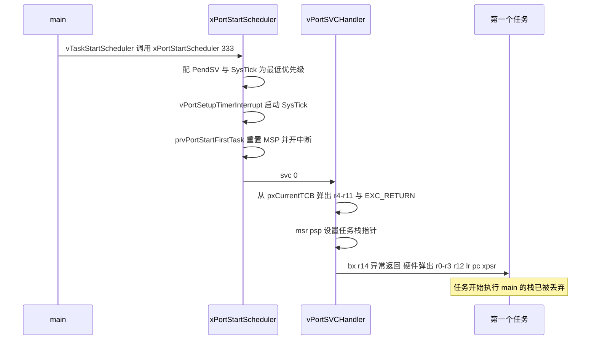

# port.c 与 portmacro.h（Cortex-M4F）—— 移植层与上下文切换完全解读

> 对应源文件（本地仓库 `~/workspace/freertos/`）：
> - [portable/GCC/ARM_CM4F/port.c](/Users/theo-richard/workspace/freertos/portable/GCC/ARM_CM4F/port.c)（972 行）
> - [portable/GCC/ARM_CM4F/portmacro.h](/Users/theo-richard/workspace/freertos/portable/GCC/ARM_CM4F/portmacro.h)（272 行）
>
> **前置阅读：** [list.md](list.md) → [tasks.md](tasks.md)（必需，本文是它的最后一环）
> 其余：[queue.md](queue.md) / [timers.md](timers.md) / [event_groups.md](event_groups.md) / [stream_buffer.md](stream_buffer.md) / [croutine.md](croutine.md)
> **配置项：** [freertosconfigh.md](freertosconfigh.md)

---

# 第一部分：先掌握什么、按什么顺序读

## 1.1 这份文件解决什么问题

内核（tasks.c）用纯 C 写好了调度逻辑，但它**无法直接操作 CPU 寄存器**。
移植层的职责就是这四件事：

| 职责 | 由谁实现 | 本文对应章节 |
|---|---|---|
| **① 造出任务的初始栈帧**（让新任务能"被返回"到入口） | `pxPortInitialiseStack` | 第三部分 3.1 |
| **② 上下文切换**（保存/恢复寄存器） | `xPortPendSVHandler` + `vPortSVCHandler` | 第三部分 3.4 / 3.5 |
| **③ 提供 tick 时基** | `xPortSysTickHandler` + `vPortSetupTimerInterrupt` | 第三部分 3.6 |
| **④ 提供临界区/屏蔽中断的原语** | `portmacro.h` 的 BASEPRI 操作 | 第四部分 |

**一句话：tasks.c 负责"决定切给谁"，port.c 负责"真的切过去"。**

## 1.2 三个中断，各司其职（这是理解 Cortex-M 移植的关键）

Cortex-M 的 FreeRTOS 移植层用**三个异常**完成全部工作：

```text
① SysTick（系统节拍中断，最低优先级）
     每 1/configTICK_RATE_HZ 秒触发
     职责：调用 xTaskIncrementTick() 推进时间
           → 若需要切换，就"挂起 PendSV"（不直接切换！）

② PendSV（可挂起的系统服务异常，最低优先级）
     由 SysTick 或 API 内部（portYIELD）挂起
     职责：真正做上下文切换
           → 保存旧任务寄存器、调 vTaskSwitchContext()、恢复新任务寄存器

③ SVC（系统服务调用，最低优先级）
     只在启动调度器时触发一次（svc 0）
     职责：启动第一个任务
```

**为什么切换要用 PendSV 而不是直接在 SysTick 里做？**

| 原因 | 说明 |
|---|---|
| **中断里不能"切走"** | 若在 SysTick 处理中途切换任务，中断返回时会回到错误的任务 |
| **延迟到所有中断处理完** | PendSV 优先级最低 → 等所有其他中断都处理完才执行 → 切换发生在"最安全"的时刻 |
| **可以在任何上下文请求切换** | `portYIELD()` 只需"挂起 PendSV"（写一个寄存器位），不用真的切 |

**这是 Cortex-M 移植设计的精髓：用"最低优先级的异常"充当切换点，把切换推迟到最安全的时刻。**

## 1.3 必须提前搞懂的 6 个概念

### 概念 1：两个栈指针 —— MSP 与 PSP

Cortex-M 有两个栈指针：

| 指针 | 谁用 | FreeRTOS 怎么用 |
|---|---|---|
| **MSP**（主栈） | 中断/异常处理程序 | 中断栈（所有中断共用） |
| **PSP**（进程栈） | 任务代码 | **每个任务一个**，切换任务 = 换 PSP |

`CONTROL` 寄存器的 bit1 决定当前用哪个。任务运行在 PSP 上，中断自动切到 MSP，
所以**任务栈和中断栈是分离的**。

**切任务 = 改 `PSP` + 改 `pxCurrentTCB`。** 这是全部秘密。

### 概念 2：硬件自动压栈 + 软件手动压栈

Cortex-M 在进入异常时**硬件自动压 8 个寄存器**（xPSR, PC, LR, R12, R3, R2, R1, R0）到当前栈，
退出时自动弹出。但**R4-R11 硬件不保存**，必须软件手动保存。

```text
所以一个完整的任务栈帧
  = 软件保存的 (R4-R11)          ← 由 PendSV 的汇编负责
  + 硬件自动的 (R0-R3, R12, LR, PC, xPSR)   ← 由 CPU 硬件负责
```

**这解释了两件事：**
- 为什么 `pxPortInitialiseStack` 要"伪造"这么一串（第三部分 3.1）；
- 为什么 PendSV 汇编里只 `stmdb {r4-r11, r14}`，不保存 R0-R3（硬件已做）。

### 概念 3：EXC_RETURN 与 FPU 懒保存

`LR` 在异常里不指向返回地址，而是**特殊的 EXC_RETURN 值**（`portINITIAL_EXC_RETURN = 0xfffffffd`，port.c:111）。
它的 bit4 表示"异常发生前用的是 PSP 还是 MSP"，还表示**是否用了 FPU**。

M4F 有浮点单元，若中断里也保存 FPU 寄存器（S0-S31）代价很大。所以 Cortex-M4F 采用
**懒保存（lazy stacking）**：只在任务真的用了 FPU 时才保存。

PendSV 里对应的是（port.c:556-559）：

```asm
tst r14, #0x10          ; 检查 EXC_RETURN 的 bit4
it eq
vstmdbeq r0!, {s16-s31} ; 若没使用 FPU，则保存高编号 VFP 寄存器
```

**注意这个条件判断方向**：`tst r14, #0x10` 若 bit4 为 0（等号成立）才保存。
这是 ARM 的约定（bit4=0 表示"使用 FPU 上下文"）。

### 概念 4：BASEPRI —— 比 PRIMASK 更细的屏蔽

| 寄存器 | 效果 | FreeRTOS 用途 |
|---|---|---|
| PRIMASK | 屏蔽**所有**中断（除 NMI/HardFault） | 极少用 |
| **BASEPRI** | 屏蔽**优先级数值 ≥ 阈值**的中断 | **临界区就用它** |

`portDISABLE_INTERRUPTS()` 实际是 `vPortRaiseBASEPRI()`（portmacro.h:124），
把 BASEPRI 设为 `configMAX_SYSCALL_INTERRUPT_PRIORITY`。

**结果：高优先级中断（数值更小）**不受影响**，低优先级中断被屏蔽。**
这就是"临界区只延迟低优先级中断"的实现方式——比关掉全部中断的延迟小得多。

### 概念 5：优先级数值越小，优先级越高（Cortex-M 的坑）

`configMAX_SYSCALL_INTERRUPT_PRIORITY = 191`（即 0xBF）表示**屏蔽优先级 11~15**，
而不是"屏蔽 191 以上的"。这个反直觉关系在 [freertosconfigh.md](freertosconfigh.md) 2.2 节详细讲过。

移植层在启动时用**两次断言**检查这个值配置正确（port.c:416、446）：

```c
configASSERT( ( configMAX_SYSCALL_INTERRUPT_PRIORITY & ( ~ucMaxPriorityValue ) ) == 0U );  // 416
configASSERT( ( configMAX_SYSCALL_INTERRUPT_PRIORITY & 0x1U ) == 0U );                      // 446
```

这两条断言就是防止"以为 0 是最高优先级"那类错误。

### 概念 6：`portYIELD()` 只是"打个标记"

```c
#define portYIELD()                                     \
{                                                       \
    portNVIC_INT_CTRL_REG = portNVIC_PENDSVSET_BIT;     \    // portmacro.h:90-92
    __DSB();                                            \
    __ISB();                                            \
}
```

它**不切换**，只是往 `ICSR` 寄存器写一个位，**挂起（pend）PendSV**。
真正的切换在稍后 PendSV 被调度到时发生。

**这带来一个关键性质：你可以在任何地方"请求切换"而不用担心状态。**
包括在临界区里（切换会延后到退出临界区之后）。

## 1.4 推荐阅读顺序（5 站）

```text
┌─ 第 1 站：portmacro.h（先读，都是小宏）────────────────────────────
│  portYIELD               portmacro.h:90
│  portDISABLE_INTERRUPTS  portmacro.h:124
│  portENTER_CRITICAL      portmacro.h:126
│  portGET_HIGHEST_PRIORITY portmacro.h:175   （CLZ 指令）
│  目标：知道内核调用的每个 port 宏都对应什么硬件动作
└──────────────────────────────────────────────────────────────────
                          │
                          ▼
┌─ 第 2 站：伪造初始栈帧 ──────────────────────────────────────────
│  pxPortInitialiseStack   port.c:224-258     ★ 让新任务能"被返回"
│  目标：看懂那 8+8 个寄存器的布局；想通"任务函数为什么不能 return"
└──────────────────────────────────────────────────────────────────
                          │
                          ▼
┌─ 第 3 站：启动第一个任务 ────────────────────────────────────────
│  xPortStartScheduler     port.c:333
│  prvPortStartFirstTask   port.c:305-330     ★ svc 0 的玄机
│  vPortSVCHandler         port.c:287-302
│  目标：明白"启动调度器后 main() 的栈去哪了"
└──────────────────────────────────────────────────────────────────
                          │
                          ▼
┌─ 第 4 站：上下文切换（最核心）──────────────────────────────────
│  xPortPendSVHandler      port.c:546-600     ★ 保存/恢复 + 换栈
│  目标：逐行看懂汇编，特别是"为什么只存 r4-r11"、"FPU 怎么处理"
└──────────────────────────────────────────────────────────────────
                          │
                          ▼
┌─ 第 5 站：tick 时基 ────────────────────────────────────────────
│  xPortSysTickHandler     port.c:602-628     ★ 只推进时间 + 挂 PendSV
│  vPortSetupTimerInterrupt port.c:880-899
│  目标：明白 SysTick 与 PendSV 的分工
└──────────────────────────────────────────────────────────────────
```

---

# 第二部分：portmacro.h 的硬件原语

## 2.1 让出与切换

| 宏 | 行号 | 展开为 | 说明 |
|---|---:|---|---|
| `portYIELD()` | 90 | 写 `ICSR.PENDSVSET = 1` + `DSB/ISB` | **只是挂起 PendSV**，不切换 |
| `portEND_SWITCHING_ISR( x )` | 103 | `if( x ) portYIELD_FROM_ISR()` | ISR 里的条件切换 |
| `portYIELD_FROM_ISR( x )` | 116 | 同 `portEND_SWITCHING_ISR` | 新旧两个名字 |

`portNVIC_INT_CTRL_REG`（portmacro.h:101）= `0xE000ED04`（ICSR）；
`portNVIC_PENDSVSET_BIT`（102）= `1UL << 28UL`。

## 2.2 临界区与中断屏蔽

| 宏 | 行号 | 展开为 |
|---|---:|---|
| `portDISABLE_INTERRUPTS()` | 124 | `vPortRaiseBASEPRI()` |
| `portENABLE_INTERRUPTS()` | 125 | `vPortSetBASEPRI( 0 )` |
| `portSET_INTERRUPT_MASK_FROM_ISR()` | 122 | `ulPortRaiseBASEPRI()`（返回旧值） |
| `portCLEAR_INTERRUPT_MASK_FROM_ISR( x )` | 123 | `vPortSetBASEPRI( x )` |
| `portENTER_CRITICAL()` | 126 | `vPortEnterCritical()`（port.c） |
| `portEXIT_CRITICAL()` | 127 | `vPortExitCritical()`（port.c） |

底层实现（portmacro.h）：

| 函数 | 行号 | 动作 |
|---|---:|---|
| `vPortRaiseBASEPRI` | 217 | `msr basepri, configMAX_SYSCALL_INTERRUPT_PRIORITY` + `DSB/ISB` |
| `ulPortRaiseBASEPRI` | 233 | 同上，但先读出旧 BASEPRI 返回（供 ISR 恢复） |
| `vPortSetBASEPRI( mask )` | 255 | `msr basepri, mask` + `DSB/ISB` |
| `xPortIsInsideInterrupt` | 195 | 读 IPSR，判断当前是否在中断里 |

**`portENTER_CRITICAL` 与 `portDISABLE_INTERRUPTS` 的区别**：
前者是**可嵌套的**（维护 `uxCriticalNesting` 计数），后者是单纯的屏蔽。

## 2.3 优先级位图（O(1) 找最高优先级）

| 宏 | 行号 | 动作 |
|---|---:|---|
| `portRECORD_READY_PRIORITY( prio, mask )` | 170 | `mask |= ( 1UL << prio )` |
| `portRESET_READY_PRIORITY( prio, mask )` | 171 | `mask &= ~( 1UL << prio )` |
| `portGET_HIGHEST_PRIORITY( top, mask )` | 175 | `top = 31 - __CLZ( mask )` |

**这就是 `configUSE_PORT_OPTIMISED_TASK_SELECTION=1` 时 O(1) 选任务的实现**：
用一个 32 位整数的每个 bit 代表一个优先级，`CLZ`（count leading zeros）一条指令
就能找出最高的置位——见 [tasks.md](tasks.md) 2.3.2。

## 2.4 其他

| 宏 | 行号 | 值 / 作用 |
|---|---:|---|
| `portMAX_DELAY` | 64 / 67 / 76 | 按 tick 位宽：`0xffff` / `0xffffffff` / 全 1 |
| `portSTACK_GROWTH` | 83 | **-1**（Cortex-M 栈向低地址增长） |
| `portTASK_FUNCTION_PROTO` | 136 | `void f( void * pvParameters )` |
| `portTASK_FUNCTION` | 137 | 同上（实现用） |
| `portFORCE_INLINE` | 191-192 | `inline __attribute__((always_inline))` |
| `portMEMORY_BARRIER()` | 264 | `__asm volatile( "" ::: "memory" )`（阻止编译器重排） |

---

# 第三部分：port.c 的核心

## 3.1 伪造初始栈帧：`pxPortInitialiseStack`（port.c:224-258）

**这个函数是新任务能"开始运行"的全部秘密。**

```text
pxPortInitialiseStack( pxTopOfStack, pxCode, pvParameters )   port.c:224
  │
  ├─ 236  pxTopOfStack--                      ← 先减 1，用于对齐补偿
  ├─ 238  *pxTopOfStack = portINITIAL_XPSR     = 0x01000000（Thumb 位必须为 1）
  ├─ 239  pxTopOfStack--
  ├─ 240  *pxTopOfStack = pxCode & 0xfffffffe ← PC = 任务入口函数
  ├─ 241  pxTopOfStack--
  ├─ 242  *pxTopOfStack = portTASK_RETURN_ADDRESS  = prvTaskExitError（port.c:148）
  ├─ 245  pxTopOfStack -= 5                    ← 跳过 R12/R3/R2/R1（不初始化，省代码）
  ├─ 246  *pxTopOfStack = pvParameters          ← R0 = 任务函数的参数
  ├─ 252  pxTopOfStack--
  ├─ 253  *pxTopOfStack = portINITIAL_EXC_RETURN = 0xfffffffd
  ├─ 255  pxTopOfStack -= 8                     ← R11..R4 位置（不初始化）
  └─ 257  return pxTopOfStack                   ← 这成为 TCB->pxTopOfStack
```

**栈帧布局（从高地址到低地址）：**

```text
   高地址
   ┌──────────────────────────────┐
   │ xPSR = 0x01000000            │  ← Thumb 位 = 1（否则 Cortex-M 会 HardFault）
   ├──────────────────────────────┤
   │ PC   = 任务入口函数            │  ← 第一次"异常返回"就跳到这里
   ├──────────────────────────────┤
   │ LR   = prvTaskExitError      │  ← 任务函数若 return 就落这里（死循环 + 断言）
   ├──────────────────────────────┤
   │ R12 / R3 / R2 / R1           │  ← 未初始化（省代码空间）
   ├──────────────────────────────┤
   │ R0   = pvParameters          │  ← 任务函数唯一的参数
   ├──────────────────────────────┤
   │ EXC_RETURN = 0xfffffffd      │  ← 告诉异常返回"用 PSP、回线程模式"
   ├──────────────────────────────┤
   │ R11 / R10 / R9 / R8          │
   │ R7  / R6  / R5  / R4         │  ← 未初始化
   └──────────────────────────────┘
      ▲ pxTopOfStack（TCB 的第一个成员）
   低地址
```

**为什么这样就能"启动"一个任务？**

第一次切到该任务时，`vPortSVCHandler`（或 PendSV）做：

```asm
ldr r0, [r1]              ; r0 = TCB->pxTopOfStack
ldmia r0!, {r4-r11, r14}  ; 从栈上弹出 r4-r11 和 EXC_RETURN 到 r14
msr psp, r0               ; PSP 指向剩余栈帧（R0-R3/R12/LR/PC/xPSR）
bx r14                    ; 异常返回！
```

`bx r14` 触发**异常返回**：硬件从 PSP 弹出 `R0-R3, R12, LR, PC, xPSR`——
于是 **PC 被设成任务入口函数，R0 = pvParameters，CPU 开始执行任务代码**。

**任务函数"看起来像被调用过"，实际上从来没有 call 指令。**
这就是"伪造栈帧"的含义。

**所以任务函数绝不能 `return`：** 它的 LR 是 `prvTaskExitError`（port.c:261-284），
那里会 `configASSERT` 然后死循环（port.c:272-283）。

## 3.2 启动第一个任务：`xPortStartScheduler`（port.c:333）

```text
xPortStartScheduler()                                      port.c:333
  │
  ├─ configASSERT( portCPUID != Cortex-M7 r0p0/r0p1 )      port.c:339-340
  │    （这两个版本的 M7 有已知勘误，需要单独的 port 目录）
  │
  ├─ #if configCHECK_HANDLER_INSTALLATION == 1              port.c:355
  │    检查向量表里 SVC / PendSV 是否指向本移植层的处理程序（约 368-370）
  │    ★ 如果你用"间接路由"（自己的 handler 再跳转），必须把这个配置设为 0
  │
  ├─ #if configASSERT_DEFINED == 1                          port.c:约 380
  │    ├─ 读 NVIC 优先级寄存器，算出芯片实际实现的优先级位数 ucMaxPriorityValue   port.c:216
  │    ├─ configASSERT( ucMaxSysCallPriority )              port.c:402-406 附近
  │    ├─ configASSERT( ( configMAX_SYSCALL_INTERRUPT_PRIORITY & ~ucMaxPriorityValue ) == 0 )  port.c:416
  │    ├─ configASSERT( ( configMAX_SYSCALL_INTERRUPT_PRIORITY & 0x1U ) == 0 )                 port.c:446
  │    └─ （还有一条检查"是否所有优先级位都被用上"）
  │
  ├─ portNVIC_SHPR3_REG |= portNVIC_PENDSV_PRI               port.c:471
  ├─ portNVIC_SHPR3_REG |= portNVIC_SYSTICK_PRI              port.c:472
  │    ★ 把 PendSV 和 SysTick 都设为最低优先级（portMIN_INTERRUPT_PRIORITY = 255，port.c:83）
  │
  ├─ vPortSetupTimerInterrupt()                              port.c:478
  │    └─ 配置 SysTick 重装载值（见 3.6）
  │
  ├─ prvPortStartFirstTask()                                 port.c:490
  │    ├─ 从向量表取初始 MSP，重置 MSP（把 main 的栈"还回去"）
  │    ├─ 清 CONTROL（选 MSP、特权模式、清 FPCA）
  │    ├─ cpsie i / cpsie f  ← 开中断！
  │    └─ svc 0              ← ★ 触发 SVC，进 vPortSVCHandler
  │
  └─ portENABLE_INTERRUPTS()                                 port.c:541（正常不会执行到）

★ prvPortStartFirstTask 永不返回：svc 0 之后 CPU 已经在跑第一个任务了
```

**`prvPortStartFirstTask`（port.c:305-330）的细节：**

```asm
ldr r0, =0xE000ED08   ; VTOR（向量表偏移寄存器）
ldr r0, [r0]          ; 取 VTOR 值
ldr r0, [r0]          ; 取向量表第 0 项 = 初始 MSP 值
msr msp, r0           ; ★ 重置 MSP 为栈顶（丢弃 main 用过的栈）
mov r0, #0
msr control, r0       ; 清 CONTROL：用 MSP、特权模式、清 FPCA（无活动 FPU）
cpsie i               ; 开中断
cpsie f               ; 开浮点异常
dsb / isb
svc 0                 ; ★ 系统调用，进 vPortSVCHandler
```

**"启动后 main() 的栈被借走"这个说法在这里得到解释**：
`msr msp, r0` 把 MSP 重置回向量表里记录的初始值，
即**main 期间用过的栈空间被整体丢弃**，之后 MSP 只用于中断。

## 3.3 `vPortSVCHandler`（port.c:287-302）—— 只为了启动第一个任务

```asm
ldr r3, =pxCurrentTCB      ; r3 = &pxCurrentTCB
ldr r1, [r3]               ; r1 = pxCurrentTCB（第一个任务的 TCB）
ldr r0, [r1]               ; r0 = TCB->pxTopOfStack
                           ;      ★ pxTopOfStack 必须是 TCB 第一个成员，这里用偏移 0
ldmia r0!, {r4-r11, r14}   ; 弹出 r4-r11 和 EXC_RETURN，r0 后移
msr psp, r0                ; PSP = 剩余栈帧地址（R0-R3/R12/LR/PC/xPSR）
isb
mov r0, #0
msr basepri, r0            ; BASEPRI = 0（开中断，允许所有优先级）
bx r14                     ; ★ 异常返回 → 硬件弹出 R0-R3/R12/LR/PC/xPSR → 任务开始跑
```

**这一段之后，CPU 就在第一个任务里了。`vTaskStartScheduler()` 永远不会返回。**

## 3.4 上下文切换：`xPortPendSVHandler`（port.c:546-600）—— 本文件最核心

**逐行拆解（这是整份文档最重要的部分）：**

```asm
; ── 阶段 1：保存旧任务的现场 ────────────────────────────────────────
mrs r0, psp                ; r0 = 旧任务的 PSP（它的栈顶）
isb

ldr r3, =pxCurrentTCB      ; r3 = &pxCurrentTCB
ldr r2, [r3]               ; r2 = pxCurrentTCB（旧任务的 TCB）

tst r14, #0x10             ; 检查 EXC_RETURN bit4：是否用了 FPU 上下文？
it eq                      ; 若 bit4 == 0（使用了 FPU）
vstmdbeq r0!, {s16-s31}    ;   则把高编号 VFP 寄存器也压栈（S16-S31）
                           ;   ★ M4F 的 FPU 懒保存：没用 FPU 就不存

stmdb r0!, {r4-r11, r14}   ; 保存内核寄存器 R4-R11 + EXC_RETURN
                           ;   ★ 只存 R4-R11！R0-R3/R12/LR/PC/xPSR 硬件已自动存过
str r0, [r2]               ; ★ TCB->pxTopOfStack = 新的栈顶
                           ;   （pxTopOfStack 是 TCB 第一个成员，偏移 0）

; ── 阶段 2：调用 C 函数选下一个任务 ────────────────────────────────
stmdb sp!, {r0, r3}        ; 把 r0（栈顶）和 r3（&pxCurrentTCB）先压到 MSP 上
                           ;   ★ 因为下面要调用 C 函数，r0/r3 会被破坏
mov r0, %0                 ; %0 = configMAX_SYSCALL_INTERRUPT_PRIORITY
msr basepri, r0            ; ★ 关掉低优先级中断（保护调度器数据结构）
dsb
isb
bl vTaskSwitchContext      ; ★ 调用 tasks.c 的 vTaskSwitchContext()
                           ;   它会修改 pxCurrentTCB 指向新任务
                           ;   （见 tasks.md 2.7）
mov r0, #0
msr basepri, r0            ; 开中断
ldmia sp!, {r0, r3}        ; 取回 r0/r3

; ── 阶段 3：恢复新任务的现场 ───────────────────────────────────────
ldr r1, [r3]               ; r1 = pxCurrentTCB（★ 已指向新任务）
ldr r0, [r1]               ; r0 = 新任务 TCB->pxTopOfStack

ldmia r0!, {r4-r11, r14}   ; 弹出 R4-R11 和 EXC_RETURN

tst r14, #0x10             ; 新任务用 FPU 吗？
it eq
vldmiaeq r0!, {s16-s31}    ;   是则恢复 S16-S31

msr psp, r0                ; ★ PSP = 新任务的栈指针（这就是"换栈"）
isb

bx r14                     ; ★ 异常返回！硬件弹出 R0-R3/R12/LR/PC/xPSR
                           ;   → CPU 从新任务上次中断的地方继续执行
```

### 三个非显然的设计点

**① 为什么只保存 R4-R11？**
因为进入异常时，Cortex-M 硬件**自动**把 `R0-R3, R12, LR, PC, xPSR` 压到了 PSP 上。
软件只需补上硬件不管的 `R4-R11`。这省了 8 条指令。

**② 为什么要把 r0/r3 压到 MSP 上？**
因为中间要 `bl vTaskSwitchContext`——**C 函数会破坏调用者保存寄存器（R0-R3, R12）**。
如果不保存，`pxCurrentTCB` 的地址（r3）和栈顶（r0）就丢了。
压在 **MSP**（sp）而不是 PSP 上，是因为 PSP 现在指向任务栈，不能乱动。

**③ "切换任务"到底是什么？**

```text
切换前：  PSP ──► 旧任务的栈（R4-R11 + 硬件帧）
          pxCurrentTCB ──► 旧 TCB

切换后：  PSP ──► 新任务的栈（R4-R11 + 硬件帧）
          pxCurrentTCB ──► 新 TCB

★ 只有两个东西变了：PSP 的值 和 pxCurrentTCB 的值
★ 其余全是"保存/恢复寄存器"的机械动作
```

## 3.5 `xPortSysTickHandler`（port.c:602-628）—— 只推进时间

```text
xPortSysTickHandler()                              port.c:602
  │  （注释强调：SysTick 是最低优先级，所以进来时所有中断都没被屏蔽，
  │    不需要保存/恢复 BASEPRI）
  │
  ├─ portDISABLE_INTERRUPTS()                      约 608
  │    （虽然是最低优先级，但仍要防自己被更高优先级中断打断）
  │
  ├─ if( xTaskIncrementTick() != pdFALSE )         ★ 调用 tasks.c:5035
  │     ├─ 需要切换 → 挂起 PendSV
  │     │    portNVIC_INT_CTRL_REG = portNVIC_PENDSVSET_BIT
  │     │    ★ 注意：不在这里切换！只是"打个标记"
  │     └─ 不需要   → 什么都不做
  │
  └─ portENABLE_INTERRUPTS()                       约 626
```

**关键：SysTick 从不切换任务，它只做两件事——推进 tick 计数、必要时挂起 PendSV。**
切换由 PendSV 在**所有中断处理完之后**执行。

## 3.6 `vPortSetupTimerInterrupt`（port.c:880-899，weak 函数）

```c
portNVIC_SYSTICK_LOAD_REG = ( configSYSTICK_CLOCK_HZ / configTICK_RATE_HZ ) - 1UL;   // 约 897
portNVIC_SYSTICK_CTRL_REG = ( CLK_BIT | INT_BIT | ENABLE_BIT );                      // 约 898
```

- `configSYSTICK_CLOCK_HZ` 默认等于 `configCPU_CLOCK_HZ`（除非单独定义，见 [freertosconfigh.md](freertosconfigh.md) 1.1）；
- 重装载值 = 时钟 / tick 频率 - 1。

**它是 `__attribute__((weak))`**，意味着**应用可以自己重写**，改用别的定时器做 tick 源
（比如想用 TIM2 而不是 SysTick）。

## 3.7 `vPortEnableVFP`（port.c:902-916）

```asm
ldr.w r0, =0xE000ED88      ; CPACR 寄存器
ldr r1, [r0]
orr r1, r1, #( 0xf << 20 )  ; 使能 CP10 和 CP11（FPU 协处理器）
str r1, [r0]
bx r14
```

**M4F 的 FPU 默认是关闭的**，必须在启动时通过 CPACR 打开，否则用浮点指令会 HardFault。

> **实用提示：** 如果你的 M4F 板子一执行浮点运算就 HardFault，
> 先检查 `configENABLE_FPU`（[freertosconfigh.md](freertosconfigh.md) 2.4）和这个函数是否被执行。

---

# 第四部分：完整时序（把所有碎片串起来）

## 4.1 图 1：从 main 到第一个任务

```text
main()
  ├─ 硬件初始化、xTaskCreate(...) 若干
  │    └─ pxPortInitialiseStack 造好每个任务的初始栈帧     port.c:224
  │
  └─ vTaskStartScheduler()                                 tasks.c:3898
       ├─ 创建空闲任务 / 定时器任务
       ├─ portDISABLE_INTERRUPTS()
       ├─ xSchedulerRunning = pdTRUE
       └─ xPortStartScheduler()                            port.c:333
            ├─ 配置 PendSV/SysTick 为最低优先级             port.c:471-472
            ├─ vPortSetupTimerInterrupt()  启动 SysTick    port.c:478
            └─ prvPortStartFirstTask()                     port.c:305
                 ├─ msr msp, <向量表初始MSP>   ← main 的栈被丢弃
                 ├─ msr control, #0            ← 用 MSP、特权、清 FPCA
                 ├─ cpsie i / cpsie f          ← 开中断
                 └─ svc 0
                      │
                      ▼
                 vPortSVCHandler                        port.c:287
                      ├─ ldmia r0!, {r4-r11, r14}  from 第一个任务的栈
                      ├─ msr psp, r0
                      └─ bx r14  → 异常返回
                           │
                           ▼
                      ★ 第一个任务开始执行
                         （main() 永不返回，其栈已废弃）
```

## 4.2 图 2：一次 tick 驱动的切换（最频繁的路径）

```text
─────── 时间轴 ───────────────────────────────────────────────────────

 ① SysTick 硬件触发（最低中断优先级）
      │
      ▼
 ② xPortSysTickHandler                          port.c:602
      ├─ portDISABLE_INTERRUPTS()
      ├─ xTaskIncrementTick()                    tasks.c:5035
      │     ├─ xTickCount++
      │     ├─ 处理到期任务 → prvAddTaskToReadyList
      │     └─ 返回 pdTRUE（需要切换）
      ├─ 写 ICSR.PENDSVSET = 1   ★ 只挂起 PendSV，不切换
      └─ portENABLE_INTERRUPTS()
      │
      ▼
 ③ 中断返回（回到被打断的任务，继续跑一会儿）
      │
      │   ... 其他更高优先级中断可以插进来，PendSV 排队等着 ...
      │
      ▼
 ④ 所有中断都处理完，PendSV（最低优先级）终于被调度
      │
      ▼
 ⑤ xPortPendSVHandler                           port.c:546
      │
      │  ── 保存旧任务 ──
      ├─ mrs r0, psp                    取旧任务栈顶
      ├─ [FPU 若使用] vstmdb s16-s31    压 FPU 高寄存器
      ├─ stmdb r0!, {r4-r11, r14}       压内核寄存器
      ├─ str r0, [pxCurrentTCB]         存栈顶进 TCB
      │
      │  ── 选择新任务 ──
      ├─ stmdb sp!, {r0, r3}            暂存到 MSP
      ├─ msr basepri, max_syscall       关低优先级中断
      ├─ bl vTaskSwitchContext          tasks.c:5428
      │     └─ taskSELECT_HIGHEST_PRIORITY_TASK
      │          └─ listGET_OWNER_OF_NEXT_ENTRY（pxIndex 轮转）
      │             → pxCurrentTCB 指向新任务
      ├─ msr basepri, 0                 开中断
      ├─ ldmia sp!, {r0, r3}            取回
      │
      │  ── 恢复新任务 ──
      ├─ ldr r0, [pxCurrentTCB]         取新任务栈顶
      ├─ ldmia r0!, {r4-r11, r14}       弹内核寄存器
      ├─ [FPU 若使用] vldmia s16-s31    弹 FPU 高寄存器
      ├─ msr psp, r0                    ★ 换栈
      └─ bx r14                         ★ 异常返回
      │
      ▼
 ⑥ 新任务从它上次被中断的地方继续执行
```

## 4.3 图 3：为什么切换能"无缝"—— 硬件与软件的配合

```text
任务 A 正在跑（PSP → A 的栈）
  │
  │  SysTick 中断到来
  ▼
硬件自动：把 A 的 R0-R3, R12, LR, PC, xPSR 压到 A 的栈（PSP）
          切到 MSP（中断栈）
          PC = xPortSysTickHandler
  │
  ▼
SysTick 处理（在 MSP 上）→ 挂起 PendSV → 返回
  │
  │  硬件自动：从 MSP 弹回中断前的状态 → 回到 A 继续跑
  ▼
... A 又跑了一会儿（可能几千条指令）...
  │
  │  PendSV 异常到来
  ▼
硬件自动：把 A 的 R0-R3, R12, LR, PC, xPSR 压到 A 的栈（PSP）  ← 第二次
          PC = xPortPendSVHandler
  │
  ▼
软件（PendSV 汇编）：
  ├─ 补存 A 的 R4-R11（硬件不管的部分）
  ├─ 把栈顶存进 A 的 TCB
  ├─ 选 B
  ├─ 从 B 的 TCB 取栈顶
  └─ 弹出 B 的 R4-R11
  │
  ▼
硬件自动（bx r14）：从 B 的栈弹出 R0-R3, R12, LR, PC, xPSR
                    → PC 回到 B 上次执行的位置
  │
  ▼
任务 B 继续跑

★ 关键：任务"被中断"由硬件负责，"补存 R4-R11"由软件负责
★ 所以 FreeRTOS 的上下文切换 = 硬件自动压栈 + 软件补存 + 换个 PSP
```

## 4.4 图 4：临界区为什么延迟更低

```text
方案 A：用 PRIMASK（关所有中断）
  portDISABLE_INTERRUPTS() → PRIMASK=1
    ├─ 高优先级中断：被屏蔽 ✗
    ├─ 中优先级中断：被屏蔽 ✗
    └─ 低优先级中断：被屏蔽 ✗
  代价：所有中断延迟

方案 B：用 BASEPRI（FreeRTOS 的选择）
  portDISABLE_INTERRUPTS() → BASEPRI = configMAX_SYSCALL_INTERRUPT_PRIORITY
    ├─ 高优先级中断（数值更小）：★ 仍然响应 ✓
    ├─ 中优先级中断（数值 ≥ 阈值）：被屏蔽
    └─ 低优先级中断：被屏蔽
  收益：紧急中断（如电机保护、通信超时）不被 RTOS 延迟

★ 这就是为什么 configMAX_SYSCALL_INTERRUPT_PRIORITY 配错后果严重：
    设得太"高"（数值太小）→ 几乎所有中断都被屏蔽 → 实时性崩溃
    设得太"低"（数值太大）→ 高优先级中断能进来，但它们不能调 API
```

## 4.5 图 5：Mermaid 版本

### 三个异常的分工



### 一次切换的寄存器流向


### 任务的第一次启动



---

# 第五部分：易错点与速查

## 5.1 最容易误解的 10 处

| # | 误解 | 实际 |
|---|---|---|
| 1 | 以为 SysTick 里做任务切换 | SysTick **只挂起 PendSV**，切换在 PendSV 里做（port.c:602-628） |
| 2 | 以为 PendSV 优先级随便设 | 必须**最低**（port.c:471 用 `portMIN_INTERRUPT_PRIORITY=255`），否则切换会被打断到不安全状态 |
| 3 | 以为上下文切换要保存所有寄存器 | 硬件自动存 R0-R3/R12/LR/PC/xPSR；软件**只补 R4-R11** |
| 4 | 以为 M4F 总是保存 FPU 寄存器 | **懒保存**：只有任务真的用了 FPU 才存（`tst r14,#0x10`） |
| 5 | 以为 FPU 默认可用 | M4F 的 FPU 默认关闭，要 `vPortEnableVFP`（port.c:902）打开 CPACR |
| 6 | 以为 `portYIELD()` 立刻切换 | 只是写 ICSR 挂起 PendSV，切换延后 |
| 7 | 用 PRIMASK 做临界区 | FreeRTOS 用 **BASEPRI**，高优先级中断不受影响（portmacro.h:124） |
| 8 | 以为任务函数可以 `return` | 初始栈帧的 LR 是 `prvTaskExitError`（port.c:261），return 会断言+死循环 |
| 9 | 用"间接路由"却保留 `configCHECK_HANDLER_INSTALLATION=1` | 会在启动时断言失败（port.c:355-375），必须设 0 |
| 10 | 以为 `configMAX_SYSCALL_INTERRUPT_PRIORITY=0` 没问题 | 移植层有 3 条断言专门检查它（port.c:402/416/446），配错启动就挂 |

## 5.2 关键地址与常量速查

| 项 | 值 | 出处 |
|---|---|---|
| ICSR（中断控制状态寄存器） | `0xE000ED04` | portmacro.h:101 |
| PENDSVSET 位 | `1 << 28` | portmacro.h:102 |
| SHPR3（PendSV/SysTick 优先级） | `0xE000ED20` | port.c:65 |
| SysTick CTRL / LOAD / VAL | `0xE000E010` / `0xE000E014` / `0xE000E018` | port.c:61-63 |
| VTOR（向量表偏移） | `0xE000ED08` | port.c:313 |
| CPACR（FPU 使能） | `0xE000ED88` | port.c:906 |
| `portMIN_INTERRUPT_PRIORITY` | `255` | port.c:83 |
| `portINITIAL_XPSR` | `0x01000000` | port.c:110 |
| `portINITIAL_EXC_RETURN` | `0xfffffffd` | port.c:111 |
| `portSTART_ADDRESS_MASK` | `0xfffffffe` | port.c:120 |
| `portSTACK_GROWTH` | `-1` | portmacro.h:83 |

## 5.3 行号自查命令

```bash
cd portable/GCC/ARM_CM4F

grep -n "^StackType_t \* pxPortInitialiseStack"  port.c
grep -n "^BaseType_t xPortStartScheduler"        port.c
grep -n "^void xPortPendSVHandler"               port.c
grep -n "^void xPortSysTickHandler"              port.c
grep -n "^void vPortSVCHandler"                  port.c
grep -n "^static void prvPortStartFirstTask"     port.c
```

期望（port.c 共 972 行）：

```text
224:StackType_t * pxPortInitialiseStack( StackType_t * pxTopOfStack,
287:void vPortSVCHandler( void )
305:static void prvPortStartFirstTask( void )
333:BaseType_t xPortStartScheduler( void )
546:void xPortPendSVHandler( void )
602:void xPortSysTickHandler( void )
```

```bash
grep -n "#define portYIELD()\|#define portDISABLE_INTERRUPTS\|#define portENTER_CRITICAL\|#define portGET_HIGHEST_PRIORITY" portmacro.h
# 期望：90 / 124 / 126 / 175
```

## 5.4 一句话总结

- **tasks.c 决定"切给谁"，port.c 真的"切过去"**：靠改 `pxCurrentTCB` 和 `PSP` 两个值，
  加上保存/恢复寄存器。
- **三个异常分工明确**：SysTick 推进时间（只挂 PendSV）、PendSV 做切换（最低优先级，
  等所有中断处理完）、SVC 只启动第一个任务。
- **只有 R4-R11 需要软件保存**——R0-R3/R12/LR/PC/xPSR 是硬件在进出异常时自动压/弹的。
- **`pxPortInitialiseStack` 伪造栈帧**，让 `bx r14` 的异常返回变成"任务开始运行"；
  因此任务函数**绝不能 return**。
- **临界区用 BASEPRI 而非 PRIMASK**，好处是高优先级中断不被 RTOS 延迟——
  这也是 `configMAX_SYSCALL_INTERRUPT_PRIORITY` 配错后果严重的根本原因。
- 至此，从**链表 → 调度器 → 队列/定时器/事件组/流缓冲 → 移植层**的完整链路就闭合了。

---

## 附：本知识库文档导航

| 文档 | 内容 | 建议顺序 |
|---|---|---|
| [freertosconfigh.md](freertosconfigh.md) | 配置项详解 + ESP32/STM32/RP2040 差异 | 0 |
| [list.md](list.md) | 内核链表（数据结构基础） | 1 |
| [tasks.md](tasks.md) | 任务管理与调度器 | 2 |
| [queue.md](queue.md) | 队列 / 信号量 / 互斥量（含优先级继承） | 3 |
| [timers.md](timers.md) | 软件定时器（守护任务 + 命令队列） | 4 |
| [event_groups.md](event_groups.md) | 事件组（位标志 + 广播唤醒） | 5 |
| [stream_buffer.md](stream_buffer.md) | 流缓冲 / 消息缓冲（任务通知 + 触发阈值） | 6 |
| [croutine.md](croutine.md) | 协程（遗留特性，了解即可） | 7 |
| **port_cortex_m4f.md**（本文） | Cortex-M4F 移植层：SysTick / PendSV / 栈切换 | 8 |
