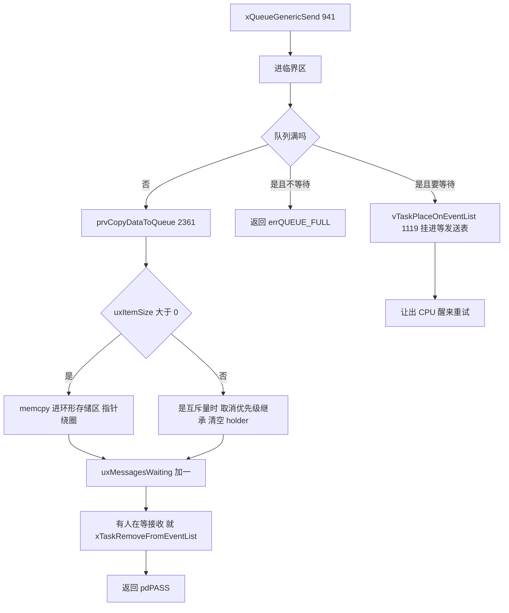
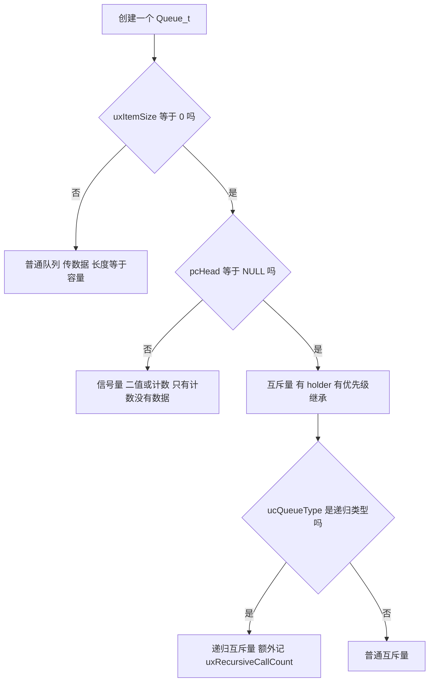
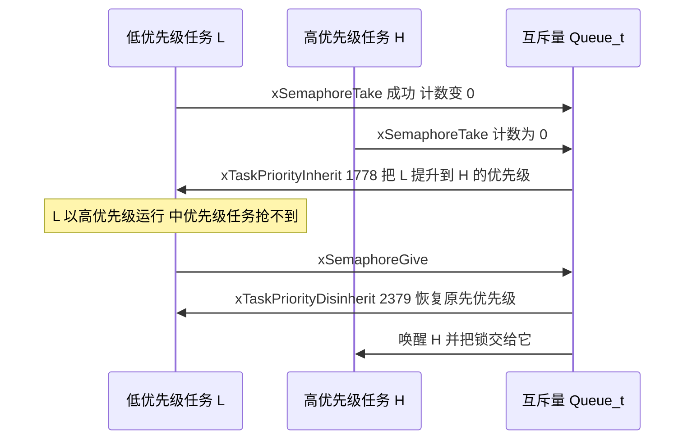

# queue.c / queue.h / semphr.h —— 队列、信号量、互斥量完全解读

> 对应源文件（本地仓库 `~/workspace/freertos/`，FreeRTOS-Kernel V11.1.0+，行号以当前文件为准）：
> - [queue.c](/Users/theo-richard/workspace/freertos/queue.c)（3369 行）—— **队列、信号量、互斥量的唯一实现**
> - [include/queue.h](/Users/theo-richard/workspace/freertos/include/queue.h)（1752 行）—— `Queue_t` 结构、队列 API 声明
> - [include/semphr.h](/Users/theo-richard/workspace/freertos/include/semphr.h)（1095 行）—— **21 个宏，全部转发到 queue.c**
>
> **前置阅读：** [list.md](list.md)（链表）→ [tasks.md](tasks.md)（任务与调度）
> **配置项：** [freertosconfigh.md](freertosconfigh.md)

---

# 第一部分：先掌握什么、按什么顺序读

## 1.1 三句话讲清这三个文件的关系

1. **`queue.c` 是唯一的实现**：队列、二值信号量、计数信号量、互斥量、递归互斥量、队列集
   ——**全部是同一个 `Queue_t` 结构、同一套代码**，靠两个字段区分行为；
2. **`queue.h` 是它的"普通队列"门面**：声明 `xQueueCreate` / `xQueueSend` / `xQueueReceive` 等；
3. **`semphr.h` 完全没有新实现**：1095 行里 **21 个宏全部是 `#define` 转发到 queue.c 的函数**（见第四部分表格）。

**所以"信号量建立在队列之上"不是比喻，是字面事实**：`xSemaphoreCreateBinary()` 展开后就是
`xQueueGenericCreate( 1, 0, queueQUEUE_TYPE_BINARY_SEMAPHORE )`（semphr.h:156）。

## 1.2 一句话概括队列：一个环形的字节缓冲区 + 两张等待表

```text
Queue_t 的全部内容就三部分：
  ① 一块线性存储区（环形复用）      pcHead / pcWriteTo / pcTail / pcReadFrom
  ② 两个计数器                      uxMessagesWaiting / uxLength / uxItemSize
  ③ 两张等待链表                    xTasksWaitingToSend / xTasksWaitingToReceive
```

**没有第三部分。** 所谓"阻塞"就是"把当前任务挂到对应的等待链表上"，
所谓"唤醒"就是"从等待链表上摘一个任务放回就绪表"——而这些链表操作全是 [list.md](list.md) 里的函数。

## 1.3 必须提前搞懂的 6 个概念

### 概念 1：按值拷贝，不是按引用传递

`xQueueSend(q, &data, ...)` 会把 `data` **拷贝**进队列的存储区（`memcpy`，queue.c:2391）。
接收时再拷贝出来（queue.c:2443 之后）。

后果：

- 队列里存的是**数据的副本**，发送方可以立刻复用那个变量；
- 大结构体（几百字节）频繁收发很费时间，此时应改用**指针队列**（存指针，不存内容）；
- **栈上的局部变量可以安全发送**（因为是拷贝），这是个常见误解的反面。

### 概念 2：环形缓冲区，靠 pcWriteTo / pcReadFrom 绕圈

存储区是**一段连续内存，但被当作环来用**：

```text
   pcHead                                              pcTail
     │                                                    │
     ▼                                                    ▼
   ┌──────┬──────┬──────┬──────┬──────┬──────┬──────┬───
   │ 项0  │ 项1  │ 项2  │ ...  │      │      │      │ 边界
   └──────┴──────┴──────┴──────┴──────┴──────┴──────┴───
            ▲                            ▲
            │                            └── pcWriteTo（写到这里）
            └── pcReadFrom（从这里读）
写满后 pcWriteTo 绕回 pcHead（queue.c:2394-2397）；
读到底后 pcReadFrom 绕回队尾（queue.c:2408-2411）。
```

`pcTail` 处多分配 1 个字节作为**边界哨兵**，只用于比较、不存数据。

### 概念 3：item size = 0 就是信号量（最关键的一条）

这是整个设计的枢纽：

```c
#define queueSEMAPHORE_QUEUE_ITEM_LENGTH   ( ( UBaseType_t ) 0 )   // queue.c:95
#define semSEMAPHORE_QUEUE_ITEM_LENGTH     ( ( UBaseType_t ) 0U )  // semphr.h:41
```

**信号量不传数据，所以"每个项的大小"设为 0。** 于是：

| | 队列 | 信号量 |
|---|---|---|
| `uxItemSize` | > 0（如 `sizeof(int)`） | **0** |
| `pcHead` | 指向存储区 | **NULL**（被复用为"类型标记"，见概念 4） |
| 存储区 | 需要 | 不需要（长度 × 0 = 0 字节） |
| 语义 | 传数据 | 只计数（`uxMessagesWaiting`） |

**所以队列长度 = 信号量的最大计数值。** `xQueueCreate(10, 4)` 是"能存 10 个 4 字节元素的队列"；
`xSemaphoreCreateCounting(10, 0)` 是"最大计数 10、初值 0 的计数信号量"——
两者在内存里是**同一个结构**，只是后者 `uxItemSize = 0`。

### 概念 4：`pcHead` 被复用为"类型标记"

```c
#define uxQueueType          pcHead                 // queue.c:77
#define queueQUEUE_IS_MUTEX  NULL                   // queue.c:78
```

因为信号量不需要 `pcHead` 指向存储区，作者干脆把这个字段**复用**为类型标记：

- `uxQueueType == NULL` → **这是互斥量**（需要优先级继承）；
- 其他（非 NULL）→ 普通队列 / 信号量。

这个做法有点"脏"，但省了 4 个字节的 TCB 级结构——在资源受限的 MCU 上是有意义的取舍。
读代码时看到 `pcHead` 先别急着当指针，先看 `uxItemSize` 是不是 0。

### 概念 5：union —— 队列数据与信号量数据互斥

`Queue_t` 里有个 union（queue.c:120-124）：

```c
union {
    QueuePointers_t xQueue;      // 队列用：pcTail / pcReadFrom
    SemaphoreData_t xSemaphore;  // 信号量用：xMutexHolder / uxRecursiveCallCount
} u;
```

因为一个对象**要么是队列、要么是信号量**，两种数据永远不会同时需要。
这就是为什么信号量能零成本复用队列结构——多出来的字段被 union 覆盖掉了。

### 概念 6：锁队列（cRxLock / cTxLock）—— ISR 安全的妙招

队列在中断里也可以收发。但中断里**不能长时间关中断**，所以 FreeRTOS 用"锁 + 延迟通知"：

```c
volatile int8_t cRxLock;   // queue.c:133  -1 = 未锁
volatile int8_t cTxLock;   // queue.c:134
```

**机制：**

1. 任务侧要操作队列时加锁；ISR 里收发**只改数据、不动等待链表**，同时把锁计数 +1；
2. 任务侧解锁时（`prvUnlockQueue`，queue.c:2464）才真正去遍历等待链表、唤醒任务。

**为什么这么绕？** 因为唤醒任务要操作调度链表、可能要触发切换——这在 ISR 里代价太高。
推迟到任务上下文做，中断就只做最轻的"存数据 + 记账"。

---

## 1.4 推荐阅读顺序（6 站）

```text
┌─ 第 1 站：Queue_t 结构 ──────────────────────────────────────────
│  queue.c:115-153   +  QueuePointers_t (80-84)  +  SemaphoreData_t (86-90)
│  目标：认出"三部分"：存储区指针 / 计数器 / 两张等待链表
│        记住 uxItemSize == 0 表示信号量、uxQueueType == NULL 表示互斥量
└──────────────────────────────────────────────────────────────────
                          │
                          ▼
┌─ 第 2 站：创建 ──────────────────────────────────────────────────
│  xQueueGenericCreate     queue.c:496
│  prvInitialiseNewQueue   queue.c:564
│  xQueueGenericReset      queue.c:296     （算 pcTail、清计数、清等待表）
│  目标：搞清存储区是怎么分配的、复位做了什么
└──────────────────────────────────────────────────────────────────
                          │
                          ▼
┌─ 第 3 站：发送与接收（对照读，重点）──────────────────────────────
│  xQueueGenericSend    queue.c:941   （满 → 阻塞；空 → 直接放并唤醒接收者）
│  xQueueReceive        queue.c:1476  （空 → 阻塞；有 → 直接取并唤醒发送者）
│  目标：看清"快路径（不阻塞）"与"慢路径（挂等待表 + 让出 CPU）"的分岔
└──────────────────────────────────────────────────────────────────
                          │
                          ▼
┌─ 第 4 站：两个内部分叉点（理解信号量/互斥量的钥匙）────────────────
│  prvCopyDataToQueue    queue.c:2361  ★ item size 0 + 是互斥量 → 取消优先级继承
│  xQueueSemaphoreTake   queue.c:1634  ★ 拿不到且是互斥量 → 触发优先级继承（1778）
│  目标：明白互斥量为什么不能当普通信号量用
└──────────────────────────────────────────────────────────────────
                          │
                          ▼
┌─ 第 5 站：ISR 版本 + 锁机制 ─────────────────────────────────────
│  xQueueGenericSendFromISR  queue.c:1156
│  xQueueReceiveFromISR      queue.c:2025
│  prvUnlockQueue            queue.c:2464   （任务上下文里补做唤醒）
│  目标：明白 ISR 里为什么"只改数据不唤醒"，锁计数怎么记账
└──────────────────────────────────────────────────────────────────
                          │
                          ▼
┌─ 第 6 站：semphr.h（本文件没有实现，只是宏）──────────────────────
│  semphr.h:41-42  两个常量；156/681/928/795  四个创建宏
│  目标：把每个信号量 API 映射回 queue.c 的具体函数（第四部分有完整表）
└──────────────────────────────────────────────────────────────────
```

---

# 第二部分：queue.h / queue.c 的数据类型

## 2.1 `Queue_t`（queue.c:115-153）

| 字段 | 行号 | 作用 |
|---|---|---|
| `pcHead` | 117 | 存储区起始。**信号量时为 NULL**（复用为类型标记） |
| `pcWriteTo` | 118 | 下一个空闲写入位置（环上移动） |
| `u.xQueue.pcTail` | 82 | 存储区末尾 + 1（边界哨兵） |
| `u.xQueue.pcReadFrom` | 83 | 最近一次读取的位置 |
| `u.xSemaphore.xMutexHolder` | 88 | **互斥量持有者**的 TCB（优先级继承靠它） |
| `u.xSemaphore.uxRecursiveCallCount` | 89 | 递归互斥量的递归层数 |
| `xTasksWaitingToSend` | 126 | **等发送**而阻塞的任务（队列满时） |
| `xTasksWaitingToReceive` | 127 | **等接收**而阻塞的任务（队列空时） |
| `uxMessagesWaiting` | 129 | 当前消息数。**信号量时它就是这个信号量的计数值** |
| `uxLength` | 130 | 队列容量（项数）。信号量时 = 最大计数值 |
| `uxItemSize` | 131 | 每项字节数。**0 = 信号量** |
| `cRxLock` | 133 | 接收锁计数，`queueUNLOCKED`(-1) = 未锁 |
| `cTxLock` | 134 | 发送锁计数 |
| `pxQueueSetContainer` | 141 | 队列集容器（`configUSE_QUEUE_SETS=1`） |
| `uxQueueNumber` / `ucQueueType` | 145-146 | 调试用编号与类型（`configUSE_TRACE_FACILITY=1`） |

**注意 `uxMessagesWaiting` 是 `volatile`**：它会被 ISR 修改，必须防止编译器缓存到寄存器。

## 2.2 六种"队列类型"其实是同一个结构

`queue.h:77-82` 定义了 6 个类型标记，`ucQueueType` 只是给调试器看的标签：

| 标记 | 值 | 由谁创建 | item size | 特殊行为 |
|---|---|---|---|---|
| `queueQUEUE_TYPE_BASE` | 0 | `xQueueCreate` | > 0 | 纯传数据 |
| `queueQUEUE_TYPE_MUTEX` | 1 | `xSemaphoreCreateMutex` | 0 | **优先级继承 + 持有者跟踪** |
| `queueQUEUE_TYPE_COUNTING_SEMAPHORE` | 2 | `xSemaphoreCreateCounting` | 0 | 计数上限 |
| `queueQUEUE_TYPE_BINARY_SEMAPHORE` | 3 | `xSemaphoreCreateBinary` | 0 | 长度固定 1 |
| `queueQUEUE_TYPE_RECURSIVE_MUTEX` | 4 | `xSemaphoreCreateRecursiveMutex` | 0 | **递归计数** |
| `queueQUEUE_TYPE_SET` | 5 | `xQueueCreateSet` | `sizeof(Queue_t*)` | 存队列句柄 |

**真正影响行为的是 `uxItemSize` 和 `uxQueueType`，不是 `ucQueueType`**（后者仅在
`configUSE_TRACE_FACILITY=1` 时存在，纯调试用途）。

## 2.3 三种同步原语的内存对比

```text
① 队列 xQueueCreate( 4, sizeof(int) )     —— 存 4 个 int
   pcHead ──► [ 4 * sizeof(int) 字节存储区 ]
   uxLength = 4,  uxItemSize = 4,  uxMessagesWaiting = 当前个数
   u.xQueue 生效（pcTail / pcReadFrom）

② 二值信号量 xSemaphoreCreateBinary()      —— 就是长度 1、item 0
   pcHead = NULL（← 被当作类型标记）
   uxLength = 1,  uxItemSize = 0,  uxMessagesWaiting = 0 或 1
   无存储区（1 × 0 = 0 字节）

③ 互斥量 xSemaphoreCreateMutex()
   pcHead = NULL, uxQueueType = NULL（← queueQUEUE_IS_MUTEX）
   uxLength = 1,  uxItemSize = 0,  uxMessagesWaiting = 1（创建时"已释放"）
   u.xSemaphore 生效（xMutexHolder / uxRecursiveCallCount）

★ 三者共用 Queue_t，靠 uxItemSize 与 pcHead 两个字段区分 —— 这是本文件的全部魔法
```

---

# 第三部分：queue.c 的核心函数

> 惯例说明：所有函数都有 `traceENTER_xxx` / `traceRETURN_xxx` 空展开钩子（见 [list.md](list.md) 第三部分说明），
> 下文不再重复。

## 3.1 创建：`xQueueGenericCreate`（queue.c:496）→ `prvInitialiseNewQueue`（564）

```text
xQueueGenericCreate( uxQueueLength, uxItemSize, ucQueueType )   queue.c:496
  ├─ 算出需要的字节数 = uxQueueLength * uxItemSize + 1（+1 是边界哨兵）
  ├─ pvPortMalloc 一次分配（存储区和 Queue_t 可以分开也可合并）
  ├─ memset 清零
  └─ prvInitialiseNewQueue( ... )                queue.c:564
       ├─ 填 uxLength / uxItemSize
       ├─ uxMessagesWaiting = 0
       ├─ pcHead / pcWriteTo / pcReadFrom 指向存储区起始
       └─ xQueueGenericReset( pxNewQueue, pdTRUE )   queue.c:593 → 296
            ├─ 重新算 pcTail = pcHead + ( uxLength * uxItemSize )
            ├─ uxMessagesWaiting = 0
            ├─ vListInitialise( &xTasksWaitingToSend )   ← list.c 的链表
            ├─ vListInitialise( &xTasksWaitingToReceive )
            └─ 若队列非空且有人在等发送 → 唤醒（复位时特殊处理）
```

**关键点：每个队列创建时都初始化两张空链表。** 几千个队列就是几千套链表——
这是 FreeRTOS 用内存换 O(1) 精确唤醒的取舍。

静态分配版 `xQueueGenericCreateStatic`（queue.c:368）逻辑相同，只是存储区和
`Queue_t` 都由用户提供，不调 malloc。

## 3.2 发送：`xQueueGenericSend`（queue.c:941）

```text
xQueueGenericSend( xQueue, pvItemToQueue, xTicksToWait, xCopyPosition )  queue.c:941
  │
  ├─ taskENTER_CRITICAL()                            queue.c:963
  │
  ├─ 快路径：队列没满（或允许覆盖）
  │    ├─ xYieldRequired = prvCopyDataToQueue(...)   queue.c:976
  │    │     └─ 拷数据进存储区、计数 +1
  │    │        ★ 若 item size 0 且是互斥量 → 这里就是"释放互斥量"
  │    └─ 若有人在等接收（xTasksWaitingToReceive 非空）
  │          └─ xTaskRemoveFromEventList( &xTasksWaitingToReceive )   queue.c:1006
  │               └─ 把最高优先级的等待者挂回就绪表（list.md 的操作）
  │        返回 pdPASS
  │
  ├─ 队列满 且 xTicksToWait == 0 → 返回 errQUEUE_FULL            queue.c:1085
  │
  └─ 队列满 且要等待：
       ├─ 检查调度器是否挂起（挂起 + 非零等待 = 断言）            queue.c:约 1100
       ├─ vTaskPlaceOnEventList( &xTasksWaitingToSend, xTicksToWait )   queue.c:1119
       │     └─ 把自己挂进"等发送"表 + 延时表（tasks.c:5621）
       ├─ taskEXIT_CRITICAL()
       ├─ portYIELD_WITHIN_API()      ← 让出 CPU
       └─ 醒来后回到循环顶部重试（可能又满了，继续等）
```

**`xCopyPosition` 三档：**

| 值 | 行为 | 用在哪 |
|---|---|---|
| `queueSEND_TO_BACK`（0） | 写到队尾（正常入队） | 绝大多数场景 |
| `queueSEND_TO_FRONT`（1） | 写到队头（插队） | 发送"紧急"消息 |
| `queueOVERWRITE`（2） | 覆盖最旧的一条（**队列满也成功**） | 只保留最新值的场景（如传感器读数） |

## 3.3 接收：`xQueueReceive`（queue.c:1476）

```text
xQueueReceive( xQueue, pvBuffer, xTicksToWait )   queue.c:1476
  │
  ├─ taskENTER_CRITICAL()
  │
  ├─ 快路径：uxMessagesWaiting > 0                  queue.c:1505
  │    ├─ prvCopyDataFromQueue( pxQueue, pvBuffer )   queue.c:1513  （拷出 + 指针绕圈）
  │    ├─ uxMessagesWaiting - 1                       queue.c:1515
  │    ├─ 若有人在等发送（xTasksWaitingToSend 非空）
  │    │     └─ xTaskRemoveFromEventList( &xTasksWaitingToSend )   queue.c:1522
  │    └─ 返回 pdPASS
  │
  ├─ 空 且 xTicksToWait == 0 → errQUEUE_EMPTY                    queue.c:1552
  │
  └─ 空 且要等待：
       ├─ vTaskPlaceOnEventList( &xTasksWaitingToReceive, xTicksToWait )   queue.c:1589
       ├─ taskEXIT_CRITICAL() → 让出 CPU
       └─ 醒来重试
```

**注意快路径里为什么要"唤醒等待发送者"：** 取走一条消息就空出一个位置，
那个正在因"满"而阻塞的发送者现在可以塞进来了。**发与收是对称的**：
- 发送成功 → 唤醒等待接收者；
- 接收成功 → 唤醒等待发送者。

## 3.4 信号量获取：`xQueueSemaphoreTake`（queue.c:1634）

这是 `xSemaphoreTake` 的实际实现（semphr.h:276 转发过来）。与 `xQueueReceive` 高度相似，
但有**三处决定性差异**：

```text
xQueueSemaphoreTake( xQueue, xTicksToWait )   queue.c:1634
  │
  ├─ 快路径：计数值 > 0                         queue.c:1669
  │    ├─ uxMessagesWaiting - 1                 queue.c:1681  （不拷数据！item size 0）
  │    ├─ 若有人在等发送 → 唤醒                  queue.c:1704
  │    └─ 返回 pdPASS
  │
  ├─ 计数为 0：
  │    ├─ xTicksToWait == 0 → errQUEUE_EMPTY    queue.c:1734
  │    ├─ 检查是否超时                          queue.c:1763
  │    ├─ ★ 若这是互斥量 → 触发优先级继承         queue.c:1778
  │    │      xInheritanceOccurred = xTaskPriorityInherit( pxQueue->u.xSemaphore.xMutexHolder )
  │    │      └─ 把持有者的优先级临时提到"我"这么高（tasks.c:7013）
  │    ├─ vTaskPlaceOnEventList( &xTasksWaitingToReceive, xTicksToWait )   queue.c:1789
  │    └─ 让出 CPU，醒来重试
  │
  └─ 若发生过继承但最终拿不到 → 回滚继承
```

**三处决定性差异（vs 普通接收）：**

| | `xQueueReceive` | `xQueueSemaphoreTake` |
|---|---|---|
| 拷数据 | `prvCopyDataFromQueue` 拷出 | **不拷**（item size 0，没有数据） |
| 唤醒发送者 | 有 | 有（信号量的"give"也可能阻塞） |
| 优先级继承 | 无 | **有**（互斥量时，queue.c:1778） |

## 3.5 分叉点：`prvCopyDataToQueue`（queue.c:2361）—— 释放互斥量就是这里

**这是全文件最重要的 30 行。** 它既是"入队"也是"释放信号量/互斥量"，靠 `uxItemSize` 分流：

```text
prvCopyDataToQueue( pxQueue, pvItemToQueue, xPosition )   queue.c:2361
  │
  ├─ if( uxItemSize == 0 )          ← 信号量/互斥量
  │    └─ if( uxQueueType == queueQUEUE_IS_MUTEX )      queue.c:2376
  │          ├─ xReturn = xTaskPriorityDisinherit( holder )   queue.c:2379  ★ 取消优先级继承
  │          ├─ xMutexHolder = NULL                          queue.c:2380  ★ 记录"已无人持有"
  │          └─ （这就是"释放互斥量"的全部动作）
  │       else → 普通信号量：什么都不用做，只把计数 +1
  │
  ├─ else if( xPosition == queueSEND_TO_BACK )      queue.c:2389
  │    ├─ memcpy( pcWriteTo, pvItemToQueue, uxItemSize )    queue.c:2391
  │    ├─ pcWriteTo += uxItemSize
  │    └─ if( pcWriteTo >= pcTail ) pcWriteTo = pcHead      queue.c:2394-2397  ← 绕回
  │
  ├─ else（SEND_TO_FRONT 或 OVERWRITE）             queue.c:2403
  │    ├─ memcpy( pcReadFrom, ... ) 然后 pcReadFrom -= uxItemSize
  │    ├─ if( pcReadFrom < pcHead ) pcReadFrom = pcTail - uxItemSize   queue.c:2408-2411  ← 绕回
  │    └─ if( 是 OVERWRITE 且队列非空 ) --uxMessagesWaiting    queue.c:2424  ← 覆盖不增计数
  │
  └─ uxMessagesWaiting + 1                          queue.c:2437
```

**读懂这一段的收益：**

- **"give 一个信号量"和"send 一条消息"是同一个函数**，只是 `uxItemSize` 决定要不要 memcpy；
- **"释放互斥量"的实质是取消优先级继承 + 清空持有者**，计数 +1 只是副作用；
- 返回值 `xReturn` 表示"是否需要立即切换任务"（继承被取消时，可能有任务在等这个优先级）。

## 3.6 ISR 版本：为什么"只改数据、不唤醒"

```text
xQueueGenericSendFromISR( xQueue, pvItemToQueue, pxHigherPriorityTaskWoken, xCopyPosition )
  queue.c:1156
  │
  ├─ 不检查队列满（由调用者先判断 xQueueIsQueueFullFromISR）
  ├─ prvCopyDataToQueue(...)          ← 只拷数据、改计数
  ├─ 把 cTxLock 加一（若已锁）        ← 只记账
  └─ 设置 *pxHigherPriorityTaskWoken      ← 告诉调用者"退出前要不要切换"

★ 它不碰 xTasksWaitingToReceive，也不调用 xTaskRemoveFromEventList
  真正的唤醒推迟到 prvUnlockQueue（在任务上下文里执行）
```

**`prvUnlockQueue`（queue.c:2464）补做的工作：**

```text
prvUnlockQueue( pxQueue )
  ├─ 按 cTxLock 记录的次数，从 xTasksWaitingToSend 摘相应数量的任务挂回就绪表
  ├─ 按 cRxLock 记录的次数，从 xTasksWaitingToReceive 摘任务
  └─ 两个锁重置为 queueUNLOCKED (-1)
```

**为什么这样设计？** ISR 里操作调度链表代价太高（要关中断、可能要触发切换），
而且 ISR 上下文很敏感。所以 ISR 只做"存数据 + 记账"，
等**任何一个任务**下次操作这个队列时，顺手把欠下的唤醒补齐。

> 副作用：如果 ISR 发了消息后**再也没有任务碰这个队列**，等待者会一直到超时才醒。
> 这是已知的设计权衡，实际使用中几乎不会出现（因为总有人在等待或轮询）。

## 3.7 队列集（`configUSE_QUEUE_SETS=1`）

| 函数 | 行号 | 作用 |
|---|---|---|
| `xQueueCreateSet` | queue.c:约 3140 | 创建队列集（本质是存 `Queue_t*` 的队列） |
| `xQueueAddToSet` | queue.c:3189 | 把队列/信号量加入集合 |
| `xQueueRemoveFromSet` | queue.c:3235 | 移出集合 |
| `xQueueSelectFromSet` | queue.c:3276 | **一次阻塞同时等多个对象** |

**用途：** 一个任务要同时等多个队列/信号量，普通做法是"轮询 + 短超时"（浪费 CPU）；
队列集让它在一条"集"上阻塞，谁有数据就带着谁的句柄醒来（queue.c:3335 把成员句柄当作消息发送进集合）。

---

# 第四部分：semphr.h —— 信号量如何"建立在队列之上"

## 4.1 全文件只有两个常量 + 21 个转发宏

```c
#define semSEMAPHORE_QUEUE_ITEM_LENGTH   ( ( UBaseType_t ) 0U )   // semphr.h:41  ← 信号量不存数据
#define semGIVE_BLOCK_TIME               ( ( TickType_t ) 0U )    // semphr.h:42  ← give 不阻塞
```

**除这两个常量外，semphr.h 没有任何实现代码。** 全部 API 都是宏，转发到 queue.c：

### 创建类

| 信号量 API | semphr.h | 展开为（queue.c） |
|---|---:|---|
| `xSemaphoreCreateBinary()` | 156 | `xQueueGenericCreate( 1, 0, queueQUEUE_TYPE_BINARY_SEMAPHORE )` |
| `xSemaphoreCreateBinaryStatic(buf)` | 209 | `xQueueGenericCreateStatic( 1, 0, NULL, buf, ... )` |
| `xSemaphoreCreateCounting(max, init)` | 928 | `xQueueCreateCountingSemaphore( max, init )`（queue.c:904） |
| `xSemaphoreCreateCountingStatic(...)` | 1000 | `xQueueCreateCountingSemaphoreStatic(...)`（queue.c:864） |
| `xSemaphoreCreateMutex()` | 681 | `xQueueCreateMutex( queueQUEUE_TYPE_MUTEX )`（queue.c:642） |
| `xSemaphoreCreateRecursiveMutex()` | 795 | `xQueueCreateMutex( queueQUEUE_TYPE_RECURSIVE_MUTEX )` |
| `vSemaphoreCreateBinary(s)`（**已弃用**） | 92 | 旧版宏，别用 |

### 获取类

| 信号量 API | semphr.h | 展开为 |
|---|---:|---|
| `xSemaphoreTake(s, t)` | 276 | `xQueueSemaphoreTake( s, t )`（queue.c:1634） |
| `xSemaphoreTakeRecursive(m, t)` | 365 | `xQueueTakeMutexRecursive( m, t )`（queue.c:809） |
| `xSemaphoreTakeFromISR(s, w)` | 629 | `xQueueReceiveFromISR( s, NULL, w )`（queue.c:2025） |

### 释放类

| 信号量 API | semphr.h | 展开为 |
|---|---:|---|
| `xSemaphoreGive(s)` | 426 | `xQueueGenericSend( s, NULL, 0, queueSEND_TO_BACK )`（queue.c:941） |
| `xSemaphoreGiveRecursive(m)` | 507 | `xQueueGiveMutexRecursive( m )`（queue.c:753） |
| `xSemaphoreGiveFromISR(s, w)` | 598 | `xQueueGiveFromISR( s, w )`（queue.c:1316） |

### 查询/删除类

| 信号量 API | semphr.h | 展开为 |
|---|---:|---|
| `vSemaphoreDelete(s)` | 1017 | `vQueueDelete( s )`（queue.c:2223） |
| `xSemaphoreGetMutexHolder(s)` | 1034 | `xQueueGetMutexHolder( s )`（queue.c:688） |
| `xSemaphoreGetMutexHolderFromISR(s)` | 1048 | `xQueueGetMutexHolderFromISR( s )`（queue.c:约 700） |
| `uxSemaphoreGetCount(s)` | 1061 | `uxQueueMessagesWaiting( s )`（queue.c:2166） |
| `uxSemaphoreGetCountFromISR(s)` | 1073 | `uxQueueMessagesWaitingFromISR( s )`（queue.c:2207） |
| `xSemaphoreGetStaticBuffer(...)` | 1092 | `xQueueGenericGetStaticBuffers(...)` |

> **注意 `xSemaphoreGive` 传的是 `NULL` 作为数据指针、`0` 作为阻塞时间**：
> 信号量不传数据（item size 0，memcpy 长度 0，什么都不会拷），
> 而且"释放"永远不该阻塞（队列满说明计数已达上限，是逻辑错误）。

## 4.2 二值信号量的"初始状态陷阱"

```c
xSemaphoreCreateBinary()   // 创建后计数 = 0（不可用！）
xSemaphoreCreateMutex()    // 创建后计数 = 1（可用）
```

为什么二值信号量创建时是 0？看 `xQueueGenericCreate( 1, 0, ... )`——新队列
`uxMessagesWaiting = 0`。而互斥量特意补了一次 send 让它变成 1（queue.c:629）：

```c
/* prvInitialiseMutex 里 */
( void ) xQueueGenericSend( pxNewQueue, NULL, 0U, queueSEND_TO_BACK );   // queue.c:629
```

**所以 `xSemaphoreCreateBinary()` 之后必须先 `xSemaphoreGive()` 一次才能 Take。**
反过来 `xSemaphoreCreateMutex()` 可以直接 Take（锁是"开"的）。

## 4.3 计数信号量的初值

`xQueueCreateCountingSemaphore( uxMaxCount, uxInitialCount )`（queue.c:904）：

```c
xHandle = xQueueGenericCreate( uxMaxCount, 0, queueQUEUE_TYPE_COUNTING_SEMAPHORE );  // 914
( ( Queue_t * ) xHandle )->uxMessagesWaiting = uxInitialCount;                       // 918  ★ 直接改计数
```

**注意它绕过了"逐个 give"的方式，直接赋值 `uxMessagesWaiting`**，
所以创建时设置初值不会触发任何唤醒——创建阶段也没有等待者，是安全的。

---

# 第五部分：队列 / 信号量 / 互斥量 —— 该用哪个

## 5.1 三者的能力对比

| 能力 | 队列 | 二值信号量 | 计数信号量 | 互斥量 |
|---|---|---|---|---|
| 传数据 | **能** | 不能 | 不能 | 不能 |
| 计数上限 | 队列长度 | 1 | 自定义 | 1 |
| 优先级继承 | 无 | 无 | 无 | **有** |
| 可递归获取 | — | 否 | 否 | 需用 Recursive 版 |
| 持有者可查 | — | — | — | **能**（`xSemaphoreGetMutexHolder`） |
| 典型用途 | 生产者/消费者传数据 | **任务↔ISR 同步** | 资源池计数 | **保护共享资源** |

## 5.2 最容易犯的三个错

### 错 1：用二值信号量保护共享资源

```c
/* 错误 */
SemaphoreHandle_t s = xSemaphoreCreateBinary();
xSemaphoreGive( s );          // 手动初始化成"可用"
xSemaphoreTake( s, ... );     // 拿锁
/* 临界区 */
xSemaphoreGive( s );          // 放锁
```

**问题：没有优先级继承。** 低优先级任务持锁时会被中优先级任务抢占，
高优先级任务无限等待 → **优先级反转**。正确做法是用 `xSemaphoreCreateMutex()`。

### 错 2：在中断里 Give 互斥量

```c
xSemaphoreGiveFromISR( mutex, &woken );   /* 错误 */
```

`xQueueGiveFromISR`（queue.c:1316）带的路径不处理优先级继承（`prvCopyDataToQueue` 里
`xTaskPriorityDisinherit` 需要任务上下文）。**互斥量只能在任务里 Give。**
ISR 里要用同步，请用二值信号量。

### 错 3：忘记二值信号量创建后是"不可用"的

`xSemaphoreCreateBinary()` 之后直接 `xSemaphoreTake( s, 100 )` 会阻塞 100 tick 然后返回
`errQUEUE_EMPTY`——因为计数是 0。要么先 Give 一次，要么一开始就用 Mutex。

## 5.3 优先级继承的完整时序（互斥量）

```text
初始：L(优先级 1) 持锁，H(优先级 5) 想拿锁，M(优先级 3) 就绪

时刻 1：H 调 xSemaphoreTake( mutex )
         → 计数 = 0 → 走慢路径（queue.c:1634 起）
         → queue.c:1778  xTaskPriorityInherit( holder = L )
              ├─ L.uxPriority 临时提升到 5（uxBasePriority 仍记 1）
              └─ 若 L 现在比当前任务优先级高 → 触发切换

时刻 2：L 以优先级 5 运行（M 抢不到它），很快释放锁
         → xSemaphoreGive → xQueueGenericSend → prvCopyDataToQueue
         → queue.c:2379  xTaskPriorityDisinherit( holder = L )
              ├─ L.uxPriority 恢复为 uxBasePriority = 1
              └─ 若有人在等这个优先级 → 返回 pdTRUE → 触发切换

时刻 3：H 拿到锁运行

★ 关键：uxPriority 是"当前生效优先级"（可被临时提升），
       uxBasePriority 是"用户设定的原始优先级"（永不被继承改动）
       —— 见 tasks.c:464-465
```

**注意 `prvCopyDataToQueue` 的返回值就是"是否需要切换"**（queue.c:2379 `xReturn`），
它一路向上传递成 `xYieldRequired`，最终触发 PendSV。

---

# 第六部分：图

## 6.1 图 1：三种对象的内存布局对比

```text
① 队列 xQueueCreate( 4, sizeof(int) )

   Queue_t
   ├─ pcHead ──────► ┌────┬────┬────┬────
   ├─ pcWriteTo ───► │ 项0│ 项1│    │        存储区 4 * 4 = 16 字节
   ├─ u.xQueue     │    │    │    │
   │   ├ pcTail ───►└────┴────┴────┴────
   │   └ pcReadFrom ──► 指向下次读的位置
   ├─ uxLength = 4
   ├─ uxItemSize = 4
   ├─ uxMessagesWaiting = 2
   ├─ xTasksWaitingToSend    （List_t，空）
   └─ xTasksWaitingToReceive （List_t，空）

② 二值信号量 xSemaphoreCreateBinary()

   Queue_t
   ├─ pcHead = NULL          ← 被当作"类型标记"，不是指针！
   ├─ pcWriteTo （无意义）
   ├─ uxLength = 1
   ├─ uxItemSize = 0         ← 没有存储区
   ├─ uxMessagesWaiting = 0  ← 就是这个信号量的"值"
   ├─ xTasksWaitingToSend    （List_t）
   └─ xTasksWaitingToReceive （List_t）

③ 互斥量 xSemaphoreCreateMutex()

   Queue_t
   ├─ pcHead = NULL          ← == queueQUEUE_IS_MUTEX，表示"我是互斥量"
   ├─ uxLength = 1
   ├─ uxItemSize = 0
   ├─ uxMessagesWaiting = 1  ← 创建时补了一次 send（queue.c:629）→ 初始可用
   ├─ u.xSemaphore.xMutexHolder = NULL
   ├─ u.xSemaphore.uxRecursiveCallCount = 0
   ├─ xTasksWaitingToSend
   └─ xTasksWaitingToReceive

★ 三者是同一个结构体，前两个字段决定行为
```

## 6.2 图 2：环形存储区的指针移动

```text
初始（空）：pcReadFrom 和 pcWriteTo 都指向 pcHead

   pcHead                                          pcTail
     ▼                                               ▼
   ┌──────┬──────┬──────┬──────┬──────┬──────┬───
   │      │      │      │      │      │      │ 边界
   └──────┴──────┴──────┴──────┴──────┴──────┴───
     ▲
     └── pcReadFrom = pcWriteTo = pcHead

写入 2 项后：

   ┌──────┬──────┬──────┬──────┬──────┬──────┬───
   │ A    │ B    │      │      │      │      │ 边界
   └──────┴──────┴──────┴──────┴──────┴──────┴───
     ▲             ▲
     │             └── pcWriteTo（下一个空位）
     └── pcReadFrom（下一次从这里读）

再写到末尾 → pcWriteTo 绕回 pcHead（queue.c:2394-2397）
读到底    → pcReadFrom 绕回 ( pcTail - uxItemSize )（queue.c:2408-2411）

★ 所以"队列满/空"不能用指针比较，必须靠 uxMessagesWaiting 计数判断
```

## 6.3 图 3：发送路径（快慢两条路）

```text
xQueueGenericSend( q, item, wait, pos )   queue.c:941
  │
  ├─ 进临界区
  │
  ├─ 队列没满？（或 pos == queueOVERWRITE）
  │    │  是
  │    ▼
  │  prvCopyDataToQueue          queue.c:976
  │    ├─ item size > 0 → memcpy 进存储区、指针前移/绕圈
  │    ├─ item size 0 + 互斥量 → 取消优先级继承、清 holder
  │    └─ uxMessagesWaiting + 1
  │    │
  │    ├─ 有人在等接收？→ xTaskRemoveFromEventList（queue.c:1006）
  │    │     └─ 把最高优先级等待者挂回就绪表（list.h 的操作）
  │    └─ 返回 pdPASS
  │
  └─ 队列满
       ├─ wait == 0 → 返回 errQUEUE_FULL        queue.c:1085
       └─ wait > 0
            ├─ vTaskPlaceOnEventList( &xTasksWaitingToSend, wait )   queue.c:1119
            │     └─ 挂进"等发送"表 + 延时表（tasks.c:5621）
            ├─ 出临界区 → 让出 CPU
            └─ 醒来后重试整个流程
```

## 6.4 图 4：接收与 Take 的差异

```text
xQueueReceive   queue.c:1476                xQueueSemaphoreTake   queue.c:1634
  │                                           │
  ├─ 计数 > 0 ?                               ├─ 计数 > 0 ?
  │    │是                                    │    │是
  │    ▼                                       │    ▼
  │  prvCopyDataFromQueue                     │  uxMessagesWaiting - 1      （queue.c:1681）
  │    └─ memcpy 出数据 + 指针绕圈             │    └─ 不拷数据（item size 0）
  │  uxMessagesWaiting - 1                    │
  │                                           │
  ├─ 唤醒等待发送者                            ├─ 唤醒等待发送者
  │  （queue.c:1522）                          │  （queue.c:1704）
  │                                           │
  └─ 计数 == 0 → 阻塞                         └─ 计数 == 0 → 阻塞
       vTaskPlaceOnEventList(等接收表)            ├─ xTaskPriorityInherit   （queue.c:1778）★
         queue.c:1589                            │    仅当是互斥量
                                                 └─ vTaskPlaceOnEventList(等接收表)
                                                      queue.c:1789

★ 唯一的行为差异就在 1778 那一行：互斥量会触发优先级继承
```

## 6.5 图 5：ISR 发送的"延迟唤醒"

```text
ISR 上下文                                    任务上下文
────────────                                   ────────────
xQueueGenericSendFromISR        queue.c:1156
  ├─ prvCopyDataToQueue  → 数据进队列
  ├─ cTxLock += 1（若已被锁）
  │     └─ 注意：不碰 xTasksWaitingToReceive
  └─ *pxHigherPriorityTaskWoken = ?

（ISR 退出，可能触发切换，但等待者还没被唤醒）

                                     某任务操作这个队列
                                     （发送/接收/查询）
                                       └─ prvUnlockQueue   queue.c:2464
                                            ├─ 按 cTxLock 次数
                                            │    从 xTasksWaitingToSend 摘任务 → 就绪表
                                            ├─ 按 cRxLock 次数
                                            │    从 xTasksWaitingToReceive 摘任务 → 就绪表
                                            └─ 两锁重置为 -1

★ 代价：如果 ISR 发完消息后再没人碰这个队列，等待者要等到超时才醒
★ 收益：ISR 里完全不碰调度链表，最短、最安全
```

## 6.6 图 6：信号量 API 到 queue.c 的完整映射

```text
        semphr.h（全是宏）                    queue.c（真正的实现）
        ─────────────────                     ──────────────────────
  xSemaphoreCreateBinary()        ──►  xQueueGenericCreate( 1, 0, ... )      496
  xSemaphoreCreateCounting(m,i)   ──►  xQueueCreateCountingSemaphore(m,i)   904
  xSemaphoreCreateMutex()         ──►  xQueueCreateMutex(...)               642
                                          └─ prvInitialiseMutex            613
  xSemaphoreCreateRecursiveMutex()──►  xQueueCreateMutex(RECURSIVE)         642

  xSemaphoreTake(s,t)             ──►  xQueueSemaphoreTake(s,t)            1634
  xSemaphoreTakeRecursive(m,t)    ──►  xQueueTakeMutexRecursive(m,t)        809
  xSemaphoreGive(s)               ──►  xQueueGenericSend(s, NULL, 0, BACK)  941
                                          └─ prvCopyDataToQueue            2361
  xSemaphoreGiveRecursive(m)      ──►  xQueueGiveMutexRecursive(m)          753

  xSemaphoreGiveFromISR(s,w)      ──►  xQueueGiveFromISR(s,w)              1316
  xSemaphoreTakeFromISR(s,w)      ──►  xQueueReceiveFromISR(s,NULL,w)      2025

  uxSemaphoreGetCount(s)          ──►  uxQueueMessagesWaiting(s)           2166
  xSemaphoreGetMutexHolder(s)     ──►  xQueueGetMutexHolder(s)              688
  vSemaphoreDelete(s)             ──►  vQueueDelete(s)                     2223

★ 没有任何一个信号量 API 有自己的实现代码
```

## 6.7 图 7：Mermaid 版本

### 队列的核心数据流



### 三种原语的类型判定



### 优先级继承时序



---

# 第七部分：易错点与速查

## 7.1 最容易误解的 8 处

| # | 误解 | 实际 |
|---|---|---|
| 1 | 以为信号量是独立实现 | 完全是"item size 0 的队列"，semphr.h 里没有任何实现代码 |
| 2 | 以为 `pcHead` 永远是有效指针 | 信号量/互斥量时它是 NULL，被复用为类型标记（queue.c:77-78） |
| 3 | 以为队列按引用传数据 | 按值 `memcpy` 拷贝（queue.c:2391），发送方可以立刻复用缓冲区 |
| 4 | 以为 `xSemaphoreCreateBinary` 创建后可用 | 计数为 0，**必须先 Give 一次** |
| 5 | 以为互斥量能在 ISR 里 Give | `xSemaphoreGiveFromISR` 不处理优先级继承，互斥量只能在任务里 Give |
| 6 | 以为用二值信号量保护临界区也行 | 没有优先级继承 → 优先级反转。保护共享资源必须用互斥量 |
| 7 | 以为 ISR 发送会立刻唤醒等待者 | 只记账（cTxLock），唤醒推迟到 `prvUnlockQueue`（queue.c:2464） |
| 8 | 以为 `ucQueueType` 决定行为 | 它只是调试标签（仅 `configUSE_TRACE_FACILITY=1` 时存在）；行为由 `uxItemSize` + `uxQueueType` 决定 |

## 7.2 容量计算速查

| 项 | 公式 / 值 |
|---|---|
| 队列分配字节数 | `uxQueueLength * uxItemSize + 1`（+1 是边界哨兵） |
| 信号量分配字节数 | `uxLength * 0 + 1` ≈ 几乎只有结构体本身 |
| 信号量最大计数值 | = `uxLength`（队列容量） |
| 互斥量初值 | 1（创建时补一次 send，queue.c:629） |
| 二值信号量初值 | 0 |
| 计数信号量初值 | `uxInitialCount` 直接赋值（queue.c:918） |
| `queueUNLOCKED` | -1（queue.c:70） |

## 7.3 行号自查命令

```bash
# queue.c 主函数位置
grep -n "^QueueHandle_t xQueueGenericCreate" queue.c
grep -n "^BaseType_t xQueueGenericSend("     queue.c
grep -n "^BaseType_t xQueueReceive("         queue.c
grep -n "^BaseType_t xQueueSemaphoreTake("    queue.c
grep -n "^static BaseType_t prvCopyDataToQueue" queue.c
grep -n "^static void prvUnlockQueue"       queue.c

# 期望（当前 queue.c 共 3369 行）
#  496:QueueHandle_t xQueueGenericCreate( const UBaseType_t uxQueueLength,
#  941:BaseType_t xQueueGenericSend( QueueHandle_t xQueue,
# 1476:BaseType_t xQueueReceive( QueueHandle_t xQueue,
# 1634:BaseType_t xQueueSemaphoreTake( QueueHandle_t xQueue,
# 2361:static BaseType_t prvCopyDataToQueue( Queue_t * const pxQueue,
# 2464:static void prvUnlockQueue( Queue_t * const pxQueue )

# 确认"信号量 = item size 0"这条基石
grep -n "queueSEMAPHORE_QUEUE_ITEM_LENGTH" queue.c
grep -n "semSEMAPHORE_QUEUE_ITEM_LENGTH"   include/semphr.h
```

## 7.4 一句话总结

- **一个结构 `Queue_t`、一套代码，实现了队列 + 4 种同步原语**。
  区分靠两个字段：`uxItemSize`（0 = 信号量）、`uxQueueType`（NULL = 互斥量）。
- **`semphr.h` 没有实现**，21 个宏全部转发到 queue.c。
- **发送/接收是对称的**：成功时都顺手唤醒"另一侧"的等待者。
- **互斥量 = 信号量 + 持有者跟踪 + 优先级继承**。
  继承在"拿不到锁"时触发（queue.c:1778），取消继承在"释放锁"时触发（queue.c:2379）。
- **ISR 版只改数据不唤醒**，靠 `cTxLock`/`cRxLock` 记账，推迟到 `prvUnlockQueue` 补做。
- 下一步：读 [timers.md](timers.md)（软件定时器）——它内部就是一个队列 + 一个任务。
