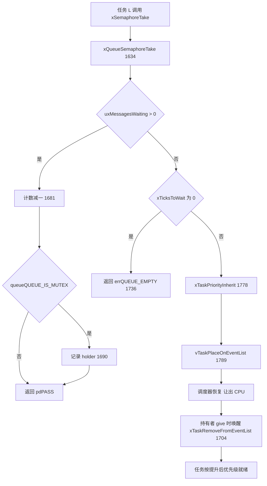
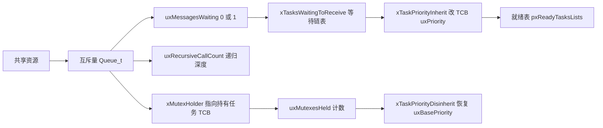

# semphr.h 与 queue.c —— 信号量、互斥量、递归互斥量与优先级继承

> 对应源文件：`include/semphr.h`（共 1095 行）、`queue.c` 中的信号量/互斥量实现（全文件 3369 行）、`tasks.c` 中的优先级继承段（全文件 9398 行）
>
> **前置阅读：** [queue.md](queue.md)（信号量就是"消息长度为 0 的队列"）、[tasks.md](tasks.md)（阻塞/唤醒与优先级链表）
> **相关配置：** [freertosconfigh.md](freertosconfigh.md)（`configUSE_MUTEXES`、`configUSE_COUNTING_SEMAPHORES`、`configUSE_RECURSIVE_MUTEXES`）
> **选型对比：** [event_groups_vs_queue.md](event_groups_vs_queue.md)
>
> 行号以本仓库当前文件为准（FreeRTOS-Kernel DEVELOPMENT BRANCH，`History.txt` 标注 V11.3.1）。
> 本仓库**没有 `semphr.c`**——见 1.1。

---

# 第一部分：先搞清结构

## 1.1 一句话结论：没有 semphr.c

FreeRTOS 的信号量 API **全部是宏**，本体在 `queue.c`。`include/semphr.h` 只做三件事：

1. 定义句柄别名：`typedef QueueHandle_t SemaphoreHandle_t;`（semphr.h:33）
2. 把 `xSemaphoreXxx()` 映射到 `xQueueXxx()`（见 1.3 映射表）
3. 写 API 文档（Doxygen 注释）

读码路径固定为：`semphr.h`（宏）→ `queue.c`（`xQueueGenericSend` / `xQueueSemaphoreTake`）→ `tasks.c`（挂起/唤醒）→ `list.c`（链表）。
**推论：** 信号量走完整的队列路径，只是 `uxItemSize == 0` 省掉了 `memcpy`。

## 1.2 三种对象的队列参数（决定行为的分水岭）

`xQueueGenericCreate( uxQueueLength, uxItemSize, ucQueueType )`（queue.c:496）的三个参数决定了这个"队列"到底是哪种同步对象：

| 对象 | `uxQueueLength` | `uxItemSize` | `ucQueueType` | 创建入口 |
|---|---|---|---|---|
| 二值信号量 | 1 | 0 | `queueQUEUE_TYPE_BINARY_SEMAPHORE` | semphr.h:156 |
| 计数信号量 | `uxMaxCount` | 0 | `queueQUEUE_TYPE_COUNTING_SEMAPHORE` | semphr.h:928 → queue.c:911 |
| 互斥量 | 1 | 0 | `queueQUEUE_TYPE_MUTEX` | semphr.h:681 → queue.c:642 |
| 递归互斥量 | 1 | 0 | `queueQUEUE_TYPE_RECURSIVE_MUTEX` | semphr.h:795 → queue.c:642 |
| 普通队列 | N | sizeof(item) | `queueQUEUE_TYPE_BASE` | queue.h 的 `xQueueCreate` |

**三条推论：** `uxItemSize == 0` 时 `prvCopyDataToQueue()` 走特殊分支（queue.c:2372），不拷贝数据而是解除互斥量持有者（queue.c:2376-2381）；二值信号量的值就是 `uxMessagesWaiting`（0/1）；计数上限 = `uxLength`。

## 1.3 全部 API 映射表（行号已核对）

| 用户 API | 定义位置 | 实际调用 | 备注 |
|---|---|---|---|
| `xSemaphoreCreateBinary()` | semphr.h:156 | `xQueueGenericCreate( 1, 0, BINARY )` | 创建后**计数为 0**，必须先 give |
| `xSemaphoreCreateBinaryStatic()` | semphr.h:209 | `xQueueGenericCreateStatic(...)` | 静态内存 |
| `vSemaphoreCreateBinary(x)` | semphr.h:92 | 创建后立即 `xSemaphoreGive` | 已弃用，初始为 1 |
| `xSemaphoreTake(x,t)` | semphr.h:276 | `xQueueSemaphoreTake` | 可阻塞 |
| `xSemaphoreGive(x)` | semphr.h:426 | `xQueueGenericSend(..., 0, TO_BACK)` | **永不阻塞**（`semGIVE_BLOCK_TIME` = 0，semphr.h:42） |
| `xSemaphoreGiveFromISR` | semphr.h:598 | `xQueueGiveFromISR` | 只能用于 itemSize 0 |
| `xSemaphoreTakeFromISR` | semphr.h:629 | `xQueueReceiveFromISR` | 不阻塞 |
| `xSemaphoreCreateMutex()` | semphr.h:681 | `xQueueCreateMutex( MUTEX )` | 创建即"可用" |
| `xSemaphoreCreateRecursiveMutex()` | semphr.h:795 | `xQueueCreateMutex( RECURSIVE_MUTEX )` | 同一入口，类型不同 |
| `xSemaphoreTakeRecursive` | semphr.h:365 | `xQueueTakeMutexRecursive` | 计数 +1 |
| `xSemaphoreGiveRecursive` | semphr.h:507 | `xQueueGiveMutexRecursive` | 计数 -1，到 0 才真正归还 |
| `xSemaphoreCreateCounting(max,init)` | semphr.h:928 | `xQueueCreateCountingSemaphore` | queue.c:911 |
| `vSemaphoreDelete(x)` | semphr.h:1017 | `vQueueDelete` | 持有中的互斥量禁止删除 |
| `uxSemaphoreGetCount(x)` | semphr.h:1061 | `uxQueueMessagesWaiting` | O(1) 读计数 |

## 1.4 内存开销（Cortex-M4F，32 位）

一个信号量 = `Queue_t`（queue.c:115-148，约 80 字节：2 个链表 + 指针 + 计数 + 2 个 lock 字节）。
`uxItemSize == 0` 时不分配存储区；互斥量的 `xMutexHolder` / `uxRecursiveCallCount`（queue.c:88-89）在 union 内，不额外增大结构体。
对比任务通知：**0 字节额外对象**（值存在 TCB 里），这是"能用通知就别用信号量"的量化依据。

---

# 第二部分：二值信号量与计数信号量

## 2.1 二值信号的创建：一行宏，两个语义陷阱

```c
#define xSemaphoreCreateBinary()    xQueueGenericCreate( ( UBaseType_t ) 1, semSEMAPHORE_QUEUE_ITEM_LENGTH, queueQUEUE_TYPE_BINARY_SEMAPHORE )
```

（semphr.h:156，逐字）

`semSEMAPHORE_QUEUE_ITEM_LENGTH` 定义为 0（semphr.h:41）：

```c
#define semSEMAPHORE_QUEUE_ITEM_LENGTH      ( ( UBaseType_t ) 0U )
```

**陷阱 1：** 创建后 `uxMessagesWaiting = 0`，第一次 take 必失败/阻塞。
**陷阱 2：** 老宏 `vSemaphoreCreateBinary()` 创建后立刻 give（semphr.h:92-98），初始为 1——与前者相反，迁移时不能只换函数名。

## 2.2 `xSemaphoreTake` 的完整路径（queue.c:1634）

函数入口三条断言（queue.c:1648-1660）：`pxQueue` 非空、`uxItemSize == 0`、**调度器挂起时不能带超时**（挂起期间超时无法推进）。

取到信号量的核心只有 4 行（queue.c:1669-1681）：

```c
const UBaseType_t uxSemaphoreCount = pxQueue->uxMessagesWaiting;
...
if( uxSemaphoreCount > ( UBaseType_t ) 0 )
{
    pxQueue->uxMessagesWaiting = ( UBaseType_t ) ( uxSemaphoreCount - ( UBaseType_t ) 1 );
```

**行为差异：** `xQueueReceive` 会把数据 `memcpy` 到用户缓冲区，`xQueueSemaphoreTake` 只做计数减一。这是信号量比队列快的唯一原因（少的是一次 `memcpy`）。

如果是互斥量，取到后立刻登记持有者（queue.c:1685-1691）：

```c
if( pxQueue->uxQueueType == queueQUEUE_IS_MUTEX )
{
    pxQueue->u.xSemaphore.xMutexHolder = pvTaskIncrementMutexHeldCount();
}
```

`pvTaskIncrementMutexHeldCount()`（tasks.c:8173）做两件事：把 `pxCurrentTCB->uxMutexesHeld` 加一，并返回当前 TCB。**这个计数器是优先级继承能否正确恢复的根**（见 3.4）。

## 2.3 取不到时的阻塞流程（queue.c:1759-1800）

```c
vTaskSuspendAll();
prvLockQueue( pxQueue );
...
if( prvIsQueueEmpty( pxQueue ) != pdFALSE )
{
    ...
    vTaskPlaceOnEventList( &( pxQueue->xTasksWaitingToReceive ), xTicksToWait );
    prvUnlockQueue( pxQueue );
    if( xTaskResumeAll() == pdFALSE )
    {
        taskYIELD_WITHIN_API();
    }
}
```

四个动作：`vTaskSuspendAll()` 禁止调度（不关中断）→ `prvLockQueue()` 把 `cRxLock/cTxLock` 置为 `queueLOCKED_UNMODIFIED`，让 ISR 在临界区外安全记账 → `vTaskPlaceOnEventList()` 挂事件项与延时项 → `xTaskResumeAll()` 恢复调度并可能在内部完成切换。
**为什么两级锁？** `vTaskPlaceOnEventList` 改多条链表不是原子操作，而 `prvLockQueue` 只保护队列字段；各管一段可缩短关中断时间。

## 2.4 计数信号量：`uxMessagesWaiting` 就是计数

创建函数（queue.c:911-936）只比二值多一个参数校验：

```c
if( ( uxMaxCount != 0U ) &&
    ( uxInitialCount <= uxMaxCount ) )
{
    xHandle = xQueueGenericCreate( uxMaxCount, queueSEMAPHORE_QUEUE_ITEM_LENGTH, queueQUEUE_TYPE_COUNTING_SEMAPHORE );
    if( xHandle != NULL )
    {
        ( ( Queue_t * ) xHandle )->uxMessagesWaiting = uxInitialCount;
```

（queue.c:911-918，逐字）

之后完全复用 `xQueueSemaphoreTake` 与 `xQueueGenericSend`。**give 到上限后再 give 会返回 `errQUEUE_FULL`**（queue.c:1087），但 `xSemaphoreGive` 的返回值经常被调用者丢弃——这是计数信号量最常见的静默丢事件。

## 2.5 二值 vs 计数：怎么选

| 场景 | 选择 | 理由 |
|---|---|---|
| ISR 通知任务"有事发生"（可合并） | 二值信号量 | 多次 give 合并为 1，任务只处理一次 |
| 记录"发生了 N 次"（不可合并） | 计数信号量 | 每次 give 都记账，上限 `uxMaxCount` |
| 保护共享资源 | 互斥量 | 需要优先级继承；信号量没有 |
| 单生产者单消费者、只要最新值 | 任务通知 | 零对象开销，见 [task_notification.md](task_notification.md) |

**常见错误：** 用二值信号量做事件计数——中断连发 3 次只处理 1 次。这不是 bug，是二值语义。

---

# 第三部分：互斥量与优先级继承

## 3.1 互斥量的创建：先当队列，再改身份

`xQueueCreateMutex()`（queue.c:642-655）先建一个长度 1、itemSize 0 的队列，然后调用 `prvInitialiseMutex()`（queue.c:613-635）：

```c
pxNewQueue->u.xSemaphore.xMutexHolder = NULL;
pxNewQueue->uxQueueType = queueQUEUE_IS_MUTEX;
pxNewQueue->u.xSemaphore.uxRecursiveCallCount = 0;
...
( void ) xQueueGenericSend( pxNewQueue, NULL, ( TickType_t ) 0U, queueSEND_TO_BACK );
```

（queue.c:620-629，逐字）

`uxQueueType = queueQUEUE_IS_MUTEX` 是**唯一区分互斥量与二值信号量的字段**，`prvCopyDataToQueue`（queue.c:2376）和 `xQueueSemaphoreTake`（queue.c:1685）都靠它分叉；最后一次 `xQueueGenericSend` 把计数从 0 变 1，使互斥量创建后立即可用。

## 3.2 递归互斥量：引用计数在队列里

递归互斥量不是另一种数据结构，只是 `uxQueueType == queueQUEUE_TYPE_RECURSIVE_MUTEX` + 一个 `uxRecursiveCallCount`。

**获取**（queue.c:809-853）：

```c
if( pxMutex->u.xSemaphore.xMutexHolder == xTaskGetCurrentTaskHandle() )
{
    ( pxMutex->u.xSemaphore.uxRecursiveCallCount )++;

    /* 检查是否发生溢出。 */
    configASSERT( pxMutex->u.xSemaphore.uxRecursiveCallCount );

    xReturn = pdPASS;
}
else
{
    xReturn = xQueueSemaphoreTake( pxMutex, xTicksToWait );
    ...
}
```

（queue.c:825-836，逐字）

**归还**（queue.c:753-800）：

```c
( pxMutex->u.xSemaphore.uxRecursiveCallCount )--;

/* 递归调用计数是否已递减到 0？ */
if( pxMutex->u.xSemaphore.uxRecursiveCallCount == ( UBaseType_t ) 0 )
{
    ( void ) xQueueGenericSend( pxMutex, NULL, queueMUTEX_GIVE_BLOCK_TIME, queueSEND_TO_BACK );
}
```

（queue.c:772-780，逐字）

**语义：** 同一任务 take N 次只需 give N 次，第 N 次才真正归还。**陷阱：** 不同任务 give 返回 `pdFAIL`（queue.c:790）且不释放；持锁任务漏配对会让优先级继承永久挂住。

## 3.3 优先级继承的触发点

关键在 `xQueueSemaphoreTake` 的阻塞分支（queue.c:1772-1790）：

```c
#if ( configUSE_MUTEXES == 1 )
{
    if( pxQueue->uxQueueType == queueQUEUE_IS_MUTEX )
    {
        taskENTER_CRITICAL();
        {
            xInheritanceOccurred = xTaskPriorityInherit( pxQueue->u.xSemaphore.xMutexHolder );
        }
        taskEXIT_CRITICAL();
    }
    ...
}
#endif
vTaskPlaceOnEventList( &( pxQueue->xTasksWaitingToReceive ), xTicksToWait );
```

（queue.c:1772-1789，逐字）

**顺序很重要：** 先继承、再挂事件链表——持有者被唤醒时已带提升后的优先级进入就绪表。

## 3.4 `xTaskPriorityInherit`（tasks.c:7117）

函数只处理一种情况：**持有者优先级 < 申请者优先级**。

```c
if( pxMutexHolderTCB->uxPriority < pxCurrentTCB->uxPriority )
{
    ...
    listSET_LIST_ITEM_VALUE( &( pxMutexHolderTCB->xEventListItem ), ( TickType_t ) configMAX_PRIORITIES - ( TickType_t ) pxCurrentTCB->uxPriority );
    ...
    if( listIS_CONTAINED_WITHIN( &( pxReadyTasksLists[ pxMutexHolderTCB->uxPriority ] ), &( pxMutexHolderTCB->xStateListItem ) ) != pdFALSE )
    {
        if( uxListRemove( &( pxMutexHolderTCB->xStateListItem ) ) == ( UBaseType_t ) 0 )
        {
            portRESET_READY_PRIORITY( pxMutexHolderTCB->uxPriority, uxTopReadyPriority );
        }
        pxMutexHolderTCB->uxPriority = pxCurrentTCB->uxPriority;
        prvAddTaskToReadyList( pxMutexHolderTCB );
    }
    else
    {
        /* 仅继承优先级。 */
        pxMutexHolderTCB->uxPriority = pxCurrentTCB->uxPriority;
    }
```

（tasks.c:7134-7186，节选逐字）

**为什么要改事件项的值？** 任务可能阻塞在某个队列上，事件链表按键 `configMAX_PRIORITIES - 优先级` 升序；改优先级不改键，排序就错了。
**为什么分两条路？** 在就绪表必须摘下再按新优先级插回（否则挂错链表）；不在就绪表（运行/阻塞）只改 `uxPriority`。

`xReturn = pdTRUE` 表示"确实发生了继承"，调用方 `xQueueSemaphoreTake` 用 `xInheritanceOccurred` 记住它，超时路径需要用它做反向恢复（tasks.c:7322 `vTaskPriorityDisinheritAfterTimeout`）。

## 3.5 `xTaskPriorityDisinherit`（tasks.c:7226）与"多锁乱序"

归还互斥量时，`prvCopyDataToQueue` 调用（queue.c:2376-2381）：

```c
if( pxQueue->uxQueueType == queueQUEUE_IS_MUTEX )
{
    /* 该互斥量不再被持有。 */
    xReturn = xTaskPriorityDisinherit( pxQueue->u.xSemaphore.xMutexHolder );
    pxQueue->u.xSemaphore.xMutexHolder = NULL;
}
```

（queue.c:2376-2381，逐字）

`xTaskPriorityDisinherit` 的关键约束（tasks.c:7241-7276）：

```c
( pxTCB->uxMutexesHeld )--;
...
if( pxTCB->uxPriority != pxTCB->uxBasePriority )
{
    /* 仅当未持有其他互斥量时才取消继承。 */
    if( pxTCB->uxMutexesHeld == ( UBaseType_t ) 0 )
    {
        ...
        pxTCB->uxPriority = pxTCB->uxBasePriority;
        listSET_LIST_ITEM_VALUE( &( pxTCB->xEventListItem ), ( TickType_t ) configMAX_PRIORITIES - ( TickType_t ) pxTCB->uxPriority );
        prvAddTaskToReadyList( pxTCB );
```

（tasks.c:7241-7276，节选逐字）

**"仅当未持有其他互斥量时才取消继承"**：持有多把锁时归还一把不能降级，否则它拿着另一把锁时又会被抢占。
**乱序归还：** A 先拿 M1 再拿 M2、却先放 M2，`uxMutexesHeld` 从 2 变 1 不降级；放 M1 时才降回 base，返回值 `pdTRUE` 让 `xQueueGenericSend` 调用 `queueYIELD_IF_USING_PREEMPTION()`（queue.c:1052-1057）补上调度点。

## 3.6 优先级继承的边界

| 情况 | 是否继承 | 源码依据 |
|---|---|---|
| 互斥量被任务持有，低优先级任务来抢 | 是 | queue.c:1774 |
| 互斥量被**中断**持有（holder = NULL） | 否 | tasks.c:7128-7129 判空 |
| 二值/计数信号量 | 否（根本没有 holder） | `uxQueueType` 不是 MUTEX |
| 递归互斥量 | 是（同一条 mutex 路径） | 创建时同为 `queueQUEUE_IS_MUTEX` |
| 持有者优先级已经更高 | 否（但仍返回 pdTRUE 表示"继承状态存在"） | tasks.c:7195-7204 |

## 3.7 互斥量执行流




## 3.8 互斥量数据流




---

# 第四部分：ISR 版本与陷阱

## 4.1 `xSemaphoreGiveFromISR` 为什么单独实现

`xSemaphoreGive` 走 `xQueueGenericSend`，内部有阻塞循环和 `vTaskSuspendAll`，ISR 不能用。中断版 `xQueueGiveFromISR`（queue.c:1316）不阻塞、只做 `uxMessagesWaiting++` 与 `xTaskRemoveFromEventList`，并用 `pxHigherPriorityTaskWoken` 带回切换请求。
**中断里不能给互斥量：** queue.c:1191 的注释明确假定 `pxQueue` 不是互斥量，因此不会触发 `xTaskPriorityDisinherit`——在 ISR 里 give 互斥量会让持有者字段永久泄漏。

## 4.2 六个高频陷阱

| # | 陷阱 | 后果 | 正确做法 |
|---|---|---|---|
| 1 | `xSemaphoreCreateBinary()` 后直接 take | 永远阻塞/失败 | 先 give 一次，或改用 `vSemaphoreCreateBinary` |
| 2 | 在 ISR 里 `xSemaphoreGive` | 断言/崩溃 | 用 `xSemaphoreGiveFromISR` + `portYIELD_FROM_ISR` |
| 3 | 在 ISR 里 give 互斥量 | 持有者泄漏，优先级继承错乱 | ISR 只给二值/计数信号量 |
| 4 | 忘记 `xSemaphoreGiveRecursive` 配对 | 锁永不释放 | 用 `goto` 统一出口，或改普通互斥量 |
| 6 | 把二值信号量当计数用 | 事件被合并丢失 | 用计数信号量或任务通知计数 |

## 4.3 量化：一次 take 的成本（Cortex-M4F @ 168 MHz）

| 路径 | 关键操作 | 量级 |
|---|---|---|
| 无竞争 take | 关中断 → 读计数 → 减一 → 记录 holder → 开中断 | 约 20-40 周期，< 0.3 µs |
| 有竞争 take（阻塞） | 上述 + 挂起调度器 + 两次链表插入 + 上下文切换 | 约 1-3 µs |
| ISR give + 切换 | 计数加一 + 事件链表摘除 + PendSV | 约 1-2 µs |
| 任务通知替代 | 直接改 TCB 两个字段 | 约 10-20 周期 |

结论：无竞争时互斥量与通知差一个数量级；有竞争时都被上下文切换主导。

## 4.4 读码路径小结

1. `semphr.h:156 / 276 / 426` —— 建立"宏 → queue.c"的映射。
2. `queue.c:1634-1860` —— 重点 1669（计数）、1685（holder）、1774（继承）、1789（挂起）。
3. `queue.c:2361-2440` 看"释放互斥量"分支；`tasks.c:7117-7315` 看继承/反继承（7140 事件项键、7152 就绪表搬家、7249 多锁不降级）；`tasks.c:8173-8190` 看 `uxMutexesHeld` 生命周期。
