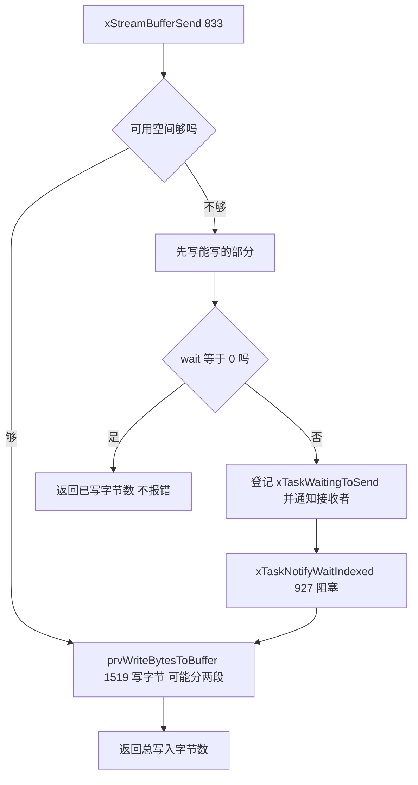
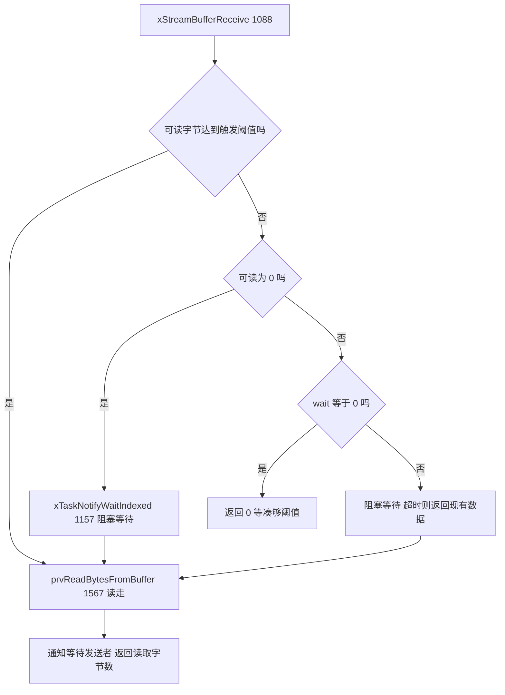
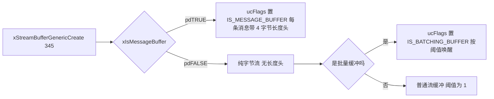

# stream_buffer.c 与 stream_buffer.h —— 流缓冲 / 消息缓冲完全解读

> 对应源文件（本地仓库 `~/workspace/freertos/`，FreeRTOS-Kernel V11.1.0+，行号以当前文件为准）：
> - [stream_buffer.c](/Users/theo-richard/workspace/freertos/stream_buffer.c)（1796 行）—— 流缓冲 + 消息缓冲实现
> - [include/stream_buffer.h](/Users/theo-richard/workspace/freertos/include/stream_buffer.h)（909 行）—— 类型与 API 声明
>
> **前置阅读：** [list.md](list.md) → [tasks.md](tasks.md) → [queue.md](queue.md)
> **配置项：** [freertosconfigh.md](freertosconfigh.md)

---

# 第一部分：先掌握什么、按什么顺序读

## 1.1 三句话讲清流缓冲

1. **流缓冲（Stream Buffer）= 一个字节环 + 一个"触发阈值"**，专门用于**单生产者 / 单消费者**的字节流搬运
   （串口收发、ADC 采样流、日志输出）；
2. **消息缓冲（Message Buffer）就是流缓冲 + 4 字节长度头**——同一个结构、同一套代码，
   靠 `ucFlags` 的一个标志位区分（`sbFLAGS_IS_MESSAGE_BUFFER`，stream_buffer.c:241）；
3. **它比队列更轻量，但能力更弱**：不按优先级唤醒（用**任务通知**而非等待链表）、
   只支持一个读任务和一个写任务。

## 1.2 与队列的本质区别（为什么需要它）

| | 队列 | 流缓冲 | 消息缓冲 |
|---|---|---|---|
| 数据单元 | 固定大小的项 | **任意字节数** | **变长消息** |
| 内存开销 | 每项都有头部对齐 | 纯字节，无对齐损失 | 每消息 +4 字节长度头 |
| 多个写者 | 支持 | **不支持**（单写） | 不支持 |
| 多个读者 | 支持 | **不支持**（单读） | 不支持 |
| 唤醒机制 | 等待链表（按优先级） | **任务通知** | 任务通知 |
| 内存拷贝次数 | 1 次 | 1 次（可直接批量） | 2 次（长度头 + 数据） |
| 适用 | 通用传数据 | **字节流** | **变长消息** |

**为什么更快？** 队列的环形缓冲区要求"每项大小固定"，因此必须用 `uxItemSize` 对齐；
而很多真实数据（串口帧、命令行输入）是**长度不定**的。
流缓冲直接按**字节**处理，没有"项"的概念，也没有队列那种"满一个才能取"的限制。

## 1.3 必须提前搞懂的 6 个概念

### 概念 1：触发阈值（Trigger Level）—— "凑够多少才叫醒读者"

```c
size_t xTriggerLevelBytes;    // stream_buffer.c:253
```

只有缓冲区里的**可读字节数 ≥ 触发阈值**时，等待的接收任务才会被唤醒。

- `xStreamBufferCreate( size, 1 )` → 有 1 字节就唤醒（最低延迟，最频繁切换）；
- `xStreamBufferCreate( size, size/2 )` → 凑够一半才唤醒（**减少任务切换次数，适合高吞吐**）。

**这是流缓冲相对队列的一个独特优化点**：队列是"有一个就唤醒一个"，
流缓冲可以让你控制"批量到达才唤醒"，从而显著降低上下文切换开销。

### 概念 2：任务通知代替等待链表 → 只能单读单写

```c
volatile TaskHandle_t xTaskWaitingToReceive;   // stream_buffer.c:254  ← 只有一个！
volatile TaskHandle_t xTaskWaitingToSend;      // stream_buffer.c:255  ← 只有一个！
```

**注意：这两个是"单个任务句柄"，不是链表**（对比 `Queue_t` 的
`xTasksWaitingToSend/Receive` 是 `List_t`）。

阻塞靠 `xTaskNotifyWaitIndexed`（stream_buffer.c:927 / 1157），唤醒靠
`xTaskNotifyIndexed`（宏 `sbSEND_COMPLETED` / `sbRECEIVE_COMPLETED`，stream_buffer.c:78-165）。

**直接后果：**
- **只能一个任务读、一个任务写**。第二个任务来读会覆盖第一个的句柄（源码有断言
  `configASSERT( pxStreamBuffer->xTaskWaitingToSend == NULL )`，stream_buffer.c:915）；
- 不按优先级唤醒（没有"最优先的等待者"概念）；
- 但**没有链表操作开销**，比队列快。

> **这是使用流缓冲最重要的约束**：多写者场景必须自己加互斥量，或改用队列。

### 概念 3：写满时"部分写入"而非全丢

`xStreamBufferSend` 的返回值是**实际写入的字节数**，可能小于请求的字节数：

```text
请求写 100 字节，缓冲区只剩 30 字节空间，xTicksToWait = 0
  → 写入 30 字节，返回 30（不报错！）
请求写 100 字节，缓冲区只剩 30 字节空间，xTicksToWait > 0
  → 先写 30，然后阻塞等空间，醒来后继续写剩下的 70
  → 最终返回 100（或超时返回已写部分）
```

**这与队列不同**：队列要么整条消息入队，要么失败（除非用 `queueOVERWRITE`）。
流缓冲的"部分写入"语义非常适合串口这种"能写多少写多少"的场景。

### 概念 4：`xRequiredSpace` 为什么要多留 1 字节

```c
xRequiredSpace = xDataLengthBytes;
if( 是消息缓冲 ) xRequiredSpace += sbBYTES_TO_STORE_MESSAGE_LENGTH;   // stream_buffer.c:860
...
configASSERT( xRequiredSpace > xDataLengthBytes );                     // stream_buffer.c:863
```

以及创建时：

```c
configASSERT( xBufferSizeBytes > sbBYTES_TO_STORE_MESSAGE_LENGTH );    // stream_buffer.c:364
```

**为什么环形缓冲区必须"留一个字节不用"？** 因为 `xHead == xTail` 既表示"空"也可能表示"满"，
无法区分。经典解法是让缓冲区**始终最多只填到 length-1**，从而
`(xHead+1) % length == xTail` 可以唯一表示"满"。

### 概念 5：消息缓冲的 4 字节长度头

```c
#define sbBYTES_TO_STORE_MESSAGE_LENGTH  ( sizeof( configMESSAGE_BUFFER_LENGTH_TYPE ) )   // stream_buffer.c:238
```

默认 `configMESSAGE_BUFFER_LENGTH_TYPE = size_t`（见 [freertosconfigh.md](freertosconfigh.md)），
在 32 位平台上就是 **4 字节**。

**写入时**：先写 4 字节长度，再写数据（stream_buffer.c:1058）：

```c
xNextHead = prvWriteBytesToBuffer( pxStreamBuffer, ( const uint8_t * ) &( xMessageLength ),
                                   sbBYTES_TO_STORE_MESSAGE_LENGTH, xNextHead );
```

**读取时**：先读 4 字节解出长度，再按长度读数据（stream_buffer.c:1220-1226）。

**所以每条消息的额外开销 = 4 字节。** 如果你发大量 1 字节消息，开销 400%——
这种情况应该用字节流（流缓冲）或打包。

### 概念 6：回调机制（`configUSE_SB_COMPLETED_CALLBACK`）

默认（关闭）时，发送/接收完成用**宏**做通知：

```c
#ifndef sbSEND_COMPLETED
    #define sbSEND_COMPLETED( pxStreamBuffer )  ...  // stream_buffer.c:161
#endif
```

打开 `configUSE_SB_COMPLETED_CALLBACK=1` 后，每个实例可以带自己的回调
（`pxSendCompletedCallback` / `pxReceiveCompletedCallback`，stream_buffer.c:264-265），
用 `xStreamBufferCreateWithCallback` 创建。

**用途：** 在做"零拷贝/直接内存访问（DMA）"集成时，可以挂自定义通知（比如给 DMA 控制器发信号）。

## 1.4 推荐阅读顺序（5 站）

```text
┌─ 第 1 站：StreamBuffer_t 结构 ───────────────────────────────────
│  stream_buffer.c:248-268   （8 个字段，很短）
│  目标：注意到 xTaskWaitingToReceive/Send 是"单个句柄"而不是链表
└──────────────────────────────────────────────────────────────────
                          │
                          ▼
┌─ 第 2 站：创建 + 初始化 ─────────────────────────────────────────
│  xStreamBufferGenericCreate   stream_buffer.c:345
│  prvInitialiseNewStreamBuffer stream_buffer.c:1664
│  目标：看清 ucFlags 怎么区分流缓冲/消息缓冲/批量缓冲
└──────────────────────────────────────────────────────────────────
                          │
                          ▼
┌─ 第 3 站：环形字节读写（底层）──────────────────────────────────
│  prvWriteBytesToBuffer  stream_buffer.c:1519
│  prvReadBytesFromBuffer stream_buffer.c:1567
│  prvBytesInBuffer       stream_buffer.c:1614
│  目标：理解"留一字节"的环形算法
└──────────────────────────────────────────────────────────────────
                          │
                          ▼
┌─ 第 4 站：发送与接收（核心）─────────────────────────────────────
│  xStreamBufferSend    stream_buffer.c:833
│  xStreamBufferReceive stream_buffer.c:1088
│  目标：看清"部分写入"、触发阈值、任务通知三者的配合
└──────────────────────────────────────────────────────────────────
                          │
                          ▼
┌─ 第 5 站：消息缓冲（流缓冲的特化）───────────────────────────────
│  prvWriteMessageToBuffer stream_buffer.c:1033
│  prvReadMessageFromBuffer stream_buffer.c:1314
│  xStreamBufferNextMessageLengthBytes stream_buffer.c:1205
└──────────────────────────────────────────────────────────────────
```

---

# 第二部分：数据类型

## 2.1 `StreamBuffer_t`（stream_buffer.c:248-268）

| 字段 | 行号 | 作用 |
|---|---|---|
| `xTail` | 250 | 下一个待读位置索引 |
| `xHead` | 251 | 下一个待写位置索引 |
| `xLength` | 252 | 缓冲区总长度 |
| `xTriggerLevelBytes` | 253 | **触发阈值**：可读字节 ≥ 此值才唤醒读者 |
| `xTaskWaitingToReceive` | 254 | **等待接收的任务**（单个句柄，不是链表！） |
| `xTaskWaitingToSend` | 255 | **等待发送的任务**（单个句柄） |
| `pucBuffer` | 256 | 缓冲区本体 |
| `ucFlags` | 257 | 标志位（见 2.2） |
| `uxStreamBufferNumber` | 260 | 调试编号 |
| `pxSend/ReceiveCompletedCallback` | 264-265 | 可选回调（`configUSE_SB_COMPLETED_CALLBACK=1`） |
| `uxNotificationIndex` | 267 | 用哪个任务通知索引（默认 0） |

**对比 `Queue_t`（[queue.md](queue.md) 2.1）：**
流缓冲没有 `uxMessagesWaiting`（用 `xHead`/`xTail` 算）、没有 union、没有 `uxItemSize`。
更简单 → 更省内存、更快。

## 2.2 `ucFlags` 的三个位（stream_buffer.c:241-243）

```c
#define sbFLAGS_IS_MESSAGE_BUFFER        ( ( uint8_t ) 1 )   // 是消息缓冲（带 4 字节长度头）
#define sbFLAGS_IS_STATICALLY_ALLOCATED  ( ( uint8_t ) 2 )   // 内存由用户提供
#define sbFLAGS_IS_BATCHING_BUFFER       ( ( uint8_t ) 4 )   // 批量缓冲（按阈值批量唤醒）
```

**`sbFLAGS_IS_MESSAGE_BUFFER` 就是"流缓冲"与"消息缓冲"的唯一区别**
（stream_buffer.c:363-369 创建时按类型设置）。

## 2.3 环形索引算法（留一字节）

```text
缓冲区长度 xLength = 8（实际可用 7 字节）

  xTail                   xHead
    │                       │
    ▼                       ▼
  ┌────┬────┬────┬────┬────┬────┬────┬────┐
  │ D0 │ D1 │ D2 │    │    │    │    │    │
  └────┴────┴────┴────┴────┴────┴────┴────┘
    0    1    2    3    4    5    6    7

已存 3 字节（D0~D2）
  可读 = xHead - xTail（不回绕时）= 3 - 0 = 3
  可写 = xLength - 可读 - 1 = 8 - 3 - 1 = 4   ← 故意少 1 字节

★ 为什么少 1：若允许写满 8 字节，xHead 绕回等于 xTail，
  "空"和"满"无法区分。留 1 字节让 (xHead+1)%len==xTail 唯一表示满。
  这就是 stream_buffer.c:863 那个 configASSERT 的由来。
```

---

# 第三部分：stream_buffer.c 核心函数

## 3.1 创建：`xStreamBufferGenericCreate`（stream_buffer.c:345）

```text
xStreamBufferGenericCreate( xBufferSizeBytes, xTriggerLevelBytes, xIsMessageBuffer, pxSendCompletedCallback, pxReceiveCompletedCallback )
  stream_buffer.c:345
  │
  ├─ 若 xTriggerLevelBytes == 0 → 设成 1                     （约 356）
  │
  ├─ configASSERT( xBufferSizeBytes > sbBYTES_TO_STORE_MESSAGE_LENGTH )   stream_buffer.c:364
  │    （消息缓冲至少要能放下 4 字节长度头）
  │
  ├─ ucFlags 设置：
  │    ├─ xIsMessageBuffer ？→ sbFLAGS_IS_MESSAGE_BUFFER        stream_buffer.c:363
  │    └─ 否则（批量缓冲）→ sbFLAGS_IS_BATCHING_BUFFER          stream_buffer.c:369
  │
  ├─ pvPortMalloc( sizeof(StreamBuffer_t) + xBufferSizeBytes )
  │    （结构与缓冲区一次分配）
  │
  └─ prvInitialiseNewStreamBuffer( ... )                       stream_buffer.c:1664
       ├─ xHead = xTail = 0
       ├─ xLength = xBufferSizeBytes
       ├─ xTriggerLevelBytes = 传入值
       ├─ xTaskWaitingToReceive = xTaskWaitingToSend = NULL
       └─ memset 缓冲区（若 configHEAP_CLEAR_MEMORY_ON_FREE 等）
```

`xStreamBufferCreate`（stream_buffer.h:115）和 `xMessageBufferCreate` 都只是
`xStreamBufferGenericCreate` 的宏包装，最后一个参数决定类型。

## 3.2 底层环形读写

### `prvWriteBytesToBuffer`（stream_buffer.c:1519）

```text
prvWriteBytesToBuffer( pxStreamBuffer, pucDataToWrite, xBytesToWrite, xHead )
  ├─ 算到尾部的剩余空间 = xLength - xHead
  ├─ 若剩余空间 >= 要写的字节数 → 一次 memcpy 搞定（不回绕，最快路径）
  └─ 否则分两段：
       ├─ 先写满尾部 [xHead .. xLength)
       └─ 再把剩下的从头部 [0 .. ) 写
  返回新的 xHead（已取模）
```

### `prvReadBytesFromBuffer`（stream_buffer.c:1567）

完全对称：先算 `xLength - xTail`，够就一次拷，不够分两段绕回。

### `prvBytesInBuffer`（stream_buffer.c:1614）

```c
可读字节 = ( xHead >= xTail ) ? ( xHead - xTail ) : ( xLength - xTail + xHead )
```

### `prvBytesInBufferMeetTriggerLevel`（stream_buffer.c:1635）

判断"可读字节是否已达触发阈值"——批量唤醒的判定依据。

## 3.3 发送：`xStreamBufferSend`（stream_buffer.c:833）

```text
xStreamBufferSend( xStreamBuffer, pvTxData, xDataLengthBytes, xTicksToWait )
  stream_buffer.c:833
  │
  ├─ configASSERT( pvTxData ); configASSERT( pxStreamBuffer );     846-847
  ├─ configASSERT( xTicksToWait == 0 || 调度器未挂起 )             约 850
  │
  ├─ xRequiredSpace = xDataLengthBytes;
  ├─ 若是消息缓冲 → xRequiredSpace += 4（长度头）                   860
  ├─ configASSERT( xRequiredSpace > xDataLengthBytes )             863  ← 防溢出
  │
  ├─ vTaskSuspendAll()                                             （准备长期操作）
  │
  ├─ 循环：还有字节要写？
  │    ├─ 算可用空间 xBytesAvailable
  │    │
  │    ├─ 有空间 → prvWriteBytesToBuffer( ... )
  │    │    ├─ 更新 xHead
  │    │    └─ 若是消息缓冲 → prvWriteMessageToBuffer               1033
  │    │          （先写 4 字节长度，再写数据，见 1058）
  │    │
  │    ├─ 写完了 → xTaskResumeAll()，返回已写字节数
  │    │
  │    └─ 还有剩余：
  │         ├─ xTicksToWait == 0 → 返回已写的部分（**不报错**）
  │         ├─ xTaskNotifyStateClearIndexed( NULL, 索引 )         912  ← 清旧通知
  │         ├─ configASSERT( xTaskWaitingToSend == NULL )          915  ← 只能一个写者！
  │         ├─ xTaskWaitingToSend = 当前任务                        （登记）
  │         ├─ 唤醒等待接收者：sbSEND_COMPLETED（通知）             （若有人在等）
  │         ├─ xTaskNotifyWaitIndexed( 索引, 0, 0, ..., 超时 )      927  ★ 阻塞在这里
  │         │     └─ 等着被"接收者腾出空间"的通知叫醒
  │         ├─ xTaskWaitingToSend = NULL
  │         └─ 回到循环顶部继续写
  │
  └─ 返回实际写入的总字节数
```

**关键：阻塞用的是 `xTaskNotifyWaitIndexed`（stream_buffer.c:927），不是事件链表。**

## 3.4 接收：`xStreamBufferReceive`（stream_buffer.c:1088）

```text
xStreamBufferReceive( xStreamBuffer, pvRxData, xBufferLengthBytes, xTicksToWait )
  stream_buffer.c:1088
  │
  ├─ 若消息缓冲 → 先预留 4 字节长度头的位置                    1108-1115
  │
  ├─ 循环：
  │    ├─ 可读字节 = prvBytesInBuffer                           1614
  │    │
  │    ├─ 读够了 / 到达触发阈值？
  │    │    ├─ 流缓冲 → prvReadBytesFromBuffer( ... )           1567
  │    │    └─ 消息缓冲 → prvReadMessageFromBuffer( ... )       1314
  │    │          （先读 4 字节长度，再按长度读数据）
  │    │    ├─ 唤醒等待发送者：sbRECEIVE_COMPLETED（通知）
  │    │    └─ 返回读到的字节数
  │    │
  │    └─ 没数据/不够：
  │         ├─ xTicksToWait == 0 → 返回 0
  │         ├─ xTaskNotifyStateClearIndexed( NULL, 索引 )        1140
  │         ├─ xTaskWaitingToReceive = 当前任务                  （登记）
  │         ├─ xTaskNotifyWaitIndexed( 索引, 0, 0, ..., 超时 )   1157  ★ 阻塞
  │         ├─ xTaskWaitingToReceive = NULL
  │         └─ 回循环顶部重试
  │
  └─ 返回实际读到的字节数
```

**注意"触发阈值"在接收侧的作用**（`xTriggerLevelBytes`，stream_buffer.c:1115）：
只有可读字节达到阈值才返回。但**如果超时了**，即使没到阈值也会返回已有的数据
（否则数据会一直卡在缓冲区里）。

## 3.5 消息缓冲的两个特化函数

### `prvWriteMessageToBuffer`（stream_buffer.c:1033）

```text
1. 先写 4 字节长度头（sbBYTES_TO_STORE_MESSAGE_LENGTH）      1058
2. 再写消息正文
3. 两条数据在环上可能不连续 → 分两段写
```

### `prvReadMessageFromBuffer`（stream_buffer.c:1314）

```text
1. 先读 4 字节长度头 → 得到消息长度
2. 若目标缓冲区放得下 → 读走完整消息
3. 若放不下 → 两种行为：
     - 若 xBufferLengthBytes >= 消息长度 → 读完整的
     - 否则：消息被"截断"读走（原文数据在缓冲区里被丢弃），返回 0
```

### `xStreamBufferNextMessageLengthBytes`（stream_buffer.c:1205）

**在不读走数据的前提下，偷看下一条消息有多长**（stream_buffer.c:1220-1226 读到长度头）。
用途：接收方可以先分配足够大的缓冲区，避免截断。

**注意源码注释（stream_buffer.c:1232-1233）：** 消息缓冲里最小的字节数是
`4 + 1 = 5` 字节（长度头 + 至少 1 字节数据），所以"可读字节 ≤ 4"就意味着缓冲区是空的。

---

# 第四部分：stream_buffer.h API 一览

## 4.1 流缓冲（字节流）

| API | stream_buffer.c | 说明 |
|---|---:|---|
| `xStreamBufferCreate(size, trigger)` | 345（宏在 .h:115） | 动态创建 |
| `xStreamBufferCreateStatic(...)` | 440 | 静态创建 |
| `xStreamBufferSend(sb, buf, len, wait)` | 833 | 写字节（可能部分写入） |
| `xStreamBufferSendFromISR(...)` | 973 | ISR 写 |
| `xStreamBufferReceive(sb, buf, len, wait)` | 1088 | 读字节 |
| `xStreamBufferReceiveFromISR(...)` | 1251 | ISR 读 |
| `xStreamBufferBytesAvailable(sb)` | 816 | 可读字节数 |
| `xStreamBufferSpacesAvailable(sb)` | 778 | 可写空间 |
| `xStreamBufferSetTriggerLevel(sb, lvl)` | 743 | 改触发阈值 |
| `xStreamBufferIsEmpty(sb)` | 1373 | 是否空 |
| `xStreamBufferIsFull(sb)` | 1401 | 是否满 |
| `xStreamBufferReset(sb)` | 615 | 复位（清空） |
| `xStreamBufferResetFromISR(sb)` | 677 | ISR 复位 |
| `vStreamBufferDelete(sb)` | 573 | 删除 |
| `xStreamBufferGetStaticBuffers(...)` | 539 | 取静态缓冲区 |

## 4.2 消息缓冲（变长消息）

| API | 展开为 | 说明 |
|---|---|---|
| `xMessageBufferCreate(size)` | `xStreamBufferGenericCreate( size, 0, pdTRUE, ... )` | 消息缓冲 |
| `xMessageBufferSend(...)` | `xStreamBufferSend(...)` | 写一条消息 |
| `xMessageBufferReceive(...)` | `xStreamBufferReceive(...)` | 读一条消息 |
| `xStreamBufferNextMessageLengthBytes(sb)` | stream_buffer.c:1205 | 偷看下条长度 |

**消息缓冲没有自己的实现函数**——全部通过 `xIsMessageBuffer = pdTRUE` 走同一套代码。
（与 [queue.md](queue.md) 里"信号量就是 item size 0 的队列"是同一个设计思路。）

## 4.3 完成回调用到的 ISR 辅助（`configUSE_SB_COMPLETED_CALLBACK=1`）

| API | stream_buffer.c |
|---|---:|
| `xStreamBufferSendCompletedFromISR` | 1441 |
| `xStreamBufferReceiveCompletedFromISR` | 1480 |

**用途：** 让 ISR 主动"假装完成了一次发送/接收"，从而通知等待者——用于 DMA 场景
（DMA 搬运完成后由 DMA 中断调用它来唤醒应用任务）。

---

# 第五部分：图

## 5.1 图 1：流缓冲 vs 消息缓冲的内存布局

```text
① 流缓冲 xStreamBufferCreate( 16, 1 )

   StreamBuffer_t
   ├─ xHead / xTail        （索引，不是指针）
   ├─ xLength = 16
   ├─ xTriggerLevelBytes = 1
   ├─ xTaskWaitingToReceive = NULL
   ├─ xTaskWaitingToSend = NULL
   └─ pucBuffer ──► ┌──┬──┬──┬──┬──┬── ... ──┬──
                    │  │  │  │  │  │          │        16 字节原始存储区
                    └──┴──┴──┴──┴──┴─ ... ───┴──
                     ↑
                     └─ 纯字节，无任何"项"的概念
                        任意位置都能读写，可跨段

② 消息缓冲 xMessageBufferCreate( 64 )

   pucBuffer ──► ┌────────┬──────────┬────────┬──────┬────────┬─────
                 │ 长度=5 │ "hello"  │ 长度=3 │ "abc"│ 长度=10│ ...
                 │ 4 字节 │ 5 字节    │ 4 字节 │3 字节 │ 4 字节 │
                 └────────┴──────────┴────────┴──────┴────────┴─────
                  ▲
                  └─ 每条消息前固定 4 字节长度头（sbBYTES_TO_STORE_MESSAGE_LENGTH）

★ 同一个结构、同一套代码，靠 ucFlags 的 sbFLAGS_IS_MESSAGE_BUFFER 位区分
```

## 5.2 图 2：环形索引与"留一字节"

```text
xLength = 8，实际最多存 7 字节

状态 A：空
   xHead = xTail = 0
   ┌────┬────┬────┬────┬────┬────┬────┬────┐
   │    │    │    │    │    │    │    │    │
   └────┴────┴────┴────┴────┴────┴────┴────┘
     ▲
     └── xHead = xTail = 0       可读 = 0

状态 B：存了 5 字节
                                     xTail      xHead
                                       │          │
                                       ▼          ▼
   ┌────┬────┬────┬────┬────┬────┬────┬────┐
   │ D0 │ D1 │ D2 │ D3 │ D4 │    │    │    │
   └────┴────┴────┴────┴────┴────┴────┴────┘
                                可读 = 5，可写 = 8 - 5 - 1 = 2

状态 C：绕回
   xTail          xHead
     │              │
     ▼              ▼
   ┌────┬────┬────┬────┬────┬────┬────┬────┐
   │ D5 │ D6 │    │    │    │ D2 │ D3 │ D4 │
   └────┴────┴────┴────┴────┴────┴────┴────┘
   可读 = 8 - 0 + 3 = ... 用公式：
         xHead < xTail ? ( xLength - xTail + xHead ) : ( xHead - xTail )

★ "可以读 D2..D6 共 5 字节" —— 数据跨过边界是连续的（逻辑上）
```

## 5.3 图 3：发送路径（含部分写入与阻塞）

```text
xStreamBufferSend( sb, buf, 100, wait )     stream_buffer.c:833
  │
  ├─ 有可用空间？
  │    ├─ 可用 30 字节 → 写 30，剩 70
  │    │
  │    ├─ wait == 0
  │    │    └─ 立刻返回 30（★ 不报错，部分写入是正常语义）
  │    │
  │    └─ wait > 0
  │         ├─ xTaskNotifyStateClearIndexed( NULL, 索引 )      912
  │         ├─ configASSERT( xTaskWaitingToSend == NULL )      915  ← 只能一个写者
  │         ├─ xTaskWaitingToSend = 本任务
  │         ├─ sbSEND_COMPLETED → 通知等待接收的任务
  │         ├─ xTaskNotifyWaitIndexed( ... 超时 )              927  ★ 阻塞
  │         │     └─ 接收者读走数据后，sbRECEIVE_COMPLETED 通知本任务
  │         ├─ xTaskWaitingToSend = NULL
  │         └─ 回顶部，继续写剩下的 70
  │
  └─ 返回总写入字节数（100，或超时时的部分值）
```

## 5.4 图 4：接收路径与触发阈值

```text
xStreamBufferReceive( sb, buf, len, wait )   stream_buffer.c:1088
  │
  ├─ 可读字节 >= 触发阈值？
  │    │
  │    ├─ 是 → 读走 min(可读, len) → 通知等待发送者 → 返回字节数
  │    │
  │    └─ 否
  │         ├─ 可读 > 0 但 < 阈值
  │         │    └─ wait == 0 → 返回 0（不读！等凑够）
  │         │       wait > 0 → 阻塞等凑够
  │         │          但★ 超时了就把现有数据返回，不丢
  │         │
  │         └─ 可读 == 0
  │              └─ 阻塞等（xTaskNotifyWaitIndexed, 1157）

★ 触发阈值 = "凑够多少才唤醒"，是流缓冲独有的性能旋钮：
    阈值为 1  → 逐字节唤醒，延迟最低、切换最多
    阈值为 N  → 攒批唤醒，吞吐更高、延迟更大
```

## 5.5 图 5：任务通知机制（对比队列的等待链表）

```text
队列（queue.c）                                流缓冲（stream_buffer.c）
──────────────                                 ────────────────────────
xTasksWaitingToReceive (List_t)                xTaskWaitingToReceive (TaskHandle_t)
  ├─ TCB_H（最高优先级）                          └─ 只存一个任务！
  ├─ TCB_M
  └─ TCB_L
  唤醒时取表头 = 最优先的那个                    唤醒时直接通知那个唯一句柄
  O(1) 但需要链表维护                            O(1) 且无链表开销

发送字节后：                                   发送字节后：
  listGET_OWNER_OF_HEAD_ENTRY                     xTaskNotifyIndexed( xTaskWaitingToReceive )
  → xTaskRemoveFromEventList                      → 直接把那个任务置为就绪
  → 挂回就绪表

★ 代价：流缓冲无法区分优先级、无法支持多个等待者
★ 收益：少一次链表操作、结构小、速度快
```

## 5.6 图 6：Mermaid 版本

### 发送与通知



### 接收与阈值



### 类型判定



---

# 第六部分：易错点与速查

## 6.1 最容易误解的 8 处

| # | 误解 | 实际 |
|---|---|---|
| 1 | 以为可以多任务同时写 | **只能一个写者**，第二个会触发断言（stream_buffer.c:915） |
| 2 | 以为可以多任务同时读 | 只能一个读者（`xTaskWaitingToReceive` 是单句柄） |
| 3 | 以为发送要么全成功要么失败 | **部分写入是正常语义**，返回实际写入字节数 |
| 4 | 以为容量就是 `xBufferSizeBytes` | **实际可用是 `size-1`**（留一字节区分空/满，stream_buffer.c:863） |
| 5 | 以为消息缓冲没有额外开销 | 每条消息 **+4 字节长度头**；大量小消息时开销极大 |
| 6 | 以为触发阈值不影响正确性 | 它只影响"何时唤醒"，**超时时仍会返回已有数据**，不丢数据 |
| 7 | 以为可以给流缓冲发"空消息" | 消息缓冲最小消息是 `4 + 1 = 5` 字节；可读 ≤ 4 就认为空（stream_buffer.c:1232） |
| 8 | 以为 `xMessageBufferReceive` 的缓冲区不够也没事 | 放不下会被**截断**（消息被丢弃），应先用 `xStreamBufferNextMessageLengthBytes` 查长度 |

## 6.2 三种"缓冲区"选型速查

| 需求 | 选 |
|---|---|
| 固定大小项、多个生产者/消费者 | **队列**（[queue.md](queue.md)） |
| 字节流（串口、ADC）、单读单写、要低开销 | **流缓冲** |
| 变长消息、单读单写、需要消息边界 | **消息缓冲** |
| 需要"批量到达才唤醒"以降切换开销 | 流缓冲 + 触发阈值 |
| 需要多任务广播、多位标志 | **事件组**（[event_groups.md](event_groups.md)） |

## 6.3 行号自查命令

```bash
grep -n "typedef struct StreamBufferDef_t"                stream_buffer.c
grep -n "size_t xStreamBufferSend("                        stream_buffer.c
grep -n "size_t xStreamBufferReceive("                     stream_buffer.c
grep -n "StreamBufferHandle_t xStreamBufferGenericCreate("  stream_buffer.c
grep -n "static size_t prvWriteBytesToBuffer"              stream_buffer.c
grep -n "static size_t prvReadBytesFromBuffer"             stream_buffer.c
grep -n "static size_t prvBytesInBuffer"                   stream_buffer.c
```

期望（当前 stream_buffer.c 共 1796 行）：

```text
248:typedef struct StreamBufferDef_t
345:StreamBufferHandle_t xStreamBufferGenericCreate( size_t xBufferSizeBytes,
833:size_t xStreamBufferSend( StreamBufferHandle_t xStreamBuffer,
1088:size_t xStreamBufferReceive( StreamBufferHandle_t xStreamBuffer,
1519:static size_t prvWriteBytesToBuffer( StreamBuffer_t * const pxStreamBuffer,
1567:static size_t prvReadBytesFromBuffer( StreamBuffer_t * pxStreamBuffer,
1614:static size_t prvBytesInBuffer( const StreamBuffer_t * const pxStreamBuffer )
```

## 6.4 一句话总结

- **流缓冲 = 字节环 + 触发阈值 + 两个任务句柄**；**消息缓冲 = 流缓冲 + 4 字节长度头**，
  同一结构、同一套代码，靠 `ucFlags` 区分。
- **阻塞靠任务通知（`xTaskNotifyWaitIndexed`），不是等待链表** ——
  这是它比队列轻量的原因，也是它**只能单读单写**的原因。
- **容量是 `size-1`**（留一字节区分空/满）；**部分写入是正常语义**。
- **触发阈值**是它独有的性能旋钮：攒批唤醒，降低上下文切换。
- 极适合**串口/DMA 字节流**；不适合多生产者、需要优先级唤醒、需要广播的场景。
- 下一步：读 [croutine.md](croutine.md)（协程）或 [port_cortex_m4f.md](port_cortex_m4f.md)（上下文切换）。
