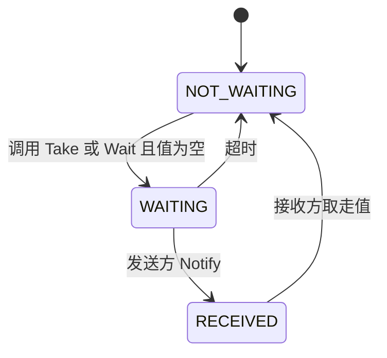
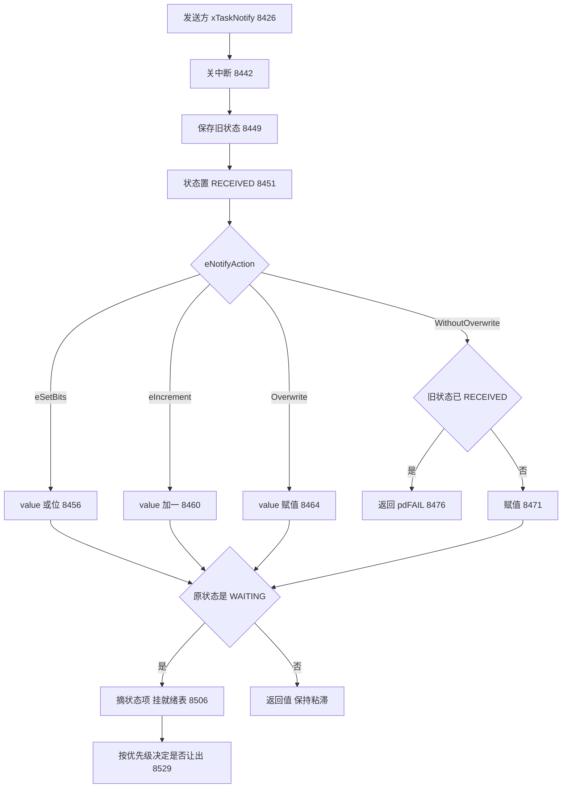
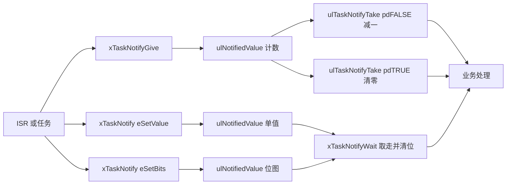

# 任务通知 —— 轻量二值/计数/值邮箱与性能对比

> 对应源文件：`tasks.c` 的任务通知段（`ulTaskGenericNotifyTake` 起，全文件 9398 行）、`include/task.h`（共 3557 行）
>
> **前置阅读：** [tasks.md](tasks.md)（TCB 与阻塞链表）、[queue.md](queue.md)（对照队列实现）
> **选型对比：** [event_groups_vs_queue.md](event_groups_vs_queue.md)、[semphr.md](semphr.md)
>
> 行号以本仓库当前文件为准。

---

# 第一部分：它到底是什么

## 1.1 一句话

**任务通知 = 直接往目标任务 TCB 里写一个 32 位值 + 一个状态字节，并在需要时把它从阻塞表摘出来。**

没有独立的"通知对象"：不 malloc、不建链表、不需要句柄。发送方只需要**目标任务句柄**。

## 1.2 TCB 里的两个字段

```c
volatile uint32_t ulNotifiedValue[ configTASK_NOTIFICATION_ARRAY_ENTRIES ]; /**< 保存任务通知值。 */
volatile uint8_t ucNotifyState[ configTASK_NOTIFICATION_ARRAY_ENTRIES ]; /**< 保存任务通知状态。 */
```

（tasks.c:486-487，逐字）

| 字段 | 宽度 | 含义 |
|---|---|---|
| `ulNotifiedValue[i]` | 4 字节 × N | 通知值/计数/位图 |
| `ucNotifyState[i]` | 1 字节 × N | 三态：未等待/等待中/已收到 |

`configTASK_NOTIFICATION_ARRAY_ENTRIES` 默认 1（include/FreeRTOS.h:2833-2834），即每个任务默认只有**一个**通知槽。多槽用于"同一任务等待多种事件"。

**内存代价：** 每任务多 `5 × N` 字节；对比约 80 字节的 `Queue_t` 省一个数量级。

## 1.3 三个状态

```c
#define taskNOT_WAITING_NOTIFICATION              ( ( uint8_t ) 0 ) /* 必须为 0，因为它是初始化值。 */
#define taskWAITING_NOTIFICATION                  ( ( uint8_t ) 1 )
#define taskNOTIFICATION_RECEIVED                 ( ( uint8_t ) 2 )
```

（tasks.c:151-153，逐字）

状态机是理解通知的关键：



**"RECEIVED" 是粘滞的**：发送方在接收方还没等待时就发了通知，值会留在 `ulNotifiedValue` 里，状态置 `RECEIVED`；接收方下次调用会立刻拿到——这就是"通知不会丢"的实现方式（对比信号量：未被 take 的 give 会累加计数，但二值信号量会合并）。

## 1.4 五种动作（`eNotifyAction`）

```c
typedef enum
{
    eNoAction = 0,            /* 通知任务，但不更新其通知值。 */
    eSetBits,                 /* 设置任务通知值中的位。 */
    eIncrement,               /* 递增任务的通知值。 */
    eSetValueWithOverwrite,   /* 将任务的通知值设置为指定值，即使任务尚未读取先前值。 */
    eSetValueWithoutOverwrite /* 仅在任务已读取先前值的情况下设置任务的通知值。 */
} eNotifyAction;
```

（include/task.h:128-135，逐字）

| 动作 | 效果 | 典型用途 |
|---|---|---|
| `eNoAction` | 只唤醒，不改值 | 纯同步（"起来干活"） |
| `eSetBits` | `value |= ulValue` | 事件位（一个通知承载 32 个事件） |
| `eIncrement` | `value++` | 计数信号量 |
| `eSetValueWithOverwrite` | `value = ulValue` | 值邮箱（最新值覆盖） |
| `eSetValueWithoutOverwrite` | 仅当旧值已被取走才写 | 有背压的邮箱（失败返回 `pdFAIL`） |

## 1.5 API 全表

| API | 定义/实现 | 映射到 |
|---|---|---|
| `xTaskNotify(h, v, action)` | task.h:2557 | `xTaskGenericNotify` |
| `xTaskNotifyIndexed(h, idx, v, action)` | task.h:2559 | 同上（多槽） |
| `xTaskNotifyAndQuery` | task.h:2582 | 带旧值输出 |
| `xTaskNotifyFromISR` | task.h:2687 | `xTaskGenericNotifyFromISR` |
| `xTaskNotifyGive(h)` | task.h:2873 | `xTaskNotify(h, 0, eIncrement)` |
| `xTaskNotifyGiveIndexed` | task.h:2875 | 多槽版 |
| `xTaskNotifyWait(clrIn, clrOut, pval, t)` | task.h:2806 | `xTaskGenericNotifyWait` |
| `ulTaskNotifyTake(clearOnExit, t)` | task.h:3034 | `ulTaskGenericNotifyTake` |
| `xTaskNotifyStateClear(h)` | task.h:3089 | `xTaskGenericNotifyStateClear` |
| `ulTaskNotifyValueClear(h, bits)` | task.h:3091 附近 | `ulTaskGenericNotifyValueClear` |

实现位置：`ulTaskGenericNotifyTake` tasks.c:8200、`xTaskGenericNotifyWait` tasks.c:8305、`xTaskGenericNotify` tasks.c:8426、`xTaskGenericNotifyFromISR` tasks.c:8548、状态清除 tasks.c:8865、值清除 tasks.c:8905。

---

# 第二部分：发送路径

## 2.1 核心 20 行

```c
ucOriginalNotifyState = pxTCB->ucNotifyState[ uxIndexToNotify ];

pxTCB->ucNotifyState[ uxIndexToNotify ] = taskNOTIFICATION_RECEIVED;

switch( eAction )
{
    case eSetBits:
        pxTCB->ulNotifiedValue[ uxIndexToNotify ] |= ulValue;
        break;

    case eIncrement:
        ( pxTCB->ulNotifiedValue[ uxIndexToNotify ] )++;
        break;

    case eSetValueWithOverwrite:
        pxTCB->ulNotifiedValue[ uxIndexToNotify ] = ulValue;
        break;

    case eSetValueWithoutOverwrite:

        if( ucOriginalNotifyState != taskNOTIFICATION_RECEIVED )
        {
            pxTCB->ulNotifiedValue[ uxIndexToNotify ] = ulValue;
        }
        else
        {
            /* 无法将值写入该任务。 */
            xReturn = pdFAIL;
        }
        break;
```

（tasks.c:8449-8477，节选逐字）

**注意顺序：** 先把状态置 `RECEIVED`，再改值。这样即使 `eSetValueWithoutOverwrite` 失败返回 `pdFAIL`，状态也已经是 `RECEIVED`——但值没变。严格说这是一个可观察的副作用：发送失败仍会把"已收到"标志置上，接收方下一次 wait 会立刻返回 `pdTRUE`（拿到旧值）。

## 2.2 唤醒阻塞者

```c
if( ucOriginalNotifyState == taskWAITING_NOTIFICATION )
{
    listREMOVE_ITEM( &( pxTCB->xStateListItem ) );
    prvAddTaskToReadyList( pxTCB );

    /* 该任务不应位于事件链表中。 */
    configASSERT( listLIST_ITEM_CONTAINER( &( pxTCB->xEventListItem ) ) == NULL );
    ...
    taskYIELD_ANY_CORE_IF_USING_PREEMPTION( pxTCB );
}
```

（tasks.c:8504-8529，节选逐字）

只摘 `xStateListItem`（延时/挂起表），不碰 `xEventListItem`——通知等待不挂事件链表，断言它必须为空。这比队列唤醒少一次链表操作。

## 2.3 ISR 版本

`xTaskGenericNotifyFromISR`（tasks.c:8548）逻辑相同，差异：

- 用 `portSET_INTERRUPT_MASK_FROM_ISR` / `portCLEAR_INTERRUPT_MASK_FROM_ISR` 而不是 `taskENTER_CRITICAL`；
- 不直接 `portYIELD`，而是把 `*pxHigherPriorityTaskWoken = pdTRUE` 交给调用者，由 `portYIELD_FROM_ISR()` 在中断退出前统一触发。

---

# 第三部分：接收路径

## 3.1 `ulTaskNotifyTake`：二值/计数二合一

```c
if( ( pxCurrentTCB->ulNotifiedValue[ uxIndexToWaitOn ] == 0U ) && ( xTicksToWait > ( TickType_t ) 0 ) )
{
    vTaskSuspendAll();
    {
        taskENTER_CRITICAL();
        {
            /* 仅当通知计数尚未非零时才阻塞。 */
            if( pxCurrentTCB->ulNotifiedValue[ uxIndexToWaitOn ] == 0U )
            {
                /* 将此任务标记为正在等待任务通知。 */
                pxCurrentTCB->ucNotifyState[ uxIndexToWaitOn ] = taskWAITING_NOTIFICATION;

                /* 安排等待任务通知。 */
                xShouldBlock = pdTRUE;
            }
        }
        taskEXIT_CRITICAL();

        if( xShouldBlock == pdTRUE )
        {
            prvAddCurrentTaskToDelayedList( xTicksToWait, pdTRUE );
        }
    }
    xAlreadyYielded = xTaskResumeAll();
```

（tasks.c:8228-8234，节选逐字）

取走时的两种语义（tasks.c:8275-8284）：

```c
if( ulReturn != 0U )
{
    if( xClearCountOnExit != pdFALSE )
    {
        pxCurrentTCB->ulNotifiedValue[ uxIndexToWaitOn ] = ( uint32_t ) 0U;
    }
    else
    {
        pxCurrentTCB->ulNotifiedValue[ uxIndexToWaitOn ] = ulReturn - ( uint32_t ) 1;
    }
}
```

| `xClearCountOnExit` | 行为 | 等价于 |
|---|---|---|
| `pdTRUE` | 取走后清零 | **二值信号量**（多次 give 合并为 1） |
| `pdFALSE` | 取走后减一 | **计数信号量**（每次 give 都算数） |

**返回值是取走前的计数**，所以可以用 `if( ulTaskNotifyTake(pdFALSE, 0) > 0 )` 做非阻塞批量消费。

## 3.2 `xTaskNotifyWait`：值邮箱

```c
pxCurrentTCB->ulNotifiedValue[ uxIndexToWaitOn ] &= ~ulBitsToClearOnEntry;
...
pxCurrentTCB->ucNotifyState[ uxIndexToWaitOn ] = taskWAITING_NOTIFICATION;
```

（tasks.c:8340-8343，逐字）

- `ulBitsToClearOnEntry`：进入等待前清掉哪些位（`0xFFFFFFFF` = 清空整个值）。
- `ulBitsToClearOnExit`：成功返回前清掉哪些位。
- `pulNotificationValue`：输出取到的值（在清零**之前**拷贝，tasks.c:8391）。

**典型用法（值邮箱）：**

```c
uint32_t value;
if( xTaskNotifyWait( 0, 0xFFFFFFFF, &value, portMAX_DELAY ) == pdTRUE )
{
    /* value 是最新一次 eSetValueWithOverwrite 写入的值 */
}
```

`0` 作为 entry 清除位 = 保留旧值；`0xFFFFFFFF` 作为 exit 清除位 = 取走后清空。

## 3.3 超时判定

`xTaskNotifyWait` 的返回值（tasks.c:8398-8410）：

```c
if( pxCurrentTCB->ucNotifyState[ uxIndexToWaitOn ] != taskNOTIFICATION_RECEIVED )
{
    /* 未收到通知。 */
    xReturn = pdFALSE;
}
else
{
    pxCurrentTCB->ulNotifiedValue[ uxIndexToWaitOn ] &= ~ulBitsToClearOnExit;
    xReturn = pdTRUE;
}
```

**关键：判据是 `ucNotifyState`，不是值。** 所以即使通知值是 0，`eSetValueWithOverwrite(0)` 也能让 wait 返回 `pdTRUE`。这解决了"0 是有效值还是超时"的歧义。

---

# 第四部分：三种模式与性能

## 4.1 模式一：轻量二值信号量

```c
xTaskNotifyGive( xWorker );                    /* 发送方，ISR 用 vTaskNotifyGiveFromISR */
ulTaskNotifyTake( pdTRUE, portMAX_DELAY );     /* 接收方，取走即清零 */
```

语义：多次 give 只算一次；接收方每次 take 清零。**与二值信号量等价，但省一个 `Queue_t`。**

## 4.2 模式二：轻量计数信号量

```c
/* 发送方 */
xTaskNotifyGive( xWorker );

/* 接收方：每次处理一个，计数减一 */
while( ulTaskNotifyTake( pdFALSE, 0 ) > 0 )
{
    process_one();
}
```

**上限是 `UINT32_MAX`**，不会像计数信号量那样在 `uxMaxCount` 处返回 `errQUEUE_FULL`。代价是**没有背压**：生产过快时计数会一直涨，消费方永远追不上。

## 4.3 模式三：值邮箱 / 事件位

| 需求 | 发送 | 接收 |
|---|---|---|
| 只要最新值 | `eSetValueWithOverwrite` | `xTaskNotifyWait(0, 0xFFFFFFFF, &v, t)` |
| 不覆盖未读值 | `eSetValueWithoutOverwrite` | 同上，检查 `pdFAIL` |
| 事件位/纯唤醒 | `eSetBits` / `eNoAction` | 自行判位 / `xTaskNotifyWait(0, 0, NULL, t)` |

**事件位与事件组的区别：** 通知的位图**没有"等待所有位/任意位"的内核支持**，需要接收方自己 `(value & mask) == mask` 判断；事件组有 `xWaitForAllBits` 参数。32 位也不够时用事件组。

## 4.4 性能对比（Cortex-M4F @ 168 MHz，数量级估算）

| 操作 | 队列/信号量 | 任务通知 | 差异来源 |
|---|---|---|---|
| 对象内存 | 约 80 字节 `Queue_t` | 0（TCB 内 5 字节） | 无独立对象 |
| 发送（无等待者） | 关中断 + 队列结构 + 可选 memcpy | 关中断 + 2 个字段 | 少一次结构体访问与 memcpy |
| 发送（有等待者） | 摘事件项 + 摘状态项 + 就绪表 | 摘状态项 + 就绪表 | 少一次链表删除 |
| 接收（非阻塞） | 读计数 + memcpy | 读 32 位值 + 清状态 | 少 memcpy |
| ISR 发送 | 需 `FromISR` + 队列锁 | 需 `FromISR`，无队列锁 | 无 `cTxLock` 记账 |
| 多等待者 | 支持 | **不支持** | 通知是"点对点" |
| 优先级继承 | 互斥量支持 | 不支持 | 通知没有持有者概念 |

**实测建议：** 中断→任务的单值传递优先用通知；需要缓冲多条数据、多消费者、或需要优先级继承时再用队列/信号量。

## 4.5 通知执行流



## 4.6 三种模式的数据流



---

# 第五部分：陷阱与边界

## 5.1 八个高频陷阱

| # | 陷阱 | 后果 | 正确做法 |
|---|---|---|---|
| 1 | 两个任务都等同一个目标任务的通知 | 只有一个能收到；另一个永远阻塞 | 通知是点对点，多消费者用队列 |
| 2 | 用 `eSetValueWithoutOverwrite` 但不检查返回值 | 静默丢值 | 检查 `pdFAIL`，或改 Overwrite |
| 3 | 以为通知值 0 等于"没通知" | 用 0 做有效值时误判超时 | 看 `xTaskNotifyWait` 返回值，不看值 |
| 4 | ISR 里用 `xTaskNotify` | 断言/崩溃 | `xTaskNotifyFromISR` + `portYIELD_FROM_ISR` |
| 5 | 多槽索引越界 | `configASSERT( uxIndex < configTASK_NOTIFICATION_ARRAY_ENTRIES )` | 索引 < 配置值 |
| 6 | 用通知做互斥 | 无优先级继承，优先级反转 | 用互斥量 |
| 7 | 发送方在中断里高频 `eIncrement` | 计数溢出回绕（无背压） | 计数信号量或丢帧策略 |
| 8 | 任务删除后仍被通知 | 野指针写 TCB | 删除前确保无人持有句柄 |

## 5.2 与其它机制的能力矩阵

| 能力 | 任务通知 | 二值信号量 | 计数信号量 | 队列 | 事件组 |
|---|---|---|---|---|---|
| 独立对象 | 否 | 是 | 是 | 是 | 是 |
| 缓冲多个值 | 否（单值） | 否 | 是（计数） | 是 | 位图 |
| 多等待者 | 否 | 是 | 是 | 是 | 是 |
| ISR 发送 | 是 | 是 | 是 | 是 | 是（延迟处理） |
| 优先级继承 | 否 | 否 | 否 | 互斥量有 | 否 |
| 超时 | 是 | 是 | 是 | 是 | 是 |

## 5.3 读码路径

1. `tasks.c:151-153` + `486-487` —— 状态与字段，建立数据模型。
2. `tasks.c:8426-8541` —— 发送：五种动作 + 唤醒；`8548-8725` 对照 ISR 版。
3. `tasks.c:8200-8295` —— Take：阻塞、清零/减一；`8305-8419` 看 Wait 的清位与超时判定。
4. `include/task.h:2557-3091` —— 宏映射，确认所有 API 落到 5 个 Generic 函数。
