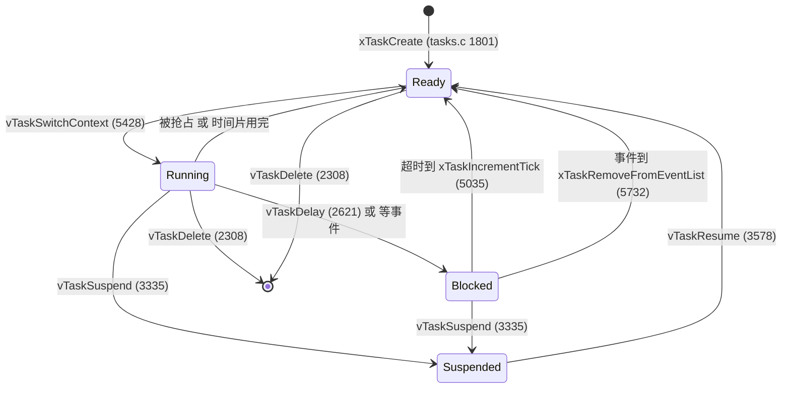
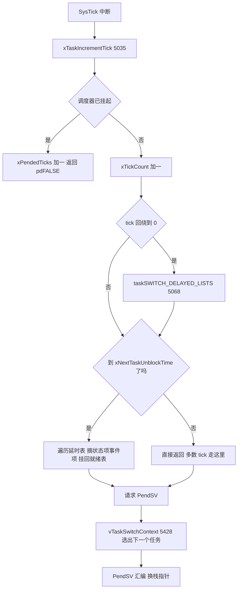
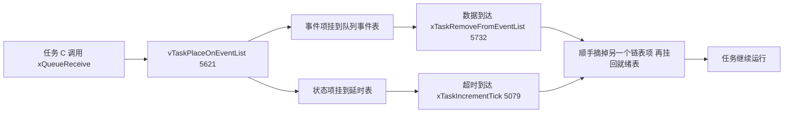

# tasks.c 与 task.h —— FreeRTOS 任务管理与调度器完全解读

> 对应源文件（本地仓库 `~/workspace/freertos/`，FreeRTOS-Kernel V11.1.0+，行号以当前文件为准）：
> - [tasks.c](/Users/theo-richard/workspace/freertos/tasks.c)（9294 行）—— 任务管理与调度器实现，内核里最大的一个文件
> - [include/task.h](/Users/theo-richard/workspace/freertos/include/task.h)（3557 行）—— TCB 句柄类型、状态枚举、**全部任务 API 声明**、临界区/让出宏
>
> **前置阅读：** [list.md](list.md)。tasks.c 里所有"排队"都是 list.c 的链表，没读 list.md 直接看 tasks.c 会一头雾水。
> 配置项含义见 [freertosconfigh.md](freertosconfigh.md)。

---

# 第一部分：先掌握什么、按什么顺序读

## 1.1 这个文件到底是什么

**一句话：`tasks.c` 就是"谁能上 CPU、什么时候上、上多久、下去之后排到哪里"的全部规则实现。**

它是 FreeRTOS 的心脏。queue.c、timers.c、event_groups.c 全都建立在它之上——
它们调用 `vTaskPlaceOnEventList()` 让任务睡下，调用 `xTaskRemoveFromEventList()` 把任务唤醒，
真正的"睡"和"醒"都在 tasks.c 里完成。

**文件结构（先有个地图，不要一上来就读）：**

| 行号范围 | 内容 | 要不要细读 |
|---|---|---|
| 30-56 | 中文导读注释（作者写的阅读路线） | 先读 |
| 58-~800 | 头文件包含、大量 `#define` 内部宏、内部函数声明 | 掠过，用到再回查 |
| ~800-1200 | 内部函数声明区 | 掠过 |
| 424-510 | **TCB 结构体** | **精读** |
| 512-598 | **全局关键变量** | **精读** |
| 1381 / 1801 | `xTaskCreateStatic` / `xTaskCreate` | 精读 |
| 1876 | `prvInitialiseNewTask` | 精读 |
| 2124 | `prvAddNewTaskToReadyList` | 精读 |
| 2308 | `vTaskDelete` | 精读 |
| 2523 / 2621 | `xTaskDelayUntil` / `vTaskDelay` | 精读 |
| 2965 / 2810 | `vTaskPrioritySet` / `uxTaskPriorityGet` | 精度 |
| 3335 / 3578 | `vTaskSuspend` / `vTaskResume` | 精度 |
| 3898 | `vTaskStartScheduler` | **精读** |
| 4061 / 4244 | `vTaskSuspendAll` / `xTaskResumeAll` | 精读 |
| 5035 | **`xTaskIncrementTick`（tick 中断里跑）** | **最精读** |
| 5428 | **`vTaskSwitchContext`（PendSV 里跑）** | **最精读** |
| 5621-5899 | 事件唤醒相关（`vTaskPlaceOnEventList`、`xTaskRemoveFromEventList`） | 精读 |
| 6146 | `prvIdleTask`（空闲任务） | 精度 |
| 6424 / 6458 | `prvInitialiseTaskLists` / `prvCheckTasksWaitingTermination` | 精度 |
| 6887 | `prvResetNextTaskUnblockTime` | 精读 |
| 7013-7335 | 优先级继承/恢复（互斥量用） | 有需要再看 |
| 9002 | `prvAddCurrentTaskToDelayedList` | **精读** |
| 9000+ | 统计/格式化函数（`vTaskList` 等） | 跳过 |

> **不要从头读到尾。** tasks.c 有 9000 行，大量内容是 SMP、MPU、统计等条件编译分支，
> 以及每个 API 前面几百行的英文 Doxygen 注释（写在 task.h 里，tasks.c 里是精简版）。
> 按 1.3 的路线走，2-3 小时能读透主线。

## 1.2 必须提前搞懂的 7 个概念

读 tasks.c 之前，这 7 个概念必须先立住，否则每个函数你都只能"看懂字面"：

### 概念 1：TCB（任务控制块）—— 任务的身份证

每个任务一个 `TCB_t`（tasks.c:424-504，`typedef tskTCB TCB_t` 在 tasks.c:510）。
它不是任务的"栈"，而是任务的**档案袋**：

```c
pxTopOfStack    // 栈顶指针——上下文切换就是保存/恢复它
xStateListItem  // 状态链表项：挂在 就绪/延时/挂起 哪条链上
xEventListItem  // 事件链表项：挂在队列/事件组的事件链上（等待某个资源时）
uxPriority      // 优先级
pxStack         // 栈底地址
pcTaskName[]    // 名字（仅为调试方便）
```

**关键洞察：同一个任务的两个链表项可能同时挂在两条不同的链表上。**
例：任务调用 `xQueueReceive` 阻塞时，`xStateListItem` 挂在**延时表**（等超时），
`xEventListItem` 挂在**队列的事件表**（等数据）。两个"闹钟"哪个先响都能把它叫醒。

### 概念 2：任务栈 —— 上下文就存在这里

每个任务有自己的栈（`pvPortMallocStack` 分配，tasks.c:1731/1749）。
上下文切换时，CPU 寄存器压到当前任务的栈上，再把栈指针（`pxTopOfStack`）存进 TCB。
所以"切换任务"本质就是**换一个栈指针**。

栈大小单位是**字不是字节**（`configMINIMAL_STACK_SIZE` 也是字），这是新手最常踩的坑。

### 概念 3：五状态模型

| 状态 | 在哪个链表上 | 何时进入 |
|---|---|---|
| **Running 运行** | 就绪表的那个优先级表里 | 被调度器选中，`pxCurrentTCB` 指向它 |
| **Ready 就绪** | `pxReadyTasksLists[优先级]` | 创建时、被唤醒时、被抢占时 |
| **Blocked 阻塞** | 延时表 + 事件表 | `vTaskDelay` 或等队列/信号量/事件 |
| **Suspended 挂起** | `xSuspendedTaskList` | `vTaskSuspend`（只能被 `vTaskResume` 叫醒，等多久都没用） |
| **Deleted 删除** | `xTasksWaitingTermination` | `vTaskDelete` 后，等空闲任务回收内存 |

注意：**Running 和 Ready 在链表结构上是同一个位置**——运行中的任务仍然躺在就绪表里，
只是 `pxCurrentTCB` 指向它。`eTaskGetState()` 靠"是不是 pxCurrentTCB"来区分这两者（tasks.c:2672）。

### 概念 4：优先级 —— 数字越大优先级越高

- 范围 `0 ~ configMAX_PRIORITIES-1`，`0` 最低，`tskIDLE_PRIORITY` = 0；
- 调度器**永远选最高优先级**的就绪任务；
- 只有所有高优先级任务都阻塞/挂起，低优先级任务才轮得到；
- 同优先级的多个任务才谈"时间片轮转"。

### 概念 5：优先级位图 —— O(1) 找最高优先级

`uxTopReadyPriority`（tasks.c:561）记录"当前最高的有就绪任务的优先级"。
找最高优先级就绪任务时，从它开始往下找，不做全表扫（tasks.c:240-255）。
开 `configUSE_PORT_OPTIMISED_TASK_SELECTION=1` 时用 CLZ 指令（tasks.c:283-291），更快。

### 概念 6：双延时表 —— 防 tick 计数回绕

`pxDelayedTaskList` 和 `pxOverflowDelayedTaskList`（tasks.c:533-534）两张表轮换：
- 唤醒时刻还没溢出 → 进**当前延时表**；
- 唤醒时刻已溢出（跨过 TickType 最大值）→ 进**溢出表**；
- tick 计数回绕到 0 时，`taskSWITCH_DELAYED_LISTS()`（tasks.c:315-327）把两张表**交换**。

这样一个简单的"两张表轮换"就解决了 32 位 tick 计数的回绕问题，不用做复杂判断。
`xNextTaskUnblockTime` 缓存"最早的唤醒时刻"，tick 中断里先和它比，**大部分 tick 直接跳过延时表处理**——这是性能关键。

### 概念 7：调度器挂起（uxSchedulerSuspended）≠ 关中断

`vTaskSuspendAll()`（tasks.c:4061）只是让调度器**不做切换**，中断照常响应（更准确地说是中断照常可以跑，
但不能碰 TCB 的状态链表项）。它和临界区是两回事：

| | 临界区 `taskENTER_CRITICAL()` | 挂起调度器 `vTaskSuspendAll()` |
|---|---|---|
| 中断 | 按优先级屏蔽（BASEPRI） | 正常响应 |
| 能否切换任务 | 不能 | 不能 |
| 嵌套 | 支持 | 支持（计数） |
| 使用场景 | 极短的链表操作 | 较长的操作（如 malloc） |

## 1.3 推荐阅读顺序（6 站，按这个顺序读）

```text
┌─ 第 1 站：数据结构 ────────────────────────────────────────────────
│  TCB 结构体 (424-504) + 全局变量 (512-598)
│  目标：每个字段干什么；pxCurrentTCB 就是"当前谁在跑"
└────────────────────────────────────────────────────────────────────
                          │
                          ▼
┌─ 第 2 站：内部宏 ──────────────────────────────────────────────────
│  prvAddTaskToReadyList (335)
│  taskSELECT_HIGHEST_PRIORITY_TASK (240 通用版 / 283 优化版)
│  taskSWITCH_DELAYED_LISTS (315)
│  目标：这三条宏是调度器的"动作词汇"，后面所有函数都在用它们
└────────────────────────────────────────────────────────────────────
                          │
                          ▼
┌─ 第 3 站：任务出生 ────────────────────────────────────────────────
│  xTaskCreate (1801)
│    → prvCreateTask (1696)
│    → prvInitialiseNewTask (1876)
│    → prvAddNewTaskToReadyList (2124)
│  目标：看清"分配 TCB+栈 → 填字段 → 伪造初始栈帧 → 挂进就绪表"
└────────────────────────────────────────────────────────────────────
                          │
                          ▼
┌─ 第 4 站：调度器启动 ──────────────────────────────────────────────
│  vTaskStartScheduler (3898)
│    → 创建空闲任务 / 定时器任务
│    → xPortStartScheduler()（进 port 层，见 port.c）
│  目标：明白启动前必须至少有一个任务；启动后 main() 的栈被"借走"
└────────────────────────────────────────────────────────────────────
                          │
                          ▼
┌─ 第 5 站：运行期两大入口（核心中的核心）──────────────────────────
│  ① xTaskIncrementTick (5035)   ← 每个 SysTick 中断调用
│        "时间在走：谁该醒了"
│  ② vTaskSwitchContext (5428)   ← 每次 PendSV 中断调用
│        "选下一个：谁该跑"
│  目标：这两个函数吃透，调度器就懂了 80%
└────────────────────────────────────────────────────────────────────
                          │
                          ▼
┌─ 第 6 站：任务的"上下车" ──────────────────────────────────────────
│  下车：vTaskDelay (2621) / xTaskDelayUntil (2523)
│         → prvAddCurrentTaskToDelayedList (9002)
│  上车：xTaskRemoveFromEventList (5732) / tick 到期分支 (5079 起)
│  其他：vTaskSuspend (3335) / vTaskResume (3578) / vTaskDelete (2308)
│  挂起调度器：vTaskSuspendAll (4061) / xTaskResumeAll (4244)
│  目标：任务怎么离开 CPU、怎么回到 CPU，形成闭环
└────────────────────────────────────────────────────────────────────
```

**读完之后再看：** 空闲任务 `prvIdleTask`（6146）、优先级继承（7013-7335）、
统计接口（9000+）——这些是边角料，不影响理解主干。

---

# 第二部分：详细讲解

## 2.1 TCB 结构体（tasks.c:424-504）

按重要性排序，前面几个字段必记：

| 字段 | 行号 | 作用 | 谁改它 |
|---|---|---|---|
| `pxTopOfStack` | 426 | **栈顶**。上下文切换保存/恢复的就是它。**必须是结构体第一个成员**（汇编里用固定偏移访问） | PendSV 切换代码 |
| `xMPUSettings` | 429 | MPU 区域配置（仅 MPU port） | — |
| `uxCoreAffinityMask` | 433 | 绑核掩码（仅 SMP + 亲和性） | `vTaskCoreAffinitySet` |
| `xStateListItem` | 436 | **状态链表项**：挂在就绪/延时/挂起表的那个 | list.c 的插入/删除函数 |
| `xEventListItem` | 437 | **事件链表项**：等队列/信号量时挂在事件表 | 同上 |
| `uxPriority` | 438 | 当前优先级（0 最低） | `vTaskPrioritySet`、优先级继承 |
| `pxStack` | 439 | 栈起始地址（用于算栈使用量、释放） | 创建时 |
| `pcTaskName[]` | 444 | 任务名，长度 `configMAX_TASK_NAME_LEN`（含 `\0`） | 创建时 |
| `uxBasePriority` | 464 | **基础优先级**（优先级继承用：被继承时 `uxPriority` 升高，`uxBasePriority` 不动） | 继承/恢复时 |
| `uxMutexesHeld` | 465 | 当前持有的互斥量数量 | 互斥量代码 |
| `ulNotifiedValue[]` | 485 | 任务通知值数组 | 通知 API |
| `ucDelayAborted` | 498 | 延时是否被 `xTaskAbortDelay` 打断 | `xTaskAbortDelay` |

**为什么 `pxTopOfStack` 必须是第一个成员：** 移植层的 PendSV 汇编代码在保存/恢复上下文时，
用 `pxCurrentTCB` 加固定偏移（0）访问栈顶指针。如果它在结构体中间，汇编就得知道偏移量，
那移植层就和内核结构强耦合了。同理 `xMPUSettings` 必须是第二个（MPU port 用）。

**条件编译字段说明：** 大量字段被 `#if` 包着（SMP、MPU、互斥量、统计、通知……）。
当前模板配置（`configNUMBER_OF_CORES=1`、`configUSE_MUTEXES=1`、`configUSE_TASK_NOTIFICATIONS=1`）下，
实际生成的 TCB 只包含其中一部分。看代码时不用管被条件编译掉的字段。

## 2.2 全局关键变量（tasks.c:512-598）

这些是"调度器的全局状态"，理解了它们就看懂了一半：

| 变量 | 行号 | 含义 | 谁改 |
|---|---|---|---|
| `pxCurrentTCB` | 516 | **当前正在运行的任务**。唯一权威，切换任务就是改它 | `taskSELECT_HIGHEST_PRIORITY_TASK`、创建/删除时 |
| `pxReadyTasksLists[]` | 530 | 就绪表数组，**每个优先级一条** | `prvAddTaskToReadyList`、`uxListRemove` |
| `pxDelayedTaskList` | 533 | 当前延时表指针 | `taskSWITCH_DELAYED_LISTS`、`prvAddCurrentTaskToDelayedList` |
| `pxOverflowDelayedTaskList` | 534 | 溢出延时表指针 | 同上 |
| `xPendingReadyList` | 535 | 调度器挂起期间被唤醒的任务暂存这里 | `xTaskRemoveFromEventList` |
| `xSuspendedTaskList` | 546 | 挂起任务表 | `vTaskSuspend`/`vTaskResume` |
| `xTasksWaitingTermination` | 539 | 已删除待回收的任务 | `vTaskDelete`、空闲任务 |
| `uxCurrentNumberOfTasks` | 559 | 当前任务总数（含空闲任务） | 创建/删除 |
| `xTickCount` | 560 | **tick 计数**，系统时间的唯一来源 | `xTaskIncrementTick` |
| `uxTopReadyPriority` | 561 | 最高就绪优先级（位图/缓存） | `taskRECORD_READY_PRIORITY` |
| `xSchedulerRunning` | 562 | 调度器是否已启动 | `vTaskStartScheduler` |
| `xPendedTicks` | 563 | 挂起期间"欠下"的 tick 数 | `xTaskIncrementTick`、`xTaskResumeAll` |
| `xYieldPendings[]` | 564 | 每核是否有待处理的切换请求 | 各种唤醒路径 |
| `xNumOfOverflows` | 565 | tick 计数回绕次数 | 换表时 +1 |
| `uxTaskNumber` | 566 | 任务编号计数器 | 创建时 +1 |
| `xNextTaskUnblockTime` | 567 | **最早唤醒时刻缓存**。tick 中断先用它做快速判断 | `prvResetNextTaskUnblockTime` |
| `xIdleTaskHandles[]` | 568 | 空闲任务句柄 | 启动时 |
| `uxSchedulerSuspended` | 587 | 调度器挂起计数（0=未挂起） | `vTaskSuspendAll`/`xTaskResumeAll` |

**`xNextTaskUnblockTime` 为什么关键：** 没有它，每个 tick 都要遍历延时表找到期任务（O(n)）。
有了它，tick 中断只需一次比较 `xConstTickCount >= xNextTaskUnblockTime`（tasks.c:5079），
**绝大多数 tick 直接返回**，只有真要唤醒任务时才动链条。这就是 FreeRTOS tick 中断极短的原因。

## 2.3 三条核心内部宏（调度器的"动作词汇"）

### 2.3.1 `prvAddTaskToReadyList(pxTCB)`（tasks.c:335-341）

```c
traceMOVED_TASK_TO_READY_STATE( pxTCB );
taskRECORD_READY_PRIORITY( ( pxTCB )->uxPriority );                                       // 更新最高优先级缓存
listINSERT_END( &( pxReadyTasksLists[ ( pxTCB )->uxPriority ] ), &( ( pxTCB )->xStateListItem ) );
tracePOST_MOVED_TASK_TO_READY_STATE( pxTCB );
```

**就三步：记优先级 → O(1) 插到该优先级就绪表末尾 → 追踪钩子。**
所有"让任务变成就绪"的路径都最终走这里，是整个内核出现频率最高的操作。

### 2.3.2 `taskSELECT_HIGHEST_PRIORITY_TASK()`（tasks.c:240-255 / 283-291）

通用版（tasks.c:240）：

```c
UBaseType_t uxTopPriority = uxTopReadyPriority;
while( listLIST_IS_EMPTY( &( pxReadyTasksLists[ uxTopPriority ] ) ) != pdFALSE )
{
    configASSERT( uxTopPriority );
    --uxTopPriority;                       // 从缓存值往下找
}
listGET_OWNER_OF_NEXT_ENTRY( pxCurrentTCB, &( pxReadyTasksLists[ uxTopPriority ] ) );
uxTopReadyPriority = uxTopPriority;
```

移植优化版（tasks.c:283）用 `portGET_HIGHEST_PRIORITY`（CLZ 指令）一步算出最高优先级，
所以 `configUSE_PORT_OPTIMISED_TASK_SELECTION=1` 时是真正的 O(1)，通用版最坏 O(configMAX_PRIORITIES)。

两条路径最后都用 list.md 里讲过的 `listGET_OWNER_OF_NEXT_ENTRY`
—— **`pxIndex` 游标轮转，这就是同优先级时间片轮转的实现处**。

### 2.3.3 `taskSWITCH_DELAYED_LISTS()`（tasks.c:315-327）

```c
configASSERT( listLIST_IS_EMPTY( pxDelayedTaskList ) );   // 换表时当前表必须已空
pxTemp = pxDelayedTaskList;
pxDelayedTaskList = pxOverflowDelayedTaskList;
pxOverflowDelayedTaskList = pxTemp;
xNumOfOverflows = ( BaseType_t ) ( xNumOfOverflows + 1 );
prvResetNextTaskUnblockTime();
```

在 tick 计数回绕到 0 时调用（tasks.c:5068），实现"双表防回绕"。

## 2.4 任务创建：`xTaskCreate`（tasks.c:1801）全流程

这是理解 tasks.c 最好的入口，因为它是唯一"从零造出一个任务"的地方。

```text
xTaskCreate( tasks.c:1801 )
   │
   ├─ pxNewTCB = prvCreateTask(...)                    tasks.c:1813
   │     │
   │     ├─ pvPortMalloc( sizeof( TCB_t ) )            分配 TCB
   │     ├─ pvPortMallocStack( uxStackDepth * sizeof(StackType_t) )   tasks.c:1731/1749
   │     │     └─ 分配失败 → vPortFreeStack( pxStack ) 回滚  tasks.c:1772
   │     ├─ prvInitialiseNewTask( ... )                tasks.c:1867 左右
   │     │     ├─ memset 清零 TCB
   │     │     ├─ 复制任务名（截断到 configMAX_TASK_NAME_LEN-1）
   │     │     ├─ pxNewTCB->uxPriority = uxPriority
   │     │     ├─ pxNewTCB->uxBasePriority = uxPriority（若开互斥量）
   │     │     ├─ vListInitialiseItem( &( pxNewTCB->xStateListItem ) )   ← 状态项 pxContainer=NULL
   │     │     ├─ vListInitialiseItem( &( pxNewTCB->xEventListItem ) )
   │     │     ├─ listSET_LIST_ITEM_OWNER( &xStateListItem, pxNewTCB )  ← pvOwner 指向自己
   │     │     ├─ listSET_LIST_ITEM_VALUE( &xEventListItem, configMAX_PRIORITIES - uxPriority )
   │     │     │     └─ 值 = 最大优先级 - 优先级 → 表头是该链上优先级最高的任务
   │     │     └─ pxPortInitialiseStack( ... )         tasks.c:2044-2072
   │     │           └─ 【关键】在栈上"伪造"一个初始上下文：
   │     │              xPSR / PC=任务入口 / LR / R12-R3 / R11-R4 入栈
   │     │              第一次切换到这个任务时，CPU 从栈里恢复寄存器，
   │     │              "返回"到任务函数——所以任务函数永远不会 ret，
   │     │              退出必须调用 vTaskDelete 或直接死循环
   │     │
   │     └─ 返回 TCB 指针
   │
   ├─ 若成功 → xReturn = pdPASS
   │
   └─ prvAddNewTaskToReadyList( pxNewTCB )             tasks.c:1820 左右 / 实现 2124
         │
         ├─ taskENTER_CRITICAL()                        tasks.c:2129
         ├─ uxCurrentNumberOfTasks++
         ├─ if( pxCurrentTCB == NULL )                  tasks.c:2133
         │     ├─ pxCurrentTCB = pxNewTCB              第一个任务 → 直接成为当前任务
         │     └─ 若是第 1 个 → prvInitialiseTaskLists()  tasks.c:2147
         │           └─ 初始化所有就绪表/延时表/挂起表/待回收表
         ├─ else if( 调度器未启动 && 新任务优先级更高 )  tasks.c:2160
         │     └─ pxCurrentTCB = pxNewTCB              启动前也按优先级选当前任务
         ├─ uxTaskNumber++
         ├─ prvAddTaskToReadyList( pxNewTCB )           tasks.c:2187  ← 挂进就绪表
         └─ taskEXIT_CRITICAL()
              └─ if( 调度器已运行 && 新任务优先级更高 ) → 立即让出  tasks.c:2199
```

**三个必须记住的细节：**

1. **任务函数不能 return。** `pxPortInitialiseStack` 伪造的初始栈帧里，LR 指向的是
   一个"任务退出"的钩子（移植层实现），任务函数一旦 return 就会触发断言/进入死循环。
   正常退出只有两条路：`vTaskDelete(NULL)` 或 `for(;;)`。
2. **`xEventListItem` 的值 = `configMAX_PRIORITIES - uxPriority`。**
   因为链表按值升序，所以"最大优先级"变成"最小值"→ 排最前。这样事件表的表头永远是最该被唤醒的任务。
3. **创建过程全程在临界区里。** 因为要同时改"任务数、当前任务、就绪链表"三样东西，不能被打断。

### 静态创建 `xTaskCreateStatic`（tasks.c:1381）

和 `xTaskCreate` 唯一的区别：TCB 和栈由用户提供（两个缓冲区指针），不调用 malloc。
最后一样走 `prvInitialiseNewTask` + `prvAddNewTaskToReadyList`。
适用场景：不允许动态内存、或任务数量固定想省堆。

## 2.5 调度器启动：`vTaskStartScheduler`（tasks.c:3898）

```text
vTaskStartScheduler()  tasks.c:3898
   │
   ├─ prvCreateIdleTasks()                 tasks.c:3914  自动创建空闲任务（优先级 0）
   ├─ xTimerCreateTimerTask()              tasks.c:3920  若 configUSE_TIMERS=1，创建定时器任务
   │
   ├─ 若都成功：
   │     ├─ portDISABLE_INTERRUPTS()        tasks.c:3946  关中断，防止启动过程中来 tick
   │     ├─ xNextTaskUnblockTime = portMAX_DELAY      tasks.c:3957
   │     ├─ xSchedulerRunning = pdTRUE                tasks.c:3958
   │     ├─ xTickCount = configINITIAL_TICK_COUNT     tasks.c:3959
   │     ├─ portCONFIGURE_TIMER_FOR_RUN_TIME_STATS()
   │     └─ xPortStartScheduler()           tasks.c:3981  ★ 进入移植层
   │           └─ 配置 SysTick 中断 + 启动第一个任务（汇编，见 port.c 的 prvStartFirstTask）
   │              → 第一次切换后，main() 的栈再也不会回来
   │
   └─ 若失败（堆不够）→ configASSERT( xReturn != errCOULD_NOT_ALLOCATE_REQUIRED_MEMORY )
```

**重要认知：`vTaskStartScheduler()` 正常情况下**永不返回**。**
因为启动后 CPU 一直在任务之间切换，`main()` 的栈帧被借走当第一个任务的初始栈了
（移植层的第一个任务启动汇编会切换到 `pxCurrentTCB` 的栈）。所以 `main()` 里
`vTaskStartScheduler()` 之后的代码是**死代码**。

**启动前必须至少创建一个用户任务**，否则调度器启动后只有空闲任务在跑（不报错但什么也不干）。

**空闲任务自动创建：** 即使你没写 `xTaskCreate`，`vTaskStartScheduler` 也会创建空闲任务
（`prvCreateIdleTasks`，tasks.c:607 声明），优先级 `tskIDLE_PRIORITY`（0），栈 `configMINIMAL_STACK_SIZE`。

## 2.6 tick 中断：`xTaskIncrementTick`（tasks.c:5035）—— "谁该醒了"

**这是整个内核最热的函数**，每个 tick 中断（默认 100Hz，即每 10ms）都会执行一次。

```text
xTaskIncrementTick()  tasks.c:5035
   │
   ├─ 若调度器已挂起（uxSchedulerSuspended != 0）
   │     └─ xPendedTicks++            "欠一个 tick，等恢复时补"
   │        直接返回 pdFALSE
   │
   ├─ xConstTickCount = xTickCount + 1        tasks.c:5059
   ├─ xTickCount = xConstTickCount            tasks.c:5064
   │
   ├─ if( xConstTickCount == 0 )  ← tick 计数回绕了
   │     └─ taskSWITCH_DELAYED_LISTS()        tasks.c:5068  交换两张延时表
   │
   ├─ if( xConstTickCount >= xNextTaskUnblockTime )    tasks.c:5079
   │   │   ← 只有这条成立时才需要真正动延时表（性能关键）
   │   └─ for( ;; )
   │         ├─ 若延时表为空 → xNextTaskUnblockTime = portMAX_DELAY; break
   │         ├─ pxTCB = listGET_OWNER_OF_HEAD_ENTRY( pxDelayedTaskList )    tasks.c:5101
   │         ├─ xItemValue = 该任务的唤醒时刻            （listGET_LIST_ITEM_VALUE，tasks.c:5102）
   │         ├─ if( xConstTickCount < xItemValue )
   │         │     └─ 还没到 → xNextTaskUnblockTime = xItemValue; break
   │         ├─ 到期了：
   │         │     ├─ listREMOVE_ITEM( &( pxTCB->xStateListItem ) )        tasks.c:5119
   │         │     ├─ 若任务还挂在某个事件表上（listLIST_ITEM_CONTAINER 非空，tasks.c:5123）
   │         │     │     └─ listREMOVE_ITEM( &( pxTCB->xEventListItem ) )  tasks.c:5126
   │         │     └─ prvAddTaskToReadyList( pxTCB )
   │         │           └─ 若该任务优先级高于当前任务 → xYieldRequired = pdTRUE
   │         └─ 循环继续（可能一次 tick 唤醒多个任务）
   │
   ├─ 若 configUSE_TIME_SLICING=1 且当前优先级就绪表不止一个任务
   │     └─ xSwitchRequired = pdTRUE        "同优先级该轮转了"
   │
   └─ 返回 xSwitchRequired / xYieldRequired（告诉移植层要不要 PendSV）
```

**三个设计要点：**

1. **绝大多数 tick 只走两条比较**（挂起？+ 到点？），然后返回。这是 tick 中断极短的原因。
2. **一次 tick 可能唤醒多个任务**：`for(;;)` 循环连续处理所有"到期时刻 <= 当前"的任务。
   因为延时表按唤醒时刻升序，表头就是最早的，所以检查表头就够了。
3. **唤醒 ≠ 立刻切换**：函数只是把任务挂回就绪表并返回 `pdTRUE`，
   真正的切换由移植层在中断退出时触发 PendSV 完成。

**与 list.md 的呼应：** 这里的 `listGET_OWNER_OF_HEAD_ENTRY`、`listREMOVE_ITEM`、
`listLIST_ITEM_CONTAINER` 全部是 list.h 的宏，行号见 [list.md](list.md) 第四章。

## 2.7 上下文切换：`vTaskSwitchContext`（tasks.c:5428）—— "谁该跑"

这个函数**在 PendSV 中断里**执行（移植层调用），负责选出下一个要运行的任务。

```text
vTaskSwitchContext()  tasks.c:5428（单核版）
   │
   ├─ if( uxSchedulerSuspended != 0 )
   │     └─ xYieldPendings[0] = pdTRUE;   "挂起期间不求切换，记下来"
   │        直接返回
   │
   ├─ xYieldPendings[0] = pdFALSE
   ├─ traceTASK_SWITCHED_OUT()
   ├─ （若开运行时间统计）更新当前任务的累计运行时间
   │
   ├─ ★ taskSELECT_HIGHEST_PRIORITY_TASK()      tasks.c:253 / 290
   │     ├─ 从 uxTopReadyPriority 往下找非空就绪表
   │     └─ listGET_OWNER_OF_NEXT_ENTRY( pxCurrentTCB, &就绪表[最高优先级] )
   │           └─ pxIndex 前进一格 → pxCurrentTCB = 该项目的 pvOwner
   │              ★ 这就是"同优先级轮转"发生的地方
   │
   ├─ traceTASK_SWITCHED_IN()
   └─ （若开栈溢出检查）检查新任务的栈末尾魔数
```

**核心只有一句：`pxCurrentTCB = 下一个任务`。**
之后移植层的 PendSV 汇编会保存旧任务的寄存器到旧栈、从新任务的 `pxTopOfStack` 恢复寄存器
——任务切换完成。

**为什么"选择"和"保存现场"分开？** 因为选择逻辑是纯 C 代码（可读性好），
保存/恢复必须用汇编（要访问所有寄存器）。FreeRTOS 用 PendSV 中断做这个分界：
C 代码在 PendSV 的 C 处理函数里跑，汇编在 PendSV 的进出栈部分。

## 2.8 任务延时：`vTaskDelay` / `xTaskDelayUntil` → `prvAddCurrentTaskToDelayedList`

### 两个延时函数的区别

| | `vTaskDelay(n)`（tasks.c:2621） | `xTaskDelayUntil(&last, n)`（tasks.c:2523） |
|---|---|---|
| 语义 | 从**现在**起睡 n 个 tick | 从**上次唤醒时刻**起再睡到 n tick 后 |
| 实际周期 | n + 执行时间（会漂移） | 严格 n（不累积误差） |
| 适用 | 不需要精确周期的场景 | 周期性任务（采样、控制环） |

### `prvAddCurrentTaskToDelayedList(xTicksToWait, xCanBlockIndefinitely)`（tasks.c:9002）

所有"让当前任务睡下"的路最终都汇到这里：

```text
prvAddCurrentTaskToDelayedList( xTicksToWait, xCanBlockIndefinitely )   tasks.c:9002
   │
   ├─ ① uxListRemove( &( pxCurrentTCB->xStateListItem ) )      tasks.c:9024
   │     └─ 先离开就绪表！
   │        若返回值 == 0（该优先级就绪表空了）
   │           → portRESET_READY_PRIORITY(...)  顺带维护优先级位图
   │
   ├─ ② 若 xTicksToWait == portMAX_DELAY 且允许无限阻塞
   │     └─ listINSERT_END( &xSuspendedTaskList, &( xStateListItem ) )   tasks.c:9045
   │           ★ 无限期阻塞进"挂起表"，这样永远等不到超时
   │
   └─ ③ 否则（有限期）：
         ├─ xTimeToWake = xTickCount + xTicksToWait          tasks.c:9056 附近
         ├─ listSET_LIST_ITEM_VALUE( &xStateListItem, xTimeToWake )   ← 写入排序键
         ├─ if( xTimeToWake < xTickCount )  （溢出）
         │     └─ vListInsert( pxOverflowDelayedTaskList, ... )       tasks.c:9064
         └─ else
               ├─ vListInsert( pxDelayedTaskList, ... )                tasks.c:9072
               └─ 若 xTimeToWake < xNextTaskUnblockTime
                     → xNextTaskUnblockTime = xTimeToWake   更新"最早唤醒时刻"缓存
```

**注意顺序：先离开就绪表，再进延时表。**
因为 `xStateListItem` 只有一份，不能同时挂在两条链上——必须先摘再挂。

### 阻塞等事件时的完整路径（`xQueueReceive` 为例）

```text
xQueueReceive()  （在 queue.c）
   │
   ├─ 队列有数据？→ 直接取走返回，根本不进 tasks.c
   │
   └─ 没数据：
         ├─ vTaskPlaceOnEventList( &queue->xTasksWaitingToReceive, xTicksToWait )   tasks.c:5621
         │     ├─ vListInsert( pxEventList, &( pxCurrentTCB->xEventListItem ) )     tasks.c:5644
         │     │     └─ 挂到队列的事件表（按优先级排序）
         │     └─ prvAddCurrentTaskToDelayedList( xTicksToWait, pdTRUE )            tasks.c:5646
         │           └─ 同时挂到延时表（等超时）
         │
         ├─ taskYIELD()   —— 主动让出 CPU，让别的任务跑
         │
         └─ 被唤醒后问：为什么醒的？
               ① 数据来了（xTaskRemoveFromEventList 把它从延时表摘了）
               ② 超时了（tick 把它从事件表摘了）
```

**这就是 `vTaskPlaceOnEventList` 存在的原因：任务同时挂两条链，"数据到"和"超时到"哪个先来都能醒。**

## 2.9 唤醒：两条路径

### 路径 A：tick 超时唤醒（等时间到）

见 2.6 的 `xTaskIncrementTick` 到期分支（tasks.c:5079-5130 区间）。

### 路径 B：事件唤醒（不用等 tick）`xTaskRemoveFromEventList`（tasks.c:5732）

由 queue.c/timers.c 在"资源可用"时调用，可能来自任务，也可能来自中断：

```text
xTaskRemoveFromEventList( pxEventList )   tasks.c:5732
   │
   ├─ 从事件表取表头（= 最高优先级的等待者）
   ├─ listREMOVE_ITEM( &( pxTCB->xEventListItem ) )      tasks.c:5753   摘事件项
   ├─ if( 该任务不在 xPendingReadyList 上 )
   │     └─ listREMOVE_ITEM( &( pxTCB->xStateListItem ) ) tasks.c:5757  摘延时项
   │        prvAddTaskToReadyList( pxTCB )                               挂回就绪表
   │
   ├─ else（调度器挂起期间被唤醒过）
   │     └─ 不直接回就绪表，等 xTaskResumeAll 统一处理
   │
   └─ 返回 pdTRUE（对方优先级比自己高 → 需要切换）
```

**如果调度器正挂起**（`uxSchedulerSuspended != 0`）：任务不能直接进就绪表
（因为挂起期间链表不能改），而是先进 `xPendingReadyList`，
等 `xTaskResumeAll()`（tasks.c:4244）时统一搬回就绪表。

## 2.10 挂起与恢复

| 函数 | 行号 | 作用 |
|---|---|---|
| `vTaskSuspend(x)` | tasks.c:3335 | 把任务放进 `xSuspendedTaskList`，**不管等多久都不会被超时唤醒** |
| `vTaskResume(x)` | tasks.c:3578 | 从挂起表摘出来，放回就绪表（只对"挂起态"有效） |
| `xTaskResume` | — | `vTaskResume` 的带返回值版本（内部用） |

**`vTaskSuspend` 和"无限期阻塞"的区别：**

| | `vTaskSuspend` | `xQueueReceive(q, portMAX_DELAY)` |
|---|---|---|
| 被谁唤醒 | **只有** `vTaskResume` | 资源可用时 |
| 在哪条链 | `xSuspendedTaskList` | 事件表 + 挂起表（无限等待走 tasks.c:9045） |
| 能否被 tick 唤醒 | 不能 | 不能（无限等待） |
| 能否被事件唤醒 | 不能 | **能** |

注意 "无限期阻塞" 也进 `xSuspendedTaskList`（tasks.c:9045），但它的 `xEventListItem` 还挂在事件表上，
所以事件来了能醒；`vTaskSuspend` 的任务事件项也被摘掉了，所以只有 `vTaskResume` 能救。

## 2.11 删除任务：`vTaskDelete`（tasks.c:2308）

```text
vTaskDelete( xTaskToDelete )   tasks.c:2308
   │
   ├─ pxTCB = ( xTaskToDelete == NULL ) ? pxCurrentTCB : xTaskToDelete
   ├─ taskENTER_CRITICAL()
   │
   ├─ ① uxListRemove( &( pxTCB->xStateListItem ) )      tasks.c:2325 附近
   │     └─ 若返回 0 → 该优先级就绪表空了（若是延时/挂起任务，本来就不在就绪表）
   ├─ ② uxListRemove( &( pxTCB->xEventListItem ) )      tasks.c:2337 附近
   │
   ├─ ③ if( 调度器已运行 && 任务是"自己删自己"或当前在跑 )   tasks.c:2361 附近
   │     ├─ vListInsertEnd( &xTasksWaitingTermination, &( pxTCB->xStateListItem ) )  tasks.c:2369 附近
   │     │     ★ 挂到"待回收表"，等空闲任务来释放内存
   │     └─ ++uxDeletedTasksWaitingCleanUp
   │
   ├─ ④ else（任务没在跑 / 调度器未启动）
   │     └─ 直接 vPortFree( TCB ) + vPortFreeStack( 栈 )  立即回收
   │
   └─ if( 删的是当前任务 ) → portYIELD_WITHIN_API()  换到别的任务去
```

**关键设计：为什么不当场释放内存？** 因为如果删的是自己，释放的是自己正在用的栈
——释放完栈就没了，函数都返回不了。所以先挂到 `xTasksWaitingTermination`，
由**空闲任务** `prvCheckTasksWaitingTermination`（tasks.c:6458）在后台安全回收。

**`uxDeletedTasksWaitingCleanUp` 的作用：** 空闲任务用这个计数判断"有没有尸体要收"，
为 0 时直接跳过整段代码（性能优化）。

## 2.12 调度器挂起/恢复：`vTaskSuspendAll` / `xTaskResumeAll`

### `vTaskSuspendAll()`（tasks.c:4061）

```c
++uxSchedulerSuspended;      // 就是个计数
```

**只做一件事：计数 +1。** 但效果是：
- 期间 `vTaskSwitchContext` 拒绝切换（只置 `xYieldPendings[0]=pdTRUE`）；
- 期间 tick 中断不处理延时表，只累加 `xPendedTicks`；
- 期间被唤醒的任务先进 `xPendingReadyList`，不直接进就绪表。

### `xTaskResumeAll()`（tasks.c:4244）

```text
xTaskResumeAll()   tasks.c:4244
   │
   ├─ --uxSchedulerSuspended;  if( 不为 0 ) return pdFALSE;   "嵌套还没退完"
   │
   ├─ 补欠下的 tick：
   │     while( xPendedTicks > 0 ) { xTaskIncrementTick(); --xPendedTicks; }
   │
   ├─ 把 xPendingReadyList 里的任务搬回就绪表：
   │     while( !listLIST_IS_EMPTY( &xPendingReadyList ) )
   │       ├─ pxTCB = listGET_OWNER_OF_HEAD_ENTRY( &xPendingReadyList )   tasks.c:4287 附近
   │       ├─ listREMOVE_ITEM( &( pxTCB->xEventListItem ) )
   │       ├─ listREMOVE_ITEM( &( pxTCB->xStateListItem ) )
   │       └─ prvAddTaskToReadyList( pxTCB )
   │
   ├─ 若期间有新任务变成就绪且优先级更高 → 立即切换
   └─ return xYieldRequired
```

**为什么这么复杂？** 因为挂起期间"时间还在走"（tick 中断照常来），但链表不能动。
所以必须记下欠的 tick、暂存被唤醒的任务，恢复时一次性补上。**这就是 `xPendedTicks` 的用途。**

## 2.13 优先级：设置与继承

### 普通设置 `vTaskPrioritySet`（tasks.c:2965）

- 若任务在就绪表 → 摘下来，改优先级，重新插进新的就绪表；
- 若任务在延时/挂起表 → 只改 `uxPriority`，不需要换链表（延时表按唤醒时刻排序，与优先级无关）；
- 若改的是当前任务 → 可能需要立即切换。

### 优先级继承（解决优先级反转，tasks.c:7013 / 7122）

**问题场景：**

```text
  低优先级任务 L 持有互斥量 M
  高优先级任务 H 想拿 M → 阻塞
  中优先级任务 M2 就绪 → 抢占 L
  → L 拿不到 CPU，M 永远释放不了，H 永远等（优先级反转）
```

**FreeRTOS 的解法（优先级继承）：**
当 H 因等 M 而阻塞时，把 M 的持有者 L 的优先级**临时提升**到 H 的优先级，
让 L 尽快执行完、释放 M，然后恢复 L 的原优先级。

| 函数 | 行号 | 作用 |
|---|---|---|
| `xTaskPriorityInherit` | tasks.c:7013 | 拿不到互斥量时调用：把持有者优先级提到自己这么高 |
| `xTaskPriorityDisinherit` | tasks.c:7122 | 释放互斥量时调用：恢复持有者原优先级 |
| `vTaskPriorityDisinheritAfterTimeout` | tasks.c:7218 | 超时场景下的恢复 |

TCB 里 `uxPriority`（当前，可能被提升）和 `uxBasePriority`（原始，不变）的区分就是为此。

## 2.14 空闲任务：`prvIdleTask`（tasks.c:6146）

优先级 0，调度器启动时自动创建（`prvCreateIdleTasks`）。它的主循环做三件事：

1. `prvCheckTasksWaitingTermination()`（tasks.c:6458）—— 回收被删任务的内存；
2. `configUSE_IDLE_HOOK=1` 时调用 `vApplicationIdleHook()` —— 用户空闲钩子；
3. `configUSE_TICKLESS_IDLE=1` 时进入低功耗模式。

**空闲任务必须存在，否则系统没有"最低优先级兜底"。**
这也是 `configMINIMAL_STACK_SIZE` 的用途——空闲任务的栈大小。

## 2.15 task.h 提供的 API 与宏（速查）

### 状态与类型

| 内容 | task.h 行号 |
|---|---|
| `TaskHandle_t`（就是 `TCB_t*`） | 108 |
| `eTaskState` 枚举（`eRunning/eReady/eBlocked/eSuspended/eDeleted/eInvalid`） | 117-125 |
| `TaskStatus_t`（`uxTaskGetSystemState` 用的状态结构） | 约 181 |
| `taskSCHEDULER_SUSPENDED / NOT_STARTED / RUNNING` | 300-302 |

### 任务创建/删除

| API | task.h 声明 | tasks.c 实现 |
|---|---|---|
| `xTaskCreate` | 397 | 1801 |
| `xTaskCreateStatic` | 515 | 1381 |
| `vTaskDelete` | 799 | 2308 |

### 延时/让出

| API | task.h 声明 | tasks.c 实现 |
|---|---|---|
| `vTaskDelay` | 849 | 2621 |
| `xTaskDelayUntil` | 945 | 2523 |
| `taskYIELD()` 宏 | 237 | `portYIELD()`（移植层） |

### 挂起/恢复

| API | task.h 声明 | tasks.c 实现 |
|---|---|---|
| `vTaskSuspend` | 1245 | 3335 |
| `vTaskResume` | 1295 | 3578 |

### 优先级

| API | task.h 声明 | tasks.c 实现 |
|---|---|---|
| `uxTaskPriorityGet` | 1032 | 2810 |
| `vTaskPrioritySet` | 1192 | 2965 |

### 调度器控制

| API | task.h 声明 | tasks.c 实现 |
|---|---|---|
| `vTaskStartScheduler` | 1513 | 3898 |
| `vTaskEndScheduler` | 1567 | 4015 |
| `vTaskSuspendAll` | 1615 | 4061 |
| `xTaskResumeAll` | 1668 | 4244 |
| `xTaskGetSchedulerState` | 3403 | — |

### 查询与统计

| API | task.h 声明 | tasks.c 实现 |
|---|---|---|
| `xTaskGetTickCount` | 1687 | 4398 |
| `xTaskGetTickCountFromISR` | 1704 | 约 4410 |
| `uxTaskGetNumberOfTasks` | 约 1720 | 4450 |
| `eTaskGetState` | 1091 | 2672 |
| `uxTaskGetStackHighWaterMark` | 1808 | 约 3500 |
| `xTaskGetIdleTaskHandle` | 2048 | — |
| `uxTaskGetSystemState` | 2146 | — |

### 临界区宏（都在 task.h 里转发到 port 层）

| 宏 | task.h 行号 | 转发到 |
|---|---|---|
| `taskENTER_CRITICAL()` | 250 | `portENTER_CRITICAL()` |
| `taskEXIT_CRITICAL()` | 268 | `portEXIT_CRITICAL()` |
| `taskDISABLE_INTERRUPTS()` | 283 | `portDISABLE_INTERRUPTS()` |
| `taskENTER_CRITICAL_FROM_ISR()` | 252/254 | port 层 |

---

# 第三部分：图

> 所有行号均取自本地源码，可直接跳过去对照。

## 图 1：任务状态机（五状态流转）

```text
                     ┌─ ① xTaskCreate / xTaskCreateStatic (1801 / 1381)
                     │     分配 TCB + 栈，伪造初始栈帧
                     └────────────────────────────────────────────────
                                     │
                                     ▼
        ╔═ 就绪态 Ready ══════════════════════════════════════════════════
        ║  挂在 pxReadyTasksLists[优先级]   tasks.c:530
        ╚══════════════════════════════════════════════════════════════════
             │                                    ▲
             │ ② 被选中（PendSV）                  │ ⑥ 唤醒：超时到 or 事件到
             │    vTaskSwitchContext (5428)        │    xTaskIncrementTick (5079)
             │                                    │    xTaskRemoveFromEventList (5732)
             ▼                                    │
        ╔═ 运行态 Running ═════════════════════════════════════════════════
        ║  仍是就绪表成员，pxCurrentTCB 指向它
        ╚══════════════════════════════════════════════════════════════════
             │                          │
   ③ 被抢占   │                          │ ④ vTaskDelay (2621)
   或时间片到  │                          │    xTaskDelayUntil (2523)
             │                          │    等队列/信号量/事件
             └──────────► Ready         ▼
        ╔═ 阻塞态 Blocked ═════════════════════════════════════════════════
        ║  延时表 + 事件表（两个链表项同时挂）
        ║  tasks.c:533-534 / queue.c:126-127
        ╚══════════════════════════════════════════════════════════════════
                                     │ ⑤ vTaskSuspend (3335)
                                     ▼
        ╔═ 挂起态 Suspended ═══════════════════════════════════════════════
        ║  xSuspendedTaskList   tasks.c:546
        ║  ★ 只有 vTaskResume (3578) 能叫醒它
        ╚══════════════════════════════════════════════════════════════════
                                     │ vTaskResume (3578)
                                     ▼
                                  回到 就绪态

   ⑦ vTaskDelete (2308)
        ├─ 从 就绪表 / 延时表 / 事件表 全部摘除
        └─ 进 xTasksWaitingTermination  tasks.c:539
             → 空闲任务 prvCheckTasksWaitingTermination (6458) 回收内存
```

**读图要点：**
- **Running 和 Ready 是同一个链表位置**，区别只在 `pxCurrentTCB` 是否指向它；
- 阻塞态的任务**同时挂在两条链上**（延时表 + 事件表），所以有两个唤醒来源；
- 挂起态的任务**只挂在 `xSuspendedTaskList`**，事件项已摘除，所以只有 `vTaskResume` 能救它。

## 图 2：调度决策全流程（从 tick 到切换）

```text
  ┌─ 硬件 SysTick 中断（每 1/configTICK_RATE_HZ 秒一次）
  │
  ▼
  ┌─ xTaskIncrementTick()   tasks.c:5035 ─────────────────────────────
  │
  │   调度器挂起？
  │      是 → xPendedTicks++，返回 pdFALSE（什么都不动）
  │      否 ↓
  │   xTickCount++
  │   tick 回绕到 0？
  │      是 → taskSWITCH_DELAYED_LISTS()  tasks.c:5068（交换两张延时表）
  │      否 ↓
  │   xTickCount >= xNextTaskUnblockTime ？
  │      否 → 直接返回（★ 绝大多数 tick 走这里）
  │      是 ↓
  │   ┌─ for(;;) 处理延时表 ─────────────────────────────────────────
  │   │  取表头任务（最早到期）  listGET_OWNER_OF_HEAD_ENTRY
  │   │  还没到期 → 更新 xNextTaskUnblockTime，break
  │   │  已到期   → 摘状态项 + 摘事件项 → prvAddTaskToReadyList
  │   │             若其优先级 > 当前任务 → xYieldRequired = pdTRUE
  │   └──────────────────────────────────────────────────────────────
  │
  │   同优先级有多个就绪任务（configUSE_TIME_SLICING=1）？→ xSwitchRequired = pdTRUE
  │
  └─ 返回 pdTRUE / pdFALSE
  │
  ▼
  ┌─ 移植层 port.c：返回 true 就触发 PendSV
  │
  ▼
  ┌─ vTaskSwitchContext()   tasks.c:5428 ─────────────────────────────
  │
  │   调度器挂起？
  │      是 → xYieldPendings[0]=pdTRUE，返回（本轮不切换）
  │      否 ↓
  │   taskSELECT_HIGHEST_PRIORITY_TASK()   tasks.c:253 / 290
  │     ├─ 从 uxTopReadyPriority 往下找第一个非空就绪表
  │     └─ listGET_OWNER_OF_NEXT_ENTRY(pxCurrentTCB, 该表)
  │            pxIndex 前进一格（同优先级轮转）
  │            pxCurrentTCB = 该项的 pvOwner
  │
  └─ 到此"下一个跑谁"已确定
  │
  ▼
  ┌─ PendSV 汇编（port.c）────────────────────────────────────────────
  │   旧任务寄存器压入旧栈 → 存进旧 TCB->pxTopOfStack
  │   从新 TCB->pxTopOfStack 恢复寄存器 → 新任务从断点继续
  └──────────────────────────────────────────────────────────────────
```

**这张图是整个 FreeRTOS 的主动脉：** tick 决定"谁该醒"，PendSV 决定"谁该跑"。
两者分开，是因为"醒"必须每 tick 检查，而"跑"只在需要时才发生。

## 图 3：同优先级时间片轮转（时序）

```text
配置：configUSE_PREEMPTION=1，configUSE_TIME_SLICING=1
      任务 A、B 同为优先级 3；任务 C 为优先级 1

  时间 ──────────────────────────────────────────────────────►

  任务 A（优先级 3）  ████████████████████
  任务 B（优先级 3）                      ████████████████████
  任务 C（优先级 1）  （一直没机会跑：优先级低于 A/B）

                      ▲
                      └─ 切换点：一次 tick 中断里发生的事

  ① xTaskIncrementTick  tasks.c:5035
       发现"该优先级就绪表里多于 1 个任务"
       → xSwitchRequired = pdTRUE（只是请求，不亲自切换）

  ② 中断退出 → 触发 PendSV

  ③ vTaskSwitchContext  tasks.c:5428
       → taskSELECT_HIGHEST_PRIORITY_TASK（tasks.c:253 / 290）
       → listGET_OWNER_OF_NEXT_ENTRY（list.h:283）
            pxIndex 沿环前进一格 → 跳过哨兵 → 取 pvOwner

  ④ pxCurrentTCB 从 A 变成 B，PendSV 汇编换栈 → B 开始跑

★ 关键：tasks.c 只负责"请求切换"，"下一个到底是谁"完全由 list.h 的
  pxIndex 游标决定。时间片轮转本质上是链表的环形遍历。
```

## 图 4：创建任务 → 第一次运行（栈的变化）

```text
① xTaskCreate 中，pxPortInitialiseStack 伪造的初始栈帧（以 Cortex-M 为例）
   （tasks.c:2044-2072 调用，具体实现在 port.c）

   高地址
   ┌─ xPSR (0x01000000)   ← Thumb 位必须置 1
   ├─ PC  = 任务入口函数     ← 第一次"返回"就跳到这里
   ├─ LR  = prvTaskExitError ← 任务函数若 return 就落到这里（死循环/断言）
   ├─ R12 / R3 / R2 / R1
   ├─ R0  = pvParameters    ← 任务函数的唯一参数
   ├─ R11 / R10 / R9 / R8 / R7 / R6 / R5 / R4
   └─ ▲ pxTopOfStack 指向这里
   低地址

② 调度器启动后第一次 PendSV，从 pxTopOfStack 恢复寄存器
   → CPU 认为"刚从中断返回"，PC 指向任务入口
   → 任务函数开始执行，参数 pvParameters 在 R0 里
   → 任务函数从此永不返回（返回会走到 LR 的退出钩子）

③ 之后每次切换，正常压栈/出栈，栈帧就是真实的寄存器现场
```

**这就是"任务函数绝不能 return"的根本原因**：初始栈帧里 LR 指向的是退出错误处理，
不是调用者；而且任务没有"调用者"，它的栈底就是裸的。

## 图 5：延时与唤醒时间轴

```text
当前 xTickCount = 1000

任务 L 调用 vTaskDelay( 50 )   ──► 唤醒时刻 = 1050
任务 M 调用 vTaskDelay( 30 )   ──► 唤醒时刻 = 1030
任务 H 调用 vTaskDelay( 10 )   ──► 唤醒时刻 = 1010

延时表（按唤醒时刻升序，vListInsert 维持）：
  表头 → [ H:1010 | M:1030 | L:1050 | 哨兵:portMAX_DELAY ] ← 表尾
             ▲
             └── xNextTaskUnblockTime = 1010（缓存，避免每 tick 扫表）

tick 1010 到来：
  xTaskIncrementTick: 1010 >= 1010 → 进循环
    → 表头 H 到期，摘除，挂回就绪表
    → 下一轮：表头 M，1030 > 1010 → 未到期
    → xNextTaskUnblockTime = 1030, break

tick 1011~1029：只需一次比较 1011 >= 1030？否 → 立即返回（几乎零开销）

tick 1030：唤醒 M，xNextTaskUnblockTime = 1050
tick 1050：唤醒 L，延时表空 → xNextTaskUnblockTime = portMAX_DELAY
```

**这就是 `xNextTaskUnblockTime` 的价值：把"每 tick 遍历全表"变成"每 tick 一次比较"。**

## 图 6：双延时表防回绕

```text
场景：TickType 是 32 位无符号，当前 xTickCount = 0xFFFFFFF0
任务 A: vTaskDelay(5)   → 唤醒时刻 0xFFFFFFF5  （没溢出）
任务 B: vTaskDelay(0x20)→ 唤醒时刻 0x00000010  （溢出了！）

处理：
  唤醒时刻 < 当前 tick  → 判定为"溢出" → 进 溢出表
  唤醒时刻 > 当前 tick  → 没溢出        → 进 当前延时表

  pxDelayedTaskList（当前表）           →  A  0xFFFFFFF5
  pxOverflowDelayedTaskList（溢出表）   →  B  0x00000010

tick 涨到 0xFFFFFFF5：A 醒，当前表空
tick 涨到 0x00000000（回绕）：
  xConstTickCount == 0  →  taskSWITCH_DELAYED_LISTS()   tasks.c:5068
  ├─ 交换两个指针
  └─ 之后"当前表"变成原来放 B 的那张，B 的 0x10 就正常可比较了

★ 用一个 assert（换表时当前表必须为空）保证正确性，
  代价只是两次指针交换——比做 64 位运算便宜得多。
```

## 图 7：队列阻塞的完整生命线（三个函数协同）

```text
任务 P（生产者，优先级 2）        任务 C（消费者，优先级 3）

时间 ──────────────────────────────────────────────────────────────────►

  C: xQueueReceive( q, 100 )
     │  队列空
     ├─ vTaskPlaceOnEventList( &q->xTasksWaitingToReceive, 100 )  tasks.c:5621
     │    ├─ vListInsert → C 的事件项挂到 q 的事件表（按优先级排序）
     │    └─ prvAddCurrentTaskToDelayedList → C 的状态项挂到延时表（100 tick 后超时）
     ├─ taskYIELD()
     ▼
  C 阻塞（同时挂在两条链上）：
     ├─ q->xTasksWaitingToReceive: [ C ]        ← 等数据
     └─ pxDelayedTaskList:         [ C(超时) ]  ← 等超时

  P: xQueueSend( q, data )
     ├─ 队列空 → 直接写入，无阻塞
     └─ 发现有人在等（xTasksWaitingToReceive 非空）
          └─ xTaskRemoveFromEventList( &q->xTasksWaitingToReceive )  tasks.c:5732
               ├─ listREMOVE_ITEM( C 的事件项 )      tasks.c:5753
               ├─ listREMOVE_ITEM( C 的状态项 )      tasks.c:5757  ← 顺手取消超时
               └─ prvAddTaskToReadyList( C )
          └─ C 优先级(3) > P(2) → 立即让出

  C 被唤醒，读走数据，返回 pdPASS
  ★ 注意：C 的延时超时被一起取消了，不会重复唤醒

  ── 如果 P 一直没来呢？──
  tick 100 后：xTaskIncrementTick 发现 C 到期
     ├─ listREMOVE_ITEM( C 的状态项 )    tasks.c:5119
     ├─ listLIST_ITEM_CONTAINER( C 的事件项 ) != NULL → 还挂着
     │     └─ listREMOVE_ITEM( C 的事件项 )  tasks.c:5126  ← 顺手从队列摘掉
     └─ prvAddTaskToReadyList( C )
  C 醒来发现队列还是空的 → 返回 errQUEUE_EMPTY
```

**这张图解释了一个常见疑问：为什么阻塞的任务不会"超时和被数据同时唤醒两次"？**
因为两条唤醒路径都会**同时摘掉另一个链表项**，谁先到谁负责清理，后到的那条路径自然找不到它。

## 图 8：调度器挂起期间的暂存与恢复

```text
时间线：
  vTaskSuspendAll()                    uxSchedulerSuspended = 1
        │
        ├─ tick 中断一次一次来
        │     xTaskIncrementTick: 挂起中 → xPendedTicks++ (1, 2, 3...)
        │     延时表一个都不动
        │
        ├─ 中断里 xQueueSendFromISR 唤醒了任务 D
        │     xTaskRemoveFromEventList: 挂起中
        │       → D 的事件项/状态项摘除
        │       → D 挂进 xPendingReadyList  tasks.c:535
        │       （不能进就绪表，因为挂起期间不动就绪表）
        │
        ├─ 你再 vTaskSuspendAll() 一次 → 计数 = 2
        │  xTaskResumeAll() 一次      → 计数 = 1，直接返回（不恢复）
        │
        └─ xTaskResumeAll() 最后一次   tasks.c:4244
              ├─ 计数归 0
              ├─ while( xPendedTicks ) xTaskIncrementTick()  ← 把欠的 tick 补齐
              │     （这时才处理延时表，该醒的都醒）
              ├─ 把 xPendingReadyList 里所有任务搬回就绪表
              └─ 返回，移植层决定是否切换

★ 关键：挂起期间"时间在走、中断在跑"，只是"链表不动、任务不切"。
  所以要用 xPendedTicks 记账、xPendingReadyList 暂存。
```

## 图 9：整体结构分层与模块协作

```text
┌─ 应用层 ─────────────────────────────────────────────────────────────
│  xTaskCreate / vTaskDelay / xQueueReceive / xSemaphoreTake ...
└──────────────────────────────────────┬───────────────────────────────
                                       │ 调用
┌─ 内核中间层（各功能模块，都依赖 tasks.c）─────────────────────────────
│
│   queue.c        timers.c       event_groups.c      stream_buffer.c
│   队列/信号量     软件定时器      事件组             流/消息缓冲区
│
│   这些模块对任务的"睡下/唤醒"都只调 tasks.c 的两个函数：
│     vTaskPlaceOnEventList()   → 任务睡下
│     xTaskRemoveFromEventList()→ 任务唤醒
└──────────────────────────────────────┬───────────────────────────────
                                       ▼
┌─ tasks.c  任务管理与调度 ────────────────────────────────────────────
│   创建/删除：xTaskCreate (1801)   vTaskDelete (2308)
│   状态迁移：vTaskDelay (2621)     vTaskSuspend (3335)   vTaskResume (3578)
│   tick 中断：xTaskIncrementTick (5035)
│   上下文切换：vTaskSwitchContext (5428)
│   挂起调度器：vTaskSuspendAll (4061)  xTaskResumeAll (4244)
└──────────────────────────────────────┬───────────────────────────────
                                       │ 依赖
┌─ list.c  双向环形链表（数据结构基础）─────────────────────────────────
│  vListInitialise / vListInsert / vListInsertEnd / uxListRemove
└──────────────────────────────────────┬───────────────────────────────
                                       ▼
┌─ 移植层 port.c / portmacro.h（平台相关，不在内核源码里）────────────────
│  portDISABLE_INTERRUPTS / portYIELD / PendSV / SysTick
│  pxPortInitialiseStack（伪造初始栈帧）
└──────────────────────────────────────────────────────────────────────

★ 读 tasks.c 时，凡是看到 port 开头的宏/函数，都当"黑盒"跳过即可，
  它们的实现取决于具体 MCU。内核只约定"调它们应该发生什么"。
```

## 图 10：Mermaid 渲染版（阅读器支持时会自动成图）

### 状态机



> 语法注意：Mermaid 的 `stateDiagram-v2` 标签里**不能出现冒号**（会被当成"标签分隔符"而报 Parse error），
> 所以这里把 `tasks.c:1801` 写成 `(tasks.c 1801)`。flowchart 的标签没有这个限制。

### 调度主流程



### 阻塞任务的双链挂载



---

# 第四部分：常见坑与速查

## 4.1 新手最容易踩的 10 个坑

| # | 坑 | 后果 | 正确做法 |
|---|---|---|---|
| 1 | 任务函数里 `return` | 进入 `prvTaskExitError`，断言/死循环 | 用 `vTaskDelete(NULL)` 或 `for(;;)` |
| 2 | 栈大小按"字节"算 | 栈溢出，随机崩溃 | `configMINIMAL_STACK_SIZE` 等单位是**字**；先按 128~512 字估，再用 `uxTaskGetStackHighWaterMark` 调 |
| 3 | 在中断里调用非 `FromISR` 的 API | 崩溃 / 断言 | 中断里只用 `xxxFromISR()`，且中断优先级必须 ≤ `configMAX_SYSCALL_INTERRUPT_PRIORITY`（见 freertosconfigh.md 2.2） |
| 4 | 创建任务后没调用 `vTaskStartScheduler()` | 什么都不跑 | `main()` 末尾必须调用 |
| 5 | `vTaskStartScheduler()` 之后还写代码 | 死代码，永不执行 | 启动调度器是最后一步 |
| 6 | 以为 `vTaskSuspendAll` 能替代临界区 | 中断仍会改数据 | 保护共享数据要用 `taskENTER_CRITICAL()` |
| 7 | 优先级数字搞反 | 以为 0 最高 | **数字越大优先级越高**，0 是最低（`tskIDLE_PRIORITY`） |
| 8 | 低优先级任务饿死 | 高优先级一直就绪 | 检查是否有 `for(;;)` 不阻塞的高优先级任务 |
| 9 | 用 `vTaskDelay(0)` 想"让一下" | 只是触发一次切换，不保证让给谁 | 用 `taskYIELD()` 或加大延时 |
| 10 | 栈溢出钩子没实现 | 链接失败 | `configCHECK_FOR_STACK_OVERFLOW=2` 时必须实现 `vApplicationStackOverflowHook` |

## 4.2 关键数字速查

| 项 | 值 | 出处 |
|---|---|---|
| 优先级范围 | `0 ~ configMAX_PRIORITIES-1` | tasks.c:530 |
| 空闲任务优先级 | `tskIDLE_PRIORITY` = 0 | tasks.c:561 |
| 默认 tick 频率 | 100Hz（10ms），见模板配置 | freertosconfigh.md |
| `xEventListItem` 的值 | `configMAX_PRIORITIES - uxPriority` | tasks.c:1867 附近 |
| 无限期阻塞 | `portMAX_DELAY` | tasks.c:9045 |
| 延时表的排序键 | 绝对唤醒时刻（`xTickCount + 延时`） | tasks.c:9056 |
| 事件表的排序键 | 优先级编码（小的在前=高的优先） | — |

## 4.3 一句话总结

- **tasks.c 的核心就两个函数**：`xTaskIncrementTick`（时间走，谁该醒）+ `vTaskSwitchContext`（选谁跑）。
- **所有状态迁移的本质**：把 TCB 的两个链表项（`xStateListItem` / `xEventListItem`）
  在 就绪表 / 延时表 / 挂起表 / 事件表 之间搬来搬去。
- **性能的两个关键**：`uxTopReadyPriority` 缓存（避免全扫优先级）、
  `xNextTaskUnblockTime` 缓存（避免每 tick 扫延时表）。
- **别忘前置**：这一切的数据结构都是 [list.md](list.md) 里的双向环形链表；
  `pxIndex` 游标轮转 = 同优先级时间片轮转。
