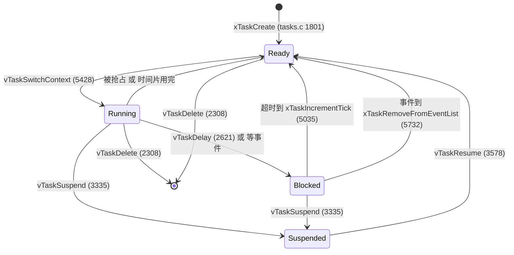
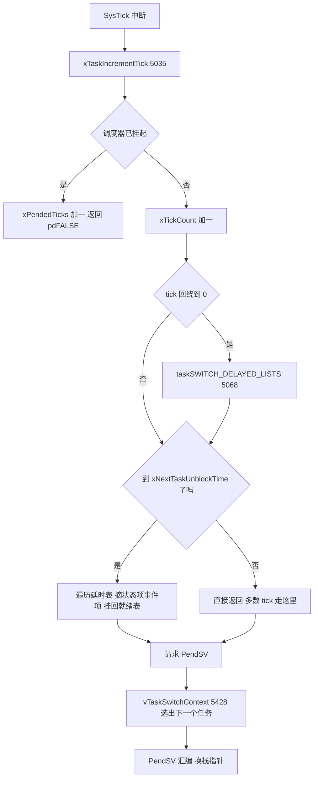
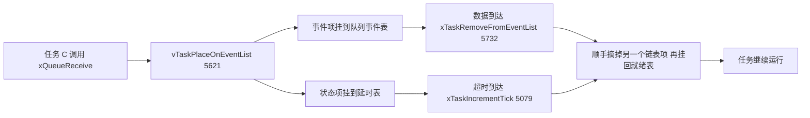

# tasks.c 与 task.h —— FreeRTOS 任务管理与调度器完全解读

> 对应源文件（本地仓库 `~/workspace/references/rtos/freertos/`，FreeRTOS-Kernel V11.1.0+，行号以当前文件为准）：
> - [tasks.c](/Users/theo-richard/workspace/references/rtos/freertos/tasks.c)（9398 行）—— 任务管理与调度器实现，内核里最大的一个文件
> - [include/task.h](/Users/theo-richard/workspace/references/rtos/freertos/include/task.h)（3557 行）—— TCB 句柄类型、状态枚举、**全部任务 API 声明**、临界区/让出宏
>
> **前置阅读：** [list.md](list.md)。tasks.c 里所有"排队"都是 list.c 的链表，没读 list.md 直接看 tasks.c 会一头雾水。
> 配置项含义见 [freertosconfigh.md](freertosconfigh.md)。
>
> **行号基准（重要）：** 本仓库的 tasks.c 已在官方源码中插入中文注释，行号与上游 FreeRTOS-Kernel 不完全一致。
> 旧版笔记里的 `xTaskIncrementTick`（旧写 5035）在当前文件中是 **5139**，`vTaskSwitchContext` 是 **5532**。
> 第五部分所有行号均已按当前工作区文件逐条核对；阅读时优先使用第五部分，旧章节中的行号若与源码不一致，以 `grep -n` 结果为准。
>
> **你贴出的那段逐行注释**来自教学版
> [freertos_tick_demo.c](../数据结构与算法/freertos_tick_demo.c) 的 310-639 行，
> 不是内核 tasks.c 的原文。内核中同一套逻辑在 tasks.c:5139-5391，但官方注释更短。
> 第五部分 5.9 给出了“教学版行号 → 内核行号”的对照表。

---

# 第一部分：先掌握什么、按什么顺序读

## 1.1 这个文件到底是什么

**一句话：`tasks.c` 就是"谁能上 CPU、什么时候上、上多久、下去之后排到哪里"的全部规则实现。**

它是 FreeRTOS 的心脏。queue.c、timers.c、event_groups.c 全都建立在它之上——
它们调用 `vTaskPlaceOnEventList()` 让任务睡下，调用 `xTaskRemoveFromEventList()` 把任务唤醒，
真正的"睡"和"醒"都在 tasks.c 里完成。

**文件结构（先有个地图，不要一上来就读）：**

| 行号范围 | 内容 | 要不要细读 |
|---|---|---|
| 30-56 | 中文导读注释（作者写的阅读路线） | 先读 |
| 58-102 | 标准头文件、`MPU_WRAPPERS_*`、统计格式化开关 | 精读本笔记 5.1 |
| 104-218 | 让出宏、通知状态、栈填充、分配标志、`STATIC`、任务名预留 | **精读**（5.2-5.8） |
| 220-417 | 优先级位图、任务选择、延时表切换、就绪表插入、SMP 让出宏 | 精读 |
| 425-505 | **TCB 结构体** | **精读** |
| 511 | `typedef tskTCB TCB_t` | 记住 |
| 526-576 | **全局关键变量** | **精读** |
| 1435 / 1855 | `xTaskCreateStatic` / `xTaskCreate` | 精读 |
| 1935 | `prvInitialiseNewTask` | 精读 |
| 2183 | `prvAddNewTaskToReadyList`（单核版；多核版 2268） | 精读 |
| 2367 | `vTaskDelete` | 精读 |
| 2582 / 2680 | `xTaskDelayUntil` / `vTaskDelay` | 精读 |
| 3024 / 2869 | `vTaskPrioritySet` / `uxTaskPriorityGet` | 精度 |
| 3394 / 3637 | `vTaskSuspend` / `vTaskResume` | 精度 |
| 3957 | `vTaskStartScheduler` | **精读** |
| 4165 / 4348 | `vTaskSuspendAll` / `xTaskResumeAll` | 精读 |
| 5139-5391 | **`xTaskIncrementTick`（tick 中断里跑）** | **最精读** |
| 5532 | **`vTaskSwitchContext`（PendSV 里跑）** | **最精读** |
| 5725-5968 | 事件唤醒相关（`vTaskPlaceOnEventList`、`xTaskRemoveFromEventList`） | 精读 |
| 6250 | `prvIdleTask`（空闲任务；协作式调度的关键让出点 6284-6292） | 精读 |
| 6528 / 6562 | `prvInitialiseTaskLists` / `prvCheckTasksWaitingTermination` | 精度 |
| 6991 | `prvResetNextTaskUnblockTime` | 精读 |
| 7117-7364 | 优先级继承/恢复（互斥量用） | 有需要再看 |
| 7763-8149 | 统计/格式化函数（`vTaskListTasks`、`vTaskGetRunTimeStatistics`） | 查依赖时读 |
| 9106 | `prvAddCurrentTaskToDelayedList` | **精读** |

> **不要从头读到尾。** tasks.c 有 9000 行，大量内容是 SMP、MPU、统计等条件编译分支，
> 以及每个 API 前面几百行的英文 Doxygen 注释（写在 task.h 里，tasks.c 里是精简版）。
> 按 1.3 的路线走，2-3 小时能读透主线。

## 1.2 必须提前搞懂的 7 个概念

读 tasks.c 之前，这 7 个概念必须先立住，否则每个函数你都只能"看懂字面"：

### 概念 1：TCB（任务控制块）—— 任务的身份证

每个任务一个 `TCB_t`（tasks.c:425-505，`typedef tskTCB TCB_t` 在 tasks.c:511）。
它不是任务的"栈"，而是任务的**档案袋**：

```c
pxTopOfStack    // 栈顶指针——上下文切换就是保存/恢复它
xStateListItem  // 状态链表项：挂在 就绪/延时/挂起 哪条链上
xEventListItem  // 事件链表项：挂在队列/事件组的事件链上（等待某个资源时）
uxPriority      // 优先级
pxStack         // 栈底地址
pcTaskName[]    // 名字（仅为调试方便）
```

**关键洞察：同一个任务的两个链表项可能同时挂在两条不同的链表上。**
例：任务调用 `xQueueReceive` 阻塞时，`xStateListItem` 挂在**延时表**（等超时），
`xEventListItem` 挂在**队列的事件表**（等数据）。两个"闹钟"哪个先响都能把它叫醒。

### 概念 2：任务栈 —— 上下文就存在这里

每个任务有自己的栈（`pvPortMallocStack` 分配，tasks.c:1785/1803）。
上下文切换时，CPU 寄存器压到当前任务的栈上，再把栈指针（`pxTopOfStack`）存进 TCB。
所以"切换任务"本质就是**换一个栈指针**。

栈大小单位是**字不是字节**（`configMINIMAL_STACK_SIZE` 也是字），这是新手最常踩的坑。

### 概念 3：五状态模型

| 状态 | 在哪个链表上 | 何时进入 |
|---|---|---|
| **Running 运行** | 就绪表的那个优先级表里 | 被调度器选中，`pxCurrentTCB` 指向它 |
| **Ready 就绪** | `pxReadyTasksLists[优先级]` | 创建时、被唤醒时、被抢占时 |
| **Blocked 阻塞** | 延时表 + 事件表 | `vTaskDelay` 或等队列/信号量/事件 |
| **Suspended 挂起** | `xSuspendedTaskList` | `vTaskSuspend`（只能被 `vTaskResume` 叫醒，等多久都没用） |
| **Deleted 删除** | `xTasksWaitingTermination` | `vTaskDelete` 后，等空闲任务回收内存 |

注意：**Running 和 Ready 在链表结构上是同一个位置**——运行中的任务仍然躺在就绪表里，
只是 `pxCurrentTCB` 指向它。`eTaskGetState()` 靠"是不是 pxCurrentTCB"来区分这两者（tasks.c:2731）。

### 概念 4：优先级 —— 数字越大优先级越高

- 范围 `0 ~ configMAX_PRIORITIES-1`，`0` 最低，`tskIDLE_PRIORITY` = 0；
- 调度器**永远选最高优先级**的就绪任务；
- 只有所有高优先级任务都阻塞/挂起，低优先级任务才轮得到；
- 同优先级的多个任务才谈"时间片轮转"。

### 概念 5：优先级位图 —— O(1) 找最高优先级

`uxTopReadyPriority`（tasks.c:562）记录"当前最高的有就绪任务的优先级"。
找最高优先级就绪任务时，从它开始往下找，不做全表扫（tasks.c:241-256）。
开 `configUSE_PORT_OPTIMISED_TASK_SELECTION=1` 时用 CLZ 指令（tasks.c:284-292），更快。

### 概念 6：双延时表 —— 防 tick 计数回绕

`pxDelayedTaskList` 和 `pxOverflowDelayedTaskList`（tasks.c:534-535）两张表轮换：
- 唤醒时刻还没溢出 → 进**当前延时表**；
- 唤醒时刻已溢出（跨过 TickType 最大值）→ 进**溢出表**；
- tick 计数回绕到 0 时，`taskSWITCH_DELAYED_LISTS()`（tasks.c:315-327）把两张表**交换**。

这样一个简单的"两张表轮换"就解决了 32 位 tick 计数的回绕问题，不用做复杂判断。
`xNextTaskUnblockTime` 缓存"最早的唤醒时刻"，tick 中断里先和它比，**大部分 tick 直接跳过延时表处理**——这是性能关键。

### 概念 7：调度器挂起（uxSchedulerSuspended）≠ 关中断

`vTaskSuspendAll()`（tasks.c:4165）只是让调度器**不做切换**，中断照常响应（更准确地说是中断照常可以跑，
但不能碰 TCB 的状态链表项）。它和临界区是两回事：

| | 临界区 `taskENTER_CRITICAL()` | 挂起调度器 `vTaskSuspendAll()` |
|---|---|---|
| 中断 | 按优先级屏蔽（BASEPRI） | 正常响应 |
| 能否切换任务 | 不能 | 不能 |
| 嵌套 | 支持 | 支持（计数） |
| 使用场景 | 极短的链表操作 | 较长的操作（如 malloc） |

## 1.3 推荐阅读顺序（6 站，按这个顺序读）

```text
┌─ 第 1 站：数据结构 ────────────────────────────────────────────────
│  TCB 结构体 (424-504) + 全局变量 (512-598)
│  目标：每个字段干什么；pxCurrentTCB 就是"当前谁在跑"
└────────────────────────────────────────────────────────────────────
                          │
                          ▼
┌─ 第 2 站：内部宏 ──────────────────────────────────────────────────
│  prvAddTaskToReadyList (335)
│  taskSELECT_HIGHEST_PRIORITY_TASK (240 通用版 / 283 优化版)
│  taskSWITCH_DELAYED_LISTS (315)
│  目标：这三条宏是调度器的"动作词汇"，后面所有函数都在用它们
└────────────────────────────────────────────────────────────────────
                          │
                          ▼
┌─ 第 3 站：任务出生 ────────────────────────────────────────────────
│  xTaskCreate (1801)
│    → prvCreateTask (1696)
│    → prvInitialiseNewTask (1876)
│    → prvAddNewTaskToReadyList (2124)
│  目标：看清"分配 TCB+栈 → 填字段 → 伪造初始栈帧 → 挂进就绪表"
└────────────────────────────────────────────────────────────────────
                          │
                          ▼
┌─ 第 4 站：调度器启动 ──────────────────────────────────────────────
│  vTaskStartScheduler (3898)
│    → 创建空闲任务 / 定时器任务
│    → xPortStartScheduler()（进 port 层，见 port.c）
│  目标：明白启动前必须至少有一个任务；启动后 main() 的栈被"借走"
└────────────────────────────────────────────────────────────────────
                          │
                          ▼
┌─ 第 5 站：运行期两大入口（核心中的核心）──────────────────────────
│  ① xTaskIncrementTick (5035)   ← 每个 SysTick 中断调用
│        "时间在走：谁该醒了"
│  ② vTaskSwitchContext (5428)   ← 每次 PendSV 中断调用
│        "选下一个：谁该跑"
│  目标：这两个函数吃透，调度器就懂了 80%
└────────────────────────────────────────────────────────────────────
                          │
                          ▼
┌─ 第 6 站：任务的"上下车" ──────────────────────────────────────────
│  下车：vTaskDelay (2621) / xTaskDelayUntil (2523)
│         → prvAddCurrentTaskToDelayedList (9002)
│  上车：xTaskRemoveFromEventList (5732) / tick 到期分支 (5079 起)
│  其他：vTaskSuspend (3335) / vTaskResume (3578) / vTaskDelete (2308)
│  挂起调度器：vTaskSuspendAll (4061) / xTaskResumeAll (4244)
│  目标：任务怎么离开 CPU、怎么回到 CPU，形成闭环
└────────────────────────────────────────────────────────────────────
```

**读完之后再看：** 空闲任务 `prvIdleTask`（6146）、优先级继承（7013-7335）、
统计接口（9000+）——这些是边角料，不影响理解主干。

---

# 第二部分：详细讲解

## 2.1 TCB 结构体（tasks.c:425-505）

按重要性排序，前面几个字段必记：

| 字段 | 行号 | 作用 | 谁改它 |
|---|---|---|---|
| `pxTopOfStack` | 427 | **栈顶**。上下文切换保存/恢复的就是它。**必须是结构体第一个成员**（汇编里用固定偏移访问） | PendSV 切换代码 |
| `xMPUSettings` | 430 | MPU 区域配置（仅 MPU port） | — |
| `uxCoreAffinityMask` | 434 | 绑核掩码（仅 SMP + 亲和性） | `vTaskCoreAffinitySet` |
| `xStateListItem` | 437 | **状态链表项**：挂在就绪/延时/挂起表的那个 | list.c 的插入/删除函数 |
| `xEventListItem` | 438 | **事件链表项**：等队列/信号量时挂在事件表 | 同上 |
| `uxPriority` | 439 | 当前优先级（0 最低） | `vTaskPrioritySet`、优先级继承 |
| `pxStack` | 440 | 栈起始地址（用于算栈使用量、释放） | 创建时 |
| `xTaskRunState` | 442 | 仅 SMP：任务运行在哪个核心，或未运行/待让出 | 调度器 |
| `pcTaskName[]` | 445 | 任务名，长度 `configMAX_TASK_NAME_LEN`（含 `\0`） | 创建时 |
| `uxBasePriority` | 465 | **基础优先级**（优先级继承用：被继承时 `uxPriority` 升高，`uxBasePriority` 不动） | 继承/恢复时 |
| `uxMutexesHeld` | 466 | 当前持有的互斥量数量 | 互斥量代码 |
| `ulNotifiedValue[]` | 486 | 任务通知值数组 | 通知 API |
| `ucNotifyState[]` | 487 | 通知等待状态：0/1/2，见 5.4 | 通知 API |
| `ucStaticallyAllocated` | 495 | 栈/TCB 分配方式状态码，见 5.6 | 创建/删除路径 |
| `ucDelayAborted` | 499 | 延时是否被 `xTaskAbortDelay` 打断 | `xTaskAbortDelay` |

**为什么 `pxTopOfStack` 必须是第一个成员：** 移植层的 PendSV 汇编代码在保存/恢复上下文时，
用 `pxCurrentTCB` 加固定偏移（0）访问栈顶指针。如果它在结构体中间，汇编就得知道偏移量，
那移植层就和内核结构强耦合了。同理 `xMPUSettings` 必须是第二个（MPU port 用）。

**条件编译字段说明：** 大量字段被 `#if` 包着（SMP、MPU、互斥量、统计、通知……）。
当前模板配置（`configNUMBER_OF_CORES=1`、`configUSE_MUTEXES=1`、`configUSE_TASK_NOTIFICATIONS=1`）下，
实际生成的 TCB 只包含其中一部分。看代码时不用管被条件编译掉的字段。

## 2.2 全局关键变量（tasks.c:517-587）

这些是"调度器的全局状态"，理解了它们就看懂了一半：

| 变量 | 行号 | 含义 | 谁改 |
|---|---|---|---|
| `pxCurrentTCB` | 517 | **当前正在运行的任务**。唯一权威，切换任务就是改它 | `taskSELECT_HIGHEST_PRIORITY_TASK`、创建/删除时 |
| `pxReadyTasksLists[]` | 531 | 就绪表数组，**每个优先级一条** | `prvAddTaskToReadyList`、`uxListRemove` |
| `pxDelayedTaskList` | 534 | 当前延时表指针 | `taskSWITCH_DELAYED_LISTS`、`prvAddCurrentTaskToDelayedList` |
| `pxOverflowDelayedTaskList` | 535 | 溢出延时表指针 | 同上 |
| `xPendingReadyList` | 536 | 调度器挂起期间被唤醒的任务暂存这里 | `xTaskRemoveFromEventList` |
| `xSuspendedTaskList` | 547 | 挂起任务表 | `vTaskSuspend`/`vTaskResume` |
| `xTasksWaitingTermination` | 540 | 已删除待回收的任务 | `vTaskDelete`、空闲任务 |
| `uxCurrentNumberOfTasks` | 560 | 当前任务总数（含空闲任务） | 创建/删除 |
| `xTickCount` | 561 | **tick 计数**，系统时间的唯一来源 | `xTaskIncrementTick` |
| `uxTopReadyPriority` | 562 | 最高就绪优先级（位图/缓存） | `taskRECORD_READY_PRIORITY` |
| `xSchedulerRunning` | 563 | 调度器是否已启动 | `vTaskStartScheduler` |
| `xPendedTicks` | 564 | 挂起期间"欠下"的 tick 数 | `xTaskIncrementTick`、`xTaskResumeAll` |
| `xYieldPendings[]` | 565 | 每核是否有待处理的切换请求 | 各种唤醒路径 |
| `xNumOfOverflows` | 566 | tick 计数回绕次数 | 换表时 +1 |
| `uxTaskNumber` | 567 | 任务编号计数器 | 创建时 +1 |
| `xNextTaskUnblockTime` | 568 | **最早唤醒时刻缓存**。tick 中断先用它做快速判断 | `prvResetNextTaskUnblockTime` |
| `xIdleTaskHandles[]` | 569 | 空闲任务句柄 | 启动时 |
| `uxSchedulerSuspended` | 594 | 调度器挂起计数（0=未挂起） | `vTaskSuspendAll`/`xTaskResumeAll` |

**`xNextTaskUnblockTime` 为什么关键：** 没有它，每个 tick 都要遍历延时表找到期任务（O(n)）。
有了它，tick 中断只需一次比较 `xConstTickCount >= xNextTaskUnblockTime`（tasks.c:5183），
**绝大多数 tick 直接返回**，只有真要唤醒任务时才动链条。这就是 FreeRTOS tick 中断极短的原因。

## 2.3 三条核心内部宏（调度器的"动作词汇"）

### 2.3.1 `prvAddTaskToReadyList(pxTCB)`（tasks.c:336-342）

```c
traceMOVED_TASK_TO_READY_STATE( pxTCB );
taskRECORD_READY_PRIORITY( ( pxTCB )->uxPriority );                                       // 更新最高优先级缓存
listINSERT_END( &( pxReadyTasksLists[ ( pxTCB )->uxPriority ] ), &( ( pxTCB )->xStateListItem ) );
tracePOST_MOVED_TASK_TO_READY_STATE( pxTCB );
```

**就三步：记优先级 → O(1) 插到该优先级就绪表末尾 → 追踪钩子。**
所有"让任务变成就绪"的路径都最终走这里，是整个内核出现频率最高的操作。

### 2.3.2 `taskSELECT_HIGHEST_PRIORITY_TASK()`（tasks.c:241-256 / 284-292）

通用版（tasks.c:241）：

```c
UBaseType_t uxTopPriority = uxTopReadyPriority;
while( listLIST_IS_EMPTY( &( pxReadyTasksLists[ uxTopPriority ] ) ) != pdFALSE )
{
    configASSERT( uxTopPriority );
    --uxTopPriority;                       // 从缓存值往下找
}
listGET_OWNER_OF_NEXT_ENTRY( pxCurrentTCB, &( pxReadyTasksLists[ uxTopPriority ] ) );
uxTopReadyPriority = uxTopPriority;
```

移植优化版（tasks.c:284）用 `portGET_HIGHEST_PRIORITY`（CLZ 指令）一步算出最高优先级，
所以 `configUSE_PORT_OPTIMISED_TASK_SELECTION=1` 时是真正的 O(1)，通用版最坏 O(configMAX_PRIORITIES)。

两条路径最后都用 list.md 里讲过的 `listGET_OWNER_OF_NEXT_ENTRY`
—— **`pxIndex` 游标轮转，这就是同优先级时间片轮转的实现处**。

### 2.3.3 `taskSWITCH_DELAYED_LISTS()`（tasks.c:315-327）

```c
configASSERT( listLIST_IS_EMPTY( pxDelayedTaskList ) );   // 换表时当前表必须已空
pxTemp = pxDelayedTaskList;
pxDelayedTaskList = pxOverflowDelayedTaskList;
pxOverflowDelayedTaskList = pxTemp;
xNumOfOverflows = ( BaseType_t ) ( xNumOfOverflows + 1 );
prvResetNextTaskUnblockTime();
```

在 tick 计数回绕到 0 时调用（tasks.c:5172），实现"双表防回绕"。

## 2.4 任务创建：`xTaskCreate`（tasks.c:1855）全流程

这是理解 tasks.c 最好的入口，因为它是唯一"从零造出一个任务"的地方。

```text
xTaskCreate( tasks.c:1855 )
   │
   ├─ pxNewTCB = prvCreateTask(...)                    tasks.c:1869
   │     │
   │     ├─ pvPortMalloc( sizeof( TCB_t ) )            分配 TCB
   │     ├─ pvPortMallocStack( uxStackDepth * sizeof(StackType_t) )   tasks.c:1785/1803
   │     │     └─ 分配失败的回滚见 tasks.c:1787-1792 / 1820-1827
   │     ├─ prvInitialiseNewTask( ... )                tasks.c:1935
   │     │     ├─ memset 清零 TCB
   │     │     ├─ 复制任务名（截断到 configMAX_TASK_NAME_LEN-1）
   │     │     ├─ pxNewTCB->uxPriority = uxPriority
   │     │     ├─ pxNewTCB->uxBasePriority = uxPriority（若开互斥量）
   │     │     ├─ vListInitialiseItem( &( pxNewTCB->xStateListItem ) )   ← 状态项 pxContainer=NULL
   │     │     ├─ vListInitialiseItem( &( pxNewTCB->xEventListItem ) )
   │     │     ├─ listSET_LIST_ITEM_OWNER( &xStateListItem, pxNewTCB )  ← pvOwner 指向自己
   │     │     ├─ listSET_LIST_ITEM_VALUE( &xEventListItem, configMAX_PRIORITIES - uxPriority )
   │     │     │     └─ 值 = 最大优先级 - 优先级 → 表头是该链上优先级最高的任务
   │     │     └─ pxPortInitialiseStack( ... )         tasks.c:2113/2137
   │     │           └─ 【关键】在栈上"伪造"一个初始上下文：
   │     │              xPSR / PC=任务入口 / LR / R12-R3 / R11-R4 入栈
   │     │              第一次切换到这个任务时，CPU 从栈里恢复寄存器，
   │     │              "返回"到任务函数——所以任务函数永远不会 ret，
   │     │              退出必须调用 vTaskDelete 或直接死循环
   │     │
   │     └─ 返回 TCB 指针
   │
   ├─ 若成功 → xReturn = pdPASS
   │
   └─ prvAddNewTaskToReadyList( pxNewTCB )             tasks.c:1880 / 实现 2183
         │
         ├─ taskENTER_CRITICAL()                        tasks.c:2188
         ├─ uxCurrentNumberOfTasks++
         ├─ if( pxCurrentTCB == NULL )                  tasks.c:2192
         │     ├─ pxCurrentTCB = pxNewTCB              第一个任务 → 直接成为当前任务
         │     └─ 若是第 1 个 → prvInitialiseTaskLists()  tasks.c:2206
         │           └─ 初始化所有就绪表/延时表/挂起表/待回收表
         ├─ else if( 调度器未启动 && 新任务优先级更高 )  tasks.c:2219
         │     └─ pxCurrentTCB = pxNewTCB              启动前也按优先级选当前任务
         ├─ uxTaskNumber++
         ├─ prvAddTaskToReadyList( pxNewTCB )           tasks.c:2246  ← 挂进就绪表
         └─ taskEXIT_CRITICAL()
              └─ if( 调度器已运行 && 新任务优先级更高 ) → 立即让出  tasks.c:2258
```

**三个必须记住的细节：**

1. **任务函数不能 return。** `pxPortInitialiseStack` 伪造的初始栈帧里，LR 指向的是
   一个"任务退出"的钩子（移植层实现），任务函数一旦 return 就会触发断言/进入死循环。
   正常退出只有两条路：`vTaskDelete(NULL)` 或 `for(;;)`。
2. **`xEventListItem` 的值 = `configMAX_PRIORITIES - uxPriority`。**
   因为链表按值升序，所以"最大优先级"变成"最小值"→ 排最前。这样事件表的表头永远是最该被唤醒的任务。
3. **创建过程全程在临界区里。** 因为要同时改"任务数、当前任务、就绪链表"三样东西，不能被打断。

### 静态创建 `xTaskCreateStatic`（tasks.c:1435）

和 `xTaskCreate` 唯一的区别：TCB 和栈由用户提供（两个缓冲区指针），不调用 malloc。
最后一样走 `prvInitialiseNewTask` + `prvAddNewTaskToReadyList`。
适用场景：不允许动态内存、或任务数量固定想省堆。

## 2.5 调度器启动：`vTaskStartScheduler`（tasks.c:3957）

```text
vTaskStartScheduler()  tasks.c:3957
   │
   ├─ prvCreateIdleTasks()                 tasks.c:4018  自动创建空闲任务（优先级 0）
   ├─ xTimerCreateTimerTask()              tasks.c:4024  若 configUSE_TIMERS=1，创建定时器任务
   │
   ├─ 若都成功：
   │     ├─ portDISABLE_INTERRUPTS()        tasks.c:4051  关中断，防止启动过程中来 tick
   │     ├─ xNextTaskUnblockTime = portMAX_DELAY      tasks.c:4062
   │     ├─ xSchedulerRunning = pdTRUE                tasks.c:4063
   │     ├─ xTickCount = configINITIAL_TICK_COUNT     tasks.c:4064
   │     ├─ portCONFIGURE_TIMER_FOR_RUN_TIME_STATS()
   │     └─ xPortStartScheduler()           tasks.c:4085  ★ 进入移植层
   │           └─ 配置 SysTick 中断 + 启动第一个任务（汇编，见 port.c 的 prvStartFirstTask）
   │              → 第一次切换后，main() 的栈再也不会回来
   │
   └─ 若失败（堆不够）→ configASSERT( xReturn != errCOULD_NOT_ALLOCATE_REQUIRED_MEMORY )
```

**重要认知：`vTaskStartScheduler()` 正常情况下**永不返回**。**
因为启动后 CPU 一直在任务之间切换，`main()` 的栈帧被借走当第一个任务的初始栈了
（移植层的第一个任务启动汇编会切换到 `pxCurrentTCB` 的栈）。所以 `main()` 里
`vTaskStartScheduler()` 之后的代码是**死代码**。

**启动前必须至少创建一个用户任务**，否则调度器启动后只有空闲任务在跑（不报错但什么也不干）。

**空闲任务自动创建：** 即使你没写 `xTaskCreate`，`vTaskStartScheduler` 也会创建空闲任务
（`prvCreateIdleTasks`，tasks.c:614 声明、tasks.c:3798 定义），优先级 `tskIDLE_PRIORITY`（0），栈 `configMINIMAL_STACK_SIZE`。

## 2.6 tick 中断：`xTaskIncrementTick`（tasks.c:5139-5391）—— "谁该醒了"

**这是整个内核最热的函数**，每个 tick 中断（默认 100Hz，即每 10ms）都会执行一次。
完整逐行解释见 **5.9**，这里只给控制流和关键行号。

```text
xTaskIncrementTick()  tasks.c:5139
   │
   ├─ 局部量：pxTCB / xItemValue / xSwitchRequired = pdFALSE      tasks.c:5141-5143
   ├─ trace 钩子：进入；递增前把旧 xTickCount 交给钩子             tasks.c:5145 / 5151
   │
   ├─ if( uxSchedulerSuspended == 0 )                             tasks.c:5158
   │   │   ← 调度器未挂起，允许修改链表
   │   ├─ xConstTickCount = xTickCount + 1                        tasks.c:5163
   │   ├─ xTickCount = xConstTickCount                            tasks.c:5168
   │   ├─ if( xConstTickCount == 0 ) → taskSWITCH_DELAYED_LISTS() tasks.c:5170-5177
   │   │
   │   ├─ if( xConstTickCount >= xNextTaskUnblockTime )           tasks.c:5183
   │   │   └─ for( ;; )                                           tasks.c:5185
   │   │         ├─ 延时表空 → xNextTaskUnblockTime = portMAX_DELAY; break   tasks.c:5187-5194
   │   │         ├─ pxTCB = 表头 TCB；xItemValue = 唤醒时刻        tasks.c:5205-5206
   │   │         ├─ 当前 tick < 唤醒时刻 → 更新缓存; break          tasks.c:5208-5216
   │   │         ├─ 从延时表摘除 xStateListItem                   tasks.c:5223
   │   │         ├─ 若 xEventListItem 仍挂在事件表 → 摘除           tasks.c:5228-5235
   │   │         ├─ prvAddTaskToReadyList( pxTCB )                tasks.c:5240
   │   │         └─ 抢占判断：单核严格高于当前优先级才置位；多核 prvYieldForTask
   │   │              tasks.c:5245-5269
   │   │
   │   ├─ 时间片：configUSE_PREEMPTION && configUSE_TIME_SLICING
   │   │   单核当前优先级就绪表长度 > 1 → xSwitchRequired = pdTRUE
   │   │   tasks.c:5278-5309
   │   ├─ tick hook：仅 xPendedTicks == 0 时调用                   tasks.c:5311-5325
   │   └─ 聚合 xYieldPendings：本核置位，其他核发 IPI               tasks.c:5327-5372
   │
   └─ else：xPendedTicks++；仍调用 tick hook                       tasks.c:5374-5386
       → 挂起期间不推进 xTickCount、不改链表，恢复时由 xTaskResumeAll 补算

返回 xSwitchRequired：pdTRUE 表示移植层在中断退出时挂 PendSV          tasks.c:5390
```

**三个设计要点：**

1. **绝大多数 tick 只走两条比较**（调度器挂起？+ 到期？）。`xNextTaskUnblockTime`
   把“延时表是否有任务到期”压缩为一次比较；没有到期任务时不进入 `for(;;)`。
2. **一次 tick 可能唤醒多个任务**：延时表按绝对唤醒时刻升序，循环连续取表头，
   直到表空或表头尚未到期。
3. **唤醒 ≠ 立刻切换**：函数只把任务挂回就绪表并返回 `pdTRUE`；
   真正的寄存器保存/恢复由移植层在中断退出时挂起 PendSV，再由 PendSV 执行
   `vTaskSwitchContext`（tasks.c:5532）。

**执行上下文：** 该函数本身不调用 `taskENTER_CRITICAL()`。互斥由调用者保证：
Cortex-M4F 的 `xPortSysTickHandler()` 在调用前执行 `portDISABLE_INTERRUPTS()`（port.c:609-613）；
`xTaskResumeAll()` 在 `taskENTER_CRITICAL()` 内补算 pended ticks（tasks.c:4364、4445）。
因此“函数内部天然临界区”这个说法不准确，准确说法是“调用契约要求调用者提供互斥”。

**与 list.md 的呼应：** 这里的 `listGET_OWNER_OF_HEAD_ENTRY`、`listREMOVE_ITEM`、
`listLIST_ITEM_CONTAINER` 全部是 list.h 的宏，语义见 [list.md](list.md) 第四章。

## 2.7 上下文切换：`vTaskSwitchContext`（tasks.c:5532）—— "谁该跑"

这个函数**在 PendSV 中断里**执行（移植层调用），负责选出下一个要运行的任务。
单核定义在 tasks.c:5532，多核定义在 tasks.c:5620。

```text
vTaskSwitchContext()  tasks.c:5532（单核版）
   │
   ├─ if( uxSchedulerSuspended != 0 )
   │     └─ xYieldPendings[0] = pdTRUE;   "挂起期间不求切换，记下来"
   │        直接返回
   │
   ├─ xYieldPendings[0] = pdFALSE
   ├─ traceTASK_SWITCHED_OUT()
   ├─ （若开运行时间统计）更新当前任务的累计运行时间
   │
   ├─ ★ taskSELECT_HIGHEST_PRIORITY_TASK()      tasks.c:253 / 290
   │     ├─ 从 uxTopReadyPriority 往下找非空就绪表
   │     └─ listGET_OWNER_OF_NEXT_ENTRY( pxCurrentTCB, &就绪表[最高优先级] )
   │           └─ pxIndex 前进一格 → pxCurrentTCB = 该项目的 pvOwner
   │              ★ 这就是"同优先级轮转"发生的地方
   │
   ├─ traceTASK_SWITCHED_IN()
   └─ （若开栈溢出检查）检查新任务的栈末尾魔数
```

**核心只有一句：`pxCurrentTCB = 下一个任务`。**
之后移植层的 PendSV 汇编会保存旧任务的寄存器到旧栈、从新任务的 `pxTopOfStack` 恢复寄存器
——任务切换完成。

**为什么"选择"和"保存现场"分开？** 因为选择逻辑是纯 C 代码（可读性好），
保存/恢复必须用汇编（要访问所有寄存器）。FreeRTOS 用 PendSV 中断做这个分界：
C 代码在 PendSV 的 C 处理函数里跑，汇编在 PendSV 的进出栈部分。

## 2.8 任务延时：`vTaskDelay` / `xTaskDelayUntil` → `prvAddCurrentTaskToDelayedList`

### 两个延时函数的区别

| | `vTaskDelay(n)`（tasks.c:2680） | `xTaskDelayUntil(&last, n)`（tasks.c:2582） |
|---|---|---|
| 语义 | 从**现在**起睡 n 个 tick | 从**上次唤醒时刻**起再睡到 n tick 后 |
| 实际周期 | n + 执行时间（会漂移） | 严格 n（不累积误差） |
| 适用 | 不需要精确周期的场景 | 周期性任务（采样、控制环） |

### `prvAddCurrentTaskToDelayedList(xTicksToWait, xCanBlockIndefinitely)`（tasks.c:9106）

所有"让当前任务睡下"的路最终都汇到这里：

```text
prvAddCurrentTaskToDelayedList( xTicksToWait, xCanBlockIndefinitely )   tasks.c:9106
   │
   ├─ ① uxListRemove( &( pxCurrentTCB->xStateListItem ) )      tasks.c:9128
   │     └─ 先离开就绪表！
   │        若返回值 == 0（该优先级就绪表空了）
   │           → portRESET_READY_PRIORITY(...)  顺带维护优先级位图
   │
   ├─ ② 若 xTicksToWait == portMAX_DELAY 且允许无限阻塞
   │     └─ listINSERT_END( &xSuspendedTaskList, &( xStateListItem ) )   tasks.c:9149
   │           ★ 无限期阻塞进"挂起表"，这样永远等不到超时
   │
   └─ ③ 否则（有限期）：
         ├─ xTimeToWake = xTickCount + xTicksToWait          tasks.c:9157
         ├─ listSET_LIST_ITEM_VALUE( &xStateListItem, xTimeToWake )   tasks.c:9160  ← 写入排序键
         ├─ if( xTimeToWake < xTickCount )  （溢出）
         │     └─ vListInsert( pxOverflowDelayedTaskList, ... )       tasks.c:9168
         └─ else
               ├─ vListInsert( pxDelayedTaskList, ... )                tasks.c:9176
               └─ 若 xTimeToWake < xNextTaskUnblockTime
                     → xNextTaskUnblockTime = xTimeToWake   更新"最早唤醒时刻"缓存（tasks.c:9182-9185）
```

**注意顺序：先离开就绪表，再进延时表。**
因为 `xStateListItem` 只有一份，不能同时挂在两条链上——必须先摘再挂。

### 阻塞等事件时的完整路径（`xQueueReceive` 为例）

```text
xQueueReceive()  （在 queue.c）
   │
   ├─ 队列有数据？→ 直接取走返回，根本不进 tasks.c
   │
   └─ 没数据：
         ├─ vTaskPlaceOnEventList( &queue->xTasksWaitingToReceive, xTicksToWait )   tasks.c:5725
         │     ├─ vListInsert( pxEventList, &( pxCurrentTCB->xEventListItem ) )     tasks.c:5748
         │     │     └─ 挂到队列的事件表（按优先级排序）
         │     └─ prvAddCurrentTaskToDelayedList( xTicksToWait, pdTRUE )            tasks.c:5750
         │           └─ 同时挂到延时表（等超时）
         │
         ├─ taskYIELD()   —— 主动让出 CPU，让别的任务跑
         │
         └─ 被唤醒后问：为什么醒的？
               ① 数据来了（xTaskRemoveFromEventList 把它从延时表摘了）
               ② 超时了（tick 把它从事件表摘了）
```

**这就是 `vTaskPlaceOnEventList` 存在的原因：任务同时挂两条链，"数据到"和"超时到"哪个先来都能醒。**

## 2.9 唤醒：两条路径

### 路径 A：tick 超时唤醒（等时间到）

见 2.6 的 `xTaskIncrementTick` 到期分支（tasks.c:5183-5240 区间）。

### 路径 B：事件唤醒（不用等 tick）`xTaskRemoveFromEventList`（tasks.c:5831）

由 queue.c/timers.c 在"资源可用"时调用，可能来自任务，也可能来自中断：

```text
xTaskRemoveFromEventList( pxEventList )   tasks.c:5831
   │
   ├─ 从事件表取表头（= 最高优先级的等待者）        tasks.c:5855
   ├─ listREMOVE_ITEM( &( pxTCB->xEventListItem ) )      tasks.c:5857   摘事件项
   ├─ if( uxSchedulerSuspended == 0 )
   │     ├─ listREMOVE_ITEM( &( pxTCB->xStateListItem ) ) tasks.c:5861  摘延时项
   │     └─ prvAddTaskToReadyList( pxTCB )               tasks.c:5862    挂回就绪表
   │
   ├─ else（调度器挂起期间被唤醒过）
   │     └─ 把 xEventListItem 插入 xPendingReadyList      tasks.c:5884
   │       等 xTaskResumeAll 统一处理
   │
   └─ 返回 pdTRUE（对方优先级比自己高 → 需要切换）
```

**如果调度器正挂起**（`uxSchedulerSuspended != 0`）：任务不能直接进就绪表
（因为挂起期间链表不能改），而是先进 `xPendingReadyList`，
等 `xTaskResumeAll()`（tasks.c:4348）时统一搬回就绪表。
注意：调度器挂起分支用的是 `xEventListItem` 挂到 `xPendingReadyList`，
不是 `xStateListItem`；恢复时 tasks.c:4390-4393 先摘事件项，再摘状态项。

## 2.10 挂起与恢复

| 函数 | 行号 | 作用 |
|---|---|---|
| `vTaskSuspend(x)` | tasks.c:3394 | 把任务放进 `xSuspendedTaskList`，**不管等多久都不会被超时唤醒** |
| `vTaskResume(x)` | tasks.c:3637 | 从挂起表摘出来，放回就绪表（只对"挂起态"有效） |
| `xTaskResume` | — | `vTaskResume` 的带返回值版本（内部用） |

**`vTaskSuspend` 和"无限期阻塞"的区别：**

| | `vTaskSuspend` | `xQueueReceive(q, portMAX_DELAY)` |
|---|---|---|
| 被谁唤醒 | **只有** `vTaskResume` | 资源可用时 |
| 在哪条链 | `xSuspendedTaskList` | 事件表 + 挂起表（无限等待走 tasks.c:9149） |
| 能否被 tick 唤醒 | 不能 | 不能（无限等待） |
| 能否被事件唤醒 | 不能 | **能** |

注意 "无限期阻塞" 也进 `xSuspendedTaskList`（tasks.c:9149），但它的 `xEventListItem` 还挂在事件表上，
所以事件来了能醒；`vTaskSuspend` 的任务事件项也被摘掉了，所以只有 `vTaskResume` 能救。

## 2.11 删除任务：`vTaskDelete`（tasks.c:2367）

```text
vTaskDelete( xTaskToDelete )   tasks.c:2367
   │
   ├─ pxTCB = ( xTaskToDelete == NULL ) ? pxCurrentTCB : xTaskToDelete
   ├─ taskENTER_CRITICAL()
   │
   ├─ ① uxListRemove( &( pxTCB->xStateListItem ) )      tasks.c:2384
   │     └─ 若返回 0 → 该优先级就绪表空了（若是延时/挂起任务，本来就不在就绪表）
   ├─ ② uxListRemove( &( pxTCB->xEventListItem ) )      tasks.c:2396
   │
   ├─ ③ if( 调度器已运行 && 任务是"自己删自己"或当前在跑 )   tasks.c:2420
   │     ├─ vListInsertEnd( &xTasksWaitingTermination, &( pxTCB->xStateListItem ) )  tasks.c:2428
   │     │     ★ 挂到"待回收表"，等空闲任务来释放内存
   │     └─ ++uxDeletedTasksWaitingCleanUp
   │
   ├─ ④ else（任务没在跑 / 调度器未启动）
   │     └─ 直接 vPortFree( TCB ) + vPortFreeStack( 栈 )  立即回收
   │
   └─ if( 删的是当前任务 ) → portYIELD_WITHIN_API()  换到别的任务去
```

**关键设计：为什么不当场释放内存？** 因为如果删的是自己，释放的是自己正在用的栈
——释放完栈就没了，函数都返回不了。所以先挂到 `xTasksWaitingTermination`，
由**空闲任务** `prvCheckTasksWaitingTermination`（tasks.c:6562）在后台安全回收。

**`uxDeletedTasksWaitingCleanUp` 的作用：** 空闲任务用这个计数判断"有没有尸体要收"，
为 0 时直接跳过整段代码（性能优化）。

## 2.12 调度器挂起/恢复：`vTaskSuspendAll` / `xTaskResumeAll`

### `vTaskSuspendAll()`（tasks.c:4165）

```c
++uxSchedulerSuspended;      // 就是个计数
```

**只做一件事：计数 +1。** 但效果是：
- 期间 `vTaskSwitchContext` 拒绝切换（只置 `xYieldPendings[0]=pdTRUE`）；
- 期间 tick 中断不处理延时表，只累加 `xPendedTicks`；
- 期间被唤醒的任务先进 `xPendingReadyList`，不直接进就绪表。

### `xTaskResumeAll()`（tasks.c:4348）

```text
xTaskResumeAll()   tasks.c:4348
   │
   ├─ --uxSchedulerSuspended;  if( 不为 0 ) return pdFALSE;   "嵌套还没退完"
   │
   ├─ 补欠下的 tick：
   │     while( xPendedTicks > 0 ) { xTaskIncrementTick(); --xPendedTicks; }
   │
   ├─ 把 xPendingReadyList 里的任务搬回就绪表：
   │     while( !listLIST_IS_EMPTY( &xPendingReadyList ) )
   │       ├─ pxTCB = listGET_OWNER_OF_HEAD_ENTRY( &xPendingReadyList )   tasks.c:4389
   │       ├─ listREMOVE_ITEM( &( pxTCB->xEventListItem ) )
   │       ├─ listREMOVE_ITEM( &( pxTCB->xStateListItem ) )
   │       └─ prvAddTaskToReadyList( pxTCB )
   │
   ├─ 若期间有新任务变成就绪且优先级更高 → 立即切换
   └─ return xYieldRequired
```

**为什么这么复杂？** 因为挂起期间"时间还在走"（tick 中断照常来），但链表不能动。
所以必须记下欠的 tick、暂存被唤醒的任务，恢复时一次性补上。**这就是 `xPendedTicks` 的用途。**

## 2.13 优先级：设置与继承

### 普通设置 `vTaskPrioritySet`（tasks.c:3024）

- 若任务在就绪表 → 摘下来，改优先级，重新插进新的就绪表；
- 若任务在延时/挂起表 → 只改 `uxPriority`，不需要换链表（延时表按唤醒时刻排序，与优先级无关）；
- 若改的是当前任务 → 可能需要立即切换。

### 优先级继承（解决优先级反转，tasks.c:7117 / 7226）

**问题场景：**

```text
  低优先级任务 L 持有互斥量 M
  高优先级任务 H 想拿 M → 阻塞
  中优先级任务 M2 就绪 → 抢占 L
  → L 拿不到 CPU，M 永远释放不了，H 永远等（优先级反转）
```

**FreeRTOS 的解法（优先级继承）：**
当 H 因等 M 而阻塞时，把 M 的持有者 L 的优先级**临时提升**到 H 的优先级，
让 L 尽快执行完、释放 M，然后恢复 L 的原优先级。

| 函数 | 行号 | 作用 |
|---|---|---|
| `xTaskPriorityInherit` | tasks.c:7117 | 拿不到互斥量时调用：把持有者优先级提到自己这么高 |
| `xTaskPriorityDisinherit` | tasks.c:7226 | 释放互斥量时调用：恢复持有者原优先级 |
| `vTaskPriorityDisinheritAfterTimeout` | tasks.c:7322 | 超时场景下的恢复 |

TCB 里 `uxPriority`（当前，可能被提升）和 `uxBasePriority`（原始，不变）的区分就是为此。

## 2.14 空闲任务：`prvIdleTask`（tasks.c:6250）

优先级 0，调度器启动时自动创建（`prvCreateIdleTasks`）。它的主循环做三件事：

1. `prvCheckTasksWaitingTermination()`（tasks.c:6562）—— 回收被删任务的内存；
2. `configUSE_IDLE_HOOK=1` 时调用 `vApplicationIdleHook()` —— 用户空闲钩子；
3. `configUSE_TICKLESS_IDLE=1` 时进入低功耗模式。

**空闲任务必须存在，否则系统没有"最低优先级兜底"。**
这也是 `configMINIMAL_STACK_SIZE` 的用途——空闲任务的栈大小。

## 2.15 task.h 提供的 API 与宏（速查）

### 状态与类型

| 内容 | task.h 行号 |
|---|---|
| `TaskHandle_t`（就是 `TCB_t*`） | 108 |
| `eTaskState` 枚举（`eRunning/eReady/eBlocked/eSuspended/eDeleted/eInvalid`） | 117-125 |
| `TaskStatus_t`（`uxTaskGetSystemState` 用的状态结构） | 约 181 |
| `taskSCHEDULER_SUSPENDED / NOT_STARTED / RUNNING` | 300-302 |

### 任务创建/删除

| API | task.h 声明 | tasks.c 实现 |
|---|---|---|
| `xTaskCreate` | 397 | 1801 |
| `xTaskCreateStatic` | 515 | 1381 |
| `vTaskDelete` | 799 | 2308 |

### 延时/让出

| API | task.h 声明 | tasks.c 实现 |
|---|---|---|
| `vTaskDelay` | 849 | 2621 |
| `xTaskDelayUntil` | 945 | 2523 |
| `taskYIELD()` 宏 | 237 | `portYIELD()`（移植层） |

### 挂起/恢复

| API | task.h 声明 | tasks.c 实现 |
|---|---|---|
| `vTaskSuspend` | 1245 | 3335 |
| `vTaskResume` | 1295 | 3578 |

### 优先级

| API | task.h 声明 | tasks.c 实现 |
|---|---|---|
| `uxTaskPriorityGet` | 1032 | 2810 |
| `vTaskPrioritySet` | 1192 | 2965 |

### 调度器控制

| API | task.h 声明 | tasks.c 实现 |
|---|---|---|
| `vTaskStartScheduler` | 1513 | 3898 |
| `vTaskEndScheduler` | 1567 | 4015 |
| `vTaskSuspendAll` | 1615 | 4061 |
| `xTaskResumeAll` | 1668 | 4244 |
| `xTaskGetSchedulerState` | 3403 | — |

### 查询与统计

| API | task.h 声明 | tasks.c 实现 |
|---|---|---|
| `xTaskGetTickCount` | 1687 | 4398 |
| `xTaskGetTickCountFromISR` | 1704 | 约 4410 |
| `uxTaskGetNumberOfTasks` | 约 1720 | 4450 |
| `eTaskGetState` | 1091 | 2672 |
| `uxTaskGetStackHighWaterMark` | 1808 | 约 3500 |
| `xTaskGetIdleTaskHandle` | 2048 | — |
| `uxTaskGetSystemState` | 2146 | — |

### 临界区宏（都在 task.h 里转发到 port 层）

| 宏 | task.h 行号 | 转发到 |
|---|---|---|
| `taskENTER_CRITICAL()` | 250 | `portENTER_CRITICAL()` |
| `taskEXIT_CRITICAL()` | 268 | `portEXIT_CRITICAL()` |
| `taskDISABLE_INTERRUPTS()` | 283 | `portDISABLE_INTERRUPTS()` |
| `taskENTER_CRITICAL_FROM_ISR()` | 252/254 | port 层 |

---

# 第三部分：图

> 所有行号均取自本地源码，可直接跳过去对照。

## 图 1：任务状态机（五状态流转）

```text
                     ┌─ ① xTaskCreate / xTaskCreateStatic (1801 / 1381)
                     │     分配 TCB + 栈，伪造初始栈帧
                     └────────────────────────────────────────────────
                                     │
                                     ▼
        ╔═ 就绪态 Ready ══════════════════════════════════════════════════
        ║  挂在 pxReadyTasksLists[优先级]   tasks.c:530
        ╚══════════════════════════════════════════════════════════════════
             │                                    ▲
             │ ② 被选中（PendSV）                  │ ⑥ 唤醒：超时到 or 事件到
             │    vTaskSwitchContext (5428)        │    xTaskIncrementTick (5079)
             │                                    │    xTaskRemoveFromEventList (5732)
             ▼                                    │
        ╔═ 运行态 Running ═════════════════════════════════════════════════
        ║  仍是就绪表成员，pxCurrentTCB 指向它
        ╚══════════════════════════════════════════════════════════════════
             │                          │
   ③ 被抢占   │                          │ ④ vTaskDelay (2621)
   或时间片到  │                          │    xTaskDelayUntil (2523)
             │                          │    等队列/信号量/事件
             └──────────► Ready         ▼
        ╔═ 阻塞态 Blocked ═════════════════════════════════════════════════
        ║  延时表 + 事件表（两个链表项同时挂）
        ║  tasks.c:533-534 / queue.c:126-127
        ╚══════════════════════════════════════════════════════════════════
                                     │ ⑤ vTaskSuspend (3335)
                                     ▼
        ╔═ 挂起态 Suspended ═══════════════════════════════════════════════
        ║  xSuspendedTaskList   tasks.c:547
        ║  ★ 只有 vTaskResume (3578) 能叫醒它
        ╚══════════════════════════════════════════════════════════════════
                                     │ vTaskResume (3578)
                                     ▼
                                  回到 就绪态

   ⑦ vTaskDelete (2308)
        ├─ 从 就绪表 / 延时表 / 事件表 全部摘除
        └─ 进 xTasksWaitingTermination  tasks.c:539
             → 空闲任务 prvCheckTasksWaitingTermination (6458) 回收内存
```

**读图要点：**
- **Running 和 Ready 是同一个链表位置**，区别只在 `pxCurrentTCB` 是否指向它；
- 阻塞态的任务**同时挂在两条链上**（延时表 + 事件表），所以有两个唤醒来源；
- 挂起态的任务**只挂在 `xSuspendedTaskList`**，事件项已摘除，所以只有 `vTaskResume` 能救它。

## 图 2：调度决策全流程（从 tick 到切换）

```text
  ┌─ 硬件 SysTick 中断（每 1/configTICK_RATE_HZ 秒一次）
  │
  ▼
  ┌─ xTaskIncrementTick()   tasks.c:5139 ─────────────────────────────
  │
  │   调度器挂起？
  │      是 → xPendedTicks++，返回 pdFALSE（什么都不动）
  │      否 ↓
  │   xTickCount++
  │   tick 回绕到 0？
  │      是 → taskSWITCH_DELAYED_LISTS()  tasks.c:5172（交换两张延时表）
  │      否 ↓
  │   xTickCount >= xNextTaskUnblockTime ？
  │      否 → 直接返回（★ 绝大多数 tick 走这里）
  │      是 ↓
  │   ┌─ for(;;) 处理延时表 ─────────────────────────────────────────
  │   │  取表头任务（最早到期）  listGET_OWNER_OF_HEAD_ENTRY
  │   │  还没到期 → 更新 xNextTaskUnblockTime，break
  │   │  已到期   → 摘状态项 + 摘事件项 → prvAddTaskToReadyList
  │   │             若其优先级 > 当前任务 → xYieldRequired = pdTRUE
  │   └──────────────────────────────────────────────────────────────
  │
  │   同优先级有多个就绪任务（configUSE_TIME_SLICING=1）？→ xSwitchRequired = pdTRUE
  │
  └─ 返回 pdTRUE / pdFALSE
  │
  ▼
  ┌─ 移植层 port.c：返回 true 就触发 PendSV
  │
  ▼
  ┌─ vTaskSwitchContext()   tasks.c:5532 ─────────────────────────────
  │
  │   调度器挂起？
  │      是 → xYieldPendings[0]=pdTRUE，返回（本轮不切换）
  │      否 ↓
  │   taskSELECT_HIGHEST_PRIORITY_TASK()   tasks.c:253 / 290
  │     ├─ 从 uxTopReadyPriority 往下找第一个非空就绪表
  │     └─ listGET_OWNER_OF_NEXT_ENTRY(pxCurrentTCB, 该表)
  │            pxIndex 前进一格（同优先级轮转）
  │            pxCurrentTCB = 该项的 pvOwner
  │
  └─ 到此"下一个跑谁"已确定
  │
  ▼
  ┌─ PendSV 汇编（port.c）────────────────────────────────────────────
  │   旧任务寄存器压入旧栈 → 存进旧 TCB->pxTopOfStack
  │   从新 TCB->pxTopOfStack 恢复寄存器 → 新任务从断点继续
  └──────────────────────────────────────────────────────────────────
```

**这张图是整个 FreeRTOS 的主动脉：** tick 决定"谁该醒"，PendSV 决定"谁该跑"。
两者分开，是因为"醒"必须每 tick 检查，而"跑"只在需要时才发生。

## 图 3：同优先级时间片轮转（时序）

```text
配置：configUSE_PREEMPTION=1，configUSE_TIME_SLICING=1
      任务 A、B 同为优先级 3；任务 C 为优先级 1

  时间 ──────────────────────────────────────────────────────►

  任务 A（优先级 3）  ████████████████████
  任务 B（优先级 3）                      ████████████████████
  任务 C（优先级 1）  （一直没机会跑：优先级低于 A/B）

                      ▲
                      └─ 切换点：一次 tick 中断里发生的事

  ① xTaskIncrementTick  tasks.c:5139
       发现"该优先级就绪表里多于 1 个任务"
       → xSwitchRequired = pdTRUE（只是请求，不亲自切换）

  ② 中断退出 → 触发 PendSV

  ③ vTaskSwitchContext  tasks.c:5532
       → taskSELECT_HIGHEST_PRIORITY_TASK（tasks.c:253 / 290）
       → listGET_OWNER_OF_NEXT_ENTRY（list.h:283）
            pxIndex 沿环前进一格 → 跳过哨兵 → 取 pvOwner

  ④ pxCurrentTCB 从 A 变成 B，PendSV 汇编换栈 → B 开始跑

★ 关键：tasks.c 只负责"请求切换"，"下一个到底是谁"完全由 list.h 的
  pxIndex 游标决定。时间片轮转本质上是链表的环形遍历。
```

## 图 4：创建任务 → 第一次运行（栈的变化）

```text
① xTaskCreate 中，pxPortInitialiseStack 伪造的初始栈帧（以 Cortex-M 为例）
   （tasks.c:2113/2137 调用，具体实现在 port.c）

   高地址
   ┌─ xPSR (0x01000000)   ← Thumb 位必须置 1
   ├─ PC  = 任务入口函数     ← 第一次"返回"就跳到这里
   ├─ LR  = prvTaskExitError ← 任务函数若 return 就落到这里（死循环/断言）
   ├─ R12 / R3 / R2 / R1
   ├─ R0  = pvParameters    ← 任务函数的唯一参数
   ├─ R11 / R10 / R9 / R8 / R7 / R6 / R5 / R4
   └─ ▲ pxTopOfStack 指向这里
   低地址

② 调度器启动后第一次 PendSV，从 pxTopOfStack 恢复寄存器
   → CPU 认为"刚从中断返回"，PC 指向任务入口
   → 任务函数开始执行，参数 pvParameters 在 R0 里
   → 任务函数从此永不返回（返回会走到 LR 的退出钩子）

③ 之后每次切换，正常压栈/出栈，栈帧就是真实的寄存器现场
```

**这就是"任务函数绝不能 return"的根本原因**：初始栈帧里 LR 指向的是退出错误处理，
不是调用者；而且任务没有"调用者"，它的栈底就是裸的。

## 图 5：延时与唤醒时间轴

```text
当前 xTickCount = 1000

任务 L 调用 vTaskDelay( 50 )   ──► 唤醒时刻 = 1050
任务 M 调用 vTaskDelay( 30 )   ──► 唤醒时刻 = 1030
任务 H 调用 vTaskDelay( 10 )   ──► 唤醒时刻 = 1010

延时表（按唤醒时刻升序，vListInsert 维持）：
  表头 → [ H:1010 | M:1030 | L:1050 | 哨兵:portMAX_DELAY ] ← 表尾
             ▲
             └── xNextTaskUnblockTime = 1010（缓存，避免每 tick 扫表）

tick 1010 到来：
  xTaskIncrementTick: 1010 >= 1010 → 进循环
    → 表头 H 到期，摘除，挂回就绪表
    → 下一轮：表头 M，1030 > 1010 → 未到期
    → xNextTaskUnblockTime = 1030, break

tick 1011~1029：只需一次比较 1011 >= 1030？否 → 立即返回（几乎零开销）

tick 1030：唤醒 M，xNextTaskUnblockTime = 1050
tick 1050：唤醒 L，延时表空 → xNextTaskUnblockTime = portMAX_DELAY
```

**这就是 `xNextTaskUnblockTime` 的价值：把"每 tick 遍历全表"变成"每 tick 一次比较"。**

## 图 6：双延时表防回绕

```text
场景：TickType 是 32 位无符号，当前 xTickCount = 0xFFFFFFF0
任务 A: vTaskDelay(5)   → 唤醒时刻 0xFFFFFFF5  （没溢出）
任务 B: vTaskDelay(0x20)→ 唤醒时刻 0x00000010  （溢出了！）

处理：
  唤醒时刻 < 当前 tick  → 判定为"溢出" → 进 溢出表
  唤醒时刻 > 当前 tick  → 没溢出        → 进 当前延时表

  pxDelayedTaskList（当前表）           →  A  0xFFFFFFF5
  pxOverflowDelayedTaskList（溢出表）   →  B  0x00000010

tick 涨到 0xFFFFFFF5：A 醒，当前表空
tick 涨到 0x00000000（回绕）：
  xConstTickCount == 0  →  taskSWITCH_DELAYED_LISTS()   tasks.c:5172
  ├─ 交换两个指针
  └─ 之后"当前表"变成原来放 B 的那张，B 的 0x10 就正常可比较了

★ 用一个 assert（换表时当前表必须为空）保证正确性，
  代价只是两次指针交换——比做 64 位运算便宜得多。
```

## 图 7：队列阻塞的完整生命线（三个函数协同）

```text
任务 P（生产者，优先级 2）        任务 C（消费者，优先级 3）

时间 ──────────────────────────────────────────────────────────────────►

  C: xQueueReceive( q, 100 )
     │  队列空
     ├─ vTaskPlaceOnEventList( &q->xTasksWaitingToReceive, 100 )  tasks.c:5725
     │    ├─ vListInsert → C 的事件项挂到 q 的事件表（按优先级排序）
     │    └─ prvAddCurrentTaskToDelayedList → C 的状态项挂到延时表（100 tick 后超时）
     ├─ taskYIELD()
     ▼
  C 阻塞（同时挂在两条链上）：
     ├─ q->xTasksWaitingToReceive: [ C ]        ← 等数据
     └─ pxDelayedTaskList:         [ C(超时) ]  ← 等超时

  P: xQueueSend( q, data )
     ├─ 队列空 → 直接写入，无阻塞
     └─ 发现有人在等（xTasksWaitingToReceive 非空）
          └─ xTaskRemoveFromEventList( &q->xTasksWaitingToReceive )  tasks.c:5831
               ├─ listREMOVE_ITEM( C 的事件项 )      tasks.c:5857
               ├─ listREMOVE_ITEM( C 的状态项 )      tasks.c:5861  ← 顺手取消超时
               └─ prvAddTaskToReadyList( C )
          └─ C 优先级(3) > P(2) → 立即让出

  C 被唤醒，读走数据，返回 pdPASS
  ★ 注意：C 的延时超时被一起取消了，不会重复唤醒

  ── 如果 P 一直没来呢？──
  tick 100 后：xTaskIncrementTick 发现 C 到期
     ├─ listREMOVE_ITEM( C 的状态项 )    tasks.c:5223
     ├─ listLIST_ITEM_CONTAINER( C 的事件项 ) != NULL → 还挂着
     │     └─ listREMOVE_ITEM( C 的事件项 )  tasks.c:5230  ← 顺手从队列摘掉
     └─ prvAddTaskToReadyList( C )
  C 醒来发现队列还是空的 → 返回 errQUEUE_EMPTY
```

**这张图解释了一个常见疑问：为什么阻塞的任务不会"超时和被数据同时唤醒两次"？**
因为两条唤醒路径都会**同时摘掉另一个链表项**，谁先到谁负责清理，后到的那条路径自然找不到它。

## 图 8：调度器挂起期间的暂存与恢复

```text
时间线：
  vTaskSuspendAll()                    uxSchedulerSuspended = 1
        │
        ├─ tick 中断一次一次来
        │     xTaskIncrementTick: 挂起中 → xPendedTicks++ (1, 2, 3...)
        │     延时表一个都不动
        │
        ├─ 中断里 xQueueSendFromISR 唤醒了任务 D
        │     xTaskRemoveFromEventList: 挂起中
        │       → D 的事件项/状态项摘除
        │       → D 挂进 xPendingReadyList  tasks.c:536
        │       （不能进就绪表，因为挂起期间不动就绪表）
        │
        ├─ 你再 vTaskSuspendAll() 一次 → 计数 = 2
        │  xTaskResumeAll() 一次      → 计数 = 1，直接返回（不恢复）
        │
        └─ xTaskResumeAll() 最后一次   tasks.c:4348
              ├─ 计数归 0
              ├─ while( xPendedTicks ) xTaskIncrementTick()  ← 把欠的 tick 补齐
              │     （这时才处理延时表，该醒的都醒）
              ├─ 把 xPendingReadyList 里所有任务搬回就绪表
              └─ 返回，移植层决定是否切换

★ 关键：挂起期间"时间在走、中断在跑"，只是"链表不动、任务不切"。
  所以要用 xPendedTicks 记账、xPendingReadyList 暂存。
```

## 图 9：整体结构分层与模块协作

```text
┌─ 应用层 ─────────────────────────────────────────────────────────────
│  xTaskCreate / vTaskDelay / xQueueReceive / xSemaphoreTake ...
└──────────────────────────────────────┬───────────────────────────────
                                       │ 调用
┌─ 内核中间层（各功能模块，都依赖 tasks.c）─────────────────────────────
│
│   queue.c        timers.c       event_groups.c      stream_buffer.c
│   队列/信号量     软件定时器      事件组             流/消息缓冲区
│
│   这些模块对任务的"睡下/唤醒"都只调 tasks.c 的两个函数：
│     vTaskPlaceOnEventList()   → 任务睡下
│     xTaskRemoveFromEventList()→ 任务唤醒
└──────────────────────────────────────┬───────────────────────────────
                                       ▼
┌─ tasks.c  任务管理与调度 ────────────────────────────────────────────
│   创建/删除：xTaskCreate (1801)   vTaskDelete (2308)
│   状态迁移：vTaskDelay (2621)     vTaskSuspend (3335)   vTaskResume (3578)
│   tick 中断：xTaskIncrementTick (5035)
│   上下文切换：vTaskSwitchContext (5428)
│   挂起调度器：vTaskSuspendAll (4061)  xTaskResumeAll (4244)
└──────────────────────────────────────┬───────────────────────────────
                                       │ 依赖
┌─ list.c  双向环形链表（数据结构基础）─────────────────────────────────
│  vListInitialise / vListInsert / vListInsertEnd / uxListRemove
└──────────────────────────────────────┬───────────────────────────────
                                       ▼
┌─ 移植层 port.c / portmacro.h（平台相关，不在内核源码里）────────────────
│  portDISABLE_INTERRUPTS / portYIELD / PendSV / SysTick
│  pxPortInitialiseStack（伪造初始栈帧）
└──────────────────────────────────────────────────────────────────────

★ 读 tasks.c 时，凡是看到 port 开头的宏/函数，都当"黑盒"跳过即可，
  它们的实现取决于具体 MCU。内核只约定"调它们应该发生什么"。
```

## 图 10：Mermaid 渲染版（阅读器支持时会自动成图）

### 状态机



> 语法注意：Mermaid 的 `stateDiagram-v2` 标签里**不能出现冒号**（会被当成"标签分隔符"而报 Parse error），
> 所以这里把 `tasks.c:5139` 写成 `(tasks.c 5139)`。flowchart 的标签没有这个限制。

### 调度主流程



### 阻塞任务的双链挂载



---

# 第四部分：常见坑与速查

## 4.1 新手最容易踩的 10 个坑

| # | 坑 | 后果 | 正确做法 |
|---|---|---|---|
| 1 | 任务函数里 `return` | 进入 `prvTaskExitError`，断言/死循环 | 用 `vTaskDelete(NULL)` 或 `for(;;)` |
| 2 | 栈大小按"字节"算 | 栈溢出，随机崩溃 | `configMINIMAL_STACK_SIZE` 等单位是**字**；先按 128~512 字估，再用 `uxTaskGetStackHighWaterMark` 调 |
| 3 | 在中断里调用非 `FromISR` 的 API | 崩溃 / 断言 | 中断里只用 `xxxFromISR()`，且中断优先级必须 ≤ `configMAX_SYSCALL_INTERRUPT_PRIORITY`（见 freertosconfigh.md 2.2） |
| 4 | 创建任务后没调用 `vTaskStartScheduler()` | 什么都不跑 | `main()` 末尾必须调用 |
| 5 | `vTaskStartScheduler()` 之后还写代码 | 死代码，永不执行 | 启动调度器是最后一步 |
| 6 | 以为 `vTaskSuspendAll` 能替代临界区 | 中断仍会改数据 | 保护共享数据要用 `taskENTER_CRITICAL()` |
| 7 | 优先级数字搞反 | 以为 0 最高 | **数字越大优先级越高**，0 是最低（`tskIDLE_PRIORITY`） |
| 8 | 低优先级任务饿死 | 高优先级一直就绪 | 检查是否有 `for(;;)` 不阻塞的高优先级任务 |
| 9 | 用 `vTaskDelay(0)` 想"让一下" | 只是触发一次切换，不保证让给谁 | 用 `taskYIELD()` 或加大延时 |
| 10 | 栈溢出钩子没实现 | 链接失败 | `configCHECK_FOR_STACK_OVERFLOW=2` 时必须实现 `vApplicationStackOverflowHook` |

## 4.2 关键数字速查

| 项 | 值 | 出处 |
|---|---|---|
| 优先级范围 | `0 ~ configMAX_PRIORITIES-1` | `configMAX_PRIORITIES` 定义于 FreeRTOSConfig.h；TCB 初始化断言在 tasks.c:2043 附近 |
| 空闲任务优先级 | `tskIDLE_PRIORITY` = 0 | task.h:220 |
| 默认 tick 频率 | 100Hz（10ms），见模板配置 | freertosconfigh.md |
| `xEventListItem` 的值 | `configMAX_PRIORITIES - uxPriority` | tasks.c:2067（初始化）、tasks.c:3166（优先级变化时） |
| 无限期阻塞 | `portMAX_DELAY` | tasks.c:4062 初始化；延时表空时 tasks.c:5193 |
| 延时表的排序键 | 绝对唤醒时刻（`xTickCount + 延时`） | tasks.c:9157-9160 |
| 事件表的排序键 | 队列/信号量：优先级编码；事件组：无序表，item 值复用为等待条件 | tasks.c:5743、tasks.c:2067；例外 tasks.c:5756-5781 |

## 4.3 一句话总结

- **tasks.c 的核心就两个函数**：`xTaskIncrementTick`（时间走，谁该醒）+ `vTaskSwitchContext`（选谁跑）。
- **所有状态迁移的本质**：把 TCB 的两个链表项（`xStateListItem` / `xEventListItem`）
  在 就绪表 / 延时表 / 挂起表 / 事件表 之间搬来搬去。
- **性能的两个关键**：`uxTopReadyPriority` 缓存（避免全扫优先级）、
  `xNextTaskUnblockTime` 缓存（避免每 tick 扫延时表）。
- **别忘前置**：这一切的数据结构都是 [list.md](list.md) 里的双向环形链表；
  `pxIndex` 游标轮转 = 同优先级时间片轮转。

---

# 第五部分：源码注释级精读——从疑问到定位

> 本部分不再按“函数讲解”组织，而是按“看到一行代码/一条注释时会产生什么问题”组织。
> 每条结论都给出当前工作区的 `文件:行号`；行号以 2026-11-03 的
> `/Users/theo-richard/workspace/freertos` 工作区为准。
>
> 先区分三类文本：
>
> 1. **C 代码**：真正参与编译的声明、定义、表达式；
> 2. **预处理指令**：`#if/#else/#endif/#include/#error`，在翻译阶段处理；
> 3. **注释**：预处理前被替换为空格，不参与语法和语义；注释可能过时、简略或错误。
>
> 后续所有“为什么”都必须先判断：这段文字属于哪一类。把注释当成规范、把宏当成函数、
> 把 `#endif` 后面的注释当成条件，是最常见的三类误读。

### 5.0 问题索引

| 你提出的问题 | 对应小节 | 关键源码位置 |
|---|---|---|
| `configUSE_STATS_FORMATTING_FUNCTIONS` 为什么能“不包含 stdio.h”，函数实现在哪里 | 5.2 | tasks.c:90-102、7763、7791、7960、7902 |
| 让出宏为什么这样写、协作式调度器的函数在哪里、单核为什么不用 `pxTCB`、`#else` 到底判断什么 | 5.3 | tasks.c:104-149、2258、5245-5309、6284-6292 |
| `ucNotifyState` 为什么用 `uint8_t` | 5.4 | tasks.c:152-154、486-488、8231、8451、8291 |
| `0xA5`、高水位线、`memset` 在哪里定义、为什么条件编译 | 5.5 | tasks.c:156-175、1963-1968、6831-6848 |
| 三个 `tsk*ALLOCATED*` 是不是位标志、如何与分配路径绑定 | 5.6 | tasks.c:162-165、493-496、1420、1537、1657、1844、6961 |
| `STATIC` / `portREMOVE_STATIC_QUALIFIER` 的“内核”指什么 | 5.7 | tasks.c:186-194、425、526-529、571-576；PIC32 portmacro.h:208-211 |
| 任务名为什么预留 1/2 字节、为什么最多 9 核、`#error` 为什么是英文 | 5.8 | tasks.c:204-218、3797-3827、3854-3867 |
| `xTaskIncrementTick` 每一行/每条注释的真实语义 | 5.9 | tasks.c:5139-5391 |
| 以后遇到新注释如何自行定位 | 5.10 | 方法清单 |

## 5.1 条件编译、宏展开、符号定义：读源码前的四个判定

### 5.1.1 判定一：这段代码是否进入翻译单元

C 预处理阶段按 `#if` 条件决定是否保留一段 token。条件表达式只允许整数常量表达式，
其中出现的宏先展开；`defined(X)` 判断宏是否已定义。示例：

```c
#if ( configUSE_STATS_FORMATTING_FUNCTIONS == 1 )
    #include <stdio.h>
#endif
```

- 若 `configUSE_STATS_FORMATTING_FUNCTIONS` 展开为 `1`，保留 `#include <stdio.h>`；
- 若展开为 `0` 或 `2`，整行 `#include` 被丢弃；
- `#endif` 后面的 `/* 条件：... */` 只是注释，预处理器不读取它，也不能用它推断嵌套关系。

**结论：** 判断一段代码是否存在，必须看它外层所有 `#if/#ifdef/#ifndef` 的实际值，
而不是看 `#endif` 的注释。

### 5.1.2 判定二：这是宏还是函数

`#define` 只做记号序列替换，不产生函数调用。示例：

```c
#define taskYIELD_TASK_CORE_IF_USING_PREEMPTION( pxTCB ) \
    do { ( void ) ( pxTCB ); portYIELD_WITHIN_API(); } while( 0 )
```

调用点写：

```c
taskYIELD_TASK_CORE_IF_USING_PREEMPTION( pxTCB );
```

预处理后变成 `do { ... } while( 0 );`。没有名为
`taskYIELD_TASK_CORE_IF_USING_PREEMPTION` 的函数符号，因此在 ELF/符号表里
`grep` 不到它的函数定义，只能 `grep` 到宏定义和调用点。

### 5.1.3 判定三：符号在哪里定义

阅读顺序固定为：

```text
宏/函数调用点 → 宏定义或函数声明 → 函数定义 → 移植层实现
```

例如 `taskYIELD()`：

```text
task.h:237                 #define taskYIELD() portYIELD()
portmacro.h:90-99          #define portYIELD() 写 ICSR.PENDSVSET
port.c:546                 xPortPendSVHandler 执行真正的寄存器保存/恢复
```

如果只看到 `taskYIELD()` 而找不到“函数体”，原因是它是宏，不是函数。

### 5.1.4 判定四：执行上下文和互斥契约

同一个函数在任务上下文和中断上下文中的约束不同。判断项至少包括：

- 是否允许阻塞；
- 调用者是否已关中断/进入临界区；
- 是否允许修改就绪表、延时表；
- 关中断范围是 PRIMASK 还是 BASEPRI；
- 是否在调度器挂起（`uxSchedulerSuspended != 0`）期间。

`xTaskIncrementTick()` 本身没有 `taskENTER_CRITICAL()`；它依赖调用者提供互斥。
Cortex-M4F 的调用者是 `xPortSysTickHandler()`，在 port.c:609 关闭中断后调用；
`xTaskResumeAll()` 的补算路径在 tasks.c:4364 的临界区内调用。
因此“这个函数自己保护自己”是不准确的。

---

## 5.2 `configUSE_STATS_FORMATTING_FUNCTIONS` 与 `stdio.h`

### 5.2.1 源码位置与原文

tasks.c:90-102：

```c
/*
 * 将 configUSE_STATS_FORMATTING_FUNCTIONS 设为 2，可在不在此处包含
 * stdio.h 的情况下包含统计信息格式化函数。
 */
#if ( configUSE_STATS_FORMATTING_FUNCTIONS == 1 )
    #include <stdio.h>
#endif
```

同一配置在文件其他位置的判断是 `> 0`，不是 `== 1`：

| 位置 | 条件 | 编译内容 |
|---|---|---|
| tasks.c:7763 | `configUSE_STATS_FORMATTING_FUNCTIONS > 0` | `prvWriteNameToBuffer()`（tasks.c:7765） |
| tasks.c:7791 | `configUSE_TRACE_FACILITY == 1 && configUSE_STATS_FORMATTING_FUNCTIONS > 0` | `vTaskListTasks()`（tasks.c:7793） |
| tasks.c:7960 | `configGENERATE_RUN_TIME_STATS == 1 && configUSE_STATS_FORMATTING_FUNCTIONS > 0 && configUSE_TRACE_FACILITY == 1` | `vTaskGetRunTimeStatistics()`（tasks.c:7962） |
| tasks.c:882 | `configUSE_TRACE_FACILITY == 1 && configUSE_STATS_FORMATTING_FUNCTIONS > 0` | `prvSnprintfReturnValueToCharsWritten()` 的声明；定义在 tasks.c:2333 |

### 5.2.2 0、1、2 三个值的准确语义

- `0`：不编译上述格式化函数；不包含 `<stdio.h>`。
- `1`：编译格式化函数；tasks.c 自己执行 `#include <stdio.h>`。
- `2`：编译格式化函数；tasks.c **不**执行 `#include <stdio.h>`。

关键点：**值 `2` 不会凭空提供 `snprintf` 的声明。** 它只是让第 94 行的
`== 1` 不成立，从而跳过第 101 行的头文件包含。函数体仍然在 tasks.c:7902、
tasks.c:7914、tasks.c:8055、tasks.c:8070、tasks.c:8088、tasks.c:8102 调用
`snprintf`。因此必须满足以下任一条件，`snprintf` 的声明才会在 tasks.c 这个
翻译单元中可见：

1. `FreeRTOSConfig.h` 包含 `<stdio.h>`；tasks.c:70 先包含 `FreeRTOS.h`，
   `FreeRTOS.h:58` 再包含 `FreeRTOSConfig.h`，声明因此进入同一翻译单元；
2. 编译命令使用 `-include stdio.h` 之类的强制包含；
3. 通过其他被 `FreeRTOS.h` 链入的头文件间接包含；
4. 使用自定义格式化实现，并在上述包含链中提供与 `snprintf` 兼容的原型。

若以上都没有，C99 及以后不允许隐式函数声明，编译器会给出
`implicit declaration of function 'snprintf'`；开启 `-Werror` 时直接失败。
所以“设为 2 就能不包含 stdio.h”应完整表述为：

> 设为 2 可以阻止 tasks.c 主动包含 `<stdio.h>`；
> 但 `snprintf` 的声明仍须由集成方从其他路径提供。

### 5.2.3 为什么用 `== 1` 而不是 `> 0`

这是上游有意保留的区分：

- `> 0` 决定“是否编译格式化函数”；
- `== 1` 决定“是否由 tasks.c 主动引入 stdio.h”。

如果两处都写 `> 0`，值 `2` 就会失去意义。`2` 的用途是让集成方控制
C 库头文件的引入方式，例如避免 `<stdio.h>` 与自定义 `printf` 实现、
精简 libc、命名空间宏发生冲突，或避免把 stdio 的声明和依赖带入内核编译单元。

### 5.2.4 功能实现到底在哪里

| 名称 | 类型 | 位置 | 作用 |
|---|---|---|---|
| `vTaskList` | 宏 | task.h:2289 | 展开为 `vTaskListTasks(pcWriteBuffer, configSTATS_BUFFER_MAX_LENGTH)` |
| `vTaskListTasks` | 函数 | tasks.c:7793 | 调 `uxTaskGetSystemState()`，把任务状态格式化为文本 |
| `vTaskGetRunTimeStats` | 宏 | task.h:2394 | 展开为 `vTaskGetRunTimeStatistics(..., configSTATS_BUFFER_MAX_LENGTH)` |
| `vTaskGetRunTimeStatistics` | 函数 | tasks.c:7962 | 格式化每个任务的运行时间统计 |
| `uxTaskGetSystemState` | 函数 | tasks.c:4880 | 生成 `TaskStatus_t` 原始数组，不依赖 stdio |
| `prvWriteNameToBuffer` | 函数 | tasks.c:7765 | 复制任务名并用空格补齐列宽 |
| `prvSnprintfReturnValueToCharsWritten` | 函数 | tasks.c:2333 | 把 `snprintf` 返回值折算为实际写入字符数 |

因此“实现功能的函数在哪里”有三个层次：

1. **数据层**：`uxTaskGetSystemState()`（tasks.c:4880）只填充结构体，不格式化；
2. **格式化层**：`vTaskListTasks()` / `vTaskGetRunTimeStatistics()`（tasks.c:7793 / 7962）；
3. **C 库层**：`snprintf()` 由工具链 C 库提供，不在 FreeRTOS 源码中定义。

### 5.2.5 为什么需要包含 `<stdio.h>`

`snprintf` 是标准 C 库函数，声明在 `<stdio.h>`。tasks.c 需要它的原型来：

- 让编译器检查参数类型和可变参数调用；
- 取得正确的返回类型 `int`；
- 避免 C99 之后“隐式声明”约束违规。

tasks.c:60 已经包含 `<string.h>`，但 `<string.h>` 只提供 `memset`、`strcpy`、
`strlen` 等声明，不提供 `snprintf`。两者不能互相替代。

### 5.2.6 配置合法性检查

`FreeRTOS.h` 还会在编译期拒绝无效组合：

- FreeRTOS.h:2793-2795：未定义时默认 `0`；
- FreeRTOS.h:2869-2871：`> 0` 但 `configSUPPORT_DYNAMIC_ALLOCATION != 1` → `#error`；
- FreeRTOS.h:2873-2876：`> 0` 但 `configUSE_TRACE_FACILITY` 与
  `configGENERATE_RUN_TIME_STATS` 都为 0 → `#error`。

这解释了为什么“只把宏改成 1”不一定能编译：统计格式化函数依赖动态分配
（内部用 `pvPortMalloc` 分配 `TaskStatus_t` 数组，tasks.c:7841），
并且至少要有一种统计数据来源。

---

## 5.3 让出宏、协作式调度与 `pxTCB` 的使用边界

### 5.3.1 条件编译的完整嵌套

tasks.c:104-149 的结构是：

```c
#if ( configUSE_PREEMPTION == 0 )                 /* A */
    #define taskYIELD_TASK_CORE_IF_USING_PREEMPTION( pxTCB )
    #define taskYIELD_ANY_CORE_IF_USING_PREEMPTION( pxTCB )
#else                                             /* A 的 else：抢占开启 */
    #if ( configNUMBER_OF_CORES == 1 )            /* B */
        ... 单核宏 ...
    #else                                         /* B 的 else：多核 */
        ... 多核宏 ...
    #endif                                        /* 关闭 B */
#endif                                            /* 关闭 A */
```

对应关系必须这样读：

| 行 | 指令 | 含义 |
|---:|---|---|
| 104 | `#if ( configUSE_PREEMPTION == 0 )` | 协作式？ |
| 112 | `#else` | 抢占式（`configUSE_PREEMPTION != 0`） |
| 114 | `#if ( configNUMBER_OF_CORES == 1 )` | 单核？ |
| 139 | `#else` | 多核（`configNUMBER_OF_CORES != 1`） |
| 147 | `#endif` | 关闭 114 的内层条件 |
| 149 | `#endif` | 关闭 104 的外层条件 |

所以 139 行的 `#else` **不是**“默认单核为真”，而是“多核分支”。
147 行和 149 行的 `#endif` 注释都写得不够精确：147 行的注释写的是
`#if ( configNUMBER_OF_CORES == 1 )`，但它关闭的是整个内层 `#if/#else`；
149 行的注释写的是 `if ( configUSE_PREEMPTION == 0 )`，但它关闭的是外层条件。
**注释不是预处理语法的一部分，不能作为嵌套依据。**

### 5.3.2 三种展开结果

以调用点 `taskYIELD_ANY_CORE_IF_USING_PREEMPTION( pxNewTCB );`（tasks.c:2258）为例：

| 配置 | 宏展开 | 结果 |
|---|---|---|
| `configUSE_PREEMPTION=0` | 空 | 该语句消失，不产生任何代码 |
| 抢占 + 单核 | `do { if( pxCurrentTCB->uxPriority < pxNewTCB->uxPriority ) portYIELD_WITHIN_API(); } while(0)` | 只有新任务优先级更高才挂 PendSV |
| 抢占 + 多核 | `prvYieldForTask( pxNewTCB )` | 计算目标核心，必要时发核间中断 |

`taskYIELD_TASK_CORE_IF_USING_PREEMPTION` 的单核版本（tasks.c:121-125）：
无条件让出当前核心；多核版本（tasks.c:142）用
`prvYieldCore( pxTCB->xTaskRunState )` 让出“该任务所在的核心”。

### 5.3.3 单核版本为什么不使用 `pxTCB`

单核版本：

```c
#define taskYIELD_TASK_CORE_IF_USING_PREEMPTION( pxTCB ) \
    do {                                                  \
        ( void ) ( pxTCB );                               \
        portYIELD_WITHIN_API();                           \
    } while( 0 )
```

原因是事实层面的：

1. `configNUMBER_OF_CORES == 1` 时，只有一个核心，核心编号恒为 0；
2. 运行中的任务必然是 `pxCurrentTCB`，不存在“这个 TCB 在别的核心上运行”的情况；
3. TCB 中的 `xTaskRunState` 字段只在 `configNUMBER_OF_CORES > 1` 时定义
   （tasks.c:441-443）。单核 TCB **根本没有这个字段**，写
   `pxTCB->xTaskRunState` 无法通过编译；
4. `portYIELD_WITHIN_API()` 最终映射到 `portYIELD()`：
   FreeRTOS.h:2737-2739 提供默认映射，portmacro.h:90-99 写
   `ICSR.PENDSVSET`。

`( void ) ( pxTCB );` 的作用只是消除“宏参数未使用”的编译警告；调用点仍然
按统一接口传入 `pxTCB`，但单核展开不读取它。

### 5.3.4 “协作式调度器”的函数定义在哪里

不存在独立的 `vTaskSwitchContextCooperative()` 或“协作式调度器函数”。
`configUSE_PREEMPTION=0` 改变的是条件编译分支，而不是替换一套调度器实现：

| 位置 | 抢占式 | 协作式 |
|---|---|---|
| tasks.c:5245-5269 | 任务到期唤醒后比较优先级，可能置 `xSwitchRequired` | 整段不编译，唤醒不触发抢占 |
| tasks.c:5278-5309 | 时间片轮转 | 整段不编译 |
| tasks.c:5327-5372 | 聚合 `xYieldPendings` | 整段不编译 |
| tasks.c:5532 | `vTaskSwitchContext()` 仍然存在 | 仍然存在，由显式让出/阻塞路径调用 |
| tasks.c:6284-6292 | 空闲任务不强制让出 | 空闲任务每次循环调用 `taskYIELD()` |

协作式下真正产生切换的路径是：

1. 任务显式调用 `taskYIELD()`（task.h:237 → `portYIELD()` → PendSV）；
2. 任务调用阻塞 API，例如 `vTaskDelay()` 在 tasks.c:2716 调用
   `taskYIELD_WITHIN_API()`；
3. 移植层的 ISR 退出路径显式请求切换（例如 `portYIELD_FROM_ISR()`）。

因此，读 `configUSE_PREEMPTION=0` 时不要去找“另一个调度函数”；
应当检查每个可能置 `xSwitchRequired` 的代码块是否被条件编译移除。

### 5.3.5 注释与实际行为的偏差

- tasks.c:107-108 的注释说“不应仅因唤醒了更高优先级的任务就执行让出”，
  这与 `configUSE_PREEMPTION=0` 时宏为空一致；
- tasks.c:117-119 的注释说“该宏中不使用 pxTCB”，这只适用于
  `taskYIELD_TASK_CORE_IF_USING_PREEMPTION` 的单核版本；
  `taskYIELD_ANY_CORE_IF_USING_PREEMPTION` 的单核版本仍然读取
  `pxTCB->uxPriority`（tasks.c:129）。
  两条宏的语义不同，不能把一条的注释套到另一条上。

---

## 5.4 `ucNotifyState` 为什么是 `uint8_t`

### 5.4.1 定义与状态值

tasks.c:486-488：

```c
#if ( configUSE_TASK_NOTIFICATIONS == 1 )
    volatile uint32_t ulNotifiedValue[ configTASK_NOTIFICATION_ARRAY_ENTRIES ];
    volatile uint8_t ucNotifyState[ configTASK_NOTIFICATION_ARRAY_ENTRIES ];
#endif
```

tasks.c:152-154：

```c
#define taskNOT_WAITING_NOTIFICATION    ( ( uint8_t ) 0 )
#define taskWAITING_NOTIFICATION        ( ( uint8_t ) 1 )
#define taskNOTIFICATION_RECEIVED       ( ( uint8_t ) 2 )
```

### 5.4.2 三个状态的转移

| 当前状态 | 触发 | 新状态 | 代码位置 |
|---|---|---|---|
| `NOT_WAITING(0)` | 任务调用通知等待，且通知值为 0、愿意阻塞 | `WAITING(1)` | tasks.c:8231 |
| `WAITING(1)` | 另一任务/ISR 发送通知 | `RECEIVED(2)` | tasks.c:8451、8593、8768 |
| `RECEIVED(2)` | 等待任务恢复并消费通知 | `NOT_WAITING(0)` | tasks.c:8291、8412 |
| `RECEIVED(2)` | 显式清除通知状态 | `NOT_WAITING(0)` | tasks.c:8883-8885 |

`taskNOT_WAITING_NOTIFICATION` 必须为 0 的原因不是“习惯”，而是初始化路径：
动态 TCB 在 tasks.c:1776/1815 被 `memset(..., 0x00, sizeof(TCB_t))`；
静态 TCB 在 tasks.c:1411/1526 也被清零。若 0 不是“未等待”，
每个新任务都会带着一个错误的通知状态启动。

### 5.4.3 为什么用 8 位而不是 2 位

三个状态在信息论上只需要 2 bit，但 C 语言没有标准化的 2 位标量类型：

1. **最小可寻址单位**：`uint8_t` 是最小的标准无符号整数类型；
   即使只存 0/1/2，也至少占 1 字节。
2. **数组索引**：`ucNotifyState` 是按
   `configTASK_NOTIFICATION_ARRAY_ENTRIES` 索引的数组；用字节数组可以直接
   逐元素访问，不需要位域打包/解包。
3. **原子性**：Cortex-M 对自然对齐的字节 load/store 是单次总线访问；
   位域写入通常是读-改-写，多个任务/ISR 并发修改同一字节的不同位时
   需要额外临界区，且位域布局由编译器实现定义。
4. **可移植性**：位域的符号性、分配方向、跨字节行为在 C 标准中未完全规定；
   FreeRTOS 需要覆盖大量编译器，使用 `uint8_t` 数组避免这些差异。
5. **空间**：若用 `UBaseType_t`（Cortex-M4F 上 4 字节），每个通知槽多 3 字节；
   多个通知槽时差距线性增长。`uint8_t` 已经是可移植前提下的最小选择。
6. **与 32 位值分离**：`ulNotifiedValue` 必须能保存任意 32 位值，
   不能用“值的高位/低位”兼职表示状态；状态必须是独立字段。

`volatile` 的原因：这些字段会被任务上下文和 ISR 上下文并发读写，
编译器不得把多次读取合并为一次或缓存到寄存器。`volatile` 只保证
“每次访问都实际发生”，不保证多字段操作的原子性；因此调用点仍使用
`taskENTER_CRITICAL()`（例如 tasks.c:8442）保护“读旧状态 + 写新状态”的组合。

---

## 5.5 `tskSTACK_FILL_BYTE`、栈高水位线与 `memset`

### 5.5.1 填充条件

tasks.c:167-175：

```c
#if ( ( configCHECK_FOR_STACK_OVERFLOW > 1 ) || ( configUSE_TRACE_FACILITY == 1 ) || \
      ( INCLUDE_uxTaskGetStackHighWaterMark == 1 ) || ( INCLUDE_uxTaskGetStackHighWaterMark2 == 1 ) )
    #define tskSET_NEW_STACKS_TO_KNOWN_VALUE    1
#else
    #define tskSET_NEW_STACKS_TO_KNOWN_VALUE    0
#endif
```

四个条件分别对应四种“需要知道栈使用量”的功能：

| 条件 | 为什么需要填充 |
|---|---|
| `configCHECK_FOR_STACK_OVERFLOW > 1` | 方法 2 检查栈底若干字节是否仍为填充值（stack_macros.h:96-115） |
| `configUSE_TRACE_FACILITY == 1` | `TaskStatus_t.usStackHighWaterMark` 需要扫描填充值（task.h:190） |
| `INCLUDE_uxTaskGetStackHighWaterMark == 1` | 应用可查询高水位线 |
| `INCLUDE_uxTaskGetStackHighWaterMark2 == 1` | 同上，返回类型可配置 |

`configCHECK_FOR_STACK_OVERFLOW == 1` 不在此列，因为方法 1 只比较
`pxTopOfStack` 与 `pxStack`/`pxEndOfStack` 的边界（stack_macros.h:62-93），
不需要填充模式。

### 5.5.2 填充与扫描

填充发生在 tasks.c:1963-1968：

```c
#if ( tskSET_NEW_STACKS_TO_KNOWN_VALUE == 1 )
    ( void ) memset( pxNewTCB->pxStack,
                     ( int ) tskSTACK_FILL_BYTE,
                     ( size_t ) uxStackDepth * sizeof( StackType_t ) );
#endif
```

扫描发生在 tasks.c:6831-6848：

```c
STATIC configSTACK_DEPTH_TYPE prvTaskCheckFreeStackSpace( const uint8_t * pucStackByte )
{
    configSTACK_DEPTH_TYPE uxCount = 0U;

    while( *pucStackByte == ( uint8_t ) tskSTACK_FILL_BYTE )
    {
        pucStackByte -= portSTACK_GROWTH;
        uxCount++;
    }

    uxCount /= ( configSTACK_DEPTH_TYPE ) sizeof( StackType_t );
    return uxCount;
}
```

`portSTACK_GROWTH` 在 Cortex-M4F 上为 `-1`（portmacro.h:83），所以
`pucStackByte -= (-1)` 等价于指针向高地址移动：从 `pxStack`（栈的低地址端）
开始，统计连续保持 `0xA5` 的字节数，再除以 `sizeof(StackType_t)` 得到“字”数。

### 5.5.3 “高水位线”到底是什么

`uxTaskGetStackHighWaterMark()`（tasks.c:6899）和
`uxTaskGetStackHighWaterMark2()`（tasks.c:6859）返回的是：

> 自任务启动以来，栈中**剩余未使用空间的最小值**，单位是 `StackType_t` 字。

它不是“历史最大使用量”本身。二者关系是：

```text
历史最大使用量 = 创建时栈深度 - 返回值
```

名称“高水位线”来自水位标记：栈使用量上升时，未使用区域的下边界（水位线）
向下移动；历史最低的未使用余量就是高水位线。`TaskStatus_t` 中字段
`usStackHighWaterMark` 的注释（task.h:190）明确写成
“自任务创建以来其栈空间的最小剩余量”。

如果任务写过 `0xA5` 这个字节值，扫描会把它误认为未使用，导致返回值偏大
（报告“剩余更多”）；这是基于哨兵值的检测方法固有的假阴性。
因此高水位线是调试估算，不是硬件强制的栈边界。

### 5.5.4 为什么选 `0xA5`

tasks.c:156-160 只说明用途，没有给出选择理由。可以确定的是：

1. `0xA5` 是非零、非 `0xFF` 的固定模式；`0xA5A5A5A5` 在二进制上是
   `10100101` 重复，调试器内存窗口中容易识别；
2. `0x00` 可能是合法的零初始化数据，`0xFF` 是 Flash 擦除态；
   用它们做哨兵会与常见初始状态混淆；
3. 它只是一个**软件约定值**，不是 Cortex-M 或 C 标准规定的值；
4. 其他移植层可能避开 `0xA5`，例如 RISC-V 移植层注释明确说
   不要用 `0xA5` 做自己的栈填充，因为内核已用它标记任务栈
   （portable/GCC/RISC-V/port.c:74）。

因此“为什么是这个值”的准确答案是：**可识别、非零、非擦除态的约定哨兵**，
不是硬件要求，也没有数学上的唯一性。

### 5.5.5 `memset` 是什么、在哪里定义

`memset` 是 C 标准库函数，原型为：

```c
void * memset( void *s, int c, size_t n );
```

- **声明**：`<string.h>`；tasks.c:60 已经包含。
- **定义**：工具链的 C 库。以 `arm-none-eabi-gcc` + newlib 为例，
  实现在 newlib 的 `libc.a` 中；链接器在需要时从库中取出该目标文件。
  它不是 FreeRTOS 内核函数，FreeRTOS 源码中没有 `memset` 的函数体。
- **编译器优化**：GCC 可能把小的、长度已知的 `memset` 内联为指令序列，
  也可能生成对 `memset` 的调用；这不改变语义。
- **裸机/`-nostdlib`**：若不用标准库，必须由启动代码、libgcc 或用户代码
  提供 `memset`，否则链接失败。

### 5.5.6 “避免不必要的 memset 依赖”是否意味着内核完全不依赖 memset

不是。tasks.c 在创建任务时还使用 `memset` 清零 TCB：

- tasks.c:1411（`xTaskCreateStatic` 的 TCB）
- tasks.c:1526（受限静态任务）
- tasks.c:1646（受限任务的动态 TCB）
- tasks.c:1776 / 1815（`prvCreateTask` 的两种栈增长方向）

所以该注释的准确含义是：**当没有任何栈检查/高水位线需求时，跳过“填充整个任务栈”
这一次额外的 `memset` 调用，避免无意义的启动开销和代码体积**；
它不保证最终镜像中绝对不出现 `memset` 符号。TCB 清零的长度是编译期常量，
编译器通常可以内联；栈填充的长度是运行期参数，通常更容易形成库调用。
这是“避免不必要依赖”的实际边界。

---

## 5.6 `tsk*ALLOCATED*` 三个宏是不是“位标志”

### 5.6.1 定义与存储字段

tasks.c:162-165：

```c
#define tskDYNAMICALLY_ALLOCATED_STACK_AND_TCB    ( ( uint8_t ) 0 )
#define tskSTATICALLY_ALLOCATED_STACK_ONLY        ( ( uint8_t ) 1 )
#define tskSTATICALLY_ALLOCATED_STACK_AND_TCB     ( ( uint8_t ) 2 )
```

TCB 字段 tasks.c:493-496：

```c
#if ( tskSTATIC_AND_DYNAMIC_ALLOCATION_POSSIBLE != 0 )
    uint8_t ucStaticallyAllocated;
#endif
```

### 5.6.2 它们不是按位组合的位标志

位标志的典型形式是 `1/2/4/8`，并用 `&`、`|` 组合。这里的值是 `0/1/2`，
代码全部用 `==` 比较：

- tasks.c:6961：`== tskDYNAMICALLY_ALLOCATED_STACK_AND_TCB`
- tasks.c:6969：`== tskSTATICALLY_ALLOCATED_STACK_ONLY`
- tasks.c:6981：断言 `== tskSTATICALLY_ALLOCATED_STACK_AND_TCB`
- tasks.c:4746 / 4755：`xTaskGetStaticBuffers()` 同样用 `==`

因此它们是**互斥的状态编码**（类似枚举），不是位掩码。源码注释中的
“位标志”是宽松说法；按代码语义应称为“分配方式状态码”。

### 5.6.3 状态如何与创建路径绑定

| 创建路径 | 赋值位置 | 值 | 含义 |
|---|---|---|---|
| `xTaskCreateStatic()` | tasks.c:1420 | `STATIC_STACK_AND_TCB (2)` | 栈和 TCB 都由用户提供 |
| `xTaskCreateRestrictedStatic()` | tasks.c:1537 | `STATIC_STACK_AND_TCB (2)` | 同上（MPU 受限任务） |
| `xTaskCreateRestricted()` | tasks.c:1657 | `STATIC_STACK_ONLY (1)` | 栈由用户提供，TCB 动态分配 |
| `xTaskCreate()` → `prvCreateTask()` | tasks.c:1844 | `DYNAMIC_STACK_AND_TCB (0)` | 栈和 TCB 都动态分配 |

字段只在 `tskSTATIC_AND_DYNAMIC_ALLOCATION_POSSIBLE != 0` 时存在。
该宏定义在 FreeRTOS.h:3128-3130：只有当“动态和静态两种创建方式都可能”
（或 MPU 包装下动态分配可能）时才需要运行时记录；否则删除路径在编译期
就知道该不该释放，不需要这个字段。

### 5.6.4 为什么删除任务时需要它

`prvDeleteTCB()`（tasks.c:6930 附近）在 tasks.c:6955-6984 根据状态决定：

```text
0 → vPortFreeStack(pxStack); vPortFree(pxTCB);
1 → 只 vPortFree(pxTCB);
2 → 不释放任何内存;
```

如果对静态分配的栈调用 `vPortFreeStack()`，会破坏堆管理器；
如果对动态分配的栈不释放，会泄漏。状态码把“创建方式”从创建点传递到删除点，
避免在删除时猜测指针来源。

---

## 5.7 `STATIC` 与“内核感知调试器”

### 5.7.1 宏定义

tasks.c:186-194：

```c
#ifdef portREMOVE_STATIC_QUALIFIER
    #define STATIC
#else
    #define STATIC    static
#endif
```

- 默认：`STATIC` 展开为 `static`，文件作用域符号具有内部链接，只在本翻译单元可见；
- 定义 `portREMOVE_STATIC_QUALIFIER`：`STATIC` 展开为空，符号变为外部链接，
  链接器和调试器可以在全局符号表中按名字找到它。

### 5.7.2 这里的“内核”指什么

这里的“内核”是 **FreeRTOS 内核**，不是 MCU 厂商的库内核，也不是 CPU 的
“Kernel”模式。所谓“内核感知调试器”（kernel-aware debugger）是理解 FreeRTOS
数据结构（TCB、就绪表、延时表、队列）的调试器插件/功能，例如：

- SEGGER J-Link/Ozone 的 FreeRTOS awareness；
- STM32CubeIDE / Eclipse 的 FreeRTOS 插件；
- OpenOCD 的 RTOS 线程感知；
- Lauterbach TRACE32 的 RTOS 支持。

这些工具通常通过 ELF 符号表定位 `pxCurrentTCB`、`pxReadyTasksLists` 等全局符号，
再按 TCB 结构布局读取任务状态。文件作用域的 `static` 符号在 ELF 中仍可能是
局部符号（STB_LOCAL），但部分调试器的表达式求值/线程枚举只查询全局符号；
把 `STATIC` 去掉可以提高兼容性。

### 5.7.3 具体证据

- tasks.c:425 的 `tskTaskControlBlock` 保留旧命名，注释明确说
  “以免破坏内核感知调试器”；
- tasks.c:526-529 的链表变量保留文件作用域，注释说这样避免破坏
  依赖“移除 static 限定符”的调试器；
- tasks.c:571-576 的 `uxTopUsedPriority` 注释明确说用于 OpenOCD
  读取就绪表数量；
- MPLAB PIC32 移植层在 `__DEBUG` 下定义 `portREMOVE_STATIC_QUALIFIER`
  （portable/MPLAB/PIC32MX/portmacro.h:208-211）。

Cortex-M4F 的 `portmacro.h` 没有定义 `portREMOVE_STATIC_QUALIFIER`，
所以本工程的 `STATIC` 仍是 `static`。如果调试器无法显示任务列表，
可以在调试构建中由移植层或编译选项定义该宏，但要注意：

1. 外部链接会扩大符号可见范围，可能与其他模块重名；
2. 去掉 `static` 可能影响编译器优化（跨翻译单元可见性改变）；
3. 只应在调试构建启用，不应作为发布配置的默认值。

---

## 5.8 任务名预留、核心编号与 `#error`

### 5.8.1 三段代码

tasks.c:204-218：

```c
#if ( configNUMBER_OF_CORES > 1 )
    #if ( configMAX_TASK_NAME_LEN < 2U )
        #error Minimum required task name length is 2. Please increase configMAX_TASK_NAME_LEN.
    #endif
    #define taskRESERVED_TASK_NAME_LENGTH    2U
#else
    #if ( configMAX_TASK_NAME_LEN < 1U )
        #error Minimum required task name length is 1. Please increase configMAX_TASK_NAME_LEN.
    #endif
    #define taskRESERVED_TASK_NAME_LENGTH    1U
#endif
```

tasks.c:3797-3827（空闲任务名复制）：

```c
char cIdleName[ configMAX_TASK_NAME_LEN ] = { 0 };
...
for( xIdleTaskNameIndex = 0U;
     xIdleTaskNameIndex < ( configMAX_TASK_NAME_LEN - taskRESERVED_TASK_NAME_LENGTH );
     xIdleTaskNameIndex++ )
{
    cIdleName[ xIdleTaskNameIndex ] = configIDLE_TASK_NAME[ xIdleTaskNameIndex ];
    if( cIdleName[ xIdleTaskNameIndex ] == ( char ) 0x00 ) break;
}
cIdleName[ xIdleTaskNameIndex ] = '\0';
```

tasks.c:3854-3867（多核追加核心号）：

```c
cIdleName[ xIdleTaskNameIndex ] = ( char ) ( xCoreID + '0' );
cIdleName[ xIdleTaskNameIndex + 1U ] = '\0';
```

### 5.8.2 为什么单核预留 1、多核预留 2

`configMAX_TASK_NAME_LEN` 是 `char pcTaskName[]` 数组的**总长度，包含结尾 `'\0'`**
（FreeRTOS.h:373-374 默认 16；task.h:344 也说明最大长度）。

- 单核：只有一个空闲任务，名称不需要核心后缀，只需给 `'\0'` 留 1 字节；
- 多核：每个核心一个空闲任务，名称末尾要追加一个核心编号字符，再追加 `'\0'`，
  共需 2 字节。

`taskRESERVED_TASK_NAME_LENGTH` 只被 tasks.c:3809 的循环使用，
它服务于 `prvCreateIdleTasks()` 的空闲任务命名，不是所有任务名的通用规则。
普通 `xTaskCreate()` 的名称复制在 tasks.c:1997-2031，按
`configMAX_TASK_NAME_LEN` 截断并在最后一个字节写 `'\0'`。

### 5.8.3 `configMAX_TASK_NAME_LEN < 2U` 为什么

多核分支需要同时容纳：

```text
[基础名称字符...] [核心号字符] ['\0']
```

若总长度小于 2，连“核心号 + `'\0'`”都放不下。

更严重的是无符号下溢：循环上界是

```c
configMAX_TASK_NAME_LEN - taskRESERVED_TASK_NAME_LENGTH
```

若 `configMAX_TASK_NAME_LEN == 1`、`taskRESERVED_TASK_NAME_LENGTH == 2`，
两个无符号数相减得到 `SIZE_MAX`/`UINT_MAX` 量级的上界，循环会越界写
`cIdleName`。`#error` 在编译期阻止这种配置，避免运行期内存破坏。

单核只需 1 字节 `'\0'`，所以检查是 `< 1U`；`configMAX_TASK_NAME_LEN == 0`
会导致零长数组和 `pcTaskName[-1]` 写入，必须拒绝。

### 5.8.4 “最多 9 个核心”是不是硬限制

不是。源码注释和 tasks.c:3856-3863 的说明针对的是**空闲任务名的单字符后缀**：

```c
cIdleName[ xIdleTaskNameIndex ] = ( char ) ( xCoreID + '0' );
```

- 核心号 0-9 可以表示为字符 `'0'`-`'9'`（共 10 个核心）；
- 核心号 10（第 11 个核心）开始，`10 + '0'` 得到 `':'`，不再是十进制数字；
- 注释写“最多 9 个核”，是保守表述；实际代码在 10 核时仍能得到 `'0'`-`'9'`，
  11 核起名称后缀错误；
- 这**不影响调度器**，只影响空闲任务名这一调试字符串。`configNUMBER_OF_CORES`
  本身没有“最多 9”的编译期限制。

因此准确结论是：**该限制是空闲任务命名的单字符编码限制，不是 FreeRTOS SMP
的核心数上限。** 任务名只用于调试，名称错误不会改变调度行为。

### 5.8.5 为什么 `#error` 信息用英文，如何改成中文

`#error` 是预处理指令，后面的 token 序列作为诊断信息输出；标准不规定
消息语言、编码和格式。上游 FreeRTOS 统一使用 ASCII 英文，原因是：

1. 跨工具链/区域设置的可移植性最好；
2. 与上游源码保持一致，便于比对补丁；
3. 某些旧编译器/终端对 UTF-8 源文件中的非 ASCII 诊断处理不一致。

本仓库并非完全英文：tasks.c:81 已经有一条中文 `#error`。所以“不能写中文”
不成立；如果要在本地分支改成中文，可以把 tasks.c:208 改为例如：

```c
#error 多核配置要求 configMAX_TASK_NAME_LEN 至少为 2，请在 FreeRTOSConfig.h 中增大该值。
```

对应 tasks.c:215 可改为：

```c
#error configMAX_TASK_NAME_LEN 至少为 1，请在 FreeRTOSConfig.h 中增大该值。
```

但要注意：这会让本地文件与上游产生差异，合并上游更新时需处理冲突。
文档中保留英文原文并给出中文解释，通常是更稳妥的做法。

---

## 5.9 `xTaskIncrementTick` 逐行精读（内核 tasks.c:5139-5391）

### 5.9.1 教学版与内核版行号对照

你贴出的逐字注释来自
[freertos_tick_demo.c](../数据结构与算法/freertos_tick_demo.c) 310-639 行。
它与内核逻辑同构，但行号和部分注释是教学版自己加的。对照如下：

| 教学版行 | 内核行 | 内容 |
|---:|---:|---|
| 310 | 5139 | 函数入口 |
| 332 | 5143 | `xSwitchRequired = pdFALSE` |
| 335 / 339 | 5145 / 5151 | `traceENTER` / `traceTASK_INCREMENT_TICK` |
| 347 | 5158 | `uxSchedulerSuspended == 0` 判定 |
| 353 / 356 | 5163 / 5168 | 计算并写回 `xConstTickCount` |
| 361-364 | 5170-5173 | tick 回绕，交换延时表 |
| 380 | 5183 | `xConstTickCount >= xNextTaskUnblockTime` |
| 388 | 5185 | `for( ; ; )` |
| 394-397 | 5187-5194 | 延时表空，设 `portMAX_DELAY` |
| 407-410 | 5205-5206 | 取表头 TCB 与 `xItemValue` |
| 416-419 | 5208-5215 | 未到期，更新缓存并退出 |
| 430 | 5223 | 摘除 `xStateListItem` |
| 435-437 | 5228-5231 | 摘除 `xEventListItem` |
| 448 | 5240 | `prvAddTaskToReadyList()` |
| 452-478 | 5245-5269 | 抢占判断（单核/多核） |
| 489-528 | 5278-5309 | 时间片判断（单核/多核） |
| 536-548 | 5311-5325 | tick hook |
| 555-612 | 5327-5372 | `xYieldPendings` 聚合 |
| 620-632 | 5374-5386 | 调度器挂起慢路径 |
| 635 / 638 | 5388 / 5390 | `traceRETURN` / `return` |

### 5.9.2 局部变量与 trace 钩子（tasks.c:5141-5151）

```c
TCB_t * pxTCB;
TickType_t xItemValue;
BaseType_t xSwitchRequired = pdFALSE;

traceENTER_xTaskIncrementTick();
traceTASK_INCREMENT_TICK( xTickCount );
```

- `pxTCB`、`xItemValue` 只在到期处理循环内使用；放在函数顶部是 C89 风格，
  避免在 `for` 内声明。
- `xSwitchRequired` 是输出变量，所有路径最终返回它。
- `traceTASK_INCREMENT_TICK(xTickCount)` 在递增**之前**调用，所以钩子看到的是
  旧 tick 值；真正的递增在 tasks.c:5168。
- “教学版钩子为空宏，零开销”只对教学版成立。实际工程中 trace 宏可能展开为
  日志、GPIO 翻转或 SystemView 记录；判断开销必须看 `FreeRTOSConfig.h`/trace 头文件，
  不能默认零开销。

### 5.9.3 调度器挂起判定（tasks.c:5158）

```c
if( uxSchedulerSuspended == ( UBaseType_t ) 0U )
```

- `uxSchedulerSuspended` 是嵌套计数（tasks.c:594 定义），不是布尔量；
  `vTaskSuspendAll()` 递增，`xTaskResumeAll()` 递减。
- 非零表示有任务/代码路径正在修改内核链表，tick 中断不得操作延时表、就绪表。
- 该判定不是“临界区判定”，而是“调度器挂起判定”。临界区可能只关中断，
  调度器并未挂起；两者不能混用。

### 5.9.4 推进 tick 与回绕（tasks.c:5163-5177）

```c
const TickType_t xConstTickCount = xTickCount + ( TickType_t ) 1;
xTickCount = xConstTickCount;

if( xConstTickCount == ( TickType_t ) 0U )
{
    taskSWITCH_DELAYED_LISTS();
}
```

- `xConstTickCount` 是局部常量副本，避免在后续判断中反复读取
  `volatile` 全局 `xTickCount`；它也固定了本次 tick 的时间基准。
- `TickType_t` 的位宽由 `configTICK_TYPE_WIDTH_IN_BITS` 决定，可能是
  16/32/64 位，不一定是 32 位。
- 回绕周期 = `2^位宽 / configTICK_RATE_HZ` 秒。
  32 位、100Hz 时约 497 天；32 位、1000Hz 时约 49.7 天。
  你贴的注释写“约 49.7 天”，只在 1kHz 下成立；当前模板 100Hz 不成立。
- `taskSWITCH_DELAYED_LISTS()`（tasks.c:315-327）交换
  `pxDelayedTaskList` 与 `pxOverflowDelayedTaskList`，并调用
  `prvResetNextTaskUnblockTime()`（tasks.c:6991）重算缓存。
  交换的前提是当前延时表为空（宏内有 `configASSERT`），因为回绕时
  旧表中不应还有未到期项。

### 5.9.5 到期判定与循环出口（tasks.c:5183-5216）

```c
if( xConstTickCount >= xNextTaskUnblockTime )
{
    for( ; ; )
    {
        if( listLIST_IS_EMPTY( pxDelayedTaskList ) != pdFALSE )
        {
            xNextTaskUnblockTime = portMAX_DELAY;
            break;
        }
        pxTCB = listGET_OWNER_OF_HEAD_ENTRY( pxDelayedTaskList );
        xItemValue = listGET_LIST_ITEM_VALUE( &( pxTCB->xStateListItem ) );

        if( xConstTickCount < xItemValue )
        {
            xNextTaskUnblockTime = xItemValue;
            break;
        }
        ...
    }
}
```

- 外层 `if` 是性能筛选：`xNextTaskUnblockTime` 缓存了“最早到期时刻”。
  没有任务到期时，只做一次无符号比较就跳过整个循环。
- 内层两个出口：
  1. 延时表空：把缓存设为 `portMAX_DELAY`，使未来很长时间内外层条件不成立；
  2. 表头未到期：因为延时表按 `xItemValue` 升序，表头是最早到期项，
     它没到期，后面不可能到期；把表头值写回缓存并退出。
- `xItemValue` 取自 `pxTCB->xStateListItem`，不是 `xEventListItem`。
  对延时表而言，`xStateListItem` 的 item 值是绝对唤醒 tick。
  对队列/信号量的有序事件表而言，`xEventListItem` 的 item 值是优先级编码
  （tasks.c:2067：`configMAX_PRIORITIES - uxPriority`）。
  **例外**：事件组使用 `vTaskPlaceOnUnorderedEventList()`（tasks.c:5756-5786），
  把等待条件位掩码写进 `xEventListItem.xItemValue` 并置
  `taskEVENT_LIST_ITEM_VALUE_IN_USE`（tasks.c:5774），事件链表不按优先级排序。
  同一个 TCB 的两个链表项承载不同语义，不能混读。

### 5.9.6 唤醒一个任务的三步（tasks.c:5223-5240）

```c
listREMOVE_ITEM( &( pxTCB->xStateListItem ) );

if( listLIST_ITEM_CONTAINER( &( pxTCB->xEventListItem ) ) != NULL )
{
    listREMOVE_ITEM( &( pxTCB->xEventListItem ) );
}

prvAddTaskToReadyList( pxTCB );
```

1. **摘除状态项**：从当前延时表移除。`listREMOVE_ITEM` 会更新前后指针、
   链表计数，并把 `pxContainer` 置 `NULL`（list.h:319-335）。
2. **摘除事件项**：如果任务同时在等队列/信号量/事件组，它的
   `xEventListItem` 还挂在事件链表上；超时先到就必须把它从事件链表移除。
   否则任务已经被超时唤醒，事件链表里还留着悬空项，之后事件到达时
   `xTaskRemoveFromEventList()` 可能再次操作同一 TCB，造成重复唤醒/链表损坏。
   `listLIST_ITEM_CONTAINER(...) != NULL` 就是“是否仍挂在某个链表”的判据。
3. **加入就绪表**：`prvAddTaskToReadyList()`（tasks.c:336-342）展开为
   `taskRECORD_READY_PRIORITY()` + `listINSERT_END()`，把任务插入其优先级
   就绪表的末尾，并更新 `uxTopReadyPriority`。

注意：任务从延时表移除后，`xStateListItem.pxContainer` 变为 `NULL`；
随后 `listINSERT_END()` 把它挂到就绪表。`xEventListItem` 在超时路径中被摘除，
所以任务不会同时留在事件表。

### 5.9.7 抢占判断（tasks.c:5245-5269）

```c
#if ( configUSE_PREEMPTION == 1 )
    #if ( configNUMBER_OF_CORES == 1 )
        if( pxTCB->uxPriority > pxCurrentTCB->uxPriority )
        {
            xSwitchRequired = pdTRUE;
        }
    #else
        prvYieldForTask( pxTCB );
    #endif
#endif
```

- 只有 `configUSE_PREEMPTION == 1` 才编译此块。协作式下，到期任务只进就绪表，
  不置 `xSwitchRequired`。
- 单核使用**严格大于**：被唤醒任务优先级等于当前任务时，不从这里置位；
  相等优先级的轮转由 5.9.8 的时间片逻辑处理。
- 单核只有一个 CPU，当前任务就是 `pxCurrentTCB`；被唤醒任务不可能在别的核上。
- 多核调用 `prvYieldForTask(pxTCB)`（tasks.c:975-1090）：它遍历各核心，
  比较目标 TCB 优先级与各核当前任务优先级，选择要抢占的核心，
  必要时调用 `prvYieldCore()` 发 IPI；不能简单比较 `pxCurrentTCB`。

### 5.9.8 时间片判断（tasks.c:5278-5309）

```c
#if ( ( configUSE_PREEMPTION == 1 ) && ( configUSE_TIME_SLICING == 1 ) )
    #if ( configNUMBER_OF_CORES == 1 )
        if( listCURRENT_LIST_LENGTH(
                &( pxReadyTasksLists[ pxCurrentTCB->uxPriority ] ) ) > 1U )
        {
            xSwitchRequired = pdTRUE;
        }
    #else
        for( xCoreID = 0; xCoreID < configNUMBER_OF_CORES; xCoreID++ )
        {
            if( listCURRENT_LIST_LENGTH(
                    &( pxReadyTasksLists[ pxCurrentTCBs[ xCoreID ]->uxPriority ] ) ) > 1U )
            {
                xYieldPendings[ xCoreID ] = pdTRUE;
            }
        }
    #endif
#endif
```

- 条件同时要求抢占和时间片；任一项为 0，整段不编译。
- 单核只看**当前任务所在优先级**的就绪表长度；长度 > 1 说明有同优先级任务
  在等待，当前 tick 请求切换。
- 长度包含当前任务本身，所以 `> 1` 等价于“至少还有一个同优先级就绪任务”。
- 多核对每个核心分别检查其当前任务所在优先级的就绪表，并给对应核心的
  `xYieldPendings` 置位；聚合阶段再决定本核切换还是给其他核发 IPI。
- 这段逻辑与本 tick 是否唤醒了任务无关；即使没有到期任务，只要同优先级
  就绪任务多于 1 个，也会请求切换。

### 5.9.9 tick hook（tasks.c:5311-5325）

```c
#if ( configUSE_TICK_HOOK == 1 )
    if( xPendedTicks == ( TickType_t ) 0 )
    {
        vApplicationTickHook();
    }
#endif
```

- 正常运行时 `xPendedTicks == 0`，每个 tick 调用一次钩子。
- 调度器挂起期间，慢路径在 tasks.c:5381-5385 每个 tick 仍然调用钩子，
  同时 `xPendedTicks++`。
- 恢复时 `xTaskResumeAll()` 在 tasks.c:4443-4458 循环调用
  `xTaskIncrementTick()` 补算；此时 `xPendedTicks > 0`，快路径跳过钩子，
  避免同一批 tick 重复调用。循环结束后 tasks.c:4460 才把 `xPendedTicks` 清零。

### 5.9.10 聚合 `xYieldPendings`（tasks.c:5327-5372）

```c
#if ( configUSE_PREEMPTION == 1 )
    #if ( configNUMBER_OF_CORES == 1 )
        if( xYieldPendings[ 0 ] != pdFALSE )
        {
            xSwitchRequired = pdTRUE;
        }
    #else
        xCurrentCoreID = portGET_CORE_ID();
        for( xCoreID = 0; xCoreID < configNUMBER_OF_CORES; xCoreID++ )
        {
            #if ( configUSE_TASK_PREEMPTION_DISABLE == 1 )
                if( pxCurrentTCBs[ xCoreID ]->xPreemptionDisable == pdFALSE )
            #endif
            {
                if( xYieldPendings[ xCoreID ] != pdFALSE )
                {
                    if( xCoreID == xCurrentCoreID )
                        xSwitchRequired = pdTRUE;
                    else
                        prvYieldCore( xCoreID );
                }
            }
        }
    #endif
#endif
```

- `xYieldPendings[]` 是每核心的“待让出”标记；时间片逻辑和某些 SMP 路径
  会写它。
- 单核只有索引 0；任何待让出请求都汇总到 `xSwitchRequired`。
- 多核必须区分当前核心和其他核心：当前核心置 `xSwitchRequired`，
  其他核心通过 `prvYieldCore()` 发核间中断，让目标核心自己调度。
- `configUSE_TASK_PREEMPTION_DISABLE` 为 1 时，先检查目标核心当前任务是否
  禁止抢占；`#if` 后面只有一条 `if`，但它控制的是紧随其后的复合语句块，
  不是整个循环体。这种写法依赖预处理与 C 语法的组合，阅读时要注意缩进。

### 5.9.11 调度器挂起慢路径（tasks.c:5374-5386）

```c
else
{
    xPendedTicks += 1U;

    #if ( configUSE_TICK_HOOK == 1 )
        vApplicationTickHook();
    #endif
}
```

- 不推进 `xTickCount`，不改任何链表；只记录欠下的 tick 数。
- tick hook 仍然调用，保持钩子的时间节奏；恢复时快路径不再重复调用。
- 恢复补算由 `xTaskResumeAll()` 完成：tasks.c:4439 取 `xPendedTicks` 的非
  volatile 副本，循环调用 `xTaskIncrementTick()`，最后 tasks.c:4460 清零。
- 补算期间每次调用都走 `uxSchedulerSuspended == 0` 的快路径，因为
  `uxSchedulerSuspended` 在 tasks.c:4374 已经减到 0；但 `xPendedTicks`
  仍大于 0，所以 hook 被 5.9.9 的条件挡住。

### 5.9.12 返回与移植层动作（tasks.c:5388-5391）

```c
traceRETURN_xTaskIncrementTick( xSwitchRequired );
return xSwitchRequired;
```

Cortex-M4F 的 `xPortSysTickHandler()`（port.c:602-629）：

```c
portDISABLE_INTERRUPTS();
if( xTaskIncrementTick() != pdFALSE )
{
    portNVIC_INT_CTRL_REG = portNVIC_PENDSVSET_BIT;  /* 挂起 PendSV */
}
portENABLE_INTERRUPTS();
```

- `pdTRUE` 只表示“需要在中断退出时切换”，不表示函数内部已经完成切换。
- 真正的切换在 PendSV 中由 `xPortPendSVHandler()`（port.c:546）完成；
  C 层的任务选择由 `vTaskSwitchContext()`（tasks.c:5532）完成。
- SysTick 中断优先级最低，PendSV 也设为最低；PendSV 会在所有其他中断
  处理完后执行，避免在中断嵌套中间保存不完整的上下文。

### 5.9.13 对那段注释的逐条校勘

| 原注释 | 判定 | 准确表述 |
|---|---|---|
| “32 位无符号 tick 加到 0 表示溢出回绕（约 49.7 天一次）” | 条件不完整 | 回绕周期 = `2^位宽 / tick 频率`；32 位 + 1kHz 才是 49.7 天，100Hz 约 497 天 |
| “调试追踪钩子……教学版为空宏，零开销” | 只对教学版 | 内核 trace 宏是否为空取决于 trace 配置，不能默认零开销 |
| “超时先到，就要取消事件等待，避免任务被唤醒两次” | 正确 | 摘除 `xEventListItem` 防止事件路径再次操作同一 TCB |
| “被叫醒任务优先级严格高于当前任务才立即切换” | 正确（单核抢占） | 相等优先级不在唤醒路径切换；由时间片逻辑处理 |
| “xYieldRequired = pdTRUE” | 变量名错误 | 内核变量是 `xSwitchRequired`（tasks.c:5143） |
| “该函数自身也在临界区内保护自己” | 不准确 | 函数内无临界区；互斥由 SysTick handler 关中断或 `xTaskResumeAll` 的临界区提供 |
| “其他核请求 yield → 发核间中断” | 正确（多核聚合） | 当前核置 `xSwitchRequired`，其他核 `prvYieldCore()` 发 IPI |
| “慢路径只记账，不推进 xTickCount” | 正确 | tasks.c:5374-5386 |

---

## 5.10 一套可复用的源码注释阅读清单

以后看到 tasks.c 中任何一条注释，按下面顺序核查，可以把“看不懂注释”转化为
可验证的问题：

1. **配置前提**：这条注释依赖哪个 `config*` 宏？默认值在 FreeRTOS.h 哪里？
   非法组合是否有 `#error`？
2. **条件编译**：这段代码在哪些 `#if` 分支内？当前工程的配置会选中哪个分支？
   用 `gcc -E` 或 IDE 的预处理视图确认，不靠 `#endif` 注释猜。
3. **宏还是函数**：`grep -n '#define 名字'` 与 `grep -n '名字('` 分别查；
   如果是宏，手工展开一次，确认参数是否被使用、是否有 `do { } while(0)`。
4. **符号定义**：函数声明在头文件，定义在 .c；移植相关宏继续追到
   `portmacro.h`/`port.c`。不要在错误文件里找实现。
5. **执行上下文**：任务还是 ISR？是否允许阻塞？调用者是否关中断/临界区/
   挂起调度器？函数内部有没有 `configASSERT` 约束？
6. **数据结构不变量**：这个链表项当前挂在哪条链表？`pxContainer` 是否为
   `NULL`？`xStateListItem` 与 `xEventListItem` 的 `xItemValue` 语义是否不同？
7. **时间语义**：绝对 tick 还是相对延时？`TickType_t` 位宽？回绕如何处理？
   `xNextTaskUnblockTime` 缓存何时失效/重算？
8. **可见副作用**：函数返回 `pdTRUE` 是否等于已经切换？是否只置 pending？
   是否修改 `xYieldPendings`、`xPendedTicks`、`uxTopReadyPriority`？
9. **名称与注释漂移**：注释里的变量名/函数名是否与代码一致？
   例如 `xYieldRequired` 与 `xSwitchRequired`、`位标志` 与“状态码”。
10. **验证**：用 `grep -n`、`readelf -s`、`nm`、`gcc -E` 或调试器验证，
    不把注释当作规范。
