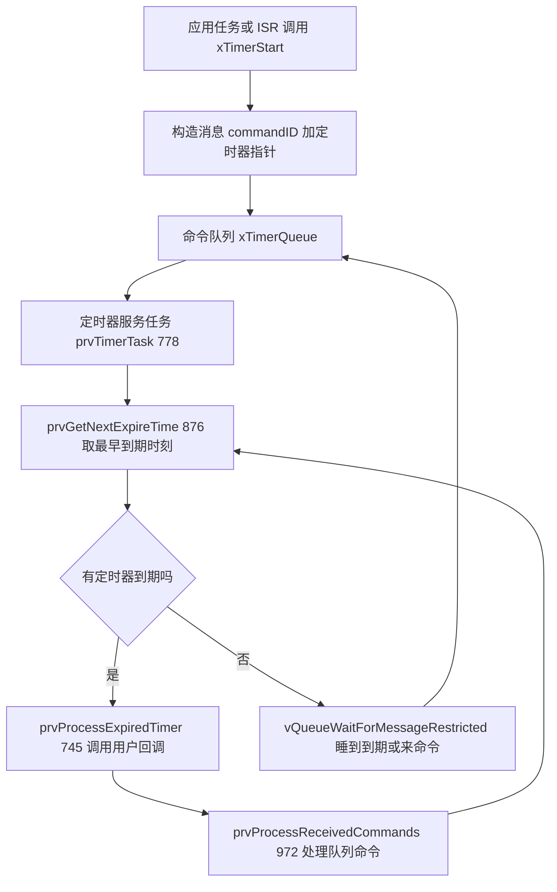
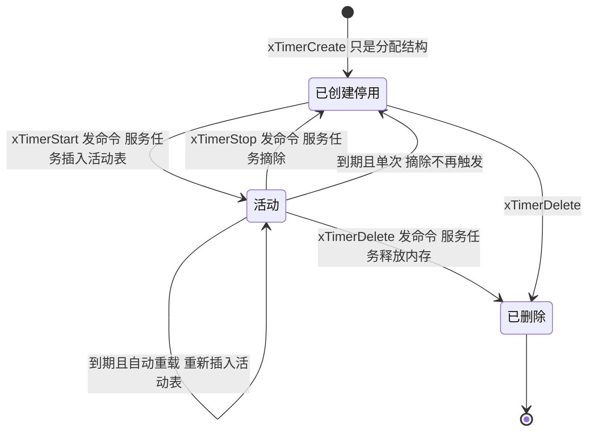
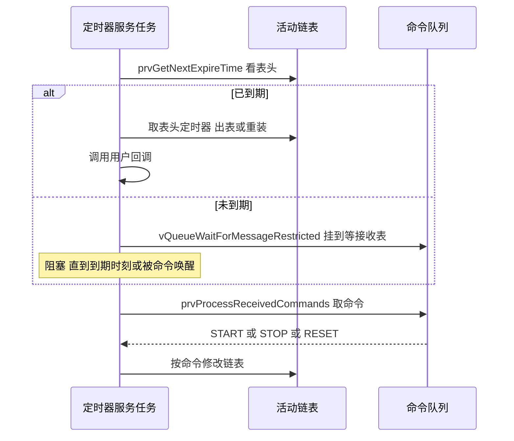

# timers.c 与 timers.h —— 软件定时器完全解读

> 对应源文件（本地仓库 `~/workspace/freertos/`，FreeRTOS-Kernel V11.1.0+，行号以当前文件为准）：
> - [timers.c](/Users/theo-richard/workspace/freertos/timers.c)（1391 行）—— 定时器实现 + 定时器服务任务
> - [include/timers.h](/Users/theo-richard/workspace/freertos/include/timers.h)（1231 行）—— `Timer_t` 声明、API 宏、命令 ID
>
> **前置阅读：** [list.md](list.md)（链表）→ [tasks.md](tasks.md)（任务）→ [queue.md](queue.md)（队列）
> **配置项：** [freertosconfigh.md](freertosconfigh.md)

---

# 第一部分：先掌握什么、按什么顺序读

## 1.1 三句话讲清软件定时器

1. **软件定时器不是硬件定时器**：它靠**一个普通任务**（定时器服务任务/守护任务）加**一条链表**实现，
   精度取决于 tick（默认 100Hz 时约 10ms，且没有抖动保证）；
2. **所有定时器回调都在同一个任务里串行执行**（`prvTimerTask`，timers.c:778）——
   所以回调里**绝对不能用会阻塞的 API**，否则所有定时器一起瘫痪；
3. **启动/停止定时器本身是"发一条命令到队列"**，不是直接操作链表（`xTimerStart` 只是往
   命令队列里塞消息，semphr 式的宏转发，timers.h:453）。

## 1.2 这个设计的核心：一个任务 + 一条有序链表 + 一条命令队列

```text
   应用任务 / ISR                        定时器服务任务 prvTimerTask (timers.c:778)
   ─────────────                        ─────────────────────────────────────────
   xTimerStart( t, 0 )
        │                                    for(;;)
        ▼                                      │
   往 xTimerQueue 塞一条命令  ───────────────►  ① prvGetNextExpireTime()   取最早到期时刻
   { tmrCOMMAND_START, 定时器指针, 值 }         │
                                               ② prvProcessTimerOrBlockTask()
                                                    ├─ 有到期 → prvProcessExpiredTimer() 调回调
                                                    └─ 没有   → 阻塞等待（到点 或 来命令）
                                               ③ prvProcessReceivedCommands()
                                                    └─ 把队列里的 START/STOP/RESET 命令作用到链表

   等到期靠的是 vQueueWaitForMessageRestricted（queue.c:3114）：
   它让服务任务"睡到下一个到期时刻"，同时"如果来命令就立刻醒"
```

**一句话：定时器服务任务平时睡着，要么被"命令"叫醒，要么被"下一个定时器到期"叫醒。**

## 1.3 必须提前搞懂的 6 个概念

### 概念 1：定时器链表按"到期时刻"排序

所有活动定时器挂在 `pxCurrentTimerList`（活动表）上，**按绝对到期时刻升序**
（用 [list.md](list.md) 的 `vListInsert`）。所以：

- **表头就是下一个要处理的定时器**，O(1) 就能知道下个到期时刻；
- 不需要遍历，不需要扫描所有定时器。

### 概念 2：双链表防 tick 回绕（和任务的延时表同一招）

```c
static List_t xActiveTimerList1;    // timers.c:168
static List_t xActiveTimerList2;    // timers.c:169
static List_t * pxCurrentTimerList; // 指向当前使用的那张
static List_t * pxOverflowTimerList;// 指向溢出那张
```

到期时刻算出来溢出了（跨过 TickType 最大值）→ 进溢出表；
tick 计数回绕时 `prvSwitchTimerLists`（timers.c:1131）把两张表交换。

**这与 tasks.c 的延时表是完全相同的技巧**，因为解决的是同一个问题（详见 [tasks.md](tasks.md) 图 6）。

### 概念 3：回调在"服务任务上下文"执行，不在中断里

定时器到期时，回调函数是**在 `prvTimerTask` 这个任务的栈上、以任务的权限**执行的。

三个直接后果：

| 后果 | 说明 |
|---|---|
| 可以用大部分任务级 API | 因为在任务上下文，不是 ISR |
| **不能用会阻塞的 API** | 比如 `vTaskDelay`、带非零超时的 `xQueueReceive`——会让所有定时器卡住 |
| 回调执行时间长 = 所有定时器延迟 | 因为只有一个任务，串行执行 |

**这是软件定时器最大的使用陷阱。** 回调应尽量短，或者只发个信号让别的任务去做。

### 概念 4：命令队列（xTimerQueue）—— 所有 API 的实际动作

`configUSE_TIMERS=1` 时内核创建一条私有队列，长度 `configTIMER_QUEUE_LENGTH`（默认 10）。

**所有 `xTimerXxx` API 都只是往这条队列里发消息**，真正的链表操作在服务任务里做：

| 命令 ID | 值 | 宏 | 定义处 |
|---|---:|---|---|
| `tmrCOMMAND_EXECUTE_CALLBACK_FROM_ISR` | -2 | — | timers.h:57 |
| `tmrCOMMAND_EXECUTE_CALLBACK` | -1 | `xTimerPendFunctionCall` | timers.h:58 |
| `tmrCOMMAND_START_DONT_TRACE` | 0 | 内部启动 | timers.h:59 |
| `tmrCOMMAND_START` | 1 | `xTimerStart` | timers.h:60 |
| `tmrCOMMAND_RESET` | 2 | `xTimerReset` | timers.h:61 |
| `tmrCOMMAND_STOP` | 3 | `xTimerStop` | timers.h:62 |
| `tmrCOMMAND_CHANGE_PERIOD` | 4 | `xTimerChangePeriod` | timers.h:63 |
| `tmrCOMMAND_DELETE` | 5 | `xTimerDelete` | timers.h:64 |
| `tmrCOMMAND_START_FROM_ISR` 等 | 6-9 | `xTimerStartFromISR` 等 | timers.h:67-70 |

**为什么这么设计？** 因为定时器链表只能被一个上下文修改（否则要加锁）。
把所有修改都集中到服务任务里，链表就永远不需要临界区保护——**用消息传递代替锁**。

### 概念 5：单次 vs 自动重载（auto-reload）

`Timer_t.ucStatus` 的一个位（`tmrSTATUS_IS_AUTORELOAD`，timers.c:99）决定到期后的行为：

- **自动重载**（默认）：到期 → 调回调 → **重新插入链表**，周期重复；
- **单次**：到期 → 调回调 → 留在链表外，不再触发。用 `vTimerSetReloadMode(t, pdFALSE)` 切换。

### 概念 6：定时器不是"精确"的

- 分辨率 = 1 tick（默认 100Hz → 10ms）；
- 到期处理延迟：取决于服务任务的优先级、当前是否有更高优先级任务、
  以及其他定时器回调执行了多久；
- **到期时刻是"不早于"而非"恰好"**。

需要精确时序的场景（如高速 PWM）必须用**硬件定时器**，软件定时器只适合"几十毫秒级、不苛刻"的场合。

## 1.4 推荐阅读顺序（5 站）

```text
┌─ 第 1 站：Timer_t 结构 ──────────────────────────────────────────
│  timers.c:102-119   （7 个字段，很短）
│  目标：认出 xTimerListItem（链表项）、xTimerPeriodInTicks、ucStatus
└──────────────────────────────────────────────────────────────────
                          │
                          ▼
┌─ 第 2 站：创建 ──────────────────────────────────────────────────
│  xTimerCreate            timers.c:354
│  xTimerCreateStatic      timers.c:389
│  prvInitialiseNewTimer   timers.c:438
│  目标：注意创建时"不启动"，只是填结构、初始化链表项
└──────────────────────────────────────────────────────────────────
                          │
                          ▼
┌─ 第 3 站：命令通道（理解所有 API 的关键）──────────────────────────
│  xTimerGenericCommandFromTask   timers.c:471
│  xTimerGenericCommandFromISR    timers.c:524
│  timers.h:453-943  各 API 宏只是填不同的 commandID
│  目标：明白 xTimerStart 并不启动定时器，只是发了一条消息
└──────────────────────────────────────────────────────────────────
                          │
                          ▼
┌─ 第 4 站：服务任务主循环（核心中的核心）──────────────────────────
│  prvTimerTask               timers.c:778
│    ├─ prvGetNextExpireTime       timers.c:876
│    ├─ prvProcessTimerOrBlockTask timers.c:814   ★ 睡到下一个到期时刻
│    │     └─ vQueueWaitForMessageRestricted  queue.c:3114
│    └─ prvProcessReceivedCommands timers.c:972   ★ 处理启动/停止命令
│  目标：吃透这三步，软件定时器就完全懂了
└──────────────────────────────────────────────────────────────────
                          │
                          ▼
┌─ 第 5 站：到期处理与链表维护 ────────────────────────────────────
│  prvProcessExpiredTimer  timers.c:745
│  prvReloadTimer          timers.c:725
│  prvInsertTimerInActiveList timers.c:925
│  prvSwitchTimerLists     timers.c:1131  （防回绕换表）
└──────────────────────────────────────────────────────────────────
```

---

# 第二部分：数据类型

## 2.1 `Timer_t`（timers.c:102-119）

| 字段 | 行号 | 作用 |
|---|---|---|
| `pcTimerName` | 104 | 名字，**内核完全不用**，只为调试 |
| `xTimerListItem` | 105 | **挂在活动表上的链表项**（list.h 的结构） |
| `xTimerPeriodInTicks` | 106 | 周期（tick 数） |
| `pvTimerID` | 107 | 用户自定义 ID。**多个定时器共用一个回调时靠它区分** |
| `pxCallbackFunction` | 108 | 到期时调用的函数 |
| `uxTimerNumber` | 110 | 调试编号（`configUSE_TRACE_FACILITY=1`） |
| `ucStatus` | 112 | **状态位**：是否活动 / 是否静态分配 / 是否自动重载 |

**只有 7 个字段。** 定时器结构非常简单——因为它不存时间，只用 `xTimerListItem.xItemValue`
存"绝对到期时刻"（借用 [list.md](list.md) 提到的排序键）。

## 2.2 `ucStatus` 的三个位（timers.c:97-99）

```c
#define tmrSTATUS_IS_ACTIVE                  ( 0x01U )   // 是否在活动表上
#define tmrSTATUS_IS_STATICALLY_ALLOCATED    ( 0x02U )   // 内存是否用户提供
#define tmrSTATUS_IS_AUTORELOAD              ( 0x04U )   // 到期后是否自动重装
```

**为什么用位而不是独立字段？** 省内存。这三个状态每个只需 1 bit，用 3 个 `UBaseType_t`
（12 字节）vs 1 个 `uint8_t`（1 字节）——在几十个定时器的系统上差异可观。

---

# 第三部分：timers.c 核心机制

## 3.1 创建：`xTimerCreate`（timers.c:354）→ `prvInitialiseNewTimer`（438）

```text
xTimerCreate( pcTimerName, xTimerPeriodInTicks, uxAutoReload, pvTimerID, pxCallbackFunction )
  timers.c:354
  ├─ pvPortMalloc( sizeof( Timer_t ) )
  ├─ prvInitialiseNewTimer( ... )              timers.c:438
  │    ├─ 填 pcTimerName / xTimerPeriodInTicks / pvTimerID / pxCallbackFunction
  │    ├─ vListInitialiseItem( &xTimerListItem )    ← list.c:151，pxContainer = NULL
  │    ├─ ucStatus 按 uxAutoReload 设置 tmrSTATUS_IS_AUTORELOAD 位
  │    └─ prvCheckForValidListAndQueue()            timers.c:1157
  │          └─ 首次调用时创建命令队列 + 初始化两张活动表 + 创建服务任务
  └─ 返回句柄
```

**关键：`xTimerCreate` 不启动定时器。** 创建后它是"停着"的（不在活动表上），
必须调用 `xTimerStart` 才开始计时。

`prvCheckForValidListAndQueue`（timers.c:1157）是"懒初始化"的入口：
只有在你第一次创建定时器时才创建命令队列和服务任务。

## 3.2 所有 API 都只是"发命令"：`xTimerGenericCommandFromTask`（timers.c:471）

```text
xTimerStart( t, xTicksToWait )                        timers.h:453
  展开为 → xTimerGenericCommand( t, tmrCOMMAND_START,
                                 xTaskGetTickCount(), NULL, xTicksToWait )
    │
    ├─ 构造一条消息 { commandID, 定时器指针, 附加参数（如 tick 值/新周期） }
    └─ xQueueGenericSend( xTimerQueue, &msg, xTicksToWait, queueSEND_TO_BACK )
          └─ queue.c:941  ← 就是普通队列发送！

xTimerStartFromISR( t, pxWoken )                      timers.h:764
  展开为 → xTimerGenericCommand( t, tmrCOMMAND_START_FROM_ISR, ..., pxWoken, 0 )
    └─ xQueueGenericSendFromISR( xTimerQueue, ... )   ← queue.c:1156
```

**读到这里应该有的顿悟：**
`xTimerStart` 除了把命令塞进队列，**什么也没做**。定时器还没开始计时。
真正的启动发生在服务任务读到这条命令之后。

**所以 `xTimerStart(t, 0)` 返回 `pdPASS` 只代表"命令入队成功"**，
不代表"定时器已经开始跑"。这是很多人误以为 `xTimerStart` 会立刻生效的原因。

## 3.3 服务任务主循环：`prvTimerTask`（timers.c:778）

```text
prvTimerTask( pvParameters )                             timers.c:778
  │
  ├─ （若 configUSE_DAEMON_TASK_STARTUP_HOOK=1）调启动钩子   timers.c:792
  │
  └─ for( ;; )                                           timers.c:796
       ├─ ① xNextExpireTime = prvGetNextExpireTime( &xListWasEmpty )   timers.c:801 / 876
       │      └─ 看活动表表头：有定时器就取它的到期时刻，没有则返回 0 并置空标志
       │
       ├─ ② prvProcessTimerOrBlockTask( xNextExpireTime, xListWasEmpty )  timers.c:806 / 814
       │      ├─ vTaskSuspendAll()                          timers.c:820
       │      ├─ xTimeNow = prvSampleTimeNow( ... )         timers.c:827  （必要时换表）
       │      ├─ 若没换表且已到期 → xTaskResumeAll() 后
       │      │      prvProcessExpiredTimer( ... )          timers.c:835 / 745
       │      └─ 否则（未到期或表空）
       │             vQueueWaitForMessageRestricted( xTimerQueue,
       │                     xNextExpireTime - xTimeNow, xListWasEmpty )   timers.c:852
       │               │     queue.c:3114
       │               │     ├─ 把"我"挂到命令队列的等接收表上
       │               │     └─ 超时设为"到下一个定时器到期"的时间
       │               │        → 要么到点醒，要么来命令立刻醒
       │               └─ xTaskResumeAll()                  timers.c:854
       │
       └─ ③ prvProcessReceivedCommands()                    timers.c:809 / 972
              └─ 从队列取消息，按 commandID 分派：
                   START          → prvInsertTimerInActiveList   入活动表
                   STOP           → uxListRemove                 出活动表
                   RESET          → 重新算时刻、重新插入
                   CHANGE_PERIOD  → 改周期、重新插入
                   DELETE         → 出表 + vPortFree
                   EXECUTE_CALLBACK → 直接调用被挂起的函数
```

**第 ② 步是这个文件最精妙的地方**，详见下一节。

## 3.4 精妙之处：`vQueueWaitForMessageRestricted`（queue.c:3114）

普通任务阻塞是"睡固定时间"或"无限等"。但服务任务需要**"睡到某个绝对时刻，但来命令要立刻醒"**。

普通做法是"用短超时轮询"——浪费 CPU。FreeRTOS 的做法是特制的受限阻塞：

```c
vQueueWaitForMessageRestricted( xTimerQueue, xTicksToWait, xWaitIndefinitely )
  queue.c:3114
  ├─ prvLockQueue( pxQueue )                       （锁队列，防止 ISR 冲突）
  ├─ if( 队列里没有消息 )
  │     └─ vTaskPlaceOnEventListRestricted( &xTasksWaitingToReceive,
  │                                        xTicksToWait, xWaitIndefinitely )
  │          └─ 把自己挂到"等接收"表 + 延时表（睡 xTicksToWait）
  ├─ prvUnlockQueue( pxQueue )
  └─ 返回——注意：并不真正阻塞，只是"挂好了"，出调度器锁定后才让出
```

**为什么叫 "Restricted"（受限）？** 源码注释（queue.c:3114 区段）说得很清楚：
它不属于公共 API，专供内核使用，且"可能导致对最多只含一个节点的链表调用 `vListInsert`"
——所以必须**在调度器挂起状态下调用**（不是临界区），这正是 `prvProcessTimerOrBlockTask`
先用 `vTaskSuspendAll()`（timers.c:820）再调它的原因。

**效果：服务任务睡到"下一个定时器该到期的时刻"；如果这期间来了新命令
（比如你 `xTimerStart` 了一个更早到期的定时器），队列消息会让它立刻醒来重算。**

## 3.5 到期处理：`prvProcessExpiredTimer`（timers.c:745）

```text
prvProcessExpiredTimer( xNextExpireTime, xTimeNow )    timers.c:745
  ├─ pxTimer = listGET_OWNER_OF_HEAD_ENTRY( pxCurrentTimerList )  ← 表头 = 最早到期
  ├─ 若是自动重载：prvReloadTimer( pxTimer, xTimeNow, ... )       timers.c:725
  │     └─ 把到期时刻 += 周期，重新插回活动表（prvInsertTimerInActiveList）
  ├─ 若是单次：uxListRemove( &pxTimer->xTimerListItem )   ← 离开活动表，不再触发
  └─ pxTimer->pxCallbackFunction( pxTimer )               ← ★ 调用用户回调
```

**注意顺序：先"重装/摘除"，后"调回调"。** 这样即使回调里又 `xTimerStop` 自己，
也不会破坏链表结构——但回调里**不能** `xTimerDelete` 自己，那会释放正在使用的内存。

## 3.6 插入活动表：`prvInsertTimerInActiveList`（timers.c:925）

```text
prvInsertTimerInActiveList( pxTimer, xNextExpiryTime, xTimeNow, xCommandTime )
  │
  ├─ 把 xNextExpiryTime 写进 xTimerListItem.xItemValue     ← 排序键 = 绝对到期时刻
  ├─ 若已过期（xNextExpiryTime <= xTimeNow）→ 立刻返回 pdTRUE（该马上处理）
  ├─ 若比"命令发出时刻"还早（说明算错了）→ 也返回 pdTRUE
  └─ 否则 vListInsert( pxCurrentTimerList, &xTimerListItem )   ← 按时刻有序插入
```

**三个"异常"判断都是为防止边界情况**（如周期为 0、tick 刚好回绕、命令延迟处理）。

---

# 第四部分：timers.h 的 API 一览

## 4.1 任务级 API

| API | timers.h | 命令 ID | 说明 |
|---|---:|---|---|
| `xTimerCreate` | — （声明） | — | 创建，**不启动** |
| `xTimerStart(t, wait)` | 453 | `tmrCOMMAND_START` (1) | 启动或重启（重置计时） |
| `xTimerStop(t, wait)` | 487 | `tmrCOMMAND_STOP` (3) | 停止 |
| `xTimerChangePeriod(t, new, wait)` | 553 | `tmrCOMMAND_CHANGE_PERIOD` (4) | 改周期并启动 |
| `xTimerReset(t, wait)` | 696 | `tmrCOMMAND_RESET` (2) | 重置计时（类似 Start 但语义不同） |
| `xTimerDelete(t, wait)` | 587 | `tmrCOMMAND_DELETE` (5) | 删除并释放内存 |

## 4.2 中断级 API（全部只有 `wait = 0`）

| API | timers.h | 命令 ID |
|---|---:|---|
| `xTimerStartFromISR(t, w)` | 764 | `tmrCOMMAND_START_FROM_ISR` (6) |
| `xTimerStopFromISR(t, w)` | 815 | `tmrCOMMAND_STOP_FROM_ISR` (8) |
| `xTimerChangePeriodFromISR(t, new, w)` | 875 | `tmrCOMMAND_CHANGE_PERIOD_FROM_ISR` (9) |
| `xTimerResetFromISR(t, w)` | 943 | `tmrCOMMAND_RESET_FROM_ISR` (7) |

**ISR 版全部不等待**（命令队列满就返回 `pdFAIL`），因为中断里不能阻塞。

## 4.3 查询/设置类（直接操作结构，不发命令）

| API | timers.c | 说明 |
|---|---:|---|
| `xTimerIsTimerActive` | 1209 | 查 `ucStatus` 的 ACTIVE 位 |
| `pvTimerGetTimerID` | 1238 | 取 `pvTimerID` |
| `vTimerSetTimerID` | 1259 | 设 `pvTimerID`（回调里用来区分实例） |
| `xTimerGetPeriod` | 583 | 取周期 |
| `vTimerSetReloadMode` | 597 | 切换单次/自动重载 |
| `xTimerGetReloadMode` | 622 | 查重载模式 |
| `xTimerGetExpiryTime` | 664 | 取下次到期时刻 |
| `pcTimerGetName` | 711 | 取名字 |

**注意这一组都不发命令**——因为只读、或只改不影响链表排序的字段。
但 `vTimerSetReloadMode` 改了行为位，**在回调外部修改要小心竞态**。

## 4.4 在服务任务里执行任意函数：`xTimerPendFunctionCall`（timers.c:1311）

```c
xTimerPendFunctionCall( xFunctionToPend, pvParameter1, ulParameter2, xTicksToWait )
```

把一个函数"委托"给定时器服务任务执行。用途：

- 在 ISR 里需要执行较重的、非实时的处理 → 挂到服务任务去跑；
- 想"串行化"某些操作（因为服务任务本身是串行的）。

**注意：这共享了服务任务的执行时间**，重活会拖慢所有定时器。

---

# 第五部分：图

## 5.1 图 1：整体架构

```text
  应用任务 / ISR
  ─────────────
   xTimerStart / xTimerStop / xTimerReset / xTimerChangePeriod
        │
        │ 全部只是"发一条消息"
        ▼
   ┌─ 命令队列 xTimerQueue（长度 configTIMER_QUEUE_LENGTH）
   │   消息 = { commandID, Timer_t*, 附加参数 }
   │   例：{ tmrCOMMAND_START, &timer1, xTaskGetTickCount() }
   └─────────┬──────────────────────────────────────────────
             │
             ▼
   ╔═ 定时器服务任务 prvTimerTask（timers.c:778）═══════════════
   ║  优先级 configTIMER_TASK_PRIORITY，栈 configTIMER_TASK_STACK_DEPTH
   ║
   ║  for(;;)
   ║    ├─ 取下个到期时刻 prvGetNextExpireTime        876
   ║    ├─ 睡到那一刻或来命令 prvProcessTimerOrBlockTask 814
   ║    │     ├─ 到期 → 调用户回调 prvProcessExpiredTimer 745
   ║    │     └─ 未到 → vQueueWaitForMessageRestricted
   ║    └─ 处理队列里的命令 prvProcessReceivedCommands 972
   ╚════════════════════════════════════════════════════════════
             │
             ▼
   活动链表 pxCurrentTimerList（按绝对到期时刻升序）
        表头 = 最早到期的定时器
        Timer_t.xTimerListItem.xItemValue = 绝对到期时刻
```

## 5.2 图 2：服务任务的一次循环

```text
第 N 次循环开始
  │
  ├─ prvGetNextExpireTime
  │    活动表空？
  │      ├─ 是 → 返回 0，xListWasEmpty = pdTRUE
  │      └─ 否 → 返回表头的 xItemValue（最早到期时刻）
  │
  ├─ prvProcessTimerOrBlockTask( xNextExpireTime, xListWasEmpty )
  │    │
  │    ├─ vTaskSuspendAll()
  │    ├─ xTimeNow = prvSampleTimeNow()   ← 顺便检查要不要换表（防回绕）
  │    │
  │    ├─ 有没有到期？（xNextExpireTime <= xTimeNow 且没换表）
  │    │    ├─ 是 → xTaskResumeAll() → prvProcessExpiredTimer()
  │    │    │        └─ 调回调（可能重装或摘除）
  │    │    │
  │    │    └─ 否 → vQueueWaitForMessageRestricted(
  │    │              xTimerQueue,
  │    │              xNextExpireTime - xTimeNow,   ← 睡多久
  │    │              xListWasEmpty )               ← 表空则无限等
  │    │            └─ 把自己挂进队列的等接收表 + 延时表
  │    │              → 到点醒 or 来命令醒
  │    │           xTaskResumeAll()   ← 这里才真正切换走
  │
  └─ prvProcessReceivedCommands()
       从队列取消息，逐条处理（见下图）
```

## 5.3 图 3：命令分派（prvProcessReceivedCommands，timers.c:972）

```text
从 xTimerQueue 取到一条消息
  │
  ├─ commandID == tmrCOMMAND_EXECUTE_CALLBACK (-1) 或 _FROM_ISR (-2)
  │     └─ 直接调用 pendedFunction( pvParameter1, ulParameter2 )
  │        （不涉及任何定时器链表）
  │
  └─ 否则是定时器操作：
       ├─ STOP     → uxListRemove( &xTimerListItem )
       │              ucStatus 清 ACTIVE 位
       ├─ START / RESET
       │     ├─ 算 xNextExpiryTime = 命令里的时刻 + 周期
       │     ├─ prvInsertTimerInActiveList( ... )   timers.c:925
       │     │     └─ 写 xItemValue = 绝对到期时刻，vListInsert 进活动表
       │     └─ ucStatus 置 ACTIVE 位
       ├─ CHANGE_PERIOD
       │     ├─ 改 xTimerPeriodInTicks
       │     ├─ 重新算到期时刻、重新插入
       │     └─ 置 ACTIVE 位
       └─ DELETE   → uxListRemove + 清 ACTIVE + vPortFree( pxTimer )
```

**关键：所有链表修改都在这个任务里、串行发生。** 所以活动表**从不需要临界区保护**
——这就是"用消息传递代替锁"的收益。

## 5.4 图 4：双链表防回绕

```text
场景：TickType 32 位，当前 tick = 0xFFFFFFF0
  定时器 A：周期 5   → 到期 = 0xFFFFFFF5（没溢出）
  定时器 B：周期 0x20 → 到期 = 0x00000010（溢出了）

处理：
  到期时刻 < 当前 tick → 判定溢出 → 进 溢出表
  到期时刻 > 当前 tick → 没溢出   → 进 当前活动表

  pxCurrentTimerList（当前活动表）      pxOverflowTimerList（溢出表）
    → A  0xFFFFFFF5                     → B  0x00000010

tick 到 0xFFFFFFF5：A 到期、处理、当前表空
tick 回绕到 0x00000000：
  prvSampleTimeNow 检测到回绕 → prvSwitchTimerLists()   timers.c:1131
    ├─ 交换 pxCurrentTimerList 和 pxOverflowTimerList
    └─ 之后"当前表"就是原来放 B 的那张，B 的 0x10 可以正常比较了

★ 与 tasks.c 的 taskSWITCH_DELAYED_LISTS 完全同构（tasks.c:315）
```

## 5.5 图 5：单次 vs 自动重载

```text
自动重载（uxAutoReload = pdTRUE，默认）

  t=0        t=100      t=200      t=300
   │          │          │          │
   Start     到期       到期       到期
   │          │          │          │
   ▼          ▼          ▼          ▼
   入表 ──► 回调 ──► 重装 ──► 回调 ──► 重装 ──► 回调 ──► ...
              ▲ 到期时刻 += 周期，重新插回活动表
              让所有定时器延迟

单次（uxAutoReload = pdFALSE，或 vTimerSetReloadMode(t, pdFALSE)）

  t=0        t=100
   │          │
   Start     到期
   │          │
   ▼          ▼
   入表 ──► 回调 ──► 出表，不再触发
                    （要再触发必须重新 Start/Reset）
```

## 5.6 图 6：Mermaid 版本

### 命令流与执行流



### 定时器状态



### 服务任务一次循环



---

# 第六部分：易错点与速查

## 6.1 最容易误解的 8 处

| # | 误解 | 实际 |
|---|---|---|
| 1 | 以为软件定时器有独立硬件 | 靠一个普通任务 + 一条有序链表，分辨率 = 1 tick |
| 2 | 以为回调在中断里跑 | 在 `prvTimerTask` 任务上下文，可以用任务级 API |
| 3 | 在回调里调用阻塞 API | **灾难**：所有定时器一起卡死。回调必须短、不许阻塞 |
| 4 | 以为 `xTimerStart` 立刻生效 | 只是发命令入队；生效在服务任务处理到它时 |
| 5 | 以为定时器精确 | 到期时刻是"不早于"，有任务调度延迟；需要精确用硬件定时器 |
| 6 | 以为服务任务优先级无所谓 | 优先级太低 → 定时器集体延迟；见 `configTIMER_TASK_PRIORITY` |
| 7 | 在回调里 `xTimerDelete` 自己 | 会释放正在执行的定时器内存 → 崩溃。用 `xTimerStop` 或让别的任务删 |
| 8 | 以为命令队列可以很长 | 长度是 `configTIMER_QUEUE_LENGTH`（默认 10）；满了 `xTimerStart` 返回 `pdFAIL` |

## 6.2 配置项影响速查

| 配置项 | 默认 | 影响 |
|---|---|---|
| `configUSE_TIMERS` | 0（模板中为 1） | 必须为 1 才有软件定时器 |
| `configTIMER_TASK_PRIORITY` | `configMAX_PRIORITIES-1` | 服务任务优先级，**直接影响定时精度** |
| `configTIMER_QUEUE_LENGTH` | 10 | 命令队列长度，频繁 start/stop 时要加大 |
| `configTIMER_TASK_STACK_DEPTH` | `configMINIMAL_STACK_SIZE` | 服务任务栈；**回调在此栈上执行**，回调吃栈要加大 |
| `configUSE_DAEMON_TASK_STARTUP_HOOK` | 0 | 为 1 时服务任务启动时调 `vApplicationDaemonTaskStartupHook`（timers.c:792） |

> **重点：回调的栈就是服务任务的栈**（`configTIMER_TASK_STACK_DEPTH`）。
> 回调里用大局部数组或调用 printf 很容易爆栈，且症状是"随机的定时器异常"。

## 6.3 行号自查命令

```bash
grep -n "TimerHandle_t xTimerCreate"            timers.c
grep -n "prvTimerTask"                          timers.c
grep -n "prvProcessExpiredTimer"                timers.c
grep -n "prvProcessTimerOrBlockTask"            timers.c
grep -n "prvProcessReceivedCommands"            timers.c
grep -n "prvInsertTimerInActiveList"            timers.c
grep -n "BaseType_t xTimerPendFunctionCall("    timers.c
```

期望（当前 timers.c 共 1391 行）：

```text
354:TimerHandle_t xTimerCreate(
745:static void prvProcessExpiredTimer(
778:static portTASK_FUNCTION( prvTimerTask,
814:static void prvProcessTimerOrBlockTask(
925:static BaseType_t prvInsertTimerInActiveList(
972:static void prvProcessReceivedCommands(
1311:BaseType_t xTimerPendFunctionCall(
```

## 6.4 一句话总结

- **一个任务（`prvTimerTask`）+ 一条按到期时刻排序的链表 + 一条命令队列**，就是软件定时器的全部。
- **所有 API 都只是发命令**（timers.h 里 6 个任务级 + 4 个 ISR 级宏），
  真正的链表操作全部串行在服务任务里 → **链表不需要任何锁**。
- **服务任务的睡眠靠 `vQueueWaitForMessageRestricted`**（queue.c:3114）：
  睡到"下一个到期时刻"，同时"来命令立刻醒"。
- **回调在服务任务上下文串行执行**：可以用任务 API、**不能阻塞、不能太长、共用同一个栈**。
- 双链表防回绕与 tasks.c 的延时表完全同构（timers.c:1131 ↔ tasks.c:315）。
- 下一步：读 [event_groups.md](event_groups.md)（事件组）——它是"一次等多个条件"的解法。
