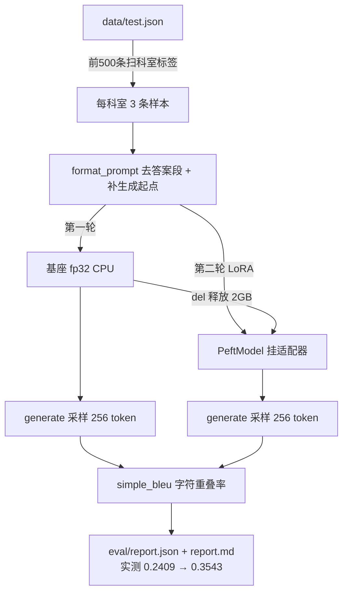

# evaluate.py —— 微调前后 A/B 对比评估（A级逐函数深读）

对应源文件：`model-training/scripts/evaluate.py`（原 209 行，注释后共 216 行）

> 互链：[Docs/03-数据流与接口协议](../../../references/firmware/loongson-medical-core/Docs/03-数据流与接口协议.md) ·
> KB：[train_lora.md](train_lora.md)（被评对象）· [preprocess_data.md](preprocess_data.md)（测试集来源）

## 1. 文件定位

训练流水线第 4 步：同一批测试样本分别喂**原始基座**与**LoRA 微调模型**，字符级 BLEU-1 打分，产出 JSON + Markdown 双报告。实测结论（outputs/eval/report.md）：**0.2409 → 0.3543，提升 +47.1%**。

## 2. 模块级配置（L10-L13）

| 配置 | 行号 | 值 | 说明 |
|---|---|---|---|
| `MODEL_PATH` | L10 | `.` | 基座目录（与 train_lora 同约定） |
| `LORA_PATH` | L11 | `lora_adapter` | 被评适配器 |
| `TEST_DATA` | L12 | `data/test.json` | preprocess_data 划出的测试集 |
| `NUM_SAMPLES` | L13 | 10 | 名义值；实际按科室每科最多 3 条 |

## 3. 逐函数总表

| 函数 | 行号 | 职责 | 备注 |
|---|---|---|---|
| `format_prompt` | L17 | messages → ChatML 文本（不含 assistant 段） | 调用方补生成起点 |
| `generate` | L28 | 采样生成 + 截出新增部分 | Qwen 官方采样参数 |
| `simple_bleu` | L52 | 字符集合重叠率 | 非 n-gram BLEU |
| `main` | L65 | 抽样 → A/B 评测 → 汇总 → 双报告 | — |

## 4. 关键代码精读

### 4.1 generate：采样参数与"只留续写"（L28-L50）

```python
# evaluate.py L34-L46
    with torch.no_grad():   # 评估不需要梯度，省一半内存
        outputs = model.generate(
            **inputs,
            max_new_tokens=max_new_tokens,   # 0.5B CPU 推理：256 token 约几秒~十几秒
            temperature=0.7,      # Qwen2.5 官方推荐采样温度（比默认 1.0 更稳）
            top_p=0.8,
            top_k=20,
            do_sample=True,       # 采样生成而非贪心，更接近真实使用场景
            pad_token_id=tokenizer.pad_token_id,
            eos_token_id=tokenizer.eos_token_id,
        )

    # 只提取新生成的部分
    input_len = inputs.input_ids.shape[1]
    generated_ids = outputs[0][input_len:]   # 切掉 prompt 回显，只留续写
    response = tokenizer.decode(generated_ids, skip_special_tokens=True)
    return response.strip()
```

`outputs[0][input_len:]` 是 HF generate 的标准姿势：输出序列包含 prompt 回显，按下标切开只评"模型自己写的部分"。

### 4.2 simple_bleu：它的数学与局限（L52-L63）

```python
# evaluate.py L54-L61
    # 注意：这是"字符集合重叠率"，不是标准 BLEU（无 n-gram、无短惩罚），
    # 只能用于同条件下两模型的相对比较，绝对值无语言学意义
    ref_chars = set(reference)
    cand_chars = set(candidate)
    if not cand_chars:
        return 0.0   # 空输出记 0 分，不参与 NaN
    overlap = len(ref_chars & cand_chars)
    return overlap / len(cand_chars)
```

打分 = |参考字符集 ∩ 候选字符集| / |候选字符集|。注意两个失真：重复字符只算一次（超长废话不吃亏多少）、顺序无关。所以它适合"同一测试集上 A/B 相对比较"，47.1% 这个数字也只有在对比意义上有效。

### 4.3 抽样协议：每科室 3 条（L76-L90）

```python
# evaluate.py L76-L88（节选）
    for item in test_data[:500]:  # 只看前500条
        msgs = item["messages"]
        dept = "未知"
        for m in msgs:
            # 从 user 内容首行"【科室：xxx】"里抠出科室名
            if m["role"] == "user" and "科室" in m["content"]:
                dept = m["content"].split("：")[1].split("\n")[0] if "：" in m["content"] else "未知"
                break
        # ...
        if len(dept_samples[dept]) < 3:
            dept_samples[dept].append(item)   # 每科室最多 3 条，控制 CPU 推理总时长
```

**已知解析 bug**：user 首行是 `【科室：早泄】\n症状…`，`split("：")[1]`（L82）得 `早泄】\n…`，再 `split("\n")[0]` 得 `早泄】`——右书名号没剥掉。实测报告里科室名显示为"早泄】"，分组展示脏了但打分不受影响。

### 4.4 A/B 对称与内存控制（L95-L152）

```python
# evaluate.py L127-L129
    # 释放基础模型
    del base_model   # CPU 全精度 0.5B ≈ 2GB，先释放再载下一组，防内存翻倍
    torch.cuda.empty_cache() if torch.cuda.is_available() else None
```

```python
# evaluate.py L140-L141
    lora_model = PeftModel.from_pretrained(base_model, LORA_PATH)   # 基座挂载 LoRA 旁路
    lora_model.eval()   # 关 dropout，进评估模式
```

两轮循环的 prompt 构造逐字对称（L114 与 L149）：`format_prompt(msgs[:-1]) + "<|im_start|>assistant\n"`——把 messages 的最后一条（参考答案）摘掉，补上生成起点。基座跑完 `del` 释放再载 LoRA，8GB 内存机器即可复现。

### 4.5 汇总与双报告（L163-L205）

```python
# evaluate.py L163-L164
    avg_base_bleu = sum(r["bleu1_char"] for r in base_results) / len(base_results) if base_results else 0
    avg_lora_bleu = sum(r["bleu1_char"] for r in lora_results) / len(lora_results) if lora_results else 0
```

提升百分比的分母用 `max(avg_base_bleu, 0.001)` 防除零（L177）。报告三段式：整体指标表、各科室对比（L194-L201）、前 5 组样例逐条并排（L203-L210）。

## 5. 评估数据流



## 6. 已知问题（读码记录，未改代码）

1. 科室名解析保留尾部 `】`（L83），报告分组显示为"早泄】"；
2. `simple_bleu` 忽略字符频率与顺序，长短句打分粒度粗；
3. 抽样只看测试集前 500 条且每科 3 条，科室覆盖与总量都极小（实测仅 1 个科室组）；
4. `dept_samples` 为空时 `total_samples=0`，后面除法有 `max(…,0.001)` 兜底但报告会全 0。
