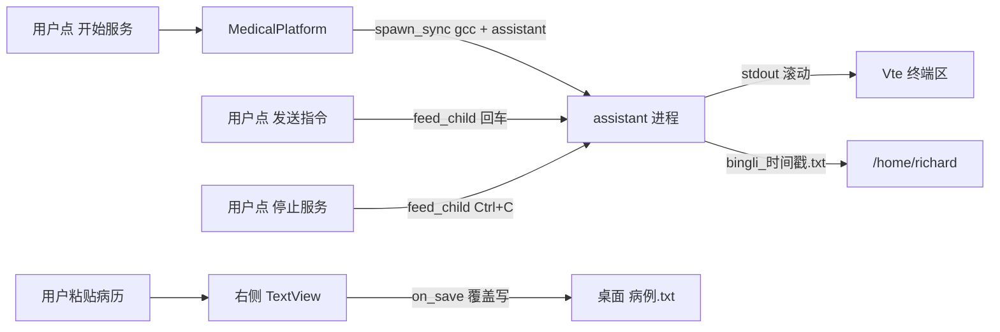

# medical_platform.py —— GTK3 医疗平台 GUI 壳（A级逐函数深读）

对应源文件：`embedded-application/medical-platform/medical_platform.py`（原 204 行，注释后共 223 行）

> 互链：[Docs/00-总览与架构](../../../references/firmware/loongson-medical-core/Docs/00-总览与架构.md) ·
> [Docs/01-启动与初始化](../../../references/firmware/loongson-medical-core/Docs/01-启动与初始化.md)

## 1. 文件定位

龙芯端侧的桌面入口：GTK3 窗口 + **Vte 原生终端**，职责只有三个——拉起/停止 assistant.c、实时展示其输出、把病历文本归档到桌面。选 Vte 而非 TextView 的根因：assistant.c 依赖"真终端"语义（`getchar()` 读回车、Ctrl+C 信号、PTY 行为），TextView 给不了。

## 2. 模块级常量

| 常量 | 行号 | 值 | 用途 |
|---|---|---|---|
| `ASSISTANT_SRC` | L17 | `/home/richard/assistant.c` | 编译输入 |
| `ASSISTANT_BIN` | L18 | `/home/richard/assistant` | 编译输出/运行 |
| `DESKTOP` | L19 | `~/Desktop` | 病例.txt 目标 |
| `LAUNCH_CMD` | L21 | `gcc -o … && assistant` | 编译+运行串联 |

`LAUNCH_CMD` 的 `&&` 是隐式编译门禁：gcc 失败就不会运行旧二进制。

## 3. 逐函数总表

| 方法 | 行号 | 职责 | 备注 |
|---|---|---|---|
| `__init__` | L28 | 建 1200×700 窗口与三面板 | 嵌套 Paned：左\|(中\|右) |
| `on_start` | L149 | 按钮状态机 + spawn 编译运行 | reset 清屏，DO_NOT_REAP_CHILD |
| `on_send_enter` | L167 | 喂回车 `b"\n"` | = 说完了 |
| `on_stop` | L172 | 喂 Ctrl+C `b"\x03"` | ETX → SIGINT |
| `_reset_buttons` | L177 | 恢复初始按钮态 | 开始可用/其余置灰 |
| `_on_vte_click` | L184 | 右键菜单复制 | `copy_clipboard_format(1)`=TEXT |
| `on_input_key` | L197 | 右侧 Enter 快捷保存 | 吞掉按键阻止换行 |
| `on_save` | L204 | 粘贴文本落盘桌面 | 已知隐患：except 吞异常 |
| `on_quit` | L218 | `Gtk.main_quit()` | assistant 靠 pidof 自清 |

## 4. 关键代码精读

### 4.1 版本钉死必须在 import 前（L10-L12）

```python
# medical_platform.py L10-L12
gi.require_version('Gtk', '3.0')
gi.require_version('Vte', '2.91')
gi.require_version('Pango', '1.0')
```

PyGObject 不钉版本会载入最新 API；Vte 2.91 与旧接口不兼容，顺序错了直接崩。

### 4.2 中栏 Vte 的环境注入（L100-L104）

```python
# medical_platform.py L100-L104
        env = os.environ.copy()
        # SenseVoice 的私有动态库路径：assistant.c 里 popen 拉起的
        # sense-voice-main 依赖它，必须在子进程环境里就位
        env["LD_LIBRARY_PATH"] = "/home/richard/sense_voice_demo/lib"
        self.vte_env = [k + "=" + v for k, v in env.items()]   # Vte 要求 KEY=VALUE 字符串列表
```

这条链路有**两处**注入（另一处在 assistant.c L308 setenv），且都指向同一目录——改 SenseVoice 部署路径时要同步两处。

### 4.3 on_start：一次点击的完整动作（L149-L165）

```python
# medical_platform.py L149-L165
    def on_start(self, btn):
        # 按钮状态机：开始置灰，发送/停止解锁（防重复 spawn）
        self.btn_start.set_sensitive(False)
        self.btn_send.set_sensitive(True)
        self.btn_stop.set_sensitive(True)

        # 清空终端，启动编译 + 运行
        self.vte.reset(True, True)   # True,True = 清屏 + 清回滚
        self.vte.spawn_sync(
            Vte.PtyFlags.DEFAULT,
            "/home/richard",                    # 子进程工作目录
            ["/bin/bash", "-c", LAUNCH_CMD],    # gcc 编译成功后立即运行 assistant
            self.vte_env,
            GLib.SpawnFlags.DO_NOT_REAP_CHILD,  # 交给 GLib 收尸，避免僵尸进程
            None, None, None
        )
```

三个细节：按钮互锁防连点；`reset(True, True)` 清屏并清回滚；`DO_NOT_REAP_CHILD` 让 GLib 代为 waitpid。

### 4.4 对 assistant 的全部控制只有两个字节（L167-L175）

```python
# medical_platform.py L167-L175
    def on_send_enter(self, btn):
        # 往 PTY 里喂一个回车 = 告诉 assistant.c 的 getchar() "说完了"
        self.vte.feed_child(b"\n")

    def on_stop(self, btn):
        # Ctrl+C 终止终端中运行的进程
        self.vte.feed_child(b"\x03")   # ETX 字符，前台进程组收到 SIGINT
```

GUI 与 C 端没有 IPC、没有 socket，就是 PTY 字节流——简单到极致，也脆到极致：assistant 死了 GUI 不知情，只能靠用户看终端。

### 4.5 on_save 的静默失败（L204-L216）

```python
# medical_platform.py L204-L216
    def on_save(self, btn):
        # 把右侧粘贴的病历文本整体写入桌面"病例.txt"（覆盖写）
        buf = self.tv_in.get_buffer()
        txt = buf.get_text(buf.get_start_iter(), buf.get_end_iter(), True)   # True = 含不可见字符
        if not txt.strip():
            return   # 空内容不落盘
        fname = os.path.join(DESKTOP, "病例.txt")
        try:
            with open(fname, "w", encoding="utf-8") as f:
                f.write(txt)
            buf.set_text("", -1)   # 成功后清空输入框，提示"已保存"
        except Exception as e:
            pass   # 已知隐患：异常被静默吞掉，用户得不到保存失败提示
```

与 assistant.c 的多文件病历（bingli_时间戳.txt）互补：右侧是固定名覆盖写的"人工归档"通道。

## 5. 数据流图



## 6. 已知问题（读码记录，未改代码）

1. `on_save` 裸 `except: pass`（L215-L216），保存失败无任何提示；
2. `on_stop` 的 Ctrl+C 只打断前台进程组；assistant 内部 popen 的子进程若正在跑，行为依赖 shell 与信号传递；
3. GUI 不感知 assistant 存活状态，异常退出后"发送指令"仍在喂字节；
4. `_on_vte_click` 返回值语义：右键处理后 `return True` 阻断传播，左键 `return False` 放行（L186-L196）。
