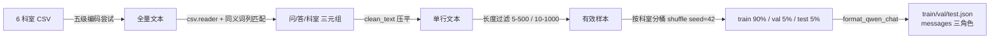

# preprocess_data.py —— 医疗对话数据预处理（A级逐函数深读）

对应源文件：`model-training/scripts/preprocess_data.py`（原 178 行，注释后共 194 行）

> 互链：[Docs/03-数据流与接口协议](../../../references/firmware/loongson-medical-core/Docs/03-数据流与接口协议.md) ·
> KB：[train_lora.md](train_lora.md)（下游消费者）

## 1. 文件定位

训练流水线第 1 步：把 6 个科室的中文医疗对话 CSV（Chinese-medical-dialogue 数据集）清洗、过滤、按科室分层划分，输出 Qwen ChatML 三角色 `messages` 格式的 `train/val/test.json`。下游 train_lora.py 与 evaluate.py 都吃这个格式。

## 2. 模块级配置

| 配置 | 行号 | 值 | 说明 |
|---|---|---|---|
| `random.seed(42)` | L11 | 42 | 划分可复现的根 |
| `DATA_DIR` | L14 | `shujuji/…/Data_数据` | 原始 CSV 目录（相对 cwd） |
| `OUT_DIR` | L15 | `data` | 输出目录（相对 cwd） |
| `DEPARTMENTS` | L20-L28 | 6 元组列表 | 男科/内科/妇产科/肿瘤科/儿科/外科 |
| `SYSTEM_PROMPT` | L30 | 医疗问诊助手人设 | 注入每条样本 system 角色 |

## 3. 逐函数总表

| 函数 | 行号 | 职责 | 返回 |
|---|---|---|---|
| `clean_text` | L33 | 压平换行、去多余空白 | 清洗后单行文本 |
| `format_qwen_chat` | L43 | 组装三角色 messages | dict |
| `read_csv_safe` | L58 | 多编码读 CSV + 列名匹配 + 长度过滤 | samples 列表 |
| `main` | L135 | 读取→统一科室→分层划分→落盘 | 无（写文件） |

## 4. 关键代码精读

### 4.1 clean_text：一行三用的空白处理（L33-L41）

```python
# preprocess_data.py L38-L41
    # 换行/回车压成空格：对话 QA 保持单行，方便后续按条切分与统计
    text = text.strip().replace('\n', ' ').replace('\r', ' ')
    # 去除多余空格
    # join(split()) 一举三得：去首尾空白、压连续空格为 1 个、去全角空格外的制表符
    text = ' '.join(text.split())
    return text
```

`' '.join(text.split())` 是 Python 惯用法：按任意空白切分再单空格重组，比多个 replace 稳。

### 4.2 format_qwen_chat：科室标签进 user 首行（L43-L55）

```python
# preprocess_data.py L46-L55
    user_content = f"【科室：{department}】\n{question}"

    # 输出结构 = OpenAI messages 风格，与 Qwen 的 ChatML 三角色一一对应
    return {
        "messages": [
            {"role": "system", "content": SYSTEM_PROMPT},
            {"role": "user", "content": user_content},
            {"role": "assistant", "content": answer}
        ]
    }
```

注意：科室标签塞进 user 内容而不是 system，使 evaluate.py 能从测试样本里**反解科室名**（这也是"早泄】"解析 bug 的源头——`】` 一起被解析进去了）。

### 4.3 read_csv_safe 的五级编码兜底（L66-L72）

```python
# preprocess_data.py L66-L72
    # 尝试多种编码：上游数据来自多人整理，编码不统一是常态；
    # latin-1 放最后兜底（任何字节流都能解，保证函数有返回内容）
    content = None
    for enc in ['utf-8', 'gbk', 'gb2312', 'gb18030', 'latin-1']:
        try:
            with open(filepath, 'r', encoding=enc) as f:
                content = f.read()
            break
        except (UnicodeDecodeError, UnicodeError):
            continue
```

latin-1 兜底的代价：真乱码文件不会报错而是以乱码字符入库——由后面的长度/内容过滤间接兜底。

### 4.4 列名同义词匹配（L95-L108）

```python
# preprocess_data.py L95-L102
        # 按同义词表匹配列名，容忍上游列名差异（ask/question/input 等）
        for i, h in enumerate(header_lower):
            if h in ('department', 'depart'):
                dept_idx = i
            elif h in ('ask', 'question', 'input'):
                ask_idx = i
            elif h in ('answer', 'output', 'response'):
                ans_idx = i
```

### 4.5 长度过滤的量化依据（L116-L121）

```python
# preprocess_data.py L116-L121
            # 过滤太短或太长的样本：
            # 短样本无医学信息量，长样本会撑爆 512 token 训练窗口（见 train_lora.py）
            if len(question) < 5 or len(answer) < 10:
                continue
            if len(question) > 500 or len(answer) > 1000:
                continue
```

上界与 train_lora.py 的 `MAX_SEQ_LENGTH = 512` 呼应：中文约 1 字 ≈ 1 token，问 500 + 答 1000 字加上模板包裹已贴近 512 的数倍——实际上 answer 1000 字会被训练时截断，此上界是"防极端"而非"保证不截"。

### 4.6 main 的分层划分（L160-L176）

```python
# preprocess_data.py L170-L176
        n_train = int(n * 0.9)    # 90% 训练
        n_val = int(n * 0.05)     # 5% 验证（选最优 checkpoint 用）

        # 剩余 ~5% 自然成为测试集（evaluate.py 消费）
        train_samples.extend(samples[:n_train])
        val_samples.extend(samples[n_train:n_train + n_val])
        test_samples.extend(samples[n_train + n_val:])
```

先按科室分桶、桶内 shuffle 后再切——保证三份里**每个科室比例一致**，防某科室整体漏进测试集。剩余 5% = 100% − 90% − 5%，浮点取整的零头自然落在 test。

## 5. 数据流



## 6. 已知问题（读码记录，未改代码）

1. 输出目录 `data/` 与脚本 cwd 绑定，换个目录执行产物就换了地方；
2. `department` 列缺失时兜底用配置中文名（L146-L149），但 CSV 内的别名科室（如"早泄】"这种脏数据）会原样进标签；
3. 长度过滤按字符数而非 token 数，边界样本仍可能超 512 token。
