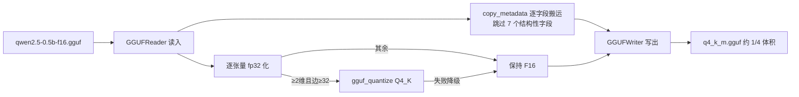

# quantize_iq1s.py —— Q4_K 量化的独立重实现（A级逐函数深读）

对应源文件：`model-training/scripts/quantize_iq1s.py`（原 109 行，注释后共 121 行）

> 互链：[Docs/03-数据流与接口协议](../../../references/firmware/loongson-medical-core/Docs/03-数据流与接口协议.md) ·
> KB：[quantize_model.md](quantize_model.md)（同协议主流水线版本）

## 1. 文件定位

文件头注释（L14-L16）写明了存在理由：

```python
# quantize_iq1s.py L14-L16
# Qwen2.5-0.5B hidden_size=896, 896%256=128 所以 K-quant 无法使用
# Q4_K block=256, 896%256≠0, Python gguf库不兼容
# Q4_K: ~4.5 bpw, 体积约为 FP16 的 1/4
```

即：Q4_K 的超块是 256，896 维不能整除，旧版 Python gguf 库会出问题。本脚本是 quantize_model.py 中 `quantize_q4k()` 的**独立重实现**，元数据走手工逐字段搬运（`add_key_value`）而非批量 `add_field`，作为兜底/调试路径。与 quantize_model.py 共享同一路径常量（L11-L12）与量化类型（L21-L22）。

## 2. 逐函数总表

| 函数 | 行号 | 职责 |
|---|---|---|
| `copy_metadata` | L26 | KV 元数据逐字段搬运（跳过 7 个结构性字段） |
| `main` | L61 | 读 FP16 → 搬元数据 → 逐张量量化 → 三段式写出 |

## 3. 关键代码精读

### 3.1 skip 集合：哪些字段必须重新生成（L27-L31）

```python
# quantize_iq1s.py L27-L31
    # skip 列表 = 由 writer 自己重新生成的字段：
    # 头部计数字段 + 架构名 + 量化类型标记，搬旧值反而会自相矛盾
    skip = {'GGUF.version', 'GGUF.tensor_count', 'GGUF.kv_count',
            'general.file_type', 'general.quantization_version',
            'general.alignment', 'general.architecture'}
```

这 7 个字段描述"文件自身结构"（版本、计数、对齐、类型），量化后值会变——搬旧值会写出自相矛盾的 GGUF。

### 3.2 GGUF 字符串与标量的手工解码（L37-L54）

```python
# quantize_iq1s.py L37-L54（节选）
        for i, data_idx in enumerate(field.data):
            vtype = field.types[i]
            val = field.parts[data_idx]
            if isinstance(val, np.ndarray):
                if val.dtype.kind == 'S' or val.dtype.kind == 'U':
                    # 字节串 → UTF-8 字符串，并去掉 GGUF 字符串补位的 '\0'
                    val = val.tobytes().decode('utf-8', errors='replace').rstrip('\x00')
                else:
                    val = val.item() if val.size == 1 else val   # 单元素数组还原成标量
            elif isinstance(val, np.generic):
                val = val.item()   # numpy 标量 → Python 原生类型
            # ...
            writer.add_key_value(name, val, vtype, sub_type)
```

GGUF reader 把字符串存成 bytes 的 numpy 数组、数值存成 numpy 标量——`add_key_value` 需要 Python 原生类型，这里就是两种解码的补齐层。`sub_type`（L50-L52）保证数组元素的元素类型写回一致。

### 3.3 与 quantize_model.py 的实现差异对照

| 维度 | quantize_model.quantize_q4k | 本脚本 main |
|---|---|---|
| 元数据 | `writer.add_field(field)` 批量 | 逐字段 `add_key_value`（L54） |
| 架构名 | `str(arch_field.parts[-1][-1])` | 逐 part 找 bytes 数组解码（L66-L72） |
| 量化门槛 | `data.ndim >= 2 and max(data.shape) >= 32`（L147） | `len(shape) >= 2 and max(shape) >= 32`（L93） |
| 降级策略 | 单张 Warning → F16（L156-L157） | 单张 Warning → F16（L100-L101） |
| 写盘 | 三段式四连 | 三段式四连（L109-L112） |

两条实现路径产出的 GGUF 语义等价，可互为交叉验证。

## 4. 数据流



## 5. GGUF 读写要点备忘（本脚本踩过的坑）

| 要点 | 细节 |
|---|---|
| GGUF 三段式 | header（魔数/版本/张量数/KV 数）→ KV 元数据 → 张量数据，对应 `write_header_to_file / write_kv_data_to_file / write_tensors_to_file`（L109-L112） |
| 字符串编码 | reader 侧是 bytes 的 numpy 数组，decode 后必须 `rstrip('\x00')`（L44） |
| 标量还原 | numpy 标量要 `.item()`，单元素数组也要还原，否则 `add_key_value` 类型不匹配（L46-L48） |
| 结构性字段 | version/tensor_count/kv_count/file_type/quantization_version/alignment/architecture 共 7 个由 writer 重新生成，绝不照搬（L29-L31） |
| raw_dtype | `add_tensor(..., raw_dtype=QTYPE)` 告诉 writer 数据已是量化字节，别再当 fp16 序列化（L98、L101） |

## 6. 已知问题（读码记录，未改代码）

1. `add_quantization_version(2)`（L57）写死为 2，与 gguf 库当前常量可能不一致（quantize_model.py 用 `gguf.GGML_QUANT_VERSION`）；
2. 脚本名 `quantize_iq1s.py` 与实际量类型 Q4_K 不符（历史遗留命名，注释 L20 已说明）；
3. 无 verify 步骤，产物正确性靠下游 llama-cli 加载验证。
