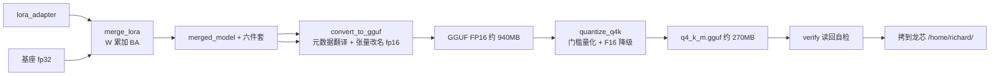

# quantize_model.py —— LoRA 合并 → GGUF → Q4_K 四步流水线（A级逐函数深读）

对应源文件：`model-training/scripts/quantize_model.py`（原 190 行，注释后共 205 行）

> 互链：[Docs/03-数据流与接口协议](../../../references/firmware/loongson-medical-core/Docs/03-数据流与接口协议.md) ·
> KB：[train_lora.md](train_lora.md)（上游）· [quantize_iq1s.md](quantize_iq1s.md)（同协议另一种实现）

## 1. 文件定位

训练流水线第 3 步，四步串行、每步幂等（"已存在则跳过"）：

```
[1/4] merge_lora        LoRA 并进基座 → merged_model/
[2/4] convert_to_gguf   HF safetensors → GGUF FP16
[3/4] quantize_q4k      FP16 → Q4_K（~4.5 bpw）
[4/4] verify            重开产物核对
```

## 2. 模块级常量（L17-L25）

| 常量 | 行号 | 值 | 说明 |
|---|---|---|---|
| `BASE_MODEL` | L17 | `.` | 基座目录（cwd） |
| `LORA_PATH` | L18 | `lora_adapter` | 上游 train_lora 产物 |
| `MERGED_DIR` | L19 | `merged_model` | 合并产物 |
| `GGUF_FP16` | L20 | `qwen2.5-0.5b-f16.gguf` | 中间产物 |
| `GGUF_Q4_K` | L21 | `/home/richard/qwen2.5-0.5b-q4_k_m.gguf` | 最终产物直写部署路径 |
| `K = Keys` | L23 | — | gguf 元数据 key 常量集 |

## 3. 逐函数总表

| 函数 | 行号 | 职责 | 幂等保护 |
|---|---|---|---|
| `merge_lora` | L27 | W ← W+BA 并补 config 六件套 | merged_model/model.safetensors 存在即跳过（L29-L31） |
| `convert_to_gguf` | L50 | 元数据翻译 + 逐张量改名转 fp16 | GGUF_FP16 存在即跳过（L52-L53） |
| `quantize_q4k` | L117 | 复制元数据 + 门槛量化 + 降级兜底 | 无（每次重写输出） |
| `verify` | L174 | 重开 GGUF 核对架构/张量数/类型 | — |

## 4. 关键代码精读

### 4.1 merge_lora：一行数学 + 六件套补齐（L27-L49）

```python
# quantize_model.py L36-L45（节选）
    model = PeftModel.from_pretrained(base, LORA_PATH)   # 基座挂载 LoRA 旁路
    model = model.merge_and_unload()   # W <- W + BA 一次性算进权重，卸载旁路
    model.save_pretrained(MERGED_DIR, safe_serialization=True)   # safetensors 格式落盘
    import shutil
    # merge_and_unload 只写权重：config/分词器六件套从基座目录补齐，
    # 否则下一步 GGUF 转换读不到架构超参与词表
    for f in ["config.json", "generation_config.json", "tokenizer.json",
              "tokenizer_config.json", "vocab.json", "merges.txt"]:
        src = os.path.join(BASE_MODEL, f)
        if os.path.exists(src):
            shutil.copy(src, os.path.join(MERGED_DIR, f))
```

`merge_and_unload` 的数学：LoRA 旁路输出 = B·A·(α/r)，合并即把 `W + B·A·(α/r)` 算成单一矩阵；α=16、r=8 时缩放系数为 2。

### 4.2 convert_to_gguf：HF→GGUF 的两张翻译表（L50-L112）

元数据翻译（HF config 键 → GGUF KV）：

```python
# quantize_model.py L66-L72（节选）
    writer.add_uint32(K.Attention.HEAD_COUNT, cfg["num_attention_heads"])
    writer.add_uint32(K.Attention.HEAD_COUNT_KV, cfg["num_key_value_heads"])   # GQA：2 个 KV 头对 14 个 Q 头
    writer.add_uint32(K.LLM.BLOCK_COUNT, n_layers)
    writer.add_uint32(K.LLM.EMBEDDING_LENGTH, cfg["hidden_size"])              # Qwen2.5-0.5B = 896
```

特殊 token id 带缺省兜底（L79-L81）：`bos 151643 / eos 151645 / pad 151643`——写死为 Qwen2 家族值，换基座要重核。

张量名映射与 fp16 降精度（L96-L104）：

```python
# quantize_model.py L96-L102（节选）
            gguf_name = tmap.get_name(hf_name, try_suffixes=(".weight", ".bias"))
            if gguf_name is None:
                continue   # 无对应 GGUF 名的张量（如 rotary inv_freq 缓存）直接丢弃
            tensor = f.get_tensor(hf_name)
            # fp32 权重统一降为 fp16：GGUF 主流格式，且体积直接减半
            tensor_f16 = tensor.to(torch.float16).numpy() if tensor.dtype != torch.float16 else tensor.numpy()
            writer.add_tensor(gguf_name, tensor_f16)
```

写盘是 GGUF 三段式协议（L107-L110）：`write_header_to_file` → `write_kv_data_to_file` → `write_tensors_to_file` → `close`。

### 4.3 quantize_q4k：门槛判定 + 单张降级（L117-L171）

```python
# quantize_model.py L146-L160（节选）
        # 一维的 norm/bias、小张量保持 F16（块量化最小块 256，太小没法分块）
        is_weight = data.ndim >= 2 and max(data.shape) >= 32

        if is_weight:
            try:
                qtype = GGMLQuantizationType.Q4_K
                quantized = gguf_quantize(data, qtype)
                writer.add_tensor(name, quantized, raw_dtype=qtype)
            except Exception as e:
                print(f"    Warning: {name} 量化失败, 降级F16 ({e})")   # 维度不整除等异常逐张量降级
                writer.add_tensor(name, data.astype(np.float16), raw_dtype=GGMLQuantizationType.F16)
        else:
            writer.add_tensor(name, data.astype(np.float16), raw_dtype=GGMLQuantizationType.F16)
```

- **门槛 `ndim>=2 且 max(shape)>=32`**：Q4_K 是 256 元素超块量化，一维 norm/bias 与小张量没法分块；
- **file_type 改写**（L133-L134）：其余元数据原样搬运，唯独 `general.file_type` 改成 MOSTLY_Q4_K；
- 输入 fp16 → 先转 fp32 再进量化器（L142-L143）。

体积量化：FP16 每参数 2 字节，0.49B 参数 ≈ 940 MB；Q4_K 约 4.5 bpw ≈ 0.56 字节/参数 ≈ **270 MB**，即脚本打印的"约 1/4"。

### 4.4 verify：读回自检（L174-L196）

重开产物核对三件事：文件存在与体积、`general.architecture` + 张量数、`general.file_type`。任何一项不对都说明上游某步静默失败。

## 5. 流水线数据流



## 6. 已知问题（读码记录，未改代码）

1. Qwen2.5-0.5B hidden_size=896，896 % 256 ≠ 0，旧版 Python gguf 库对 K-quant 支持不稳——同目录 quantize_iq1s.py 是手工兜底实现；
2. `GGUF_Q4_K` 直写 `/home/richard/`：PC 上重跑会因目录不存在而 mkdir（L121），但语义上这是部署机路径；
3. tensor_names 里无映射的张量被静默丢弃（L97-L98），只靠张量总数对比间接发现。
