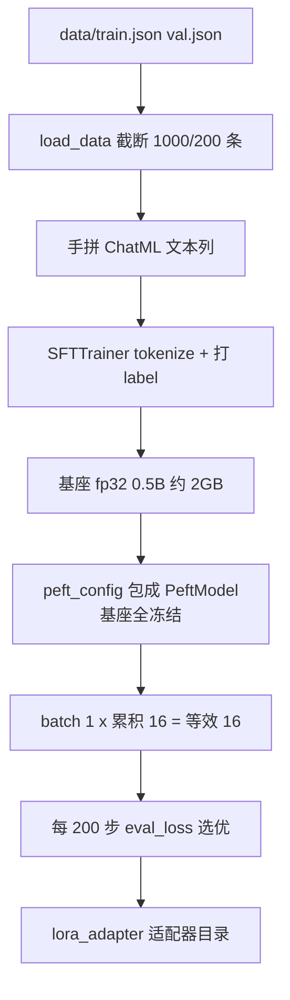

# train_lora.py —— LoRA 微调 Qwen2.5-0.5B（A级逐函数深读）

对应源文件：`model-training/scripts/train_lora.py`（原 155 行，注释后共 169 行）

> 互链：[Docs/03-数据流与接口协议](../../../references/firmware/loongson-medical-core/Docs/03-数据流与接口协议.md) ·
> KB：[preprocess_data.md](preprocess_data.md)（上游）· [quantize_model.md](quantize_model.md)（下游）

## 1. 文件定位

训练流水线第 2 步：用 LoRA（r=8）微调 Qwen2.5-0.5B-Instruct，**CPU 可跑**是本脚本的硬约束设计——fp32 全量加载 0.5B（约 2 GB 内存）、batch=1、梯度累积凑等效 16、只训 <1% 参数。

## 2. 模块级配置

| 配置 | 行号 | 值 | 设计意图 |
|---|---|---|---|
| `MODEL_PATH` | L19 | `"."` | 在基座模型目录里运行 |
| `lora_config` | L26-L34 | r=8 / alpha=16 / dropout=0.05 | 7 类线性层全注入 |
| `training_args` | L37-L63 | 见下表 | CPU 友好训练参数集 |
| `MAX_TRAIN_SAMPLES` | L65 | 1000 | 0.5B+CPU 的采样上限 |
| `MAX_VAL_SAMPLES` | L66 | 200 | 验证集上限 |
| `MAX_SEQ_LENGTH` | L67 | 512 | 与预处理长度过滤呼应 |

training_args 关键项：`per_device_train_batch_size=1`（L41）+ `gradient_accumulation_steps=16`（L42，等效 batch 16）、`warmup_steps=50`、`learning_rate=2e-4`（LoRA 专用区间，比全参微调 2e-5 大一个量级）、`max_grad_norm=0.3`、`load_best_model_at_end=True` + `metric_for_best_model="eval_loss"`（训完回载最优而非最后一轮）、`fp16=bf16=False`（CPU 无 TensorCore 收益）。

## 3. 逐函数总表

| 函数 | 行号 | 职责 |
|---|---|---|
| `load_data` | L71 | 读 JSON → 截断 → 手拼 ChatML 文本 → Dataset |
| `main` | L98 | 载模型 → 注入 LoRA → SFT → 存适配器 |

## 4. 关键代码精读

### 4.1 load_data：手拼 ChatML 而非 apply_chat_template（L71-L95）

```python
# train_lora.py L84-L91
        # 手动构建chat文本：不用 tokenizer.apply_chat_template，
        # 手拼 ChatML 保证与 evaluate.py / assistant.c 的推理格式完全一致
        text_parts = []
        for msg in messages:
            role = msg["role"]
            content = msg["content"]
            text_parts.append(f"<|im_start|>{role}\n{content}<|im_end|>")
        texts.append("\n".join(text_parts))
```

**为什么不用 `apply_chat_template`**：模板函数可能带默认 system、换行风格也与端侧 C 代码的手拼不同；训练/推理格式必须逐字节一致，手拼是唯一可控路径。返回 `Dataset.from_dict({"text": texts})`（L94），只留一列由 SFTTrainer 的 formatting_func 取用。

### 4.2 pad_token 的补法（L110-L114）

```python
# train_lora.py L110-L114
    # 确保有pad_token
    # Qwen 的 tokenizer 没配 pad：批量训练时用 eos 填充，
    # SFTTrainer 内部会把 pad 位置的 label 置 -100 不计损失
    if tokenizer.pad_token is None:
        tokenizer.pad_token = tokenizer.eos_token
```

### 4.3 fp32 全量加载（L118-L126）

```python
# train_lora.py L118-L126
    print("加载模型 (float32)...")
    model = AutoModelForCausalLM.from_pretrained(
        MODEL_PATH,
        torch_dtype=torch.float32,   # 0.5B fp32 ≈ 2GB 内存，小模型全精度训练可行
        device_map={"": device},     # 全部层放同一设备
        trust_remote_code=True,
        low_cpu_mem_usage=True,      # 分块加载权重，峰值内存近乎减半
    )
```

`low_cpu_mem_usage=True` 跳过随机初始化全量副本，0.5B 上加载峰值从 ~4GB 降到 ~2GB。

### 4.4 SFTTrainer 一站式注入 LoRA（L135-L147）

```python
# train_lora.py L142-L150
    # peft_config 传入后：SFTTrainer 自动把基座包成 PeftModel，
    # 冻结全部基座权重、只训 LoRA 旁路
    trainer = SFTTrainer(
        model=model,
        args=training_args,
        train_dataset=train_dataset,
        eval_dataset=eval_dataset,
        processing_class=tokenizer,
        formatting_func=formatting_func,
        peft_config=lora_config,
    )
```

`peft_config` 传给 SFTTrainer 后无需手动 `get_peft_model`——trl 1.7+ API 内部完成包装。训练量量化：1000 条 × 3 epoch ÷ 等效 batch 16 每 epoch ≈ ceil(1000/16)=63 步、共 ~189 步**，每 200 步保存+评估一次（save_total_limit=2 只留最近 2 个 checkpoint）。

### 4.5 只存适配器（L161-L162）

```python
# train_lora.py L161-L162
    trainer.model.save_pretrained(OUTPUT_DIR)   # 只存 A/B 低秩矩阵，不存基座
    tokenizer.save_pretrained(OUTPUT_DIR)       # 分词器随行，便于合并脚本直接用
```

产物 `lora_adapter/` 是 PEFT 标准目录（adapter_config.json + adapter_model.safetensors），几十 MB——合并回基座是下一步 quantize_model.py 的事。

## 5. 训练数据流



## 6. 已知问题（读码记录，未改代码）

1. `MAX_SEQ_LENGTH = 512` 定义了但训练参数里未传给 SFTTrainer（trl 有自己的 max_seq_length 参数），实际截断长度由 trl 默认值决定——两者可能不一致；
2. `eval_strategy="steps"` 配 `eval_steps=200`，若训练总步数 <200 则全程无验证、`load_best_model_at_end` 无从选择；
3. 输出目录 `lora_adapter` 是相对 cwd 的，运行位置影响产物落点。
