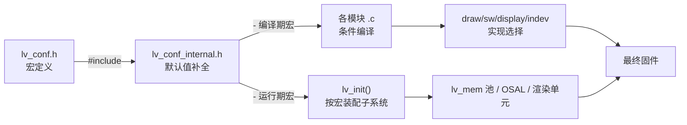

# lv_conf_template —— LVGL 配置模板逐项速查

> 对应源文件：
> - `lv_conf_template.h`（共 2640 行）—— 复制为 `lv_conf.h` 后使用
> - `src/misc/lv_timer.c`（`LV_DEF_REFR_PERIOD` 的消费者）
> - `src/draw/sw/lv_draw_sw.c`（渲染线程配置的消费者）
> - `src/lv_init.c`（初始化顺序，与配置联动）
>
> 深读文章：Docs/[07-移植与实战指南](../../../references/graphics/LVGL/Docs/07-移植与实战指南.md)
> 关联条目：[lv_display.md](lv_display.md)、[lv_draw_sw.md](lv_draw_sw.md)

## 0. 使用方式

```c
/* 复制本文件为 lv_conf.h，把首处 #if 0 改成 #if 1 */
#if 1 /* Set this to "1" to enable content */     /* 模板第 15 行 */
```

放置位置（模板 7-13 行注释）：① 放在 lvgl 目录旁边；② 任意位置 +
定义 `LV_CONF_INCLUDE_SIMPLE` 并把该路径加入 include 路径。
也可以完全不建 lv_conf.h——库会用各宏的默认值（等价于本模板默认值）。

## 1. 内存与标准库（30-67 行）

| 宏 | 行号 | 默认 | 说明 |
|---|---|---|---|
| `LV_USE_STDLIB_MALLOC` | 37 | `LV_STDLIB_BUILTIN` | BUILTIN / CLIB / MICROPYTHON / RTTHREAD / CUSTOM |
| `LV_USE_STDLIB_STRING` | 46 | `LV_STDLIB_BUILTIN` | 字符串函数来源 |
| `LV_USE_STDLIB_SPRINTF` | 55 | `LV_STDLIB_BUILTIN` | 格式化函数来源 |
| `LV_MEM_SIZE` | 59 | 65536 (64 KB) | 内置池大小，**至少 2048** |
| `LV_MEM_ADR` | 64 | 0x0 | 0 = 跟随数组放置；非 0 = 固定地址 |

选择建议：MCU 上用内置池（可预测、无碎片管理开销）；Linux/PC 模拟器用
`LV_STDLIB_CLIB` 把内存交给系统 malloc。

## 2. 颜色格式（132-142 行）

| 宏 | 行号 | 默认 | 可选值 |
|---|---|---|---|
| `LV_COLOR_FORMAT_DEFAULT` | 142 | `LV_COLOR_FORMAT_RGB565` | I1 / L8 / RGB565 / RGB565_SWAPPED / RGB888 / XRGB8888 / ARGB8888 / ARGB8888_PREMULTIPLIED |

注意 v10 **没有全局 `LV_COLOR_DEPTH`**：色深由 display 的
`color_format` 决定（`lv_display_set_color_format`），本宏只是
`lv_display_create` 时的默认值（lv_display.c:99）。

## 3. OS 与线程（93-107 行）

| 宏 | 行号 | 默认 | 可选 |
|---|---|---|---|
| `LV_USE_OS` | 104 | `LV_OS_NONE` | NONE / PTHREAD / FREERTOS / CMSIS_RTOS2 / RTTHREAD / WINDOWS / MQX / SDL2 / CUSTOM |
| `LV_OS_CUSTOM_INCLUDE` | 107 | "" | `LV_OS_CUSTOM` 时的头文件 |

开 OS 后才有：`lv_lock/lv_unlock`、渲染线程池、`lv_thread_sync_*`。
FreeRTOS 适配实现见 `src/osal/lv_freertos.c`（572 行），
`lv_lock` 用递归互斥量（447-451 行）。

## 4. 时序与 DPI（148-160 行）

| 宏 | 行号 | 默认 | 说明 |
|---|---|---|---|
| `LV_DEF_REFR_PERIOD` | 153 | 33 ms | 刷新/输入/动画统一节拍（≈30 FPS） |
| `LV_DPI_DEF` | 156 | 130 | 逻辑 DPI，影响默认控件尺寸与 `LV_DPX()` |
| `LV_DRAW_BUF_STRIDE_ALIGN` | 159 | 1 | 行对齐字节；DMA 要求时改 4/16/32 |

## 5. 绘制与渲染后端（175-670 行）

| 宏 | 行号 | 默认 | 说明 |
|---|---|---|---|
| `LV_DRAW_LAYER_SIMPLE_BUF_SIZE` | 180 | 24576 B | 离屏 layer 行块预算（lv_refr.c:557） |
| `LV_DRAW_THREAD_STACK_SIZE` | 190 | 8192 B | 渲染线程栈 |
| `LV_DRAW_THREAD_PRIO` | 203 | 3 | 渲染线程优先级 |
| `LV_USE_SNAPSHOT` | 215 | 0 | 控件截图组件 |
| `LV_USE_DRAW_SW` | 227 | 1 | 软件渲染总开关 |
| `LV_DRAW_SW_DRAW_UNIT_CNT` | 271 | 1 | 软件渲染线程数，>1 需 OS |
| `LV_USE_DRAW_ARM2D_SYNC` | 276 | 0 | Arm-2D 同步模式 |
| `LV_DRAW_SW_COMPLEX` | 284 | 1 | 阴影/圆角 mask/任意混合 |
| `LV_USE_DRAW_SW_COMPLEX_GRADIENTS` | 290 | 0 | 复杂渐变 |
| `LV_DRAW_SW_SHADOW_CACHE_SIZE` | 296 | 0 | 阴影缓存（阴影多时开） |
| `LV_DRAW_SW_CIRCLE_CACHE_SIZE` | 301 | 4 | 圆形缓存条目 |
| `LV_USE_DRAW_SW_ASM` | 314 | `LV_DRAW_SW_ASM_NONE` | NEON / HELIUM / RISCV_V / SVE2 / CUSTOM |
| `LV_USE_DRAW_VG_LITE` | 327 | 0 | VeriSilicon GPU |
| `LV_USE_DRAW_DAVE2D` | 416 | 0 | Renesas Dave2D |
| `LV_USE_DRAW_PXP` | 499 | 0 | NXP PXP |
| `LV_USE_DRAW_DMA2D` | 538 | 0 | ST DMA2D（配合 `LV_USE_DRAW_DMA2D_INTERRUPT` 547） |
| `LV_USE_DRAW_EVE` | 575 | 0 | FT800/FT813 |
| `LV_USE_DRAW_G2D` | 601 | 0 | NXP G2D |
| `LV_USE_DRAW_NANOVG` | 628 | 0 | NanoVG 矢量 |
| `LV_USE_DRAW_OPENGLES` | 653 | 0 | OpenGL ES |
| `LV_USE_DRAW_SDL` | 667 | 0 | SDL 渲染 |

GPU 后端注册顺序决定竞标优先级：`lv_draw_create_unit` 头插
（lv_draw.c:76-88），后注册的在前；软件单元最后注册，兜底 100 分。

## 6. 对象与样式（700-760 行）

| 宏 | 行号 | 默认 | 说明 |
|---|---|---|---|
| `LV_USE_GRIDNAV` | 703 | 0 | 网格导航（方向键在网格内移动） |
| `LV_OBJ_STYLE_CACHE` | 734 | 1 | 样式属性位图缓存——保持 1 |
| `LV_USE_OBJ_NAME` | 737 | 0 | 对象名字符串 |
| `LV_USE_OBJ_ID` | 740 | 0 | 对象 ID（内置分配器 753） |
| `LV_USE_EXT_DATA` | 772 | 0 | 对象/定时器附加外部数据 + free_cb |
| `LV_USE_OBSERVER` | 778 | 1 | 数据绑定（lv_subject） |

## 7. 日志、断言、监控（790-820 / 2090-2380 行）

| 宏 | 行号 | 默认 | 说明 |
|---|---|---|---|
| `LV_USE_LOG` | 793 | 0 | 日志总开关 |
| `LV_LOG_LEVEL` | 805 | `LV_LOG_LEVEL_WARN` | TRACE 会显著拖慢（lv_init.c:320-322 告警） |
| `LV_USE_PERF_MONITOR` | 2096 | 0 | FPS/CPU 贴片 |
| `LV_USE_PERF_MONITOR_POS` | 2111 | `LV_ALIGN_BOTTOM_RIGHT` | 贴片位置 |
| `LV_USE_PERF_MONITOR_LOG_MODE` | 2114 | 0 | 改为日志输出 |
| `LV_USE_MEM_MONITOR` | 2120 | 0 | 内存贴片 |
| `LV_USE_MEM_MONITOR_POS` | 2137 | `LV_ALIGN_BOTTOM_LEFT` | |
| `LV_USE_ASSERT` | 2362 | 0 | 断言总开关 |
| `LV_USE_ASSERT_MALLOC` | 2365 | 0 | 分配失败断言 |
| `LV_USE_ASSERT_NULL` | 2368 | 0 | 空指针断言 |
| `LV_USE_ASSERT_STYLE` | 2371 | 0 | 样式 sentinel 校验（多耗 RAM） |
| `LV_USE_ASSERT_MEM_INTEGRITY` | 2374 | 0 | 内存完整性（很慢） |
| `LV_USE_ASSERT_OBJ` | 2377 | 0 | 对象合法性（很慢） |

调试期建议：`LV_USE_LOG=1` + `LV_LOG_LEVEL=WARN` + `LV_USE_ASSERT=1`；
发布期：全关，仅保留 perf monitor 到最终验收。

## 8. 输入手感（672-700 行）

| 宏 | 行号 | 默认 | 说明 |
|---|---|---|---|
| `LV_INDEV_DEF_SCROLL_LIMIT` | 676 | 10 px | 滚动触发位移 |
| `LV_INDEV_DEF_SCROLL_THROW` | 679 | 10 | 甩动衰减 |
| `LV_INDEV_DEF_LONG_PRESS_TIME` | 685 | 400 ms | 长按判定 |
| `LV_INDEV_DEF_LONG_PRESS_REP_TIME` | ~688 | 300 ms | 长按连发间隔 |
| `LV_INDEV_DEF_DOUBLE_CLICK_TIME` | ~691 | 300 ms | 双击窗口 |
| `LV_INDEV_DEF_GESTURE_LIMIT` | 694 | 50 px | 手势最小位移 |
| `LV_INDEV_DEF_GESTURE_MIN_VELOCITY` | ~697 | 3 | 手势最小速度 |

实际生效值在 `lv_indev_create` 里拷进设备（lv_indev.c:116-123），
运行期可用 `lv_indev_set_*` 逐设备覆盖。

## 9. 字体与主题（845-1200 行）

| 宏 | 行号 | 默认 | 说明 |
|---|---|---|---|
| `LV_THEME_DEFAULT_DARK` | 855 | 0 | 深色主题 |
| `LV_THEME_DEFAULT_GROW` | 858 | 1 | 按压缩放效果 |
| `LV_THEME_DEFAULT_TRANSITION_TIME` | 861 | 80 ms | 状态过渡；0 = 关闭（省 CPU） |
| `LV_USE_FLEX` | 878 | 1 | Flexbox 布局 |
| `LV_USE_GRID` | 881 | 1 | Grid 布局 |
| `LV_FONT_DEFAULT` | 1147 | Montserrat 14 | 换成含汉字的自定义字体 |
| `LV_USE_FONT_COMPRESSED` | 1158 | 0 | 压缩字形（省 Flash 费 CPU） |
| `LV_USE_FONT_PLACEHOLDER` | 1163 | 1 | 缺字画方框 |
| `LV_USE_FONT_MANAGER` | 1168 | 0 | 运行时字体管理 |
| `LV_USE_FREETYPE` | 1180 | 0 | 动态 TTF（体积大） |

## 10. 缓存与文件系统（890-900 行等）

| 宏 | 行号 | 默认 | 说明 |
|---|---|---|---|
| `LV_CACHE_DEF_SIZE` | 892 | 0 | 解码图像缓存字节数，0=禁用 |
| `LV_IMAGE_HEADER_CACHE_DEF_CNT` | 897 | 0 | 图像头缓存条目数 |

`lv_init` 把这俩传给 `lv_image_decoder_init(LV_CACHE_DEF_SIZE, LV_IMAGE_HEADER_CACHE_DEF_CNT)`
（lv_init.c:280）。

## 11. 关键默认值一览（移植前对照）

| 项 | 默认值 | 影响 |
|---|---|---|
| 刷新周期 | 33 ms | 最高 30 FPS |
| LVGL 池 | 64 KB | 控件/样式/任务/字体数据 |
| 默认色格式 | RGB565 | 每像素 2 B |
| 默认字体 | Montserrat 14 | 无汉字 |
| 渲染线程 | 1 个（裸机 0 个） | 双核需手动开 |
| 脏区数组 | 32 块（非配置项） | 超限整屏重画 |
| 长按 | 400 ms | 交互手感 |
| 滚动触发 | 10 px | 交互手感 |
| 日志 | 关 | 调试时开 |
| 断言 | 全关 | 调试时开 LV_USE_ASSERT |

## 12. 配置生效链路



## 13. 陷阱

1. **忘了把首行 `#if 0` 改 1**：lv_conf.h 全篇失效，库用默认值——
   改了配置没生效，先查这里（模板 15 行）。
2. **`LV_MEM_SIZE` 太小**：表现是创建控件返回 NULL / 断言 MALLOC 失败；
   64 KB 只够中等 UI，图片多时上 CLIB 或加大。
3. **`LV_DRAW_SW_DRAW_UNIT_CNT>1` 但 `LV_USE_OS=NONE`**：编译期 #error
   （lv_draw_sw.c:37-39）。
4. **`LV_COLOR_FORMAT_DEFAULT` 与实际屏不符**：花屏/颜色错位；
   它只决定 display 默认格式，运行期可 `lv_display_set_color_format` 改。
5. **发布版忘关断言/日志**：`LV_USE_ASSERT_MEM_INTEGRITY`、`LV_USE_ASSERT_OBJ`、
   TRACE 日志都让库"much slower"（lv_init.c:308-322 有明确告警）。
6. **`LV_USE_OBSERVER=1` 是默认值**：不用数据绑定也可保持，编译进去的代码
   很小；但若极致裁剪 Flash，可关。
