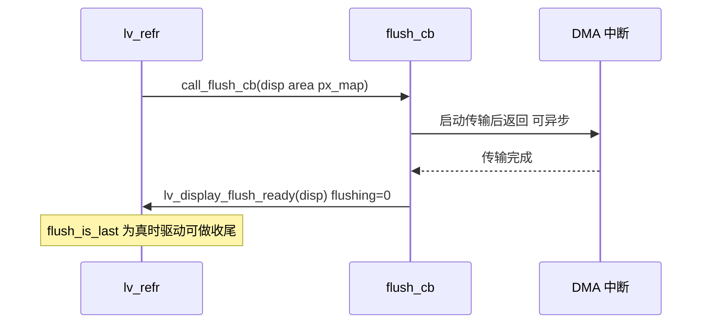

# lv_display —— 显示器抽象与 flush 契约速查

> 对应源文件：
> - `src/display/lv_display.c`（共 1742 行）
> - `src/display/lv_display_private.h`（共 216 行）
>
> 深读文章：Docs/[04-显示驱动接口](../../../references/graphics/LVGL/Docs/04-显示驱动接口.md)、
> Docs/[02-渲染管线与刷新](../../../references/graphics/LVGL/Docs/02-渲染管线与刷新.md)
> 关联条目：[lv_refr.md](lv_refr.md)

## 1. 定位

`lv_display_t` 是"屏驱动插座"：分辨率 + 缓冲 + flush_cb 三个必填项，
其余全是可选 hook。每个 display 拥有独立的屏树、脏区数组、refr_timer、主题。

## 2. 核心字段（lv_display_private.h:37-194）

| 分组 | 字段 | 行号 |
|---|---|---|
| 分辨率 | hor_res/ver_res、physical_hor/ver_res、offset_x/y、dpi | 46-64 |
| 缓冲 | buf_1/buf_2/buf_3、buf_act | 69-74 |
| flush | flush_cb(78)、flush_wait_cb(84)、flushing(88)、flushing_last(92)、last_area/last_part(93-94) |
| sync | sync_cb(99)、sync_wait_cb(105)、syncing(109)、sync_areas ll(116) |
| 模式 | render_mode(118)、antialiasing/tile_cnt/stride_is_auto(119-121)、rendering_in_progress(125) |
| 脏区 | color_format(127)、inv_areas[32]/inv_area_joined/inv_p(130-132)、inv_en_cnt(133) |
| 屏树 | layer_head(140)、`screens[147]`、sys_layer(148)、top_layer(149)、act_scr(150)、bottom_layer(151)、prev_scr(152) |
| 其他 | rotation(168)、theme(172)、refr_timer(175)、last_activity_time(178) |

`LV_INV_BUF_SIZE = 32`（30 行）。flushing/flushing_last 故意不用位域，
防"中断清标志 + 主线程读改写"竞争（86-92 行注释）。

## 3. 关键函数表（lv_display.c）

| 函数 | 行号 | 职责 |
|---|---|---|
| `lv_display_create` | 81 | 头插进 disp_ll；建根 layer/refr_timer/主题/四层屏；首个即默认 |
| `lv_display_delete` | 203 | 解绑 indev → 删四层屏与 screens → 删 refr_timer → free |
| `lv_display_set_default/get_default` | 267/272 | 默认屏指针（NULL 父级对象建在这） |
| `lv_display_set_resolution` | 289 | 改分辨率 + update_resolution 同步 |
| `lv_display_set_buffers` | 538 | → set_buffers_with_stride(546)：对齐校验、PARTIAL 反推行数 |
| `lv_display_set_render_mode` | 588 | PARTIAL/FULL/DIRECT |
| `lv_display_set_flush_cb` | 609 | 上屏回调 |
| `lv_display_set_flush_wait_cb` | 620 | 自定义等待；不设则轮询 flushing |
| `lv_display_set_sync_cb/wait` | 631/642 | 双 DIRECT 缓冲区域同步 |
| `lv_display_set_color_format` | 653 | 同步 buf 头格式 + 底层透明处理 |
| `lv_display_set_tile_cnt` | 689 | 切片数；GPU 后端强制回 1（699-705） |
| `lv_display_flush_ready` | 756 | `flushing = 0`（可在中断调用） |
| `lv_display_flush_is_last` | 762 | 读 flushing_last |
| `lv_screen_load_anim` | 885 | 切屏动画 |
| `lv_display_get_inactive_time` | 1195 | 最后一次输入距今 ms |

## 4. set_buffers 校验规则（546-586）

```c
    /* buf1 or buf2 is not aligned according to LV_DRAW_BUF_ALIGN */
    LV_CHECK_ARG_FORMAT_MSG(buf1 == lv_draw_buf_align(buf1, cf), return, "buf1 is not properly aligned: %p", buf1);
    ...
    bool is_auto_stride = stride == LV_STRIDE_AUTO;
    if(is_auto_stride) {
        stride = lv_draw_buf_width_to_stride(w, cf);        /* :565 */
    }

    if(render_mode == LV_DISPLAY_RENDER_MODE_PARTIAL) {
        h = buf_size / stride;                              /* :571 由字节量反推行数 */
    }
    else {
        LV_CHECK_ARG_FORMAT_MSG(stride * h <= buf_size, return, "%s mode requires screen sized buffer(s)", ...);  /* :575 */
    }
```

- buf1/buf2 必须满足 `LV_DRAW_BUF_ALIGN`（559-561 行）。
- PARTIAL：缓冲行数 = buf_size / stride（571 行）。
- FULL/DIRECT：必须整屏大小（575 行）。
- 用户裸指针被包装进 `disp->_static_buf1/2`（579-583 行）。

## 5. 创建时的四层屏（162-183 行）

| 对象 | Z 序 | 备注 |
|---|---|---|
| bottom_layer | 底 | 默认背景不透明（172-177 行按格式决定） |
| act_scr | 中 | 活动屏，创建即整屏失效（183 行） |
| top_layer | 高 | 不可点击（169 行） |
| sys_layer | 顶 | 不可点击，鼠标/拖拽层 |

refr_timer 周期 = `LV_DEF_REFR_PERIOD`（131 行），user_data 是 disp 自身；
创建后 `lv_timer_ready` 立即刷一帧（190 行）。

## 6. flush 握手协议



- 必须调 `lv_display_flush_ready`，否则单缓冲模式下渲染线程死等
  （`wait_for_flushing`，lv_refr.c:1058-1060）。
- `lv_display_flush_is_last`（762 行）：最后一块时驱动可切 GRAM 窗口。

## 7. 陷阱

1. **双屏**：create 两次即可；`lv_obj_create(NULL)` 落在 default display，
   其他屏用 `lv_indev_set_display` / 直接传 screen 指定。
2. **buf_3 第三缓冲**：`lv_display_set_3rd_draw_buffer`（523-536 行），
   需先有 buf_1/buf_2。
3. **`lv_display_set_antialiasing` 已废弃**（723 行告警，v9 起不支持关抗锯齿）。
4. **flush_cb 里禁止改 UI**：`rendering_in_progress=1` 时 invalidate 触发
   lv_refr.c:289 断言。
5. **删除 display 自动顺延默认屏**（262 行）。
