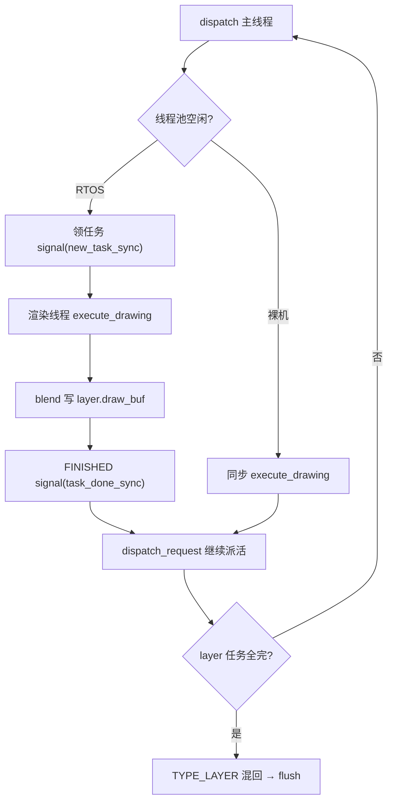

# lv_draw_sw —— 软件渲染后端速查

> 对应源文件：
> - `src/draw/sw/lv_draw_sw.c`（共 524 行）—— 软件绘制单元（evaluate/dispatch/线程池）
> - `src/draw/lv_draw.c`（共 839 行）—— 绘制任务框架（登记/竞标/调度）
> - `src/draw/sw/blend/` —— 按目标格式的混合实现
> - `src/draw/sw/lv_draw_sw_mask.c` 等 —— 遮罩（`LV_DRAW_SW_COMPLEX=1`）
>
> 深读文章：Docs/[03-draw层精读](../../../references/graphics/LVGL/Docs/03-draw层精读.md)
> 关联条目：[lv_refr.md](lv_refr.md)

## 1. 定位

软件渲染单元是兜底渲染器：所有 GPU 单元不接的绘制任务都由它光栅化。
单元 ID `DRAW_UNIT_ID_SW = 1`（lv_draw_sw.c:44），初始化在
`lv_draw_sw_init`（80-134 行），由 `lv_init` 按 `LV_USE_DRAW_SW` 调用
（lv_init.c:219-221）。

## 2. 初始化要点（lv_draw_sw_init，80-134）

```c
    lv_draw_sw_unit_t * draw_sw_unit = lv_draw_create_unit(sizeof(lv_draw_sw_unit_t));
    draw_sw_unit->base_unit.dispatch_cb = dispatch;
    draw_sw_unit->base_unit.evaluate_cb = evaluate;
    ...
#if LV_USE_OS
    uint32_t i;
    for(i = 0; i < LV_DRAW_SW_DRAW_UNIT_CNT; i++) {
        lv_draw_sw_thread_dsc_t * thread_dsc = &draw_sw_unit->thread_dscs[i];
        ...
        lv_thread_init(&thread_dsc->thread, "swdraw", LV_DRAW_THREAD_PRIO, render_thread_cb,
                       LV_DRAW_THREAD_STACK_SIZE, thread_dsc);       /* :119 */
    }
#endif
```

- 线程数 = `LV_DRAW_SW_DRAW_UNIT_CNT`（lv_conf_template.h:271，默认 1）；
  **>1 必须有 OS**（lv_draw_sw.c:37-39 编译期断言）。
- 线程栈 8 KB / 优先级 3（lv_conf_template.h:190/203）。
- 单元名按 SIMD 后端变化（95-109 行："SW"/"SW_NEON"/"SW_HELIUM"/…）。
- thorvg 矢量引擎按需初始化（124-131 行）。
- 自定义混合注册表 `draw_sw_blend_handler_ll`（133 行）。

## 3. 竞标策略：evaluate（229-269）

```c
    switch(task->type) {
        case LV_DRAW_TASK_TYPE_IMAGE:
        case LV_DRAW_TASK_TYPE_LAYER: {
                lv_draw_image_dsc_t * draw_dsc = task->draw_dsc;
                /* not support skew */
                if(draw_dsc->skew_x != 0 || draw_dsc->skew_y != 0) return 0;   /* :239 */
                bool masked = draw_dsc->bitmap_mask_src != NULL;
                lv_color_format_t cf = draw_dsc->header.cf;
                if(masked && (cf == LV_COLOR_FORMAT_A8 || cf == LV_COLOR_FORMAT_RGB565A8)) return 0;  /* :246 */
                if(cf >= LV_COLOR_FORMAT_PROPRIETARY_START) return 0;          /* :250 */
            }
            break;
        ...
    }

    if(task->preference_score >= 100) {
        task->preference_score = 100;
        task->preferred_draw_unit_id = DRAW_UNIT_ID_SW;         /* :265 兜底 */
    }
```

分数越低越优先（0=独占，100=无偏好兜底）。GPU 单元先注册（头插，
lv_draw.c:76-88），先打分；`LV_DRAW_UNIT_NONE` 结果触发
"Draw task failed" 告警（lv_draw.c:168）。

## 4. 派发与执行

### 无 OS（dispatch #else，333-366 行）

同步路径：取任务 → 分配 layer 缓冲 → `execute_drawing` → FINISHED →
`lv_draw_dispatch_request`。裸机下整个渲染在 `lv_timer_handler` 线程内完成。

### 有 OS（271-331 行 + render_thread_cb 371-402 行）

```c
        t = lv_draw_get_next_available_task(layer, t, DRAW_UNIT_ID_SW);   /* :301 */
        ...
        t->state = LV_DRAW_TASK_STATE_IN_PROGRESS;
        thread_dsc->task_act = t;
        lv_thread_sync_signal(&thread_dsc->new_task_sync);                /* :326 唤醒线程 */
```

渲染线程（371-402 行）：`lv_thread_sync_wait(new_task_sync)` →
`execute_drawing` → `FINISHED` → `signal(task_done_sync)` →
`lv_draw_dispatch_request()`。`wait_for_finish`（404-415 行）等全部线程清空
`task_act`。

### execute_drawing 分派（417-469）

| 任务类型 | sw 实现 |
|---|---|
| FILL / BORDER / BOX_SHADOW | fill / border / box_shadow |
| LETTER / LABEL | letter（单字）/ label（整段） |
| IMAGE / LAYER | image / layer（离屏混回） |
| LINE | `lv_draw_line_iterate(…, lv_draw_sw_line)` |
| ARC / TRIANGLE / BLUR / MASK_RECTANGLE | arc / triangle / blur / mask_rect |
| VECTOR | thorvg（可选编译） |

## 5. 并行安全：is_independent（lv_draw.c:701-726）

```c
    lv_draw_task_t * t = layer->draw_task_head;
    while(t && t != t_check) {
        if(t->state == LV_DRAW_TASK_STATE_FINISHED ||
           (t->state == LV_DRAW_TASK_STATE_QUEUED && t->preferred_draw_unit_id == draw_unit_id)) {
            t = t->next;
            continue;
        }
        lv_area_t a;
        if(lv_area_intersect(&a, &t->_real_area, &t_check->_real_area)) {
            return false;                          /* :717 重叠则不可并行 */
        }
        t = t->next;
    }
```

后画的盖先画的 → 区域重叠的任务必须保序执行。
单单元走线性消费 `get_first_available_task`（lv_draw.c:812-839），
遇 TYPE_LAYER 任务停下先画完子层。

## 6. 混合与自定义加速

- 目标格式分文件：`blend_to_rgb565 / rgb888 / argb8888(_premultiplied) /
  l8 / al88 / a8 / rgb565_swapped`。
- 自定义混合：`lv_draw_sw_register_blend_handler(dest_cf, handler)`
  （lv_draw_sw.c:172-195）按目标格式抢接管；注销 197-210 行。
- SIMD 选择：`LV_USE_DRAW_SW_ASM`（lv_conf_template.h:314）。

## 7. 调试

`LV_USE_PARALLEL_DRAW_DEBUG=1` 时 `parallel_debug_draw`（472-521 行）
给每个任务按线程编号染色+描边+写编号，直观验证并行度与竞态。

## 8. 执行流图


