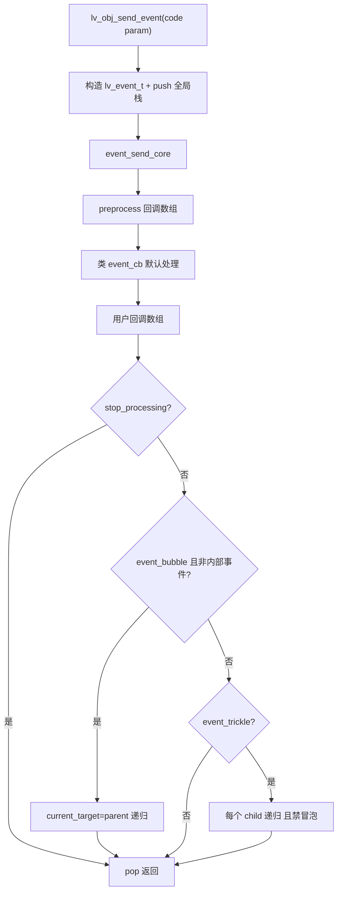

# lv_event —— 事件系统速查

> 对应源文件：
> - `src/misc/lv_event.c`（共 520 行）—— 事件存储、发送内核、全局事件栈
> - `src/core/lv_obj_event.c`（共 485 行）—— 对象事件发送、冒泡、滴灌
> - `src/misc/lv_event_private.h` —— `lv_event_t` / `lv_event_dsc_t` 定义
>
> 深读文章：Docs/[01-对象系统与事件](../../../references/graphics/LVGL/Docs/01-对象系统与事件.md)
> 关联条目：[lv_obj.md](lv_obj.md)、[lv_timer.md](lv_timer.md)

## 1. 定位

LVGL 的事件模型三层：

1. **存储**：每个对象的 `spec_attr->event_list`（`lv_event_dsc_t` 指针数组）。
2. **发送内核**：`lv_event_send` 遍历数组，按 filter / preprocess 分发。
3. **对象级语义**：`lv_obj_send_event` + `event_send_core` 负责
   基类回调、冒泡、滴灌。

## 2. 数据结构

| 结构 | 字段 | 说明 |
|---|---|---|
| `lv_event_dsc_t` | cb / filter / user_data | 一条注册记录 |
| `lv_event_t` | code / current_target / original_target / param / user_data / deleted / stop_bubbling / stop_trickling / stop_processing / prev | 一次发送的上下文 |
| `lv_event_list_t` | array / is_traversing / has_marked_deleting | 对象上的回调数组容器 |

## 3. 注册与注销（lv_event.c）

| 函数 | 行号 | 要点 |
|---|---|---|
| `lv_event_add` | 154-189 | malloc dsc；首次创建时 `lv_array_init(&list->array, 1, sizeof(lv_event_dsc_t*))`（175 行）；push_back |
| `lv_event_remove_dsc` | 191-213 | 标记删除 + cleanup |
| `lv_event_remove` | 241-255 | 按 index |
| `lv_event_remove_all` | 257-273 | 清全部（析构时用，lv_obj.c:1553） |
| `lv_event_get_count/dsc` | 215/221 | 查询 |

对应对象级封装（lv_obj_event.c）：`lv_obj_add_event_cb`(106)、
`lv_obj_remove_event_cb`(148)、`lv_obj_remove_event_dsc`(139)。

## 4. 发送内核：lv_event_send（102-152）

```c
    /* When obj is deleted in its own event, it will cause the `list->array` header to be released,
     * but the content still exists, which leads to memory leakage. ... */
    lv_array_t back_array_head = list->array;             /* :112 备份数组头 */

    const bool is_traversing = list->is_traversing;
    list->is_traversing = true;                           /* :116 防嵌套清理 */

    for(uint32_t i = 0; i < size && !e->deleted; i++) {
        lv_event_dsc_t * dsc = *event_array_at(list, i);
        if(dsc->cb == NULL) continue;
        if(event_is_marked_deleting(dsc)) continue;        /* :123 */
        const bool is_preprocessed = (dsc->filter & LV_EVENT_PREPROCESS) != 0;
        if(is_preprocessed != preprocess) continue;        /* :125 两遍扫描：先 preprocess 后普通 */
        lv_event_code_t filter = dsc->filter & ~LV_EVENT_PREPROCESS;
        if(filter == LV_EVENT_ALL || filter == e->code) {
            e->user_data = dsc->user_data;
            dsc->cb(e);                                   /* :134 */
            if(e->stop_processing) break;
            if(e->deleted) { res = LV_RESULT_INVALID; break; }   /* :136-139 */
        }
    }

    if(is_traversing) return res;                         /* :143 嵌套调用不清理 */

    if(e->deleted) cleanup_event_list_core(&back_array_head);   /* :145 */
    else { list->is_traversing = false; cleanup_event_list(list); }
```

两个精妙点：

1. **两遍扫描**：`preprocess` 标记的回调先跑（filter 位
   `LV_EVENT_PREPROCESS`），普通回调第二遍——预处理能在类默认处理前
   改参数或拦截。
2. **延迟删除**：回调里删自己/别的回调只置
   `LV_EVENT_MARKED_DELETING`（503-507 行），遍历结束再统一压缩数组
   （`cleanup_event_list_core`，475-491 行）——遍历期间的数组不被破坏。

## 5. 全局事件栈：防 use-after-free

```c
void lv_event_push(lv_event_t * e)
{
    /*Build a simple linked list from the objects used in the events
     *It's important to know if this object was deleted by a nested event
     *called from this `event_cb`.*/
    e->prev = event_head;
    event_head = e;                        /* :70 */
}

void lv_event_pop(lv_event_t * e)
{
    event_head = e->prev;                  /* :76 */
}
```

`lv_event_mark_deleted(target)`（341-349 行）沿栈扫描所有
`original_target/current_target == target` 的事件置 `deleted=1`。
`lv_event_push_and_send`（79-100 行）是"push→send→pop"的封装，
`lv_obj_send_event`（lv_obj_event.c:52-76）手写同样三步。

## 6. 对象级发送：event_send_core（lv_obj_event.c:350-401）

五步顺序：

| 步 | 调用 | 行号 |
|---|---|---|
| 1 | `lv_event_send(list, e, true)` —— preprocess 回调 | 364 |
| 2 | `lv_obj_event_base(NULL, e)` —— 类 `event_cb` 默认行为 | 367 |
| 3 | `lv_event_send(list, e, false)` —— 用户回调 | 370 |
| 4 | 冒泡：`event_is_bubbled` 为真则对 parent 递归 | 373-378 |
| 5 | 滴灌：`event_is_trickled` 为真则对 children 递归（且 `stop_bubbling=1`） | 381-398 |

每步之间检查 `stop_processing`；`e->deleted` 时返回
`LV_RESULT_INVALID`。

## 7. 冒泡规则（event_is_bubbled，403-442）

| 类别 | 事件 | 行为 |
|---|---|---|
| 永远冒泡 | `LV_EVENT_CHILD_CREATED/DELETED` | 不看标志 |
| 永不冒泡（即使开 bubble） | HIT_TEST / COVER_CHECK / REFR_EXT_DRAW_SIZE / DRAW_MAIN_* / DRAW_POST_* / DRAW_TASK_ADDED / REFRESH / DELETE / CHILD_CHANGED / SIZE_CHANGED / STYLE_CHANGED / GET_SELF_SIZE | 内部事件 |
| 需 `event_bubble` 标志 | 其余（PRESSED/CLICKED/VALUE_CHANGED…） | 默认关闭 |

滴灌规则对称（444-474 行），需 `event_trickle` 标志；滴灌前强制
`e->stop_bubbling = 1`（385 行）防止子级再冒回来。

## 8. 事件读取 API（lv_obj_event.c / lv_event.c）

| API | 行号 | 返回 |
|---|---|---|
| `lv_event_get_target_obj` | 196-200 | original_target（最初对象） |
| `lv_event_get_current_target_obj` | 190-194 | current_target（冒泡后的当前对象） |
| `lv_event_get_code` | lv_event.c:287 | 事件码（剥 PREPROCESS） |
| `lv_event_get_param` | 293 | 事件参数指针 |
| `lv_event_get_user_data` | 299 | 注册时 user_data |
| `lv_event_get_indev` | 202 | 输入设备（输入类事件） |
| `lv_event_get_key/rotary_diff` | 250/260 | KEY / ROTARY 参数 |
| `lv_event_get_layer` | 225 | 绘制事件层 |
| `lv_event_get_draw_task` | 327 | DRAW_TASK_ADDED 的任务 |
| `lv_event_get_prev_state` | 336 | STATE_CHANGED 旧状态 |
| `lv_event_get_old_size` | 241 | SIZE_CHANGED 旧尺寸 |
| `lv_event_get_hit_test_info` | 298 | HIT_TEST 精判结构 |
| `lv_event_get_cover_area` / `set_cover_res` | 307/317 | COVER_CHECK 应答 |

停止控制：`lv_event_stop_bubbling`（305）、`lv_event_stop_trickling`（311）、
`lv_event_stop_processing`（317）。

## 9. 事件码分类（lv_event.c:351-469 `lv_event_code_get_name`）

| 类别 | 示例 |
|---|---|
| 输入 | PRESSED / PRESSING / PRESS_LOST / SHORT_CLICKED / SINGLE/DOUBLE/TRIPLE_CLICKED / LONG_PRESSED(_REPEAT) / CLICKED / RELEASED / SCROLL* / GESTURE* / KEY / ROTARY / FOCUSED / DEFOCUSED / HOVER* |
| 绘制 | COVER_CHECK / REFR_EXT_DRAW_SIZE / DRAW_MAIN_BEGIN/MAIN/MAIN_END / DRAW_POST_* / DRAW_TASK_ADDED |
| 值/状态 | VALUE_CHANGED / INSERT / REFRESH / READY / CANCEL / STATE_CHANGED / CHECKED / UNCHECKED |
| 生命周期 | CREATE / DELETE / CHILD_CHANGED / CHILD_CREATED / CHILD_DELETED / SCREEN_* / SIZE_CHANGED / STYLE_CHANGED / LAYOUT_CHANGED / GET_SELF_SIZE |
| 刷新/同步 | INVALIDATE_AREA / RESOLUTION_CHANGED / COLOR_FORMAT_CHANGED / REFR_REQUEST/START/READY / RENDER_START/READY / FLUSH_START/FINISH/WAIT_* / SYNC_* / VSYNC* |

自定义事件：`lv_event_register_id()`（330-339 行）动态分配，
上限 `LV_EVENT_LAST_CUSTOM`。

## 10. 流程图



## 11. 陷阱

1. **回调里删对象安全**（deleted 标记 + 栈扫描），但删的是"别的对象"
   不会终止当前事件链——只有 target 匹配的事件被标记。
2. **手动 `lv_obj_send_event` 不自动冒泡**：接收对象必须开 `event_bubble`。
3. **DRAW 事件里不能改 UI**：会触发 lv_refr.c:289 断言，用 `lv_async_call` 推迟。
4. **`lv_event_get_indev` 只对输入类事件有效**，其他事件返回 NULL 并告警
   （202-223 行事件码白名单校验）。
5. **CHILD_CREATED/DELETED 永远冒泡**，容器上挂一个就能统一接管子树生命周期。
