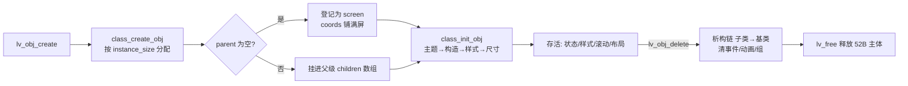

# lv_obj —— LVGL 对象系统核心速查

> 对应源文件：
> - `src/core/lv_obj.c`（共 2332 行）—— 对象基类实现
> - `src/core/lv_obj_private.h`（共 201 行）—— `lv_obj_t` 结构与 spec_attr
> - `src/core/lv_obj_class.c`（共 243 行）—— 类机制（创建/构造/析构）
>
> 深读文章：Docs/[01-对象系统与事件](../../../references/graphics/LVGL/Docs/01-对象系统与事件.md)
> 关联条目：[lv_event.md](lv_event.md)、[lv_style.md](lv_style.md)

## 1. 定位

`lv_obj` 是一切控件的基类（`base_class = NULL`，lv_obj.c:367）。控件 =
`lv_obj_class_t` 函数表 + 按需扩展的实例结构；"继承"靠 `base_class` 链。

类表定义（lv_obj.c:358-370）：

```c
const lv_obj_class_t lv_obj_class = {
    .constructor_cb = lv_obj_constructor,
    .destructor_cb = lv_obj_destructor,
    .event_cb = lv_obj_event,
    .width_def = LV_DPI_DEF,
    .height_def = LV_DPI_DEF,
    .editable = LV_OBJ_CLASS_EDITABLE_FALSE,
    .group_def = LV_OBJ_CLASS_GROUP_DEF_FALSE,
    .instance_size = (sizeof(lv_obj_t)),
    .base_class = NULL,
    .name = "lv_obj",
    LV_PROPERTY_CLASS_FIELDS(obj, OBJ)
};
```

## 2. 结构速览（lv_obj_private.h）

| 成员 | 行号 | 说明 |
|---|---|---|
| `class_p` | 62 | 指向类表（多态入口） |
| `parent` | 63 | 父对象；screen 的 parent 为 NULL |
| `spec_attr` | 64 | 懒分配：孩子数组/事件表/滚动/分组（32-55 行定义） |
| `styles` | 65 | 样式数组（`lv_obj_style_t`） |
| `style_main/other_prop_is_set` | 67-68 | 属性位图缓存（`LV_OBJ_STYLE_CACHE`） |
| `coords` | 74 | 屏幕绝对坐标 x1/y1/x2/y2 |
| 23 个属性位 | 76-145 | hidden/clickable/scrollable/event_bubble/… |
| `state` | 147 | 状态位（DEFAULT/CHECKED/PRESSED/FOCUSED/…） |
| `style_cnt : 6` | 152 | 样式条数上限 63（lv_obj_style.c:125 校验） |
| `rendered` | 161 | 首次绘制后置 1（跳过初始过渡动画） |
| `is_deleting` | 157 | 删除中标志 |

裸对象 52 B（32 位平台），spec_attr/styles 用到才分配。

## 3. 关键函数表（lv_obj.c）

| 函数 | 行号 | 职责 |
|---|---|---|
| `lv_obj_create` | 380 | 创建对象：class_create_obj + class_init_obj |
| `lv_obj_delete` | lv_obj_tree.c | 递归删除子树后析构 |
| `lv_obj_set_state` | 781 | 置位状态位（触发过渡） |
| `lv_obj_add_state/clear_state` | 邻近 | 封装 |
| `lv_obj_has_state` | 邻近 | 查询 |
| `lv_obj_add_flag/remove_flag/has_flag` | 邻近 | 23 位属性开关 |
| `lv_obj_set_pos/set_size/set_align` | lv_obj_pos.c | 布局入口 |
| `lv_obj_center` | lv_obj_pos.c | 对齐父级中心 |
| `lv_obj_mark_layout_as_dirty` | lv_obj_pos.c | 布局延迟重排标记 |
| `lv_obj_update_layout` | lv_obj_pos.c | 立即结算布局（绘制前调用） |
| `lv_obj_invalidate` | lv_obj_draw.c | 失效（含 ext_draw_size） |
| `lv_obj_allocate_spec_attr` | 1780 附近声明 private.h:178 | 懒分配孩子/事件容器 |
| `lv_obj_constructor` | 1487 | 属性默认值 + 初始坐标 |
| `lv_obj_destructor` | 1527 | 清理事件/动画/组/样式 |
| `lv_obj_event` | 1802 | 基类事件处理（滚动条绘制等） |
| `update_obj_state` | 2010 | 状态切换的样式差异分级处理 |
| `obj_transition_states` | 2070 | 收集 LV_STYLE_TRANSITION 属性生成过渡 |
| `lv_obj_draw` | 1576 | COVER_CHECK / 绘制事件应答 |

## 4. 创建流水线（lv_obj_class.c）

| 步骤 | 函数 | 行号 | 要点 |
|---|---|---|---|
| 分配 | `lv_obj_class_create_obj` | 45-105 | `lv_malloc_zeroed(instance_size)`；parent==NULL → 登记为 screen（71-87 行） |
| 挂树 | 同上 | 94-101 | 父级先 allocate_spec_attr 再 add_child |
| 初始化 | `lv_obj_class_init_obj` | 107-137 | 主题→构造→样式全刷→内容尺寸→默认组→CHILD_CREATED→invalidate |
| 构造链 | `lv_obj_construct` | 204-233 | 先基类后子类（临时切 class_p 防子类覆写） |
| 析构链 | `lv_obj_destruct` | 139-160 | 先子类后基类 |
| 实例大小 | `get_instance_size` | 235-243 | 沿 base_class 找第一个非 0 的 instance_size |

lv_obj_class_init_obj 关键摘录（115-118 行）：

```c
    lv_obj_construct(obj->class_p, obj);

    lv_obj_enable_style_refresh(true);
    lv_obj_refresh_style(obj, LV_PART_ANY, LV_STYLE_PROP_ANY);
```

构造期间样式刷新被关（112 行 `lv_obj_enable_style_refresh(false)`），
构造完一次全量刷——初始化路径的核心优化。

## 5. 状态切换分级（update_obj_state，2010-2068）

| 比较结果 | 处理 |
|---|---|
| `LV_STYLE_STATE_CMP_SAME` | 只更新 state + 发 STATE_CHANGED（2022-2026） |
| `DIFF_REDRAW`（仅滚动条） | 只刷 scrollbar part（2048-2054） |
| `DIFF_REDRAW` | 全量 refresh_style（2055-2058） |
| `DIFF_LAYOUT` | refresh_style（重排）（2059-2061） |
| `DIFF_DRAW_PAD` | 重算 ext_draw_size（2062-2065） |

未渲染过的对象（`rendered==0`）跳过过渡动画（2036-2044 行）。

## 6. 生命周期一览



## 7. 陷阱

1. **`lv_obj_create(NULL)` 需先有 display**：无屏时返回 NULL 并告警
   （lv_obj_class.c:60-65）。
2. **spec_attr 是第一次"用到"才分配**：只有孩子/事件/分组对象才有；
   纯样式容器比预期省内存。
3. **style_cnt 上限 63**：`lv_obj_add_style` 超限直接 return + 告警
   （lv_obj_style.c:125-126）——6 bit 存储。
4. **删除对象 ≠ 释放资源**：`lv_obj_delete` 递归删子树、删动画、清事件；
   但控件里 `user_data` 指向的内存归用户管。
5. **screen 不挂树**：在 `disp->screens[]` 数组里，切换用 lv_screen_load。
