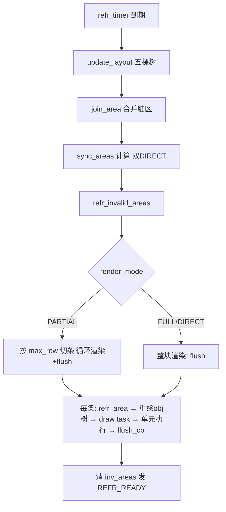

# lv_refr —— 刷新系统速查

> 对应源文件：
> - `src/core/lv_refr.c`（共 1537 行）—— 失效登记、脏区合并、渲染调度、flush 调用
> - `src/display/lv_display_private.h`（共 216 行）—— 脏区数组宿主
>
> 深读文章：Docs/[02-渲染管线与刷新](../../../references/graphics/LVGL/Docs/02-渲染管线与刷新.md)
> 关联条目：[lv_display.md](lv_display.md)、[lv_draw_sw.md](lv_draw_sw.md)

## 1. 定位

刷新系统 = **脏区管理**（inv_areas）+ **一帧总指挥**（lv_display_refr_timer）+
**对象树重绘**（lv_obj_redraw/lv_obj_refr）。`lv_refr_init/deinit` 是空壳
（lv_refr.c:76-82），状态全在 display 里。

## 2. 失效登记：lv_inv_area（269-345）

| 规则 | 行号 |
|---|---|
| 渲染中禁止失效（断言） | 289 |
| area==NULL 清空缓冲 | 292-295 |
| 与屏幕求交，屏外丢弃 | 306-307 |
| I1 格式 x 对齐字节（x1&~7, x2|7） | 309-314 |
| FULL 模式恒整屏 | 317-322 |
| `LV_EVENT_INVALIDATE_AREA` 可改写 | 324 |
| 已包含于现有脏区则丢弃（去重） | 329-331 |
| 超 32 块清零并整屏 | 335-338 |
| 发 LV_EVENT_REFR_REQUEST | 342 |

`LV_INV_BUF_SIZE=32`（lv_display_private.h:30）。

## 3. 一帧总指挥：lv_display_refr_timer（365-458）

```c
    disp_refr = timer->user_data;                                  /* :371 */
    ...
#if !LV_USE_PERF_MONITOR
    if(timer) lv_timer_pause(timer);                               /* :396 自暂停 */
#endif
    lv_result_t res = lv_display_send_event(disp_refr, LV_EVENT_REFR_START, NULL);  /* :399 */
    ...
    if(disp_refr->act_scr) lv_obj_update_layout(disp_refr->act_scr);  /* :408 布局结算 */
    ...
    lv_obj_invalidate_expand_blur(disp_refr);                      /* :424 模糊扩脏区 */
    lv_refr_join_area();                                           /* :425 */
    refr_sync_areas();                                             /* :426 */
    refr_invalid_areas();                                          /* :427 */
    ...
    lv_memzero(disp_refr->inv_areas, sizeof(disp_refr->inv_areas)); /* :444 清脏区 */
    disp_refr->inv_p = 0;
refr_finish:
    lv_draw_sw_mask_cleanup();                                     /* :451 */
    lv_display_send_event(disp_refr, LV_EVENT_REFR_READY, NULL);   /* :454 */
```

## 4. 脏区合并：lv_refr_join_area（634-668）

两两试合并（O(n²)，n≤32）：`lv_area_is_on` 相交 且
**合并后面积 < 两块之和** 才并（658 行），否则保持两块——避免"小条并成
大方块多画无用像素"。合并掉的一方标记 `inv_area_joined=1`。

## 5. 分块渲染：refr_invalid_areas（792-869）

```c
    lv_display_send_event(disp_refr, LV_EVENT_RENDER_START, NULL);   /* :798 */
    ...
        lv_area_t inv_a = disp_refr->inv_areas[i];
        if(disp_refr->render_mode == LV_DISPLAY_RENDER_MODE_PARTIAL) {
            int32_t max_row = get_max_row(disp_refr, w, h);          /* :827 缓冲可容行数 */
            for(row = inv_a.y1; row + max_row - 1 <= inv_a.y2; row += max_row) {
                ...
                refr_area(&sub_area, y_off);
                y_off += lv_area_get_height(&sub_area);
                draw_buf_flush(disp_refr);                           /* :844 渲一条上一屏 */
            }
        }
        else {  /* FULL / DIRECT */
            refr_area(&disp_refr->inv_areas[i], 0);                  /* :861 */
            draw_buf_flush(disp_refr);
        }
    ...
    lv_display_send_event(disp_refr, LV_EVENT_RENDER_READY, NULL);   /* :866 */
```

`last_area`/`last_part` 标志（818/841 行）传递给 flush_cb（flush_is_last）。

## 6. refr_area 与切片（891-990）

- layer 绑定 `buf_act`，clip 区 = 当前子块（895-898 行）。
- PARTIAL：`buf_area = 子块`，reshape 缓冲（901-905 行）；
  DIRECT/FULL：`buf_area = 整屏`（906-921 行）。
- tile 切片（924-938 行）：`tile_cnt = ceil(区域字节 / (总缓冲/tile 数))`，
  默认 tile 数 = `LV_DRAW_SW_DRAW_UNIT_CNT`（lv_display.c:30-37）；
  多 tile 时为每片建假 layer 并行渲染，等全部完成再收（975-983 行）。

## 7. 重绘对象树

| 函数 | 行号 | 职责 |
|---|---|---|
| `lv_refr_get_top_obj` | 466-503 | 递归找"不透明全覆盖"的最顶层对象，跳过其下重绘 |
| `lv_obj_refr` | 506-625 | 无 layer_type 直接 redraw；否则离屏层分块渲染（LV_DRAW_LAYER_SIMPLE_BUF_SIZE 行块）+ 变换混回 |
| `lv_obj_redraw` | 101-267 | clip 交集 → `rendered=1` → DRAW_MAIN_* 事件 → 子项递归 → POST 事件 |
| `refr_obj_and_children` | 1115-1170 | top_obj + 更晚兄弟 + 逐级 POST |
| `refr_configured_layer` | 992-1108 | 单缓冲先等 flush（1058）；透明屏清底（1065）；bottom→(prev→)act→top→sys 顺序 |

DRAW 事件三段：`DRAW_MAIN_BEGIN/MAIN/MAIN_END` + `DRAW_POST_BEGIN/POST/POST_END`
（lv_obj_redraw 127-129、161-163 行）。

## 8. 一帧流程图



## 9. 陷阱

1. `lv_refr_now(disp)`（84-99 行）同步强制重绘，别放进主循环。
2. perf monitor 关闭时 refr_timer 渲染完自暂停（396 行）——
   手动 pause/resume 要成对。
3. `inv_p == 0` 直接跳到收尾（429 行）：静止画面零渲染开销，
   perf 贴片 FPS 显示 0 属正常。
4. 脏区含 ext_draw_size（阴影/圆角外扩）——残影排查先查
   `LV_EVENT_REFR_EXT_DRAW_SIZE` 有没有正确上报。
