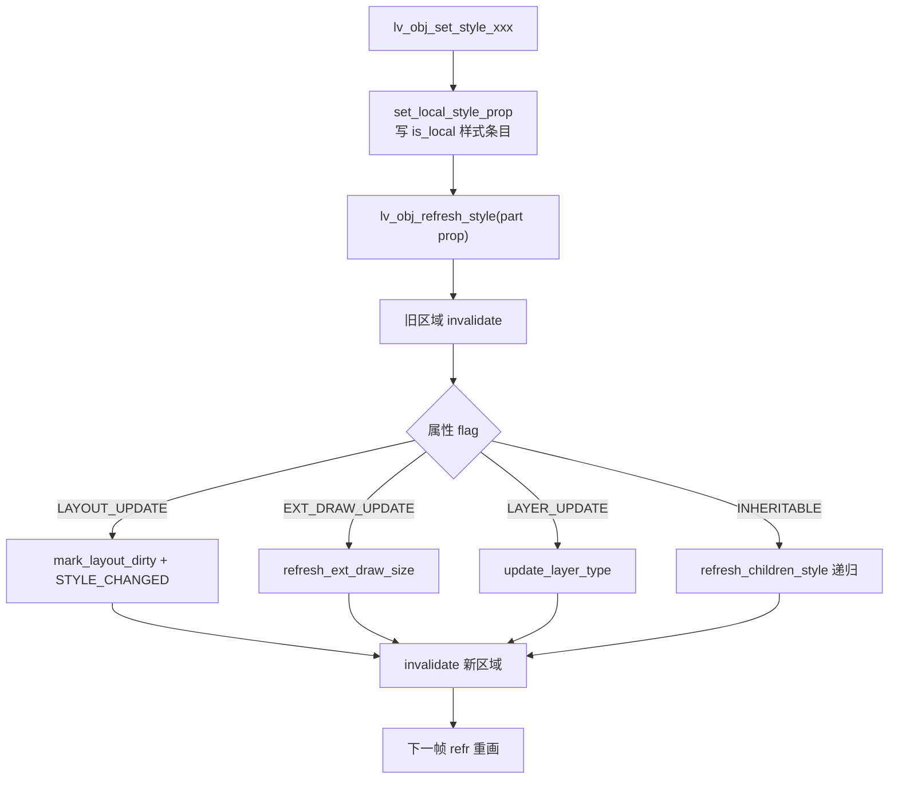
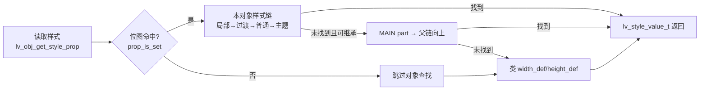

# lv_style —— 样式系统速查

> 对应源文件：
> - `src/misc/lv_style.c`（共 603 行）—— 样式对象本身（键值存储/合并/自定义属性）
> - `src/core/lv_obj_style.c`（共 1761 行）—— 对象上的样式分层、选择器解析、过渡
> - `src/misc/lv_style_private.h` —— 常量样式的内联查找
>
> 深读文章：Docs/[01-对象系统与事件](../../../references/graphics/LVGL/Docs/01-对象系统与事件.md)
> 关联条目：[lv_obj.md](lv_obj.md)

## 1. 三层结构

| 层 | 结构 | 说明 |
|---|---|---|
| 样式对象 | `lv_style_t` | 属性-值对集合（`values_and_props` 连续块 + `prop_cnt` + `has_group`） |
| 对象挂载 | `lv_obj_style_t` 数组（`obj->styles`） | 每条 = `style* + selector + is_local/is_trans/is_theme/is_disabled` |
| 选择器 | `lv_style_selector_t` | `part | state` 合成（如 `LV_PART_MAIN | LV_STATE_PRESSED`） |

`prop_cnt == 255` 表示**常量样式**（`lv_style_const_prop_t` 数组，
存在 Flash 里，`lv_style_private.h` 的 `lv_style_is_const_internal` 判定）。

## 2. 样式对象 API（lv_style.c）

| 函数 | 行号 | 要点 |
|---|---|---|
| `lv_style_init` | 184-197 | 清零 + sentinel（`LV_USE_ASSERT_STYLE`） |
| `lv_style_reset` | 199-208 | 释放 values 块 |
| `lv_style_copy` | 211-223 | reset + merge；目标是常量样式时拒绝 |
| `lv_style_merge` | 225-259 | 逐条 `lv_style_set_prop`；常量样式遍历到 `LV_STYLE_PROP_INV` |
| `lv_style_set_prop` | 350-403 | 已存在则原地改值；否则 realloc 扩容、props 区后移、置 `has_group` 位 |
| `lv_style_get_prop` | 405-410 | 转 `lv_style_get_prop_internal`（线性查找） |
| `lv_style_remove_prop` | 297-348 | 常量样式拒绝；压缩数组 |
| `lv_style_register_prop` | 261-290 | 自定义属性 ID 分配，flag 存查找表 |
| `lv_style_get_num_custom_props` | 292-295 | |
| `lv_style_is_const` | 515 | |
| `lv_style_transition_dsc_init` | 412 | 过渡描述符（props 数组 + path + time + delay） |

存储布局（set_prop 摘录，350-403 行）：

```c
    if(style->values_and_props) {
        props = (lv_style_prop_t *)style->values_and_props + style->prop_cnt * sizeof(lv_style_value_t);
        for(i = style->prop_cnt - 1; i >= 0; i--) {
            if(props[i] == prop) {
                lv_style_value_t * values = (lv_style_value_t *)style->values_and_props;
                values[i] = value;                        /* :369 已存在 → 原地改 */
                return;
            }
        }
    }

    size_t size = (style->prop_cnt + 1) * (sizeof(lv_style_value_t) + sizeof(lv_style_prop_t));
    uint8_t * values_and_props = lv_realloc(style->values_and_props, size);   /* :377 */
    ...
    uint32_t group = lv_style_get_prop_group(prop);
    style->has_group |= (uint32_t)1 << group;         /* :401 分组位图 */
```

布局 = `[value0 value1 …][prop0 prop1 …]`（值区在前、属性区在后）。
`has_group` 用于 `report_style_change` 只刷新受影响的属性组。

## 3. 对象侧 API（lv_obj_style.c）

| 函数 | 行号 | 要点 |
|---|---|---|
| `lv_obj_style_init` | 107-110 | 过渡样式链表 `style_trans_ll` |
| `lv_obj_add_style` | 121-… | 上限 63 条（125 行）；先 remove 再插到"过渡/局部样式之后"（142-159 行）；刷 `style_*_prop_is_set` 位图（168-181 行） |
| `lv_obj_remove_style` / `remove_style_all` | 邻近 / 260 | 走 `remove_style_core`（1648 行） |
| `lv_obj_refresh_style` | 277-328 | 失效 + 按属性 flag 触发 layout/ext_draw/inherit 级联 |
| `lv_obj_get_style_prop` | 390-394 → `lv_obj_get_style_prop_internal` 396-407 | 返回 `lv_style_value_t`；找不到给默认值 |
| `lv_obj_set_local_style_prop` | 439-475 | 写局部样式（`is_local`），触发 refresh |
| `lv_obj_get_local_style_prop` | 477-492 | |
| `lv_obj_remove_local_style_prop` | 494-517 | |
| `lv_obj_style_create_transition` | 519-… | 为单个属性建 `lv_anim_t` |
| `lv_obj_set_style_enabled` | 330-350 | 启用/禁用某条样式 |
| `lv_obj_report_style_change` | 263-275 | 全局样式变更后通知所有屏 |
| `lv_obj_style_init/deinit` | 107/112 | 过渡链表生命周期 |

### 3.1 解析优先级：get_selector_style_prop（1576-1646）

```c
    /*The happy path*/
#if LV_OBJ_STYLE_CACHE
    const uint32_t prop_shifted = STYLE_PROP_SHIFTED(prop);
    if((part == LV_PART_MAIN ? obj->style_main_prop_is_set : obj->style_other_prop_is_set) & prop_shifted)
#endif
    {
        found = get_prop_core(obj, selector, prop, value_act);      /* :1588 */
        if(found == LV_STYLE_RES_FOUND) return LV_STYLE_RES_FOUND;
    }

    /* 判断属性是否可继承 */
    if(prop < LV_STYLE_NUM_BUILT_IN_PROPS) {
        inheritable = lv_style_builtin_prop_flag_lookup_table[prop] & LV_STYLE_PROP_FLAG_INHERITABLE;
    }
    ...
    if(inheritable) {
        /*If not found, check the `MAIN` style first, if already on the MAIN part go to the parent*/
        if(part != LV_PART_MAIN) part = LV_PART_MAIN;               /* :1606 */
        else obj = obj->parent;

        while(obj) {                                                 /* :1609 沿父链向上找 */
            selector = part | obj->state;
            found = get_prop_core(obj, selector, prop, value_act);
            if(found == LV_STYLE_RES_FOUND) return LV_STYLE_RES_FOUND;
            obj = obj->parent;
        }
    }
    else {
        /*Get the width and height from the class.*/
        if(part == LV_PART_MAIN && (prop == LV_STYLE_WIDTH || prop == LV_STYLE_HEIGHT)) {
            const lv_obj_class_t * cls = obj->class_p;
            while(cls) {                                             /* :1627 类默认宽高 */
                if(prop == LV_STYLE_WIDTH  && cls->width_def != 0)  { value_act->num = cls->width_def;  return LV_STYLE_RES_FOUND; }
                if(prop == LV_STYLE_HEIGHT && cls->height_def != 0) { value_act->num = cls->height_def; return LV_STYLE_RES_FOUND; }
                cls = cls->base_class;
            }
        }
    }
```

三级来源：**本对象同 selector 的样式链（局部→过渡→普通→主题，由
`get_prop_core` 顺序保证）→ 可继承属性沿父链 → 类的 width_def/height_def 默认值**。
`style_main_prop_is_set` 位图是"快速否定"：某属性从未在任何样式里设过，
直接跳过整个查找（`LV_OBJ_STYLE_CACHE=1` 时生效）。

### 3.2 刷新级联：lv_obj_refresh_style（277-328）

```c
    lv_obj_invalidate(obj);                                        /* :285 旧外观失效 */

    bool is_layout_refr    = lv_style_prop_has_flag(prop, LV_STYLE_PROP_FLAG_LAYOUT_UPDATE);
    bool is_ext_draw       = lv_style_prop_has_flag(prop, LV_STYLE_PROP_FLAG_EXT_DRAW_UPDATE);
    bool is_inheritable    = lv_style_prop_has_flag(prop, LV_STYLE_PROP_FLAG_INHERITABLE);
    bool is_layer_refr     = lv_style_prop_has_flag(prop, LV_STYLE_PROP_FLAG_LAYER_UPDATE);

    if(is_layout_refr) {
        if(part == LV_PART_ANY || part == LV_PART_MAIN ||
           lv_obj_get_style_height_internal(obj, LV_PART_MAIN) == LV_SIZE_CONTENT ||
           lv_obj_get_style_width_internal(obj, LV_PART_MAIN) == LV_SIZE_CONTENT) {
            lv_obj_send_event(obj, LV_EVENT_STYLE_CHANGED, NULL);   /* :297 */
            lv_obj_mark_layout_as_dirty(obj);
        }
    }
    ...
    if(prop == LV_STYLE_PROP_ANY || is_ext_draw) {
        lv_obj_refresh_ext_draw_size(obj);                          /* :317 阴影外扩 */
    }
    lv_obj_invalidate(obj);                                         /* :319 新外观失效 */

    if(prop == LV_STYLE_PROP_ANY || (is_inheritable && (is_ext_draw || is_layout_refr))) {
        if(part != LV_PART_SCROLLBAR) {
            refresh_children_style(obj);                            /* :323 继承属性向下刷 */
        }
    }
```

属性 flag 决定四件事：要不要重排（layout）、要不要扩绘制区（ext_draw）、
要不要传给孩子（inheritable）、要不要重算 layer 类型（layer）。

## 4. 状态与过渡

| 机制 | 实现 |
|---|---|
| 状态位 | `obj->state`（DEFAULT/CHECKED/PRESSED/FOCUSED/EDITED/HOVERED/DISABLED/USER_1..4） |
| 状态选择器 | `selector = part | state`；`lv_obj_set_state` 改 `obj->state` 后重新解析 |
| 状态差异分级 | `lv_obj_style_state_compare` → SAME / DIFF_REDRAW / DIFF_LAYOUT / DIFF_DRAW_PAD（lv_obj.c:2020） |
| 过渡 | `LV_STYLE_TRANSITION` 属性 → `obj_transition_states`（lv_obj.c:2070）收集 ≤32 条 → `lv_obj_style_create_transition`（519）建动画 → 值写入 `is_trans` 临时样式 |
| 过渡结束 | 动画 `completed_cb` 摘除临时样式，落回目标状态样式 |

过渡属性集合用 `lv_style_transition_dsc_t`（props 数组以 0 结尾，
lv_obj.c:2094 的 `for(j = 0; tr->props[j] != 0; j++)`）。

## 5. 局部样式（is_local）

`lv_obj_set_style_bg_color(obj, …)` 这类便捷 API 最终走
`lv_obj_set_local_style_prop`（439-475 行）：找到/创建带 `is_local`
标记的样式条目（`get_local_style`），写属性，再 `lv_obj_refresh_style`。
**局部样式的优先级高于普通样式与主题**（在 `get_prop_core` 的遍历顺序里靠前）。

## 6. 样式解析与刷新流程图





## 7. 陷阱

1. **样式对象的 RAM 归属**：`lv_style_t` 里的 `values_and_props` 是 malloc 的
   （set_prop 377 行）；`lv_style_reset` 才释放。常量样式（`lv_style_const_prop_t`）
   不要对其 set/remove（354-357 行直接报错拒绝）。
2. **同一对象样式上限 63 条**（125 行 6 bit 限制）——给控件挂大量状态样式时
   合并成一条，或用局部属性 API。
3. **样式变更要通知**：直接改 `lv_style_t`（`lv_style_set_prop`）之后必须
   调 `lv_obj_report_style_change(style)`（263-275 行），否则已绘对象不刷新。
4. **过渡只对"有差异属性"生效**：状态比较为 SAME 时连 STATE_CHANGED 都照发
   但不建动画（lv_obj.c:2022-2026）。
5. **`LV_STYLE_PROP_ANY` 走全量路径**：refresh 时所有 flag 视为真，
   慎在高频路径用。
6. **主题应用先于构造**：`lv_obj_class_init_obj` 先 `lv_theme_apply`（lv_obj_class.c:114）
   再构造，所以构造函数里设的局部样式能覆盖主题值。
