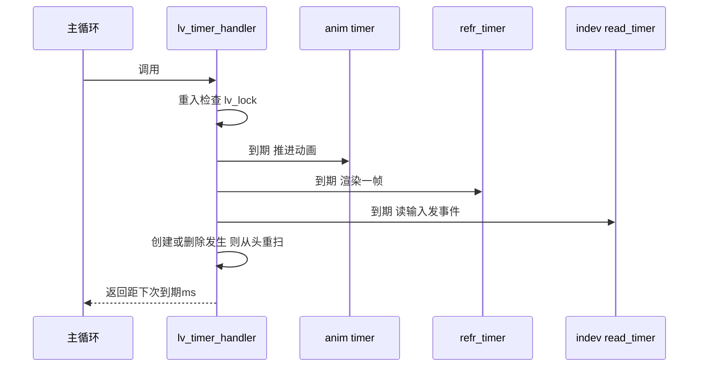

# lv_timer —— 定时器心跳速查

> 对应源文件：
> - `src/misc/lv_timer.c`（共 426 行）
> - `src/misc/lv_async.c`（共 111 行，异步 = 0 周期一次性 timer）
> - `src/tick/lv_tick.c`（共 112 行，时基）
>
> 深读文章：Docs/[06-定时器与任务模型](../../../references/graphics/LVGL/Docs/06-定时器与任务模型.md)
> 关联条目：[lv_event.md](lv_event.md)、[lv_display.md](lv_display.md)

## 1. 定位

`lv_timer_handler()` 是 LVGL 唯一心跳；indev 读取、动画推进、屏幕刷新
全部是这条定时器链上的节点。链表 `timer_ll`（lv_timer.c:62），
全局状态在 `LV_GLOBAL_DEFAULT()->timer_state`（29 行）。

## 2. lv_timer_t 字段

| 字段 | 含义 | 默认 |
|---|---|---|
| period | 周期 ms | 用户给 |
| timer_cb | 回调 | 用户给 |
| repeat_count | 剩余次数，-1 无限 | -1（178-192 行） |
| paused | 暂停 | false |
| last_run | 上次执行 tick | lv_tick_get() |
| auto_delete | 次数用尽自动删 | true |
| user_data | 私有数据 | NULL |

创建（`lv_timer_create`，178-203 行）：**头插**（新定时器先执行）+
`lv_timer_handler_resume()` 通知外部调度器。

## 3. 核心函数表（lv_timer.c）

| 函数 | 行号 | 要点 |
|---|---|---|
| `lv_timer_handler` | 68-143 | 重入保护(74)→lv_lock(86)→tick 检测(90-96)→遍历执行(102-122)→算下次间隔(124)→idle 统计(126-133)→return |
| `lv_timer_get_time_to_next` | 145-161 | 所有未暂停 timer 的 min(period-elapsed) |
| `lv_timer_periodic_handler` | 163-171 | 到期才调 handler（事件驱动模式用） |
| `lv_timer_create_basic` | 173 | 500ms 空回调占位 |
| `lv_timer_create` | 178 | 头插 + resume |
| `lv_timer_delete` | 211 | 摘链 + 置 timer_deleted + free |
| `lv_timer_pause/resume` | 227/233 | |
| `lv_timer_set_period` | 240 | |
| `lv_timer_ready` | 247 | last_run 倒拨 → 下一轮立即执行 |
| `lv_timer_set_repeat_count` | 254 | |
| `lv_timer_set_auto_delete` | 260 | 次数用尽删 or 暂停 |
| `lv_timer_reset` | 272 | last_run = now（重新计时） |
| `lv_timer_enable` | 279 | 总开关 lv_timer_run |
| `lv_timer_get_idle` | 292 | 0~100，每 500ms 刷新（IDLE_MEAS_PERIOD，26 行） |
| `lv_timer_handler_run_in_period` | 308 | 到期才执行的封装（PC 主循环用） |
| `lv_timer_handler_set_resume_cb` | 422 | 定时器就绪时通知（RTOS 唤醒用） |
| `lv_timer_exec`（静态） | 349-394 | 先扣 repeat_count(359)→执行(365)→用尽自动删/停(380-390) |
| `lv_timer_time_remaining`（静态） | 401-408 | elapsed>=period → 0 |

## 4. 遍历自愈机制（102-122 行）

```c
    do {
        state_p->timer_deleted             = false;
        state_p->timer_created             = false;

        timer_active = lv_ll_get_head(timer_head);
        while(timer_active) {
            next = lv_ll_get_next(timer_head, timer_active);      /* 先取 next 再执行 */
            if(lv_timer_exec(timer_active)) {
                if(state_p->timer_created || state_p->timer_deleted) {
                    LV_TRACE_TIMER("Start from the first timer again because a timer was created or deleted");
                    break;
                }
            }
            timer_active = next;
        }
    } while(timer_active);          /* 链表被改过 → 从头再扫一轮 */
```

回调里建/删定时器合法；最坏 O(n²)（频繁建删），正常无感。

## 5. tick 时基（lv_tick.c）

| 函数 | 行号 | 说明 |
|---|---|---|
| `lv_tick_inc` | 37-43 | 中断里累加 sys_time（推荐接法：RTOS tick hook） |
| `lv_tick_get` | 45-64 | 有 tick_get_cb 直接回调；否则 irq_flag 重读循环防撕裂 |
| `lv_tick_elaps` | 66-69 | now - prev（无符号回绕安全） |
| `lv_tick_diff` | 71-75 | 同上 |
| `lv_delay_ms` | 77-93 | 有 delay_cb 转发；否则忙等 |
| `lv_tick_set_cb` | 95-98 | v10 推荐接法：直接给毫秒函数 |

handler 的 tick 检测（lv_timer.c:90-96）：tick 恒 0 时累计 100 次打
"It seems lv_tick_inc() is not called." 警告。

## 6. lv_async（lv_async.c，111 行）

```c
    lv_timer_t * timer = lv_timer_create(lv_async_timer_cb, 0, info);   /* :73 period=0 */
    ...
    lv_timer_set_repeat_count(timer, 1);                                /* :80 只跑一次 */
```

回调（107-115 行）**先删 timer 再执行用户回调**（回调里可安全 cancel 自己）。
`lv_async_call_cancel`（66-96 行）遍历定时器链按 cb+user_data 匹配删除。

## 7. 内建定时器清单

| 定时器 | 周期 | 创建处 |
|---|---|---|
| anim timer | LV_DEF_REFR_PERIOD | lv_anim.c:67 |
| 每个 display 的 refr_timer | 同上 | lv_display.c:131 |
| 每个 indev 的 read_timer | 同上 | lv_indev.c:111 |
| async 一次性 | 0 | lv_async.c |

## 8. 时序图



## 9. 陷阱

1. repeat_count=0 的定时器永不执行（lv_timer.c:363 前置检查）。
2. `lv_timer_enable(false)` 会让本轮剩余定时器跳过（80-83 行）。
3. 头插语义：同周期新定时器先执行。
4. 多任务别并发调 handler：already_running 兜底返回 1（74-78 行），
   但返回值不可作为"执行成功"信号。
