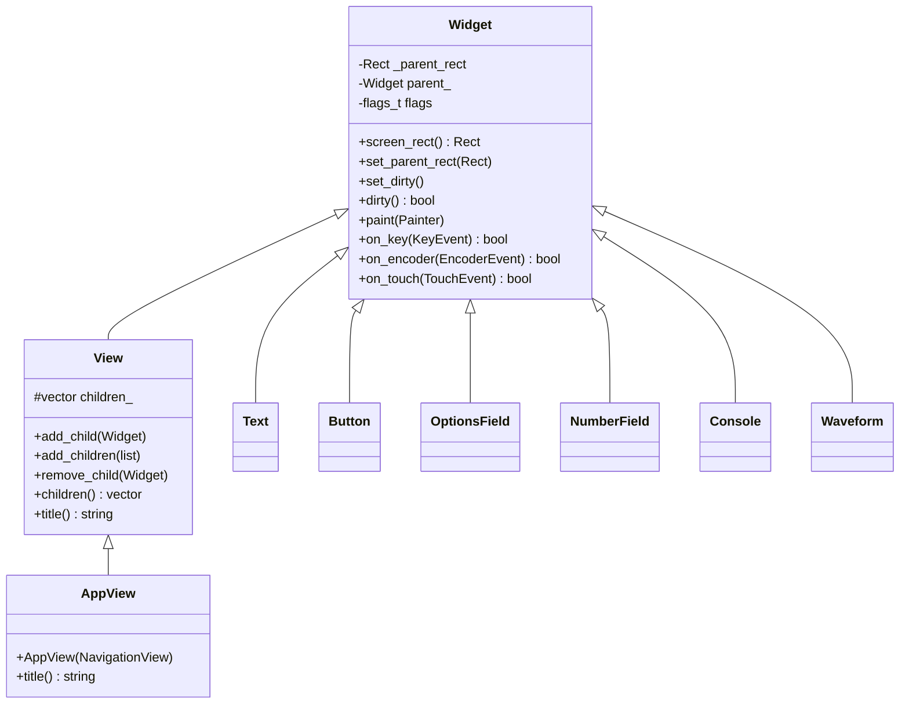
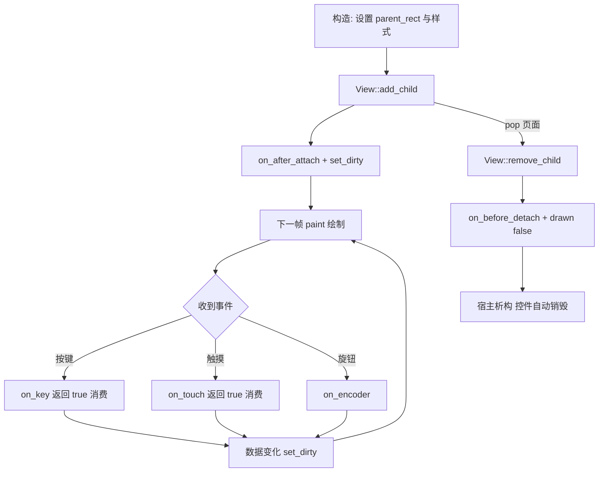

# AppView / Widget / View（应用与控件基类）—— ui_widget.hpp / ui_widget.cpp

> 对应源文件：
> - `firmware/common/ui_widget.hpp`（1177 行）
> - `firmware/common/ui_widget.cpp`（3399 行）
> - `firmware/application/view_factory.hpp`（约 45 行）
>
> 合计约 4621 行。本文行号以当前仓库为准。
>
> ⚠️ **路径说明**：任务书里写的 `firmware/common/ui_app_view.*` 在本仓库**不存在**。
> Mayhem 没有单独的 `AppView` 类——"应用"就是 `View` 的子类，由 `NavigationView` 持有。
> 因此本文以 `ui_widget.hpp/.cpp` 的 `Widget`/`View` 为主，辅以 `view_factory.hpp` 说明
> App 的构造约定。
>
> 相关 Docs：[02-应用框架与导航](../../../references/firmware/mayhem-firmware/Docs/02-应用框架与导航.md)
> 相关 KB：[navigation.md](navigation.md)、[ui_painter.md](ui_painter.md)

---

## 1. 一句话职责

`Widget` 是所有可视对象的抽象基类（矩形、脏标记、父子关系、四类输入回调）；
`View` 是"能装子控件的 Widget"，也是所有 App 页面的基类。**Mayhem 的 App = 一个 `View` 子类 +
一个接受 `NavigationView&` 的构造函数**，没有更上层的框架。

## 2. 核心结构

### 2.1 `Widget` 的字段（`ui_widget.hpp:138-160`）

| 字段 | 类型/位宽 | 含义 | 行号 |
|---|---|---|---|
| `_parent_rect` | `Rect`（8 B） | 相对父控件的位置与尺寸 | 140 |
| `style_` | `const Style*`（4 B） | 字体+前景+背景 | 141 |
| `parent_` | `Widget*`（4 B） | 父控件；`nullptr` = 未挂载 | 142 |
| `flags.dirty` | 1 bit | 内容变了，需要重绘 | 145 |
| `flags.hidden` | 1 bit | 隐藏自己与子树 | 146 |
| `flags.focusable` | 1 bit | 可被方向键选中 | 147 |
| `flags.highlighted` | 1 bit | 高亮态（焦点/按下） | 148 |
| `flags.drawn` | 1 bit | 上一帧是否真的画了 | 149 |
| `id` | `int16_t` | 焦点导航标记，`-1` = 返回键 | 122 |

32 位 ARM 上单个 `Widget` 头开销 **约 24 B**（vptr 4 + Rect 8 + 两个指针 8 + flags/id 4）。

### 2.2 `View` 的额外成员（`ui_widget.hpp:163-190`）

| 成员 | 类型 | 含义 | 行号 |
|---|---|---|---|
| `children_` | `std::vector<Widget*>` | 子控件裸指针 | 187 |
| `add_child` | void | 挂载（已挂载则忽略） | 178 |
| `add_children` | void | initializer_list 批量 | 179 |
| `remove_child` | void | 摘下并 `set_parent(nullptr)` | 180 |
| `remove_children` | void | 批量 | 181 |
| `children()` | `const vector&` | 只读访问 | 182 |
| `title()` | `std::string` | 状态栏显示的标题 | 184 |
| `invalidate_child` | void | 让某个子控件变脏（**仅声明**：本仓库未找到定义，也无调用点） | 189 |

### 2.3 App 的构造约定（`view_factory.hpp:30-36`）

```cpp
template <typename T>
class ViewFactory : public ViewFactoryBase {
   public:
    virtual std::unique_ptr<View> produce(NavigationView& nav) const override {
        return std::unique_ptr<View>(new T(nav));
    }
};
```

所以每个 App 必须提供 `T(NavigationView&)` 形式的构造函数（可以带额外参数，但 `appList`
里的工厂只调这一个）。带参数的页面用 `nav.push<T>(args...)` 手工构造。

## 3. 逐函数表

### 3.1 `Widget`（`ui_widget.cpp`）

| 函数 | 行号 | 作用 |
|---|---|---|
| `screen_pos()` | 63-65 | `screen_rect().location()` |
| `size()` | 67-69 | 父矩形尺寸 |
| `screen_rect()` | 71-75 | 递归累加父坐标 |
| `parent_rect()` | 77-79 | 原始父矩形 |
| `set_parent_rect()` | 81-84 | 改矩形 + `set_dirty()` |
| `parent()` / `set_parent()` | 86-108 | 父子关系；摘下时 `drawn(false)` |
| `set_dirty()` / `dirty()` / `set_clean()` | 110-121 | 脏标记 |
| `hidden(bool)` | 123-144 | 隐藏/显示（显示时置脏） |
| `focus()` / `on_focus()` / `blur()` / `on_blur()` | 146-170 | 焦点回调 |
| `on_key()` / `on_encoder()` / `on_touch()` / `on_keyboard()` | 172-194 | 默认全返回 false |
| `children()` | 196-198 | 默认空表 |
| `context()` | 200-202 | 向上找 `Context` |
| `set_style()` / `style()` | 204-214 | 样式 |
| `drawn(bool)` | 216-218 | 记录绘制状态 |
| `set_highlighted()` | 242-245 | 高亮 |
| `dirty_overlapping_children_in_rect()` | 247-253 | 与某矩形相交的子控件置脏 |

### 3.2 `View`（`ui_widget.cpp`）

| 函数 | 行号 | 作用 |
|---|---|---|
| `paint()` | 263-267 | 只填背景色 |
| `add_child()` | 269-276 | 未挂载才加 |
| `add_children()` | 278-282 | 批量 |
| `remove_child()` | 284-289 | 从 vector 删除 + 断父 |
| `remove_children()` | 291-295 | 批量 |
| `children()` | 297-299 | 返回 `children_` |
| `invalidate_child()` | 无定义 | 头文件声明，仓库内未实现/未调用 |

### 3.3 其它被 App 直接使用的控件

| 控件 | 声明行 | 实现行 | 关键行为 |
|---|---|---|---|
| `Text` | 210 | 约 700 | 文本 + 触摸可选 |
| `Button` | 422 | — | `on_select` 回调 |
| `ImageButton` | 576 | — | 位图按钮 |
| `OptionsField` | 685 | — | 左右键切换枚举 |
| `NumberField` | 853 | — | 数字输入 + 上下键 |
| `Checkbox` | 382 | — | 布尔 |
| `ProgressBar` | 327 | — | 进度 |
| `Console` | 357 | — | 彩色日志 + 滚动 |
| `Waveform` | 1035 | — | 波形绘制 |

## 4. 逐字摘录

### 4.1 Widget 的私有布局（`ui_widget.hpp:138-160`）

```cpp
   private:
    /* Widget rectangle relative to parent pos(). */
    Rect _parent_rect;
    const Style* style_{nullptr};
    Widget* parent_{nullptr};

    struct flags_t {
        bool dirty : 1;        // Widget content has changed.
        bool hidden : 1;       // Hide widget and children.
        bool focusable : 1;    // Widget can receive focus.
        bool highlighted : 1;  // Show in a highlighted style.
        bool drawn : 1;        // Object was drawn during last paint.
    };

    flags_t flags{
        .dirty = true,
        .hidden = false,
        .focusable = false,
        .highlighted = false,
        .drawn = false,
    };

    static const std::vector<Widget*> no_children;
```

设计意图：

- **`_parent_rect` 而不是绝对坐标**：控件移动只需改父矩形，整棵子树自动跟随。
- **普通指针而非 `unique_ptr`**：子控件绝大多数是宿主类的值成员，析构顺序由编译器保证；
  用智能指针会引入额外堆分配与 4–8 B 开销。
- **位域**：5 个布尔压进 1 B，对 600 个控件的界面省下约 2.4 KB。
- **`no_children` 静态空表**：让非容器 `Widget` 的 `children()` 返回引用而不是临时对象，
  避免每次调用构造 `std::vector`。

### 4.2 父子关系切换（`ui_widget.cpp:89-108`）

```cpp
void Widget::set_parent(Widget* const widget) {
    if (widget == parent_) {
        return;
    }

    if (parent_ && !widget) {
        // We have a parent, but are losing it. Update drawn status.
        dirty_overlapping_children_in_rect(screen_rect());
        drawn(false);
    }

    if (widget == nullptr)
        on_before_detach();

    parent_ = widget;

    if (widget != nullptr)
        on_after_attach();

    set_dirty();
}
```

- **摘下时**：先把与自己重叠的兄弟置脏（露出下面的内容），再标 `drawn(false)`。
- **`on_before_detach()` / `on_after_attach()`** 是两个钩子，控件可以在这里停定时器、
  释放资源（`ui_widget.hpp:89-90`）。
- `set_dirty()` 无条件调用，保证挂载/摘下后一定会重绘。

### 4.3 View 的背景与挂载（`ui_widget.cpp:263-296`）

```cpp
void View::paint(Painter& painter) {
    painter.fill_rectangle(
        screen_rect(),
        style().background);
}

void View::add_child(Widget* const widget) {
    if (widget) {
        if (widget->parent() == nullptr) {
            widget->set_parent(this);
            children_.push_back(widget);
        }
    }
}

void View::add_children(const std::initializer_list<Widget*> children) {
    for (auto child : children) {
        add_child(child);
    }
}

void View::remove_child(Widget* const widget) {
    if (widget) {
        children_.erase(std::remove(children_.begin(), children_.end(), widget), children_.end());
        widget->set_parent(nullptr);
    }
}
```

- `View::paint()` **只填背景**，不遍历子控件；子控件由 `Painter::paint_widget()` 递归调用。
- `add_child()` 的 `parent() == nullptr` 检查意味着**同一个控件不能同时属于两个 View**；
  重复添加会静默忽略，是"控件不显示"的常见原因。
- `remove_child()` 用 erase-remove 惯用法，O(n)；控件多的容器频繁增删会变慢。

## 5. 类层次



## 6. 一个控件的生命周期



## 7. 陷阱与读码建议

- **没有 `AppView` 类**：找"应用框架"时不要搜 `ui_app_view`，直接看 `View` 子类的构造函数。
  App 的"入口"是 `NavigationView::push<T>()` 或 `appList` 里的 `ViewFactory<T>`。
- **App 构造里做事要小心**：构造函数执行时控件还没 `add_child`，`screen_rect()` 可能不准；
  需要"显示后再做"的逻辑放 `on_show()` 或 `focus()`。
- **`View` 析构不会 delete 子控件**：所有子控件必须是宿主的值成员或由别处管理。
  用 `new` 创建又忘了 delete 就是内存泄漏（`appList` 的工厂对象就是"故意泄漏"的例子）。
- **`add_child` 对已挂载控件静默失败**：把控件从 A 移到 B 必须先 `A.remove_child(w)`。
- **`dirty` 具有"父脏子全脏"的传染性**：给根 View 调 `set_dirty()` 等于整屏重绘，
  在 240×320 屏上就是 76 800 像素的 SPI 流量。
- **`on_touch` 返回 true 会截断传播**：容器控件若实现 `on_touch` 但只是想"记录一下"，
  必须返回 false，否则子控件永远收不到触摸。
- **`Widget::id = -1` 是保留值**：`FocusManager` 用它标记"返回键"目标
  （`ui_focus.cpp:185-190`），普通控件不要用负数 id。
- **样式指针是共享的**：`style_` 指向 `Theme` 里的静态 `Style`，控件不拥有它；
  换主题只需换指针 + 全树置脏，不需要改每个控件。
- 读代码建议：先看 `ui_widget.hpp` 的字段布局 → `ui_widget.cpp` 的 `set_parent`/`set_dirty` →
  `Painter::paint_widget`（跨文件）→ 最后挑一个具体控件（`Text`/`Button`）看它如何
  重写 `paint()`/`on_key()`。
