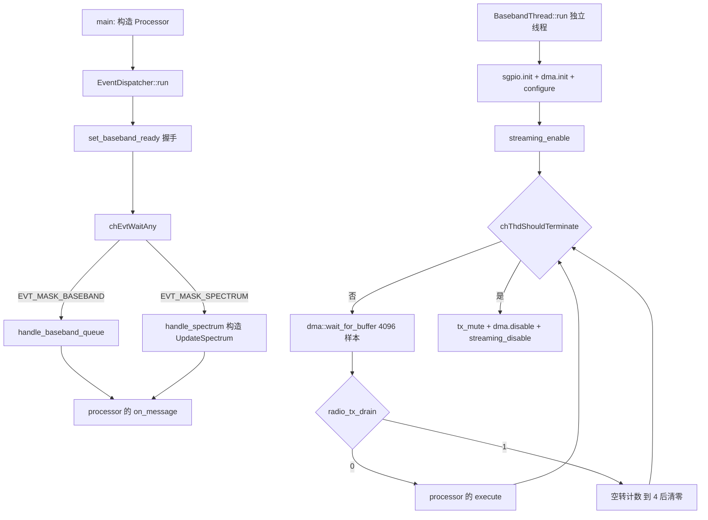
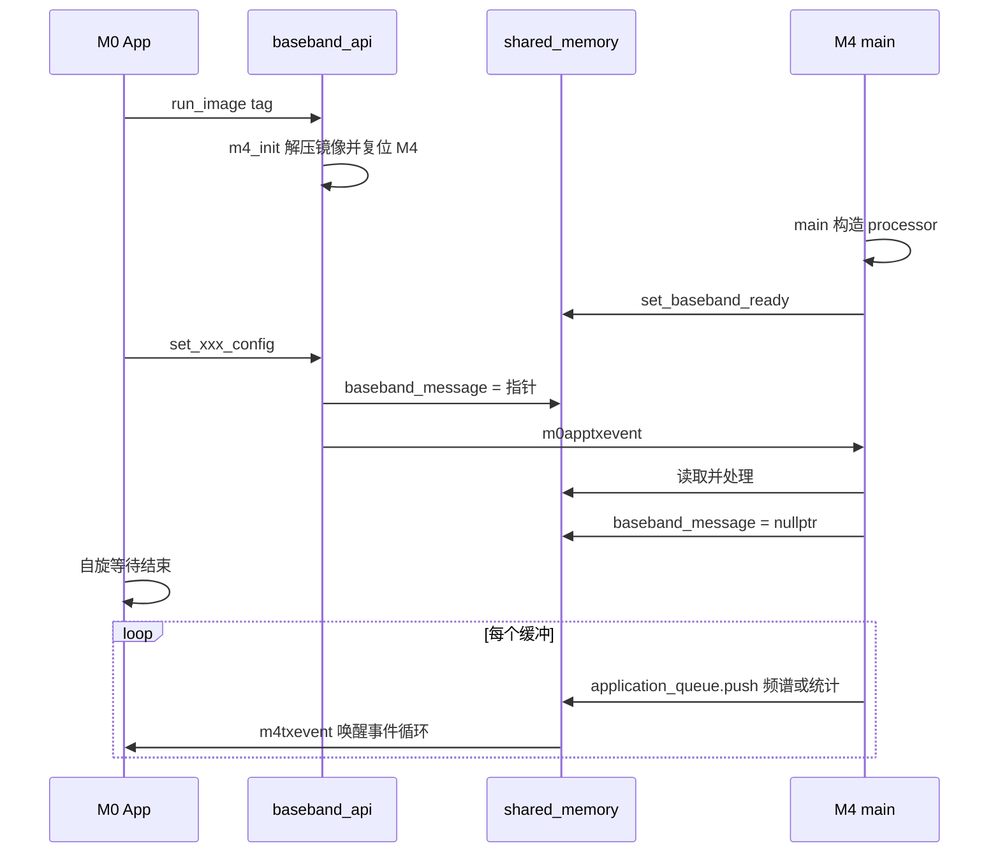

# BasebandProcessor / BasebandThread（M4 基带主流程）—— baseband_processor.* + baseband_thread.* + proc_wideband_spectrum.*

> 对应源文件：
> - `firmware/baseband/baseband_processor.hpp`（46 行）
> - `firmware/baseband/baseband_processor.cpp`（35 行）
> - `firmware/baseband/baseband_thread.hpp`（73 行）
> - `firmware/baseband/baseband_thread.cpp`（137 行）
> - `firmware/baseband/proc_wideband_spectrum.hpp`（59 行）
> - `firmware/baseband/proc_wideband_spectrum.cpp`（113 行）
> - `firmware/baseband/event_m4.cpp`（125 行，M4 消息分发）
>
> 合计约 588 行。本文行号以当前仓库为准。
> 相关 Docs：[03-接收链路与基带](../../../references/firmware/mayhem-firmware/Docs/03-接收链路与基带.md)、[04-发射链路与应用](../../../references/firmware/mayhem-firmware/Docs/04-发射链路与应用.md)
> 相关 KB：[event_dispatcher.md](event_dispatcher.md)、[receiver_model.md](receiver_model.md)

---

## 1. 一句话职责

`BasebandProcessor` 是**每个基带镜像的业务接口**（只有 `execute()` 和 `on_message()` 两个虚函数）；
`BasebandThread` 是**每个镜像唯一的采样线程**：它从 GPDMA 乒乓缓冲取 4096 个 `complex8_t`，
交给 `execute()` 处理，并在收到 `radio_tx_drain` 时停止生成。两者合起来就是 M4 的"主循环"。

## 2. 核心结构

### 2.1 `BasebandProcessor`（`baseband_processor.hpp:31-44`）

| 成员 | 类型 | 含义 | 行号 |
|---|---|---|---|
| `~BasebandProcessor` | virtual default | 允许派生类清理 | 33 |
| `execute(const buffer_c8_t&)` | 纯虚 | 处理一块采样（RX 或 TX 方向） | 35 |
| `on_message(const Message*)` | 虚，默认空 | 处理 M0 下发的配置/控制消息 | 37 |
| `channel_stats` | `ChannelStatsCollector` | 通道统计（RSSI/峰值） | 43 |
| `feed_channel_stats()` | protected | 把统计结果打包成消息推给 M0 | 40 |

### 2.2 `BasebandThread`（`baseband_thread.hpp:37-71`）

| 成员 | 类型/默认 | 含义 | 行号 |
|---|---|---|---|
| `sampling_rate` | `uint32_t` | 写入 `buffer_t::sampling_rate` | 67 |
| `direction` | `baseband::Direction` | Rx/Tx 决定 DMA 源与目的 | 66 |
| `baseband_processor_` | `BasebandProcessor*` | 业务对象（不拥有） | 65 |
| `priority_` | `tprio_t` = `NORMALPRIO + 20` | 线程优先级 | 68 |
| `thread` | `static Thread*` | ChibiOS 线程句柄 | 63 |
| `WORKING_AREA` | 4096 B | 线程栈 | `.cpp:42` |
| `run()` | override | 采集主循环 | `.cpp:79-137` |

> 注释（`baseband_thread.hpp:31-35`）强调：**线程成员必须放在 Processor 类的最后**，
> 因为 `ThreadBase` 默认构造即启动线程，前面的成员若未初始化就会被访问。

### 2.3 `WidebandSpectrum`（`proc_wideband_spectrum.hpp:37-57`）

| 成员 | 类型 | 含义 | 行号 |
|---|---|---|---|
| `configured` | bool | 收到配置前不处理 | 43 |
| `baseband_fs` | `size_t` = 20 000 000 | 默认 20 MSa/s | 44 |
| `channel_spectrum` | `SpectrumCollector` | 256 bin FFT 收集器 | 49 |
| `spectrum` | `array<complex16_t,256>` | 两段累加缓冲 | 51 |
| `phase` / `trigger` | `size_t` | 累加相位与触发点（默认 127） | 52 |
| `baseband_thread` | `BasebandThread` | 采样线程（**最后成员**） | 55 |
| `rssi_thread` | `RSSIThread` | 独立 RSSI 线程 | 56 |

## 3. 逐函数表

### 3.1 `BasebandProcessor`（`.cpp`）

| 函数 | 行号 | 作用 |
|---|---|---|
| `feed_channel_stats(channel)` | 28-35 | 调 `ChannelStatsCollector::feed()`，回调里构造 `ChannelStatisticsMessage` 并 `push` 到 `application_queue` |

### 3.2 `BasebandThread`（`.cpp`）

| 函数 | 行号 | 作用 |
|---|---|---|
| 构造函数 | 46-57 | 保存四个参数，`auto_start` 则立即 `start()` |
| 析构 | 59-65 | `chThdTerminate` + `chThdWait`，清空静态句柄 |
| `start()` | 67-73 | `chThdCreateStatic(WORKING_AREA, 4096, priority, fn, this)` |
| `set_sampling_rate()` | 75-77 | 只改成员，下一块缓冲生效 |
| `run()` | 79-137 | 初始化 SGPIO/DMA → 分配 16 KiB 缓冲 → 循环取缓冲 → `execute()` |

### 3.3 `event_m4.cpp`

| 函数 | 行号 | 作用 |
|---|---|---|
| `MAPP_IRQHandler` | 36-46 | M0→M4 消息中断，置 `EVT_MASK_BASEBAND` |
| `EventDispatcher::run` | 56-71 | 使能 `m0apptxevent`、`set_baseband_ready()`、等事件 |
| `on_message` | 98-112 | `Shutdown` 特判；其余转给 `baseband_processor->on_message()` |
| `handle_baseband_queue` | 91-96 | 从 `shared_memory.baseband_message` 取一条 |
| `handle_spectrum` | 122-125 | 构造 `UpdateSpectrumMessage` 转给 processor |

### 3.4 `proc_wideband_spectrum.cpp`

| 函数 | 行号 | 作用 |
|---|---|---|
| `execute` | 32-61 | 累加两块 1024 点 → 到 trigger 时喂 FFT |
| `on_signal_message` | 63-67 | 蜂鸣停止请求 |
| `on_beep_message` | 69-71 | 蜂鸣启动 |
| `on_message` | 73-106 | 分发 RequestSignal/AudioBeep/UpdateSpectrum/Config |
| `main` | 108-113 | 初始化音频 DMA、构造 processor、跑 M4 事件循环 |

## 4. 逐字摘录

### 4.1 接口定义（`baseband_processor.hpp:31-44`）

```cpp
class BasebandProcessor {
   public:
    virtual ~BasebandProcessor() = default;

    virtual void execute(const buffer_c8_t& buffer) = 0;

    virtual void on_message(const Message* const) {};

   protected:
    void feed_channel_stats(const buffer_c16_t& channel);

   private:
    ChannelStatsCollector channel_stats{};
};
```

- `execute()` 是**纯虚 + 热路径**：每个缓冲周期调用一次（3.072 MSa/s 下 1.33 ms 一次）。
- `on_message()` 默认空实现：不需要配置的处理器（如纯信号源）可以不重写。
- `feed_channel_stats()` 是唯一的内建辅助：派生类在处理完通道滤波后调它，就能让 UI 拿到 RSSI。

### 4.2 采集主循环（`baseband_thread.cpp:79-100`、`119-137`）

```cpp
void BasebandThread::run() {
    baseband_sgpio.init();
    baseband::dma::init();

    const auto baseband_buffer = std::make_unique<std::array<baseband::sample_t, 8192>>();
    baseband::dma::configure(baseband_buffer->data(), direction());
    // baseband::dma::allocate(4, 2048);

    baseband_sgpio.configure(direction());
    baseband::dma::enable(direction());
    baseband_sgpio.streaming_enable();
#ifdef PRALINE
    shared_memory.m4_streaming_marker = 0xAA;  // Phase 0 instrumentation
#endif
    uint8_t buffer_drained = 0;  // to count how many dma buffers we already emptied
    while (!chThdShouldTerminate()) {
#ifdef PRALINE
        shared_memory.m4_baseband_loops++;  // Phase 0 instrumentation
#endif

        // TODO: Place correct sampling rate into buffer returned here:
        const auto buffer_tmp = baseband::dma::wait_for_buffer();
        if (buffer_tmp) {
            buffer_c8_t buffer{
                buffer_tmp.p, buffer_tmp.count, sampling_rate_};
```

```cpp
            if (baseband_processor_) {
                if (shared_memory.radio_tx_drain == 0) {  // only generate if not draining.
                    baseband_processor_->execute(buffer);
                }
            }
            if (shared_memory.radio_tx_drain == 1) {
                buffer_drained++;
                if (buffer_drained >= 4) {             // We have 4 buffers, so after draining 4 we should be safe to disable.
                    shared_memory.radio_tx_drain = 0;  // Clear the drain request to allow normal operation to resume.
                    buffer_drained = 0;
                }
            }
        }
    }
    shared_memory.radio_tx_drain = 0;
    i2s::i2s0::tx_mute();
    baseband::dma::disable();
    baseband_sgpio.streaming_disable();
}
```

要点：

1. **16 KiB 缓冲是 `unique_ptr` 堆分配**（`make_unique<array<sample_t,8192>>`），
   不在栈上；栈只有 4096 B，放不下。
2. `dma::configure()` 建立一个 **2 个 LLI 的环形链表**，每个 8 KiB（4096 样本）。
3. `wait_for_buffer()` 返回的是"已经填满且上一轮已消费"的那半块；`count` 固定 4096。
4. `radio_tx_drain` 是 **TX 停机协议**：M0 置 1 → M4 停止调 `execute()` 并空转 4 个缓冲
   （注释说 "We have 4 buffers"，实际只有 2 个 LLI，属于保守值）→ 清零后恢复。
5. 退出时 `i2s::i2s0::tx_mute()` 必须调用，否则耳机里会有"关机爆音"。

### 4.3 一个完整处理器（`proc_wideband_spectrum.cpp:32-61`）

```cpp
void WidebandSpectrum::execute(const buffer_c8_t& buffer) {
    // 2048 complex8_t samples per buffer.
    // 102.4us per buffer. 20480 instruction cycles per buffer.

    if (!configured) return;

    if (phase == 0) {
        std::fill(spectrum.begin(), spectrum.end(), 0);
    }

    for (size_t i = 0; i < spectrum.size(); i++) {
        // TODO: Removed window-presum windowing, due to lack of available code RAM.
        // TODO: Apply window to improve spectrum bin sidelobes.
        spectrum[i] += buffer.p[i + 0];
        spectrum[i] += buffer.p[i + 1024];
    }

    if (phase == trigger) {
        const buffer_c16_t buffer_c16{
            spectrum.data(),
            spectrum.size(),
            buffer.sampling_rate};
        channel_spectrum.feed(
            buffer_c16,
            0, 0, 0);
        phase = 0;
    } else {
        phase++;
    }
}
```

- 注释里的 "2048 samples / 102.4us" 与当前 `transfer_samples = 4096` **不一致**，是过期注释；
  按 4096 算，20 MSa/s 下是 204.8 µs。
- 它把前 1024 点与后 1024 点**逐点相加**，相当于 2 倍相干积累降噪，代价是频率分辨率减半。
- `trigger = 127`：每 128 个缓冲（约 26 ms）输出一帧频谱，约 38 帧/秒。

### 4.4 镜像入口（`proc_wideband_spectrum.cpp:108-113`）

```cpp
int main() {
    audio::dma::init_audio_out();  // for AudioRX app (enables audio output while this baseband image is running)
    EventDispatcher event_dispatcher{std::make_unique<WidebandSpectrum>()};
    event_dispatcher.run();
    return 0;
}
```

每个基带镜像都有自己的 `main()`，链接成独立 ELF，再由 `DeclareTargets` 打包成
"4 字符 tag + 长度 + LZ4 数据"的 chunk（见 Docs 07）。运行时 `m4_init()` 按 tag 找到它、
解压到 `m4_code` 并复位 M4。

## 5. M4 主循环



## 6. M0 与 M4 的握手



## 7. 陷阱与读码建议

- **`execute()` 的输入恒为 4096 样本**（`transfer_samples`），不是 2048。
  `proc_wideband_spectrum.cpp:33-34` 的注释是历史遗留，别拿它算时间预算。
- **`execute()` 不能阻塞、不能分配内存、不能调用 FATFS**。所有 I/O 通过
  `shared_memory.application_queue.push()` 或 `StreamInput::write()`（后者只写 FIFO）。
- **`on_message()` 在另一个线程执行**（M4 事件线程），与 `execute()` 并发。
  共享状态要用 `std::atomic` 或 `chSysLock()`：`proc_nfm_audio.cpp:144-154` 的
  `configure_fs4()` 就是范例。
- **`BasebandThread` 是 Processor 的成员且必须最后声明**：否则线程可能在其它成员构造完成前
  就开始跑（注释 `baseband_thread.hpp:31-35`）。
- **线程优先级 `NORMALPRIO + 20` = 84**（本仓库 `NORMALPRIO = 64`），
  比 RSSI 线程（74）高，保证采样不被 RSSI 抢。
- **析构顺序**：`BasebandThread::~BasebandThread()` 会 terminate + wait；
  如果 Processor 析构时线程还在访问成员，就会 use-after-free。所以要保证
  "先停止线程，再销毁成员"——把线程放最后声明正好让它在析构时**最先**被销毁。
- **`feed_channel_stats()` 每条消息约几十字节**，但走 2 KiB 队列；高频调用会挤掉频谱消息。
  典型做法是每 N 个缓冲调一次（见各 `proc_*.cpp` 的 `spectrum_interval_samples`）。
- **新增镜像的检查清单**：`proc_xxx.cpp` 有 `main()`、CMake `DeclareTargets(PXXX xxx)`、
  `spi_image.hpp` 有对应 tag、App 里 `run_image(tag)`。四者缺一不可。
